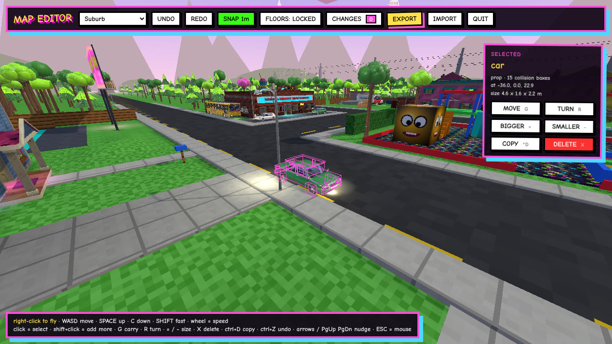
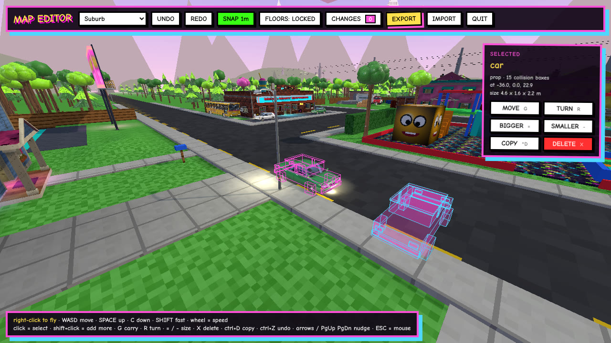
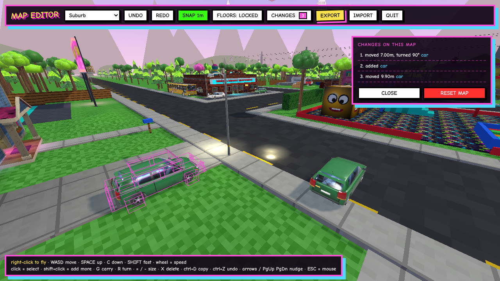
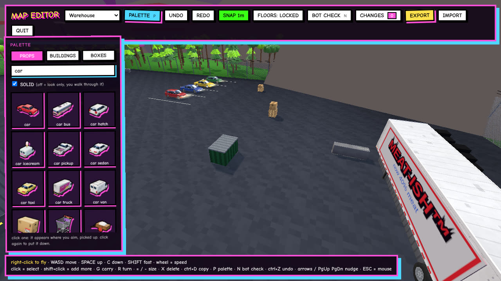
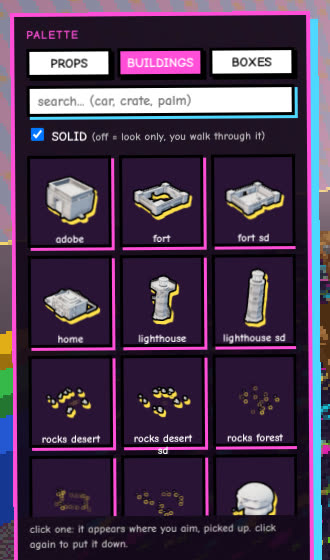
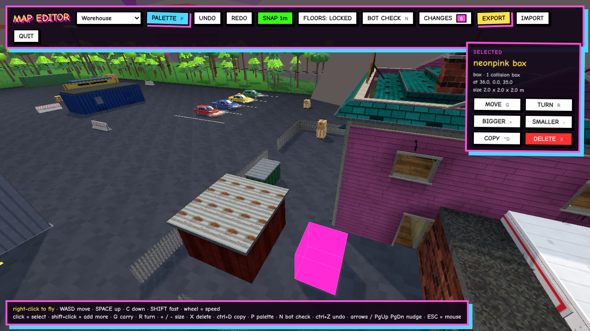
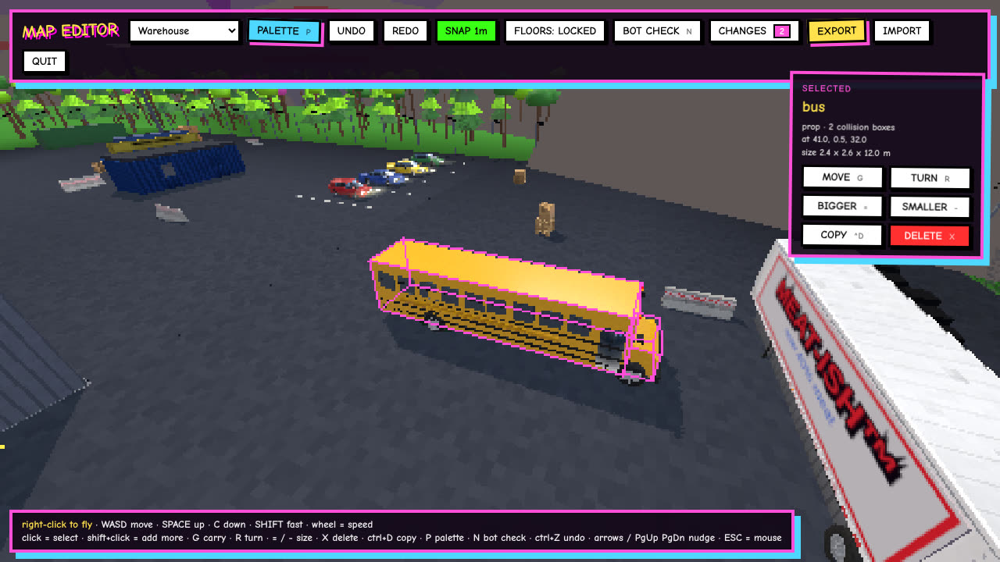
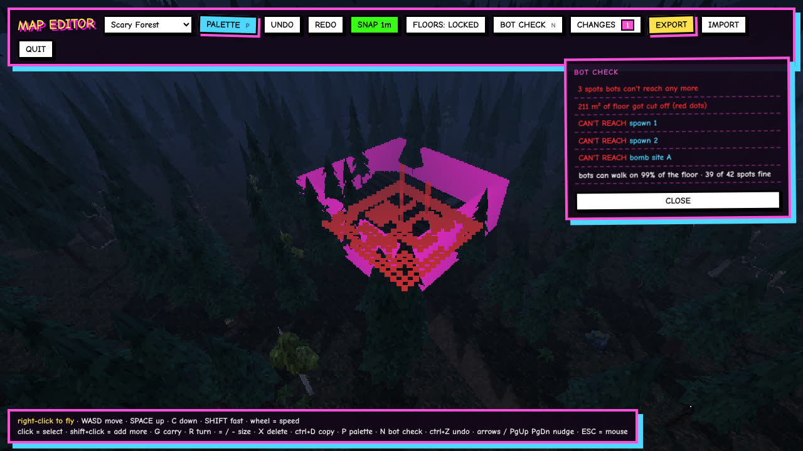
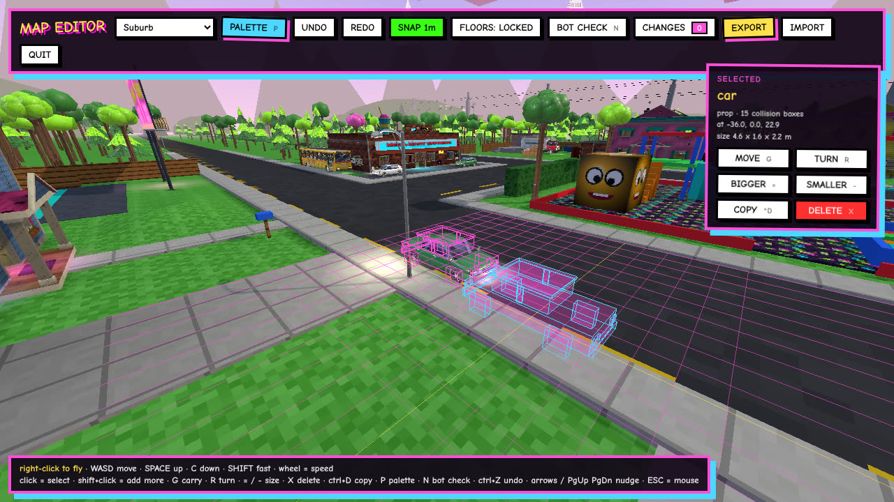
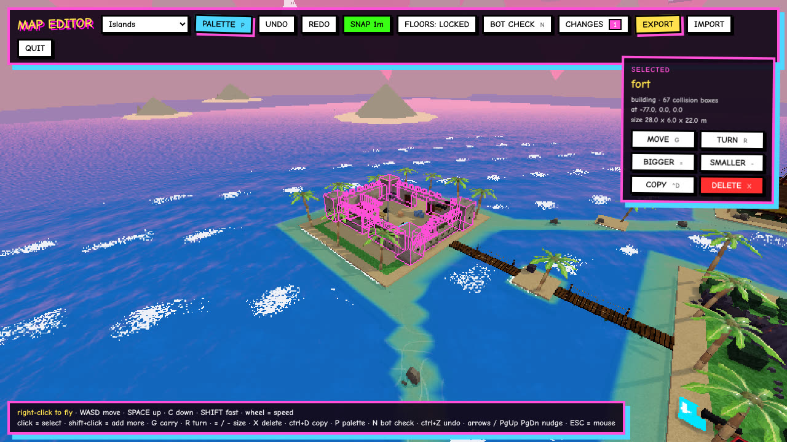

# JANKFIRE map editor

The owner's ask: "a map editor that lets me go to individual maps place delete move any prop and asset from grid or
free placement! for minor personal corrections, itll belike minecraft creative mode I can fly around wall clip etc".

So: fly round any map with noclip, Minecraft creative style. Point at a thing, pick it up, put it down somewhere else,
turn it, size it, copy it, delete it, or place new models from a palette. Every change is saved and can be sent to us
as a file, and the shipped map then loads those changes on top of its normal layout.


*Pick anything: a prop, a building or a plain box. Pink = selected, yellow = what you're pointing at.*


*G picks it up. A see-through ghost follows the crosshair and sits on whatever floor you point at. R turns it, the
mouse wheel pushes it away or pulls it in, a click puts it down.*


*CHANGES lists every edit on this map in plain words. Click one to fly to it. RESET MAP throws them all away.*

(These pictures are the real first build on Suburb, not paintings.)

## Getting in
- Owner/dev only for now. The MAP EDITOR button shows on the main menu only in a browser that was let in:
  - open the game with `?editor=1` (`?editor=0` locks it again), or
  - type `editor` on the main menu (works in the exe too, no URL bar needed). Type it again to hide the button.
- It opens `/editor.html` (a page of its own, so it can't break a match). Phones and tablets don't get it: it needs a
  keyboard and a mouse.
- The editor never talks to the server. Edits change only what that browser draws and what it saves. Nothing a player
  does in the editor can reach a live match.

## Controls
| | |
|---|---|
| right-click | fly mode (mouse look, crosshair). ESC gives the mouse back for the panels |
| WASD, SPACE, C | fly; SPACE up, C down. Noclip: walls don't stop you |
| SHIFT | 4x speed. The mouse wheel sets the base speed |
| click / shift+click | select / add to the selection |
| G | carry the selection; click or G again puts it down, right-click or ESC puts it back |
| R / shift+R | turn 90 degrees |
| = / - | 10% bigger / smaller |
| X or Delete | delete |
| ctrl+D | copy (the copy comes up carried) |
| ctrl+Z / ctrl+Y | undo / redo |
| arrows, PgUp, PgDn | nudge one grid step (along the grid axis nearest to where you look) |
| B, [ ] | grid snap on/off, grid size 0.25 / 0.5 / 1 / 2 / 4 m |
| L | FLOORS: big ground slabs are locked by default so you don't grab the whole street by accident |
| 1-4 | graphics: Potato, Crusty, Mid, Too HD |

## What you can pick
A map is boxes (collision, bots, hits) plus models drawn over them. The editor groups them the way players see them:
- **Prop**: one Blender model placement (car, forklift, crate, pine...) and every box it stands in for.
- **Building**: one Blender building (`B.arch`) and its tagged boxes. Buildings move and turn but keep their size.
- **Box**: any other single box (walls, ramps, crates without a model, deco).
- Terrain heightfields (shaped ground) aren't editable: they're one mesh, not things.

Collision always follows the edit. Boxes stay axis-aligned boxes: turns are in 90-degree steps, so a turned box is still
an exact box. The model follows its boxes like it does today.

## The edit file
Each map's changes are a list of ops (`shared/mapedit.js`), saved in the browser per map and exported as
`jankfire-edits-<map>.json`:

```json
{ "map": "suburb", "v": 1, "ops": [
  { "t": "xf", "sel": ["p|b|car|-36,0,22.9"], "o": [-36, 0, 22.9], "k": 1, "q": 1, "d": [7, 0, 0] },
  { "t": "del", "sel": ["b|b|crate|3,0,4|4.2,1.2,5.2"] },
  { "t": "add", "items": [{ "list": "b", "boxes": [...], "prop": { "id": "car", "a": [...], "y": 1.57, "lo": [...], "hi": [...] } }] }
] }
```
- `xf` = scale `k` round `o`, turn `q` quarter turns, move `d`. `del` = delete. `add` = new things (copies, palette).
- Things are named by **what they are and where they are** (`kind|list|id|position`), not by their index in the box list.
  The map lanes are remodelling maps right now; if a map changes under an edit, the edit simply can't find its thing
  and shows as **MAP CHANGED: skipped** in the change list instead of moving the wrong box.
- Replay is deterministic, same on every machine, so the server and the client get the same map.

## Shipping edits into the real game (later PR)
1. The owner exports the file and sends it to us (or drops it in chat).
2. We commit it as `shared/mapedits/<map>.json` and list it in `shared/mapedits/index.js`.
3. `shared/map.js` runs `applyEdits()` on each map right after it's built, on the server and the client alike, so
   collision, bots, hits and the drawing all agree. Edit files are checked (`validEdits`: types, finite numbers, sizes)
   before they're used.
4. The server never takes edits from players. There's no message for it. Later, if the owner wants to push edits
   without us, it would be an owner-only upload behind their account (server-side check, never in a live match).

## Bots
After edits the editor will rebuild the bot nav graph for the map (`shared/nav.js`, the same one the server builds) and
flag spawns, objectives, buy spots and wall guns the bots can't reach any more, plus any edit that blocks a route that
used to exist. Flags show as red markers you can click to fly to. (PR 5.)

## Build order (small PRs, each from main)
1. **This doc.**
2. **Fly cam + select / move / turn / size / copy / delete** + change list + export/import + local save. (The first piece
   the owner can try. Branch `claude/editor-flycam`.)
3. **Palette + place**: every `public/models/p_*.glb` and building, with 3D thumbnails rendered in the editor, searchable.
   Placed models get a collision box from the model's size (editable like any box).
4. **Edits in the real game**: `shared/mapedits/<map>.json` loaded by server + client, with a check per map in the tests.
5. **Grid polish + nav check**: snap to other things' edges, a visible grid, the bots' reachability flags.

## Open questions for the owner
- Should new props from the palette be solid (collision) by default, or look-only? (Plan: solid, with a toggle.)
- Do you want a "play here" button that drops you in the edited map with bots (a local Training room), or is fly + look
  enough for small fixes?

## Built so far (2026-11-12)
- Part 1 (#371, fixes #392): fly, select, carry, turn, size, copy, delete, undo, change list, export/import.
- Part 2 (#389): the PALETTE (P).  
  Placing a Suburb house in Warehouse brings its real walls; a bus from the palette:  
- Part 3 (#390): shipped edits load on the server and the client (`node tools/mapedits.mjs add <file>`).
- Part 4 (#391): BOT CHECK (N) and the snap grid. Walling in Forest's bomb site A:  
- The Islands fort turning in place after the review fix: 

## Sandbox tools (owner: "something like a prop gun, and a move gun? ... and a menu like creative mode")
You hold a tool in first person. The hotbar along the bottom picks it (1-9):

| slot | tool | what it does |
|---|---|---|
| 1 | GRABBY BEAM | hold click on a thing: a wobbly pink/cyan beam picks it up (the real model, not boxes). Wheel pushes/pulls, hold R and move the mouse to turn it (90 degree clicks), right-click freezes it where it floats, let go and it drops to the floor. Swing and let go: it flies, thuds and squashes. Fling it into the void and it comes back ("THE VOID SAID NO"). |
| 2 | PLOP CANNON | shoots the loaded thing where you aim: a see-through preview on the floor, R turns, wheel sizes, click = pew, it pops in |
| 3 | YEET RAY | zaps a thing away in a cartoon poof |
| 4 | EDIT WAND | the old tools: select, G carry, R turn, = / - size, X delete, ctrl+D copy, arrows nudge |
| 5-9 | favourites | anything dragged here from the menu; pressing it loads the plop cannon |

**E** (or Q, P) opens the CREATIVE MENU: every prop, building and box material with 3D pictures, in tabs (city, nature,
industrial, island, vehicles, lights, buildings, boxes, recent) and a search. Click one to load the plop cannon, or drag it
onto hotbar slot 2 or 5-9. Shift+1-4 = graphics now. Every tool's change is an ordinary edit (undo, CHANGES, EXPORT).
Sounds are synthesized (editor/sfx.js): a hum while the beam holds, a clunk, a pew, a pop, a zap and a poof.
