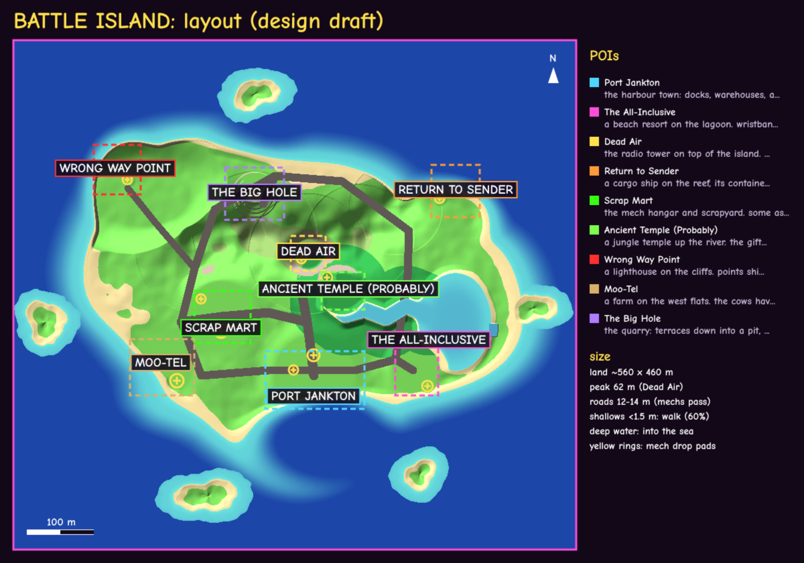
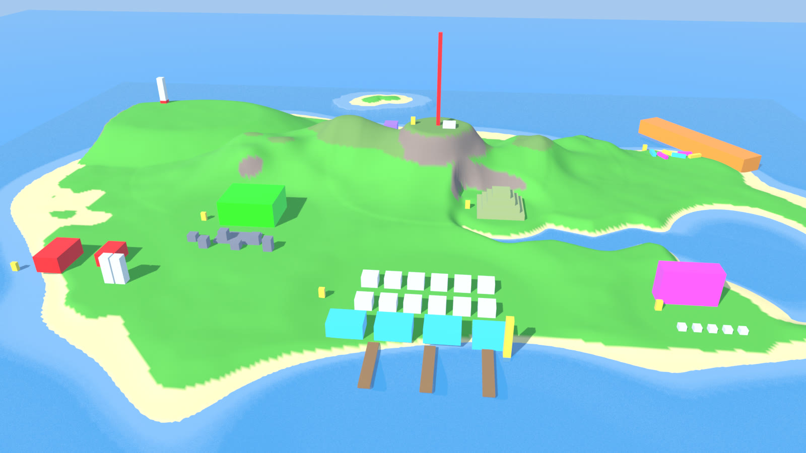
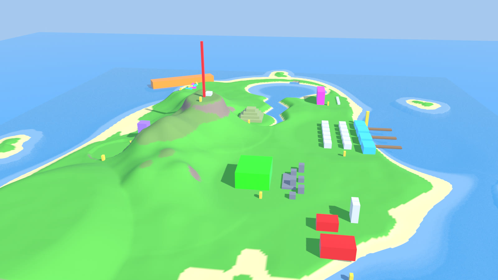

# BATTLE ISLAND: the map (design draft, for the owner's OK)

The island for the mech-hero battle royale (the mode: `docs/modes/BATTLE_ISLAND.md`, branch `claude/battle-island-design`,
PR #324). This PR is design only: the master plan in code (`shared/battleisland.js`), pictures made from it, and the
build plan. Nothing in the game changes yet.

| from the blimp (south) | from the blimp (west) | silhouette |
|---|---|---|
|  |  |  |

(The blimp pictures are a plain blockout: the real ground from the plan, the sea, and simple blocks where each POI's
buildings go, at real size. The small yellow blocks are a 6 m mech for scale. The real build uses Blender models from
the start.)

## The island
- **Land about 560 x 460 m**, sea out to ~900 m, five islets (lumpy sand and rock, reachable from the blimp).
- **Coast:** a deep harbour bay (south), a lagoon behind a reef with a channel out to sea (east), the lighthouse headland
  on a cliff plateau (north-west, ~24 m sheer drop), the north-east point where the ship ran aground, a dune spit
  (south-west), small coves.
- **Ridge across the middle** up to 62 m, the radio tower on a flat summit (40 m across: a finale spot).
- **The river:** a sea-level channel from the lagoon west up into the jungle to the temple, 16 m wide, waist-deep.
- **Water rules (the mode's):** shallows up to 1.5 m deep (the shelf round the coast, the reef, the lagoon, the river)
  are walkable for pilots and mechs at 60% speed; deep water (out past the shelf, the bay's middle, the reef channel) is
  "into the sea".
- **Roads for mechs:** a 12 m ring road, 14 m cross roads (Main Drag: the harbour up to the radio saddle; Hangar Road:
  the farm and hangar across to the middle), tracks to the quarry, the point and the resort.
- **Ground** is one heightfield (`islandH(x, z)`, the same on the server and every client), built through the existing
  shaped-ground system (`shared/terrain.js` relief, as Islands' volcano). Players, mechs and bots walk it; bullets and
  grapples hit it.

## The POIs (all data in `PLAN.pois`: id, name, centre, radius, rect, mech drop pads, energy-cell count)
| # | POI | where | what's there | mech drop pads | cells |
|---|---|---|---|---|---|
| 1 | **Port Jankton** | the bay (south) | the biggest drop: a quay of warehouses (8 m doors), a main street of two-storey fronts, piers, a dock crane, fishing boats | 2 | 6 |
| 2 | **The All-Inclusive** | lagoon shore (south-east) | a hotel block, a pool, cabanas, a swim-up bar, jet skis on the sand | 1 | 4 |
| 3 | **Dead Air** | the summit | a 70 m lattice radio mast (seen from everywhere), the transmitter shack, dishes, a flat summit | 1 | 3 |
| 4 | **Return to Sender** | the north-east point | a cargo ship aground and listing, containers spilled up the beach (walk-in), a lifeboat | 1 | 4 |
| 5 | **Scrap Mart** | west-centre | the mech hangar (mechs walk in), gantry cranes, scrap stacks, half-built mechs, a test range | 2 | 6 |
| 6 | **Ancient Temple (Probably)** | the river's head | a stepped jungle pyramid, a gate, the falls, a newer gift shop | 1 | 4 |
| 7 | **Wrong Way Point** | the north-west cliffs | the lighthouse on the cliff top (Islands' model reused, re-dressed), the keeper's cottage, a sign pointing at the rocks | 1 | 3 |
| 8 | **Moo-Tel** | the west flats | two barns, silos, crop fields, a windmill, cows with opinions | 1 | 4 |
| 9 | **The Big Hole** | north foot of the ridge | quarry terraces stepping into a pit, a conveyor, a rock crusher, a dump truck | 1 | 5 |

Between them: open fields and beaches (mech fights), jungle along the river, scattered loot (shacks, wrecked cars,
crates). **Loot:** ~400 spots (30-60 per POI by size, the rest scattered), energy-cell spots tagged apart (39).
**Zone:** zone0 = [0, 0, 330] (the whole island); 5 rings; the last one on land, leaning to Dead Air or Scrap Mart (both
have 40 m+ of flat ground). **Grapple points:** every tall thing (the mast, cranes, the lighthouse, silos, the ship).

## Props: what's new in Blender, what's reused (no code blocks: every prop is a model from day one)
**Reused** (existing glbs): palms, ferns, bushes, conifers (jungle and dunes); crates, barrels, pallets, containers,
cardboard; Islands' rocks, piers / rope walkways, the lighthouse; cars (traffic models, wrecked), the forklift, the
excavator, the semi + trailer, streetlights, AC units, vending machines, jersey barriers, cones, the generator tower;
tents and stalls (the harbour market); hay; the news helicopter (`p_heli`, crashed at Scrap Mart).

**New** (Blender, glossy bevelled house look, by POI, in build order):
1. **Terrain + coast** (PR 1): sand / grass / rock / jungle ground paint, cliff rock faces, reef coral heads, beach dressing (driftwood, shells, buoys), the river's banks and the falls.
2. **Dead Air**: the radio mast (lattice, red / white bands, aircraft lights, guy wires), the transmitter shack, dishes.
3. **Port Jankton**: harbour warehouses (mech-size doors), two-storey shopfronts, the quay, piers, a dock crane, fishing boats, a lighthouse-buoy.
4. **Scrap Mart**: the mech hangar (open both ends), gantry cranes, scrap stacks, half-built mech frames, a test-range target.
5. **Return to Sender**: the cargo ship (hull, bridge, cranes, a hole in its side to walk through).
6. **The All-Inclusive**: the hotel block, pool, cabanas, a swim-up bar, sun loungers, jet skis.
7. **Ancient Temple (Probably)**: the stepped pyramid, a gate, statues, the gift shop.
8. **Moo-Tel**: barns, silos, a windmill (shares Desert's `p_windpump` plan), fences, cows, a tractor.
9. **The Big Hole**: the rock crusher, conveyor, a dump truck, terrace rails.
10. Scatter: beach shacks, wrecked cars, signposts in the game's voice, loot crates.

## Build plan (small PRs, pictures from the ground and the blimp each time)
1. **Terrain + coast + sea + roads** wired in as map `battleisland` (the royale flag on it), sky / fog / light tuned,
   spawn + walk test, bots' nav (2 m cells: mechs are big), the blimp crossing it.
2. **Dead Air + Port Jankton.** 3. **Scrap Mart + Return to Sender.** 4. **The All-Inclusive + the Temple.**
5. **Wrong Way Point + Moo-Tel + The Big Hole.** 6. **Loot / cells / zone tuning with the Gameplay session, scatter.**

## Tools
- `shared/battleisland.js`: the master plan + `islandH(x, z)` (the ground) + `poiAt`.
- `node tools/battleisland/layout.cjs <dir>`: the layout picture, the silhouette, a heightmap for Blender.
- `blender52 -b --python tools/battleisland/make_blockout.py -- <dir>`: the blimp pictures.
