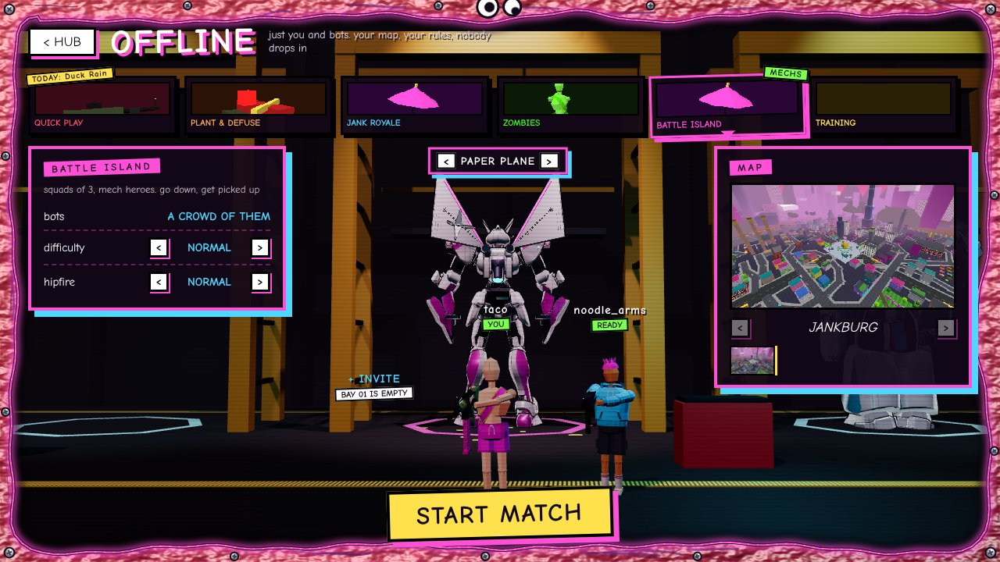
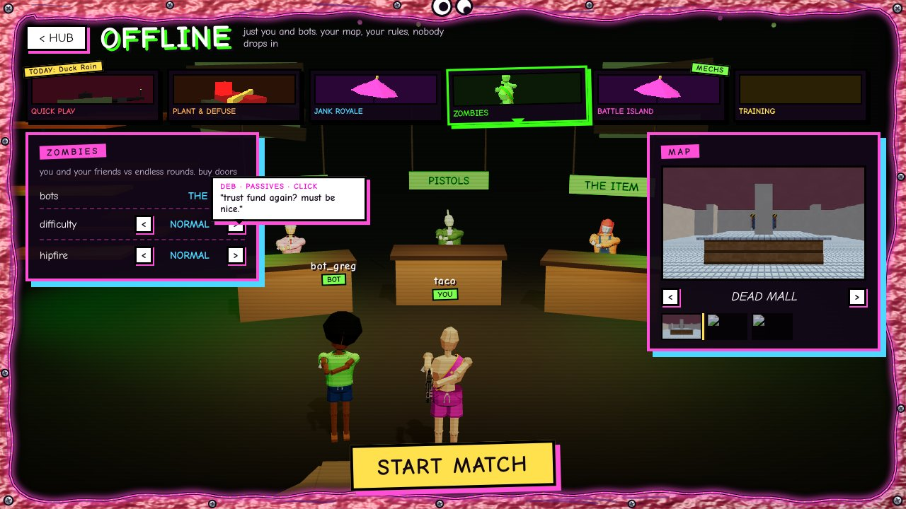
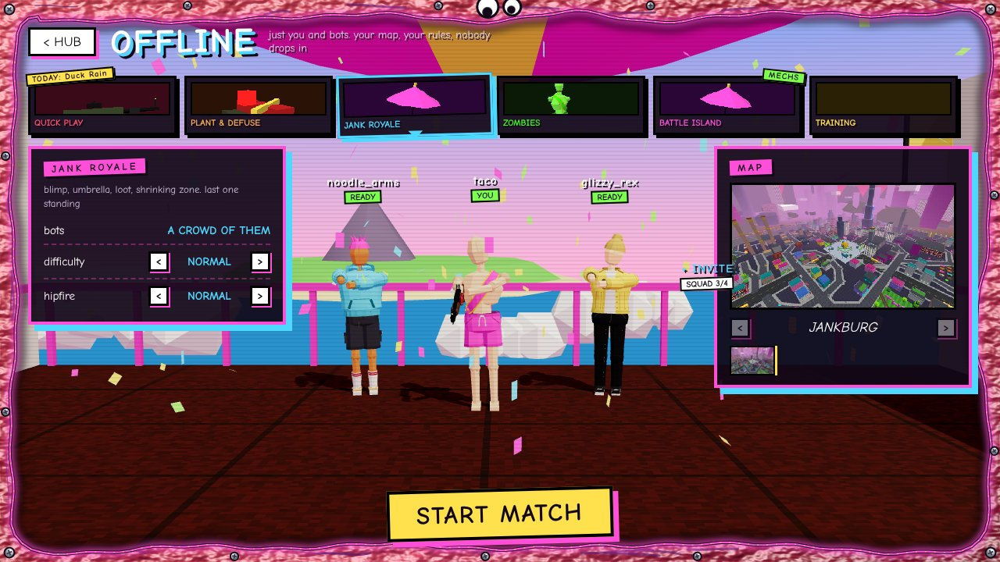
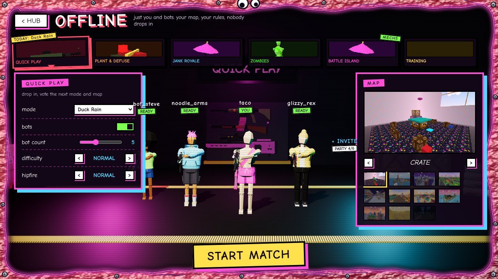

# LOBBY SCENES: a 3D place behind each mode's lobby (design)

The owner: *"for mech mode I want like a lobby area thats like a garage it displays your current mech and changes when
you change it, you can also see your teammates, for zombies, its like a warehouse and different stations and npcs for
different things like an npc lets you change passive, another starting gera tec all accessible from escape customize
but it just adds a bit of personality, for jank royale, itll be like a fortnite lobyy and for quiuck play itll be like a
cod lobby setup thingy"*

The hub's lobby screen (`public/js/hubmenu.js`, `docs/menu/HUB_LOBBY.md`) stays exactly as it is: the mode strip, MATCH
on the left, the map on the right, the big yellow button. What changes is **behind** it: instead of the slow orbit over
the current map, each mode gets its own little 3D place, and you and your party stand in it.

Mockups below are **blockouts**: the real game page, the real lobby UI, the real characters, guns and mechs, but grey
boxes where the Blender props go. Poses are placeholders too (the real ones are below). Code: `lobbyscenes/mockup.js`.

## Update: you walk around in BATTLE ISLAND and ZOMBIES (the owner, after the mockups)
*"nooo but I want to be able to walk around in zombies, and mech lobbies research super mecha champions lobby"*

- **Walkable lobbies** (garage + warehouse): the panels fold away and you play your character in third person.
  WASD (your key bindings) walks where the camera looks, SHIFT runs, SPACE jumps (onto crates too), drag the mouse to
  look round, the wheel zooms, **E** (or your USE key) uses what you stand next to, **Z** waves. **TAB**, the corner
  button or **Esc** brings the full lobby back (Esc again leaves, as before); the mode strip and the big yellow button
  stay on screen the whole time. Keys are left alone while you type in a text box.
- **Your party walks too:** each member's spot goes over the party connection ~10 times a second (`party.js`
  `sendLobbyPos` / `onLobbyPos`, relayed by the server only inside the party and only in these two lobbies, clamped to
  the scene's box); `a` = 0 walking, 1 in their mech, 2 waving. Offline, the bots wander about.
- **The garage, walkable:** a big hangar. Three bays along the back (the Blender gantry), your mech in yours, your squad's
  in theirs. **E at the bay terminal** (or the < > plate, or CUSTOMIZE) swaps your mech with the crane. **E at its feet:
  hop in** and stomp round (the fenced TEST PAD out front, or anywhere in front of the bays); E again and you hop down
  while it jet-hops home. A break room with the cola machine (E: you get a warm can), a TEST FIRE range (E: three shots,
  the targets spin), crates, barrels, a tool cart, and the hangar door open on the island and the sea.
- **The warehouse, walkable:** a boarded-up base at night. Hands poke through the gaps in the window planks, green light
  leaks in, the generator chugs (DO NOT KICK), the radio's on, string lights blink out now and then, and the wall of
  tally marks says ROUNDS SURVIVED (gary counted twice). A practice zombie shuffles round its post on a chain (E: poke it,
  it flails and says something). The Jank Cola and Cheat Machine stand by the walls. **Deb** (PASSIVES, behind her desk,
  stamping things), **Gus** (PISTOLS, polishing a revolver in front of a pegboard of the five start pistols) and **Marge**
  (THE ITEM, sitting on her crates with grenades, a smoke, the duck, a medkit, a shield bubble): walk up, they turn to
  you and say hi; E and the camera goes over your shoulder while the picker opens on the right. Pick, and they have an
  opinion ("trust fund. must be nice.", "it's a revolver. it revolves."). It's your zombies loadout (the same one
  CUSTOMIZE > LOADOUT > ZOMBIES sets); E again or walking off closes it.
- JANK ROYALE and QUICK PLAY keep the line-up scenes below.

## The four places

### 1. BATTLE ISLAND: the garage (first to build; now walkable, see the update above)

- A dark hangar with three **mech bays** (squads of 3). Your mech stands in the middle bay in a yellow gantry: two
  lattice towers, a walkway at chest height, a crane rail overhead, a work lamp on it, bay numbers on the beams.
- **Your current mech** = the loadout's MECH DROP FRAME (`G.settings.loadout.mech`), which the server already uses as your
  Battle Island hero ask (`server/islemeter.js`: `p.heroWant || p.mechFrame`). Painted in your colour, like in a match.
- **Swapping it:** a `< PAPER PLANE >` plate over the bay (click the arrows, or click the mech), and it also follows
  CUSTOMIZE > LOADOUT live. Same setting, nothing new on the server.
- **The swap, with juice (about 1.6 s, skippable by swapping again):** the bay lights snap to red and a klaxon honks, the
  crane hook drops, the old mech is hauled up out of frame, the new one comes down swinging a little on the hook,
  CLANK on the floor (camera shake, dust ring), welding sparks off the gantry arms, the lights flick back to white one
  bank at a time, the bay sign flips to its name with a stamp. The mech plays its idle clip once it's down.
- **Teammates:** the side bays. Each party member stands in front of their bay with their own mech (their frame). An
  empty bay shows a cyan hologram **+ INVITE** (online) or a bot with a random mech (offline, the bots that will play).
- Background bits: crates, a tool cart, cables, hazard tape, a "DAYS WITHOUT A MECH ON FIRE: 0" sign.

### 2. ZOMBIES: the warehouse (walkable too: walk up to Deb, Gus and Marge and press E)

- A boarded-up warehouse at night: planks over the windows with toxic-green light leaking through, pallet racks,
  string lights, a pile of spare planks, the Jank Cola and Cheat Machine standing about as decor (the real in-match
  models, `x_zmcola` / `x_zmmachine`).
- **Stations with NPCs.** What the zombies loadout has today (CUSTOMIZE > LOADOUT > ZOMBIES, `shared/zombies.js`,
  `public/js/zmloadout.js`) is three things, so three stations:
  | station | NPC (ours, original) | opens | hover line (examples) |
  |---|---|---|---|
  | **PASSIVES** desk | Deb, the desk clerk who has seen everything | your passive (Quick Hands, Trust Fund, Stubborn...) | "trust fund again? must be nice." / "pick one. i'm on break in 4 minutes." |
  | **PISTOLS** counter | Gus, the gun counter guy, too calm | your starting pistol (revolver, Plan B, akimbo, sawn-off, water) | "it's a revolver. it revolves." / "no refunds. no returns. no questions." |
  | **THE ITEM** crate | Marge, sitting on a crate of frags | the item you bring | "frag. classic. like a nice cardigan." |
- **Hover** an NPC: it turns to you, its station light brightens, and a comic speech bubble pops with a line (several per
  NPC, some react to your current pick). **Click:** a small picker opens in the lobby (the same rows as CUSTOMIZE, from
  the same data), and the NPC reacts to what you chose. It saves to the same zombies loadout, so Esc / CUSTOMIZE show it too
  and still work as today.
- Your squad (up to 4) stands in the middle. Bots in offline lobbies.
- Nothing the owner named is missing: "passive" and "starting gear" (pistol + item) both exist. If more zombies options
  get added later, each gets a station.

### 3. JANK ROYALE: the blimp deck

- Bright and goofy: your party lined up on the blimp's open launch deck, a pink railing behind them, the big sky,
  chunky clouds drifting past below, the island far away down there, the blimp's pink envelope overhead, a little
  flag, a sign: "GATE 7 · NO REFUNDS". Confetti drifts down.
- Everyone idles; READY plays a short emote (see poses). The camera bobs very slightly, like a blimp.

### 4. QUICK PLAY (and PLANT & DEFUSE): the staging hangar

- Moody: a dark concrete hangar, pink and cyan rim lights, hazard tape on the floor, crates and sandbags (the existing
  `p_crate`, `p_pallet_load`, `p_sandbags` props), a big screen on the back wall with the mode name and today's event,
  and **a rack with your loadout's guns** under it (your skins).
- Your party in a line-up, you in front and centre, the others in a shallow V behind you, nameplates over everyone,
  the camera slowly drifting side to side.
- PLANT & DEFUSE: the same hangar with a briefing table (the bomb, a defuse kit, a map print) and the screen saying
  ATTACK / DEFEND.

TRAINING keeps today's backdrop (nobody asked, and there's no party there).

## The bits every scene shares
- **You are in the scene.** While a scene is up, the stage's hero preview hides and the scene draws you itself, with the
  same character, outfit, gun and skin (`buildCharacter` / `buildWeapon`, like the hero), lit by the scene.
- **Nameplates** over each person, in the UI's comic style: the name, then a sticker: YOU, READY / NOT READY, BOT,
  a crown for the party leader. Empty spots: **+ INVITE** (clicking it will open the hub session's invite once parties land).
- **Poses** (code poses on the mannequin, the same way `idlePose` works, xhigh effort): a lobby idle with the gun at
  low ready, gun on the shoulder, arms crossed, hands on hips, a lean, a stretch. Everyone gets a random one and shifts
  now and then. Pressing READY plays a short original emote (a flex, a finger guns, a tiny jump).
- **Camera:** slow drift, framed for the middle column between the two panels (all sizes, see testing). Turned a few
  degrees by the mouse position so it feels alive.
- **Mode switch:** a quick comic cut, never a loading wait: the old scene holds, a 0.2 s white flash + whoosh, the new one
  is there. Scenes are small and their code is fetched when you hover a mode card; if a prop file isn't in yet, the
  scene shows without it and it pops in (the house rule: the code model or nothing, never a loading screen).

## How it's built
- **New files only, plus one hook.** `public/js/lobbyscenes/index.js` (mount, unmount, the shared bits: people,
  nameplates, poses, transitions) and one file per place (`garage.js`, `warehouse.js`, `royale.js`, `hangar.js`), each
  loaded with `import()` only when its mode is picked. Props: `tools/blender/lobby/*.py` -> `public/models/lobby_*.glb`.
- **The hook** (in the lobby, a few lines in `hubmenu.js`, agreed with the hub session):
  ```js
  mountLobbyScene(mode, { me, party, side })   // mode: 'qp' | 'bomb' | 'br' | 'zm' | 'isle' | 'training'
  setLobbyParty(party)                         // the party changed (joins, leaves, READY)
  unmountLobbyScene()                          // left the lobby or the match starts
  // party: [{ id, name, color, look, gun, skin, mech, ready, leader, bot, me }], up to 6. today: [me] + invite spots
  // (online) or [me] + bots (offline); the hub session's parties fill the same list later.
  ```
- **Drawing:** with the game's own renderer (no second WebGL context): while a scene is mounted, the menu backdrop's
  map orbit is skipped and the scene is drawn instead (one line in the main loop), at the current graphics preset, so
  POTATO is pixelated like everything else. The stage preview canvas stops drawing while it's hidden.
- **Budgets per scene:** under 1.5 MB of new models (the mechs and cola machine are already in the game), textures
  at most 512 px, about 150 draw calls (props instanced / merged), shadows from one light, off on Potato and Low.
  POTATO also drops the confetti, the sparks and the fog, and uses the code stand-ins if a model is still loading.
- **Clean up:** unmount disposes every geometry, material and texture the scene made (shared models are left alone,
  like `freeTree`), drops its listeners and DOM. Tested with `renderer.info.memory` before and after 10 mode switches
  and a match start: it must come back to where it was.
- **Clicks** in the scene (the mech, the NPCs, the + INVITE spots) are raycasts on the canvas, only where no panel is
  on top; keyboard and Esc keep working as today.

## Build order (one PR each, from fresh `main`, tested with pictures and a clip)
1. **This doc** (claude/lobby-design).
2. **Battle Island garage** (claude/lobby-garage): the hook, the shared bits, the garage, the gantry (Blender, xhigh),
   the mech swap. Clip: a mode switch and a mech swap.
3. **Zombies warehouse** (claude/lobby-zombies): the three NPCs (Blender, xhigh), stations, bubbles, the pickers.
4. **Jank Royale** (claude/lobby-royale): the deck, the blimp, sky, clouds, confetti.
5. **Quick Play + Plant & Defuse** (claude/lobby-qp): the hangar, the gun rack, the screen, the line-up.

Each one: Playwright at Too HD, Mid, Potato and a small window, no page errors, every hub start path still starts a
match, the memory check, a reviewer pass, then "done, tested" with pictures.

## Questions for the owner
1. Click yourself in a scene to open CHARACTER (like the old home hero)? (default: yes)
2. NPC names and lines: Deb, Gus and Marge OK, or do you have characters in mind?
3. Garage: swap only from the plate / CUSTOMIZE, or also cycle with a key (Q / E)? (default: plate + CUSTOMIZE)
