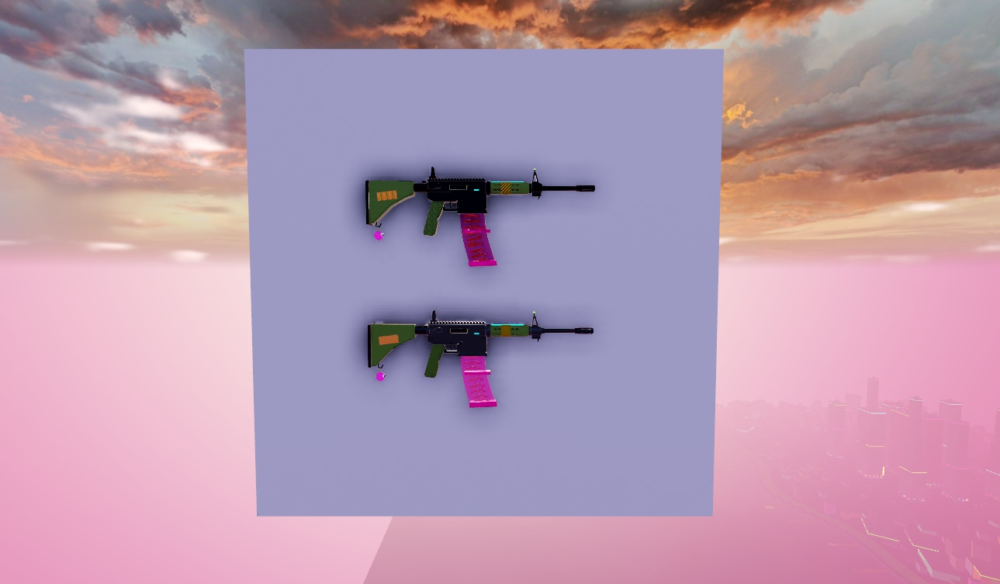
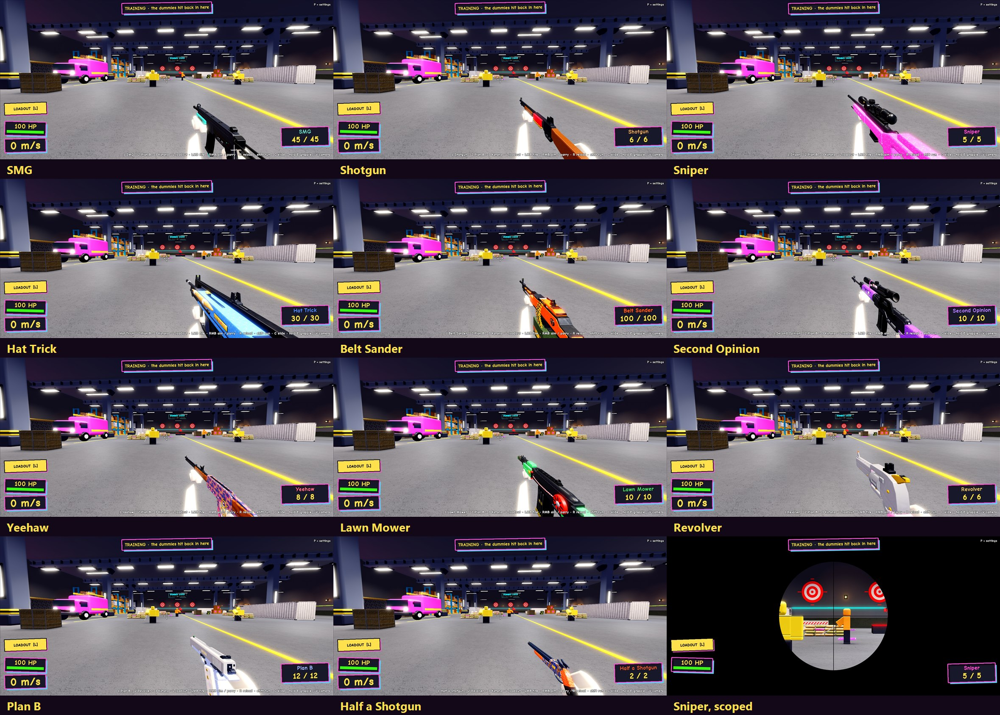
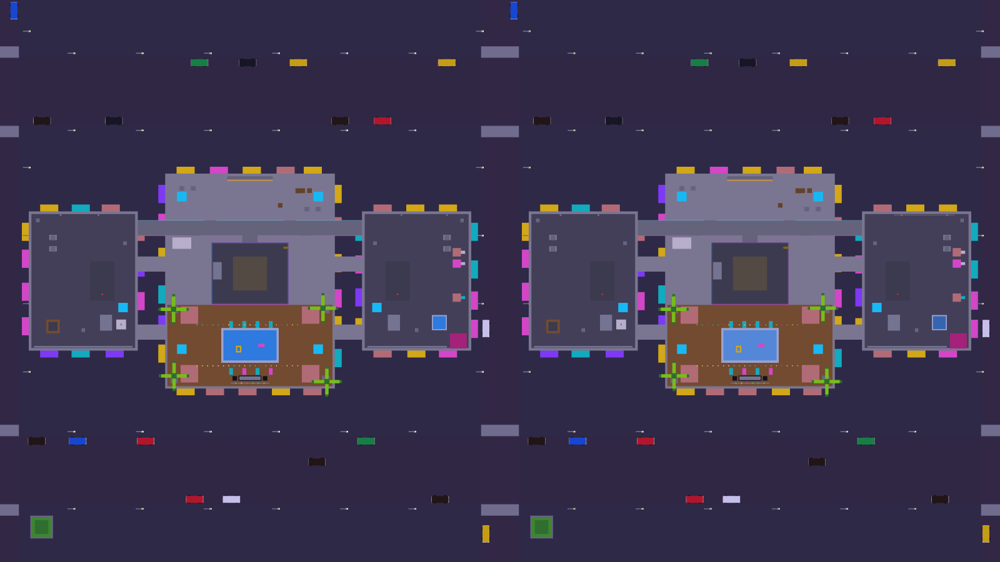
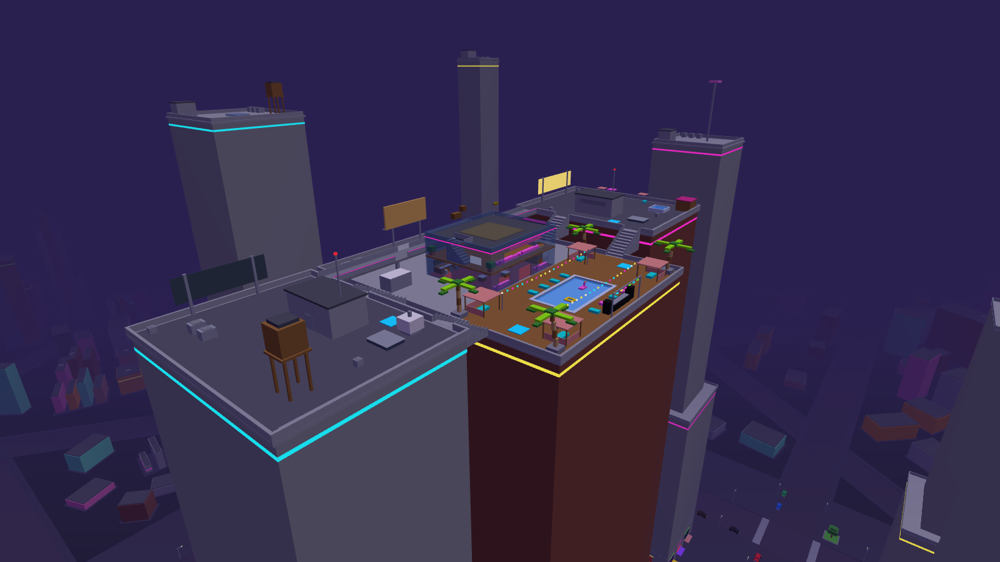
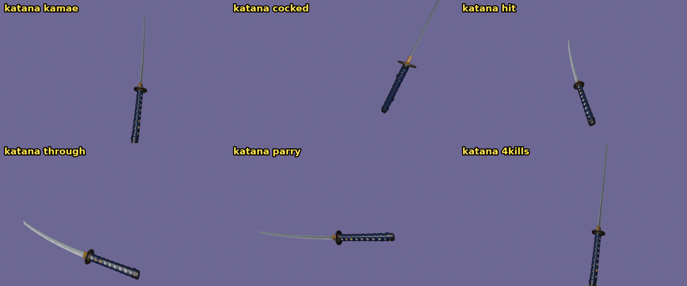
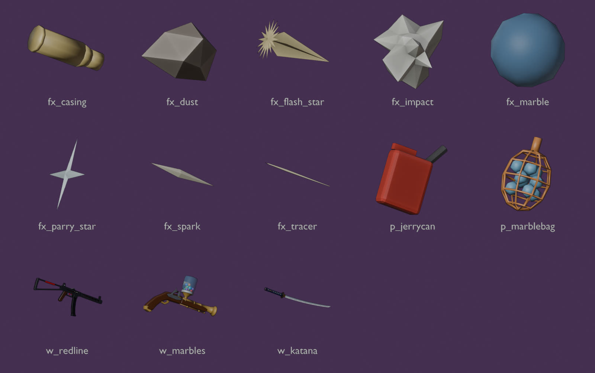

# JANKFIRE on Roblox

> **The Studio place is ahead of these files.** The live work happens in the Roblox place "Jankfire.." through the
> Roblox Studio MCP: the hub, the pad matches (1v1 to 4v4, first to 5), the training hall, the loadout screen, the
> Shredder and every fix since step 2 were built there. This folder is the export of that place
> (version 71, 2026-11-14), so the code is reviewable and nothing is lost if the place breaks.
>
> | what | where |
> | --- | --- |
> | The place's code, one file per script | `src/shared`, `src/server`, `src/client` (the three `Jankfire` folders), `src/server_root` and `src/client_root` (loose scripts next to them), `src/in_models` (scripts that live inside a model) |
> | The maps and asset folders, as Roblox model files | `place/**.rbxm` (the hub, Rooftop, mesh templates, weapons, effects, sounds, remotes, lighting effects, the clouds, the grid material) |
> | Service settings (gravity, lighting numbers, player settings) | `place/settings.json` |
> | Edit-time helpers (prop placer, overlap check, the hub builder, the kit importer, the weapon importer, the exporter itself) | `studio-tools/` |
>
> **Export again after a batch of Studio work** (a Claude session with the Studio MCP does this):
> 1. In Studio (execute_luau, Edit): `local m = game.ServerStorage.PolishBackup.StudioExport:Clone(); local E = require(m); m:Destroy(); return E.run("bundle")`.
>    Use `E.run("bundle", "src/")` for code only. It prints how many slices there are.
> 2. Fetch every slice: `... return E.run("slice", n)` for n = 1..N. The MCP saves each result as a text file.
> 3. `node tools/roblox/studio_export_unpack.mjs <the folder with those result files>` from the repo root, then commit.
>
> **Rebuild a place from the export:** `rojo build roblox/studio.project.json -o JANKFIRE-studio.rbxl` (Rojo 7.7+).
> It restores the code, maps, templates, lighting, the clouds and the grid material. Not in the export: Terrain's cells (the pool water is refilled by
> `JankWater` when the game runs), the old backups in ServerStorage, and DataStore data.
>
> `default.project.json` is the code-only project for `rojo serve`. `place.project.json` and `tools/roblox/build.mjs`
> are the older "build Rooftop from the web map" path from steps 1 and 2; they don't know about the hub.
>
> **Not merged yet:** `claude/f-roblox-core` (bots, Deathmatch with the map vote) branched from step 2 like this did.
> The plan and the order of work: `docs/PORT-PLAN.md`. The specs: `docs/WEAPONS.md`, `docs/MODES.md` (on `main`).

## Adding a plain gun (batch 3 onwards)

A gun with no gimmick needs no code, and **nothing is turned or painted by hand any more**. The Assault Rifle and
the eleven guns of batch 3 (`docs/BATCH3-GUNS.md`) went in exactly like this:

1. **Row:** add it to `src/shared/Weapons.luau` (in Studio: ReplicatedStorage.Jankfire.Weapons). Stats from
   `shared/weapons.js`, `vm` and `recoilVM` from `public/js/weapons.js` (VM, RECOIL; the rifle pack's are in
   `public/js/rifles.js`), `fx` (flash, brass, shake), `snd`, and `mdl`: the model file's bounds, the muzzle / sight /
   port / grip / fore spots (metres; leave `fore` out for a one-handed sidearm) and `parts`, the pieces that move.
2. **Model:** `blender -b --factory-startup -P tools/roblox/export_weapons.py -- roblox/assets/weapons --sil public/models/w_<id>.glb`.
   It turns the model so the upload lands facing the right way, writes each piece's look into its name, prints the
   bounds, muzzle and sight for `mdl`, and with `--sil` draws the gun's side view as text (to pick the grip and fore
   spots). `export_report.json` also lists where every moving node turns (`nodes`) and the web model's own notes
   (`meta`: pump travel, bolt lift and so on) for `mdl.parts`. Upload the .glb (Open Cloud, Model), put its asset id
   in `roblox/assets/weapons/assets.json`, give the gun its calm paint (next section), push the paint book
   (`node tools/roblox/push.mjs <out.rbxm> roblox/studio-tools/WeaponPaint.luau`) and run in Studio (execute_luau,
   Edit) `require(game.ServerStorage.PolishBackup.WeaponImport:Clone()).load({ "<id>" })`. That loads the asset,
   paints every piece, checks the facing against the exporter's bounds and puts `w_<id>` in
   ReplicatedStorage.JankfireWeapons.
3. **Sound:** `node tools/roblox/render_guns.mjs` writes `roblox/assets/sounds/gun_<id>.wav` (14 guns are rendered:
   the 12 plain guns, the Minigun and Lefty & Righty). Upload it (Open Cloud, Audio) and add a Sound named `gun_<id>`
   to ReplicatedStorage.JankfireSounds. Uploads are capped at 100 per 30 days: **44 used on 2026-11-15**.
4. **Clips:** `node tools/roblox/reloads.mjs` regenerates `Reloads.luau` from the web game: every reload, the draws,
   the clips that follow a shot (pump, bolt, lever) and the moving parts' timings. A gun with no reload of its own
   borrows the rifle's, stretched to its reload time. `GunParts.luau` moves the pieces named in `mdl.parts`.
5. **Roster:** set `live = true` (and write its `gimmick` line) in `src/shared/Roster.luau` so the loadout screen
   offers it.
6. Play test in the training hall (below), then export and commit.

The server needs nothing for a plain gun: `Rules.luau` and `Combat.server.luau` already check any hitscan gun from its
row (held, ammo, fire rate, range, line of sight, that the shot was really aimed at the target along its last 0.6 s,
and for one-bullet guns that a claimed headshot crossed the head). Row fields the server acts on by itself: `kb` /
`kbUp` (shove the victim), `lethalHead`, `burst` + `burstGap`, `ramp` + `chain`, `quick` + `qsDmg`, `fan`, `ricochet`.

### The models are a switch: `kit` (the default) or `web`

Since 16 November 2026 the weapons are new models built for Roblox (`docs/GUN-MODELS.md`): a few big chamfered
pieces in flat colours, SmoothPlastic, no pictures. They come from `tools/roblox/gun_models.py` (built on
`tools/roblox/gunkit.py`), go through `export_weapons.py --kit`, and live in `roblox/assets/weapons-kit/`; their book is
`studio-tools/WeaponKit.luau` (= `ServerStorage.PolishBackup.WeaponKit`). Both sets are kept in
`ServerStorage.PolishBackup.WeaponSets.{kit,web}`:

```lua
local W = require(game.ServerStorage.PolishBackup.WeaponImport:Clone())
W.models()           -- the kit models in (the default)        W.models("web")  the web models back
W.kit({ "ar" })      -- load a kit model from its asset again  W.skin("ar", "cardboard") / W.skin("ar")
```

The paint below applies to the **web** models only; a kit model wears its own colours (change them in its builder).

### The paint is a switch: `calm` (the default) or `web`

The owner's direction (15 November 2026): the weapons and mechanics come from the web game, the finish is the Roblox
game's own, serious and less colourful. So a weapon's **shape, pieces and numbers** come from the web model, and its
**paint** comes from `tools/roblox/weapon_paint.py`:

- `calm`: a quiet body (black polymer, dark and mid steel, one muted furniture colour per gun: olive, tan, walnut,
  slate, graphite) and one small accent per gun in its web hue. Bright only where it tells the player something: a
  sight dot, a heat glow, live shells, the marbles. Joke stickers take the colour of the surface under them.
- `web`: the web game's paint exactly as the model file carries it, pictures and all. Nothing is lost: the piece
  names in every .glb, and so every uploaded asset, always carry the web look.

How it fits together:

| what | where |
| --- | --- |
| the table (per gun: material or `node__material` -> a paint code) | `CALM` in `tools/roblox/weapon_paint.py` |
| a paint code | `<kind><rrggbb>[aa][+]`: `p` plastic, `m` dark metal, `s` shiny metal, `n` neon, `g` glass (+ alpha), `w` wood, `r` rubber; `+` keeps the piece's picture (a picture ignores the part's Color, so a repainted piece drops it) |
| both paints of every gun, for Studio | `roblox/studio-tools/WeaponPaint.luau` = `ServerStorage.PolishBackup.WeaponPaint` (generated: never edit it) |
| which paint the place wears | `paint = "calm"` at the top of that file; each template's `Paint` attribute says what it has on |

To change a colour: edit `CALM`, run `py tools/roblox/weapon_paint.py roblox/assets/weapons/export_report.json`
(add `--paint web` to make the web paint the default; `export_weapons.py` takes the same flag), push
`roblox/studio-tools/WeaponPaint.luau` with `push.mjs`, then in Studio:

```lua
local W = require(game.ServerStorage.PolishBackup.WeaponImport:Clone())
return W.use()          -- every template gets the book's default paint.  W.use("web") / W.use("calm", { "smg" })
-- W.shredder("calm") / W.shredder("web")   the Shredder is a hand-imported Tool: its paint is W.SHREDDER
-- W.load({ "smg" })                        loads a model from its asset again, painted
```

No model is uploaded again for a colour change. A
preview without Studio is `blender -b --factory-startup -P tools/roblox/paint_preview.py -- <out_dir> --paint calm
roblox/assets/weapons/w_*.glb`.

**Choose dark.** The halls' lamps show a colour far brighter than Blender does: `4c5639` olive came out lime and
`4a3222` walnut orange in the first photos. Look at the gun in hand in a Play test before keeping a colour. To see
the other paint in a running test only (Edit untouched), run `W.use("web")` in the **Server** datamodel during Play.

**The first-person arms** are your own avatar's hand and forearm shapes (so they fit a blocky or a round body) in
the game's dark glove and darker sleeve (`AvatarArms.luau`, `AvatarArms.KIT`). A pale avatar's bare arm blew out to a
white shape under the lamps. Your skin and shirt instead: `AvatarArms.LOOK = "avatar"`, or the module's `Look`
attribute. They are never a custom hand model (the owner's rule, 15 November 2026).

**How a weapon is held** is one table, `tools/roblox/holds.json`: per weapon and hand, the kind of hold (a handle
through the fist, or held from under), where it is on the weapon and how it is turned; where each forearm comes from
(an elbow spot in camera space); and the katana's rest and parry poses. `py tools/roblox/holds.py` writes
`src/shared/Holds.luau` from it. The arms are placed every frame (`AvatarArms.aim`), never glued to the gun, so a
forearm cannot sweep across the screen when the gun rolls; the off hand goes with the magazine, the pump and the
reload props (`Viewmodel.luau`, "the off hand"). A new gun needs a row there (take the spots from its side view, as
for `grip` and `fore`), or its hands are not drawn. Full account: `docs/GUN-PAINT.md`, "The hold".

**Where a weapon sits on the screen** follows the Rivals-class layout measured on 16 November 2026 (vault note
`Research/Rivals first-person holds.md`): every gun's muzzle just below and right of the crosshair, a two-handed gun
about a quarter of the screen wide with its back end leaving the bottom edge at about 80 % across, a one-handed gun
turned so its side shows, the katana upright on the right. Per weapon, `holds.json` has `shift` (a move of the rest
pose, camera space, metres), `scale` and `tilt` (degrees added to the rest turn), kept as three looks per weapon
(`looks`: before / after / combined; `use` picks one; the player's `HoldLook` attribute previews one in a test).
`py tools/roblox/hold_screen.py [--look ...]` prints where each gun lands on a 16:9 screen at the game's default FOV
of 80, from the kit's part boxes, so a new gun can be placed before any Play test.

**Aiming down the sights** (16 November 2026, place version 474; the owner: aiming should look like Rivals and
Valorant, the Redline "covers most of your screen") follows each weapon's `ads` row in `holds.json`. The sight sits on
the crosshair, 0.17 m + `aimZ` from the eye, and the gun is pushed back by the zoom's own amount, so zooming in never
makes it bigger (`Viewmodel.adsPos`). `sight` moves the aim line where the gun's own Sight spot is blocked, as on the
Redline and Half a Shotgun. `kind` tells the HUD what to draw: `iron` (the crosshair fades out), `dot` (a red dot,
the Redline), `none` (a faint crosshair, the Marble Shotgun), `scope` (the Sniper's and Second Opinion's lenses,
each with its own reticle; the gun is hidden). `skins.<id>` gives a skin its own `aimZ` or `sight`, and `hide` lists
its pieces that fade out while aiming: the wings, horns and crowns of the Seraph and Infernal sets. `near` draws a
skin's big pieces by the stock smaller in your own first-person view only, about the spot where they meet the gun
(pieces, scale, pivot); everyone else sees them full size. The Seraph rifle's wings are 45 % there (place version 475),
a corner at the hip instead of a third of the screen. `hold_screen.py --hip id@skin` finds such pieces. A long gun aimed
covers about 6 to 8 % of the screen, its body starting just under the crosshair and leaving the bottom edge between
40 and 60 % across, like Rivals' rifles. `py tools/roblox/hold_screen.py --ads [id or id@skin ...]` measures that on
the guns' real triangles. A new gun or skin is checked there first: a piece over the crosshair or above it means a
`sight` or a `hide` entry. Sheets: `docs/gun-hold/ads-1.jpg` to `ads-3.jpg`. Full account: `docs/GUN-PAINT.md`,
"Aiming down the sights".

Wraps are untouched by any of this: a wrap repaints pieces through `Color` and takes pictures off, then restores
whatever the template had.

### How uploads arrive (measured 2026-11-15)

`tools/roblox/rbxglb.py` holds what was measured and the helpers every exporter should use. One test object
(`export_weapons.py -- <dir> --orient-test`: a body with a nose, a post and a cap, plus one cube per colour route)
went through the same Open Cloud upload as everything else:

| question | what arrived |
| --- | --- |
| facing | Blender (x, y, z) lands at Roblox (-x, z, y): the file turned half way round its up axis. Each piece is a MeshPart at its box centre, unrotated (the turn is in the vertices), 1 unit = 1 stud. **Fix: the exporter turns every piece 180 degrees before export** (`rbxglb.PRE_TURN`), so the upload lands in the file's own frame. |
| plain material colours | lost: grey `a3a2a5`, Plastic |
| pictures (textures) | kept as `TextureID`, colours exact. The part's own Color does not tint an opaque picture, so Color holds a fallback. A picture shows white for a moment while it downloads: `Arsenal` preloads every weapon's assets. |
| vertex colours | kept, but shown too dark (Roblox reads the file's linear numbers as sRGB) and multiplied by the part's grey Color. `rbxglb.bake_vertex_colours` writes them so they read true; set Color white. They can't be removed in a running game. |

So: weapons keep one flat Color per piece (the loadout's wraps repaint pieces through Color; a baked vertex colour
would shine through every wrap), written into each piece's name by the exporter and applied by `WeaponImport`.
Vertex colours are the route for models that are never repainted. The hub kits (`chunky.py`) still go through
`KitImport`, which turns and paints them by itself; they were left alone because the hub was being rebuilt.



### Pushing code into Studio, and testing it

- **Big or generated code goes in as a model:** `node tools/roblox/push.mjs <out.rbxm> roblox/src/...` packs script
  files with Rojo; upload the .rbxm as a Model and run the Luau it prints (it copies each script's Source onto the
  script of the same name). Check the files match Studio first, or you overwrite newer work.
- **A play test can reach the running server through `ServerStorage.JankTest`** (a BindableFunction that only exists
  in Studio, `src/server/TestHook.luau`): `:Invoke("arm", player, { "smg", "revolver", "katana" })` arms you with
  anything without touching the saved loadout; `"me"`, `"all"` and `"hp"` read and set the server's own numbers.
  (The Studio MCP's Luau gets its own copies of the modules, so `require` can't see the fighters.)
- Set the player attribute `RangeRun` so the Plinker leaves you alone, and send cheat checks straight to the remotes
  from the client. Take the eye from the character's root + 1.8 studs, not the camera (a third-person camera makes
  the server refuse every shot, correctly).



## Steps 1 and 2 (how it started)


The Roblox version lives here, next to the web game, which carries on unchanged. This first step has the Rooftop map,
converted box for box from `shared/map.js`, and JANKFIRE movement on the default Roblox character: run, sprint, slide,
bhop, air strafing, the grapple, grapple jumps and the jump pads. Step 2 adds the first three weapons and a
free-for-all (below).


*Top down: the web game's Rooftop (left) and the converted Roblox Parts (right), both drawn by the game's own Three.js.*



## Step 2: the first three weapons + free-for-all



A free-for-all on Rooftop: first to **20 kills** or the most kills after **6 minutes**, respawn after 2.5 s (1.2 s
of spawn protection), a kill feed in each weapon's colour, an end screen, then the next round starts by itself 12 s
later. Two test dummies stand on the roof so you can try everything alone: **Dummy** (yellow) strafes, **Plinker**
(red) fires Redline bursts at you so you can practise the parry. They never score and never show in the feed.

| key | weapon | gimmick |
| --- | --- | --- |
| **1** | **Redline** | full auto. the lower your HP, the faster it fires (6/s at full HP, 22/s at 0). watch the tacho needle. |
| **2** | **Marble Shotgun** | 100 marbles a shot, point blank it's a one-shot. the marbles stay on the floor for 9 s: run over them and you slip (crouch-walk to cross). |
| **3** | **Katana** | grows with every kill (resets when you die). **right click = parry**: bullets from the front bounce off, a perfect parry (the first 0.15 s) sends them back into the shooter. parry a sword and the attacker staggers. |

Also: **left click** fire / swing, **right click** aim (guns), **R** reload, mouse wheel swaps. Movement keys as before.

**The server decides everything that matters** (exploiters can fire any RemoteEvent, so it's stricter than the web
game): it owns HP, kills, the katana's length and the marbles on the floor, and it checks every shot (the weapon you
really hold, ammo / mag / reload, the fire rate from the server's own HP, a line of sight from your head, range, how
many pellets can really land at that distance), every swing (a swing first, reach incl. growth, the cone, line of
sight) and every parry (the 0.35 s window, the 140 degree front, the cooldown). Your own movement is still yours, so
knockback and slips are sent to the victim's game.

### Import the step 2 models, effects and sounds (one time, optional but much better)

Until you do, the weapons show as their chunky code versions, the effects as plain glowing parts, and the game is
silent. Nothing breaks either way.

1. **Weapons:** Studio **Import 3D**, pick `roblox/assets/weapons/w_redline.glb`, `w_marbles.glb`, `w_katana.glb`.
   Keep their names. Drag the three imported models into **ReplicatedStorage > JankfireWeapons**.
2. **Effects:** Import 3D the 10 files in `roblox/assets/fx/` (`fx_*` effects, `p_*` reload props), drag them into
   **ReplicatedStorage > JankfireFX**.
3. **Sounds:** upload the 31 `.ogg` files in `roblox/assets/sounds/` (View > Asset Manager > Bulk Import), then paste
   each id into the Sound with the same name in **ReplicatedStorage > JankfireSounds** (`SoundId` = `rbxassetid://...`).
   `roblox/assets/sounds/SOUNDS.md` lists what each one is.
4. **File > Save to File.**



### Test with two players in Studio

**Test** tab > **Clients and Servers** > pick **2 Players** > **Start**. Studio opens a server window and two player
windows. Shoot each other: the hit marker / DINK / kill feed should show up in both, the marbles should stay on the
floor in both, and a katana kill should make the blade longer for everyone.

### Step 2 files

| Piece | Where |
| --- | --- |
| Weapon stats (studs), fire rate, parry numbers, FFA | `src/shared/Weapons.luau` |
| Hit boxes (the web game's two boxes), spread, melee cone | `src/shared/Hitbox.luau` |
| Floor marbles: where a patch lands, who slips | `src/shared/Marbles.luau` |
| The server's rules (pure, tested): fire / hit / swing / parry checks, damage, kills, credit, growth | `src/server/Rules.luau` |
| Fighters, HP, deaths, spawns, the FFA match | `src/server/Fight.luau` |
| The remotes (every one checked), marble patches | `src/server/Combat.server.luau` |
| Test dummies | `src/server/Dummies.luau` |
| Your weapons: input, firing, swings, parry, server events | `src/client/Arsenal.client.luau` |
| First-person pose stack, springs, clips, needle, katana stretch, reload props | `src/client/Viewmodel.luau` |
| Effects (Blender meshes, plain parts until imported) | `src/client/Fx.luau` |
| HUD: crosshair, parry ring, hit markers, damage numbers, HP, ammo, clock, feed, end screen | `src/client/FightHud.luau` |
| Recoil / knockback / slips into your movement | `src/client/Body.luau` (+ `Movement.slip`) |
| Sounds | `src/client/Sfx.luau`, `assets/sounds/`, `tools/roblox/render_sounds.cjs` |
| Code weapon models + fitting the Blender ones | `src/shared/WeaponModels.luau`, `tools/roblox/export_weapons.py` |
| Animations (generated from the web game's keys) | `src/shared/Anims.luau` from `tools/roblox/anims.mjs` |
| Effect meshes, contact sheet, pose renders | `tools/roblox/fx_blender.py`, `fx_sheet.py`, `pose_sheet.py` |
| Tests | `tests/weapons.luau` (called by `tests/run.luau`) |

**Not in step 2 yet:** bots that play (only the two dummies), the end-of-match vote, killstreaks and items, the other
weapons. Others see your gun held up level in your hand but not your exact aim pitch; others hear the Redline at its
full-HP pitch (like the web game).

## What you need

Everything here is free.

**On your PC, just to play and test:**
- **Roblox Studio**, signed in with your Roblox account. That's all you need to open the place and press Play.

**On your PC, only if you want extras:**
- **Roblox Studio MCP** (optional): lets a Claude session on your PC open the place, press Play and take
  screenshots for you.
- **Git, Node 22, Rojo and the Rojo plugin for Studio**: only needed if you want code changes to show up in
  Studio live as they're made. Rojo is a small program and its plugin is a button in Studio that links the two.
  Without these you just download the newest `.rbxl` file and open it.

**In the cloud (what Claude uses to build it, nothing for you to install):**
- **Rojo**: turns the code and the map into the `.rbxl` place file.
- **Lune**: runs the Luau tests outside Studio.
- **selene**: checks the Luau code for mistakes.
- **Blender**: exports the 3D models in a form Roblox can import.
- **Node**: runs the map converter.

Rojo, Lune and selene install with `cargo install rojo lune selene`. Blender and Node are already in the jankfire
cloud setup.

## Play it in Roblox Studio

1. Download `roblox/build/JANKFIRE-Rooftop.rbxl` (on GitHub: open the file, then the download button).
2. Double-click it. Roblox Studio opens the place. (Or in Studio: **File > Open from File...** and pick it.)
3. Press **Play** (F5). You spawn on a roof.
4. Keys: **WASD** move, **Shift** run, **C** or **Ctrl** slide (while running), **Space** jump (hold it to bhop),
   **hold E** grapple (aim at a wall or roof), **Space while on the rope** = grapple jump, **V** first/third person.
   The cyan pads throw you back up the towers. Falling to the street: INTO THE SMOG.

The `.rbxl` is the binary place file (140 KB). `node tools/roblox/build.mjs` also writes the same place as XML
(`JANKFIRE-Rooftop.rbxlx`, 10 MB, not committed); Studio opens either.

## Put the Blender models in (optional, they look much better)

Until then, the props and buildings show as their JANKFIRE box versions, exactly where the web game draws them.

1. In Studio: **Home > Import 3D** (or **File > Import 3D**), pick the `.glb` files in `roblox/assets/rooftop/`
   (16 files: `p_*` props, `arch_*` buildings). Import each as a **Model** and keep the name it gets from its file
   (`p_acunit`, `arch_penthouse`...).
2. In the Explorer, drag the imported models into **ServerStorage > JankfireMeshes**.
3. Press Play. The server swaps every placeholder for its model (the boxes stay as the invisible collision, like the
   web game). To see them in edit mode too, paste this in the Command Bar (View > Command Bar) and press Enter:
   `require(game.ServerScriptService.Jankfire.MeshSwap).run()`
4. **File > Save to File** keeps them in the place.

`roblox/assets/rooftop/placements.json` lists every copy (which file, where, how big) and `export_report.json` the
triangle counts: every piece is under Roblox's 20k cap, so nothing needed slimming.

## For a Claude session driving Studio (Roblox Studio MCP)

- Open the latest place: `git pull`, then open `roblox/build/JANKFIRE-Rooftop.rbxl` in Studio.
- Live code: install Rojo (`cargo install rojo`, or the Rojo plugin's own installer) and its Studio plugin, then from
  `roblox/` run `rojo serve` (it serves `default.project.json`: the scripts only) and press **Connect** in the Rojo
  plugin. Edits to `roblox/src/**` sync straight into the open place; the map stays as it is in the place.
- Rebuild the whole place from the repo: `node tools/roblox/build.mjs` (needs Node and Rojo; runs the tests too if
  Lune is installed). It regenerates the map from `shared/map.js`.
- Useful checks from the MCP: Play, then read `game.Players.LocalPlayer.Character.HumanoidRootPart.AssemblyLinearVelocity`
  while running/sliding; `workspace.Map.Rooftop.ModelMarkers` has a marker per Blender model.

## Flicker check: run it after every rebuild

Two visible surfaces in one plane that face the same way and overlap flicker as the camera moves (z-fighting: the
owner saw it all over the maps on 16 Nov 2026). Builders must not leave any. After rebuilding a map, in Studio (Edit):

```lua
local Z = require(game.ServerStorage.PolishBackup.ZFight:Clone())
print(Z.start({ workspace.Map.RooftopV3 }))        -- any roots: Map.Hub.Rotunda, Map.Hub.TrainingGround, ...
repeat local s = Z.step(25) print(s) until s == "done"   -- big areas: one Z.step(25) per execute_luau call
print(Z.report(30))                                 -- ranked: overlap area, distance from where players stand
Z.clear()
```

`studio-tools/ZFight.luau` turns every visible part into triangles (blocks, wedges, cylinder caps, and MeshParts from
their real mesh through `AssetService:CreateEditableMeshAsync`, so the colour-merged kits are checked face by face)
and reports pairs of DIFFERENT looks (colour, material, variant, texture) whose faces lie within 0.02 studs, face the
same way and overlap by more than 0.01 square studs. Same-look overlaps are invisible and skipped. Fix one in the
builder, never only in the live parts: lift the detail (decal, trim, inlay, light panel) 0.03 to 0.05 studs proud,
inset it, or delete the hidden duplicate.

The Blender kits fix themselves: `rooftop2_models.py` and `rooftop3_models.py` call `tools/roblox/zfightfix.py` just
before `flush()`, which pushes the smaller face of each clashing pair 0.04 studs out (never a `water` piece). Check a
kit before uploading it: `blender -b --factory-startup -P tools/roblox/zfight_glb.py -- <kit.glb> [alone=r2_tw]`
(`alone`: models placed on their own in Studio, like v2's city towers, are only compared with themselves).

## How it's built

| Piece | Where |
| --- | --- |
| Map converter (JS map -> Rojo JSON model, Parts in studs) | `tools/roblox/convert.mjs` |
| Material colours (pulled out of the web renderer) + Roblox materials | `tools/roblox/matcolors.cjs`, `matcolors.json`, `rbxmat.mjs` |
| Blender models -> Roblox-ready `.glb` | `tools/roblox/export_models.py` (`blender -b -P ... -- <out> <files>`) |
| Place build (convert, `rojo build`, tests) | `tools/roblox/build.mjs` |
| Pictures (web map vs Roblox parts) | `tools/roblox/preview.cjs` |
| Movement numbers / maths (Luau) | `src/shared/Config.luau`, `src/shared/Movement.luau` |
| Client: movement controller, HUD | `src/client/Move.client.luau`, `src/client/Hud.luau` |
| Server: grapple checks, the street, teleport check, model swap | `src/server/Main.server.luau`, `HookCheck.luau`, `MeshSwap.luau` |
| Tests | `tests/run.luau` (`lune run tests/run`), `tools/roblox/test-convert.mjs` |

**Scale: 1 m = 3 studs.** A JANKFIRE player is 1.8 m tall = 5.4 studs, about an R15 character. Speeds and accelerations
scale by 3 (run 10 m/s = 30 studs/s, gravity 26 m/s² = `Workspace.Gravity` 78, jump 9.2 m/s = `JumpPower` 27.6); rates
like friction don't. Axes are the same (y up), so a point is just (x, y, z) × 3, no offset: the roofs are at y 0 and the
street 486 studs down (`Workspace.FallenPartsDestroyHeight` is -1500).

**Movement:** the Humanoid still stands, steps, jumps and animates; a `LinearVelocity` on the root (horizontal plane)
holds the sideways velocity at what JANKFIRE's maths says each physics step: quake-style ground accel and friction,
air strafing with W-steering, slide friction, bhop (no friction on the landing tick), the classic grapple (checked
against `shared/hookphys.js` to 1e-6 m). Movement is the client's, like the web game. The server checks every hook
(real point, in range, in sight from your head, at most 6 a second), kills you at the street, and puts you back if you
move impossibly far between checks.

**Map:** every box is an anchored Part. Solid boxes collide and can be grappled; look-only ones (`deco`, the city
below) don't. Long city roads are split under Roblox's 2048-stud Part limit. Each Part keeps its JANKFIRE material in
a `Mat` attribute; pads have `Pad` (launch velocity, studs/s); signs and ads have `Picture` (a colour for now).

## What doesn't port (yet)

- **Pictures on signs and ads** (JANK BANK, HOTEL 4 HOURS, the billboards) are flat colours: they need their images
  uploaded as Decals.
- **Sounds:** `public/js/audio.js` synthesizes them live; Roblox needs uploaded files, so step 2's are rendered to
  `.ogg` (`roblox/assets/sounds/`) for the owner to upload.
- **Render presets / shaders** (Potato pixelation, outlines, the haze over the street) don't exist in Roblox; the place
  uses Future lighting and plain fog.
- **Model looks:** the Blender models' paint and vertex colours become one colour per piece (Roblox shows a MeshPart
  in one colour, plus textures), and the glossy clear-coat becomes Roblox's standard PBR. Per-placement paint
  (the lift rooms' blue/pink stripe) isn't applied yet.
- **New effects** will be Blender meshes / flipbooks (the owner's rule), not code effects.
