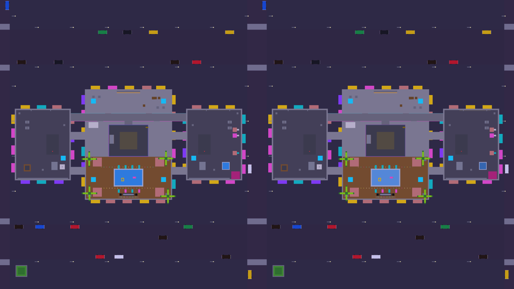
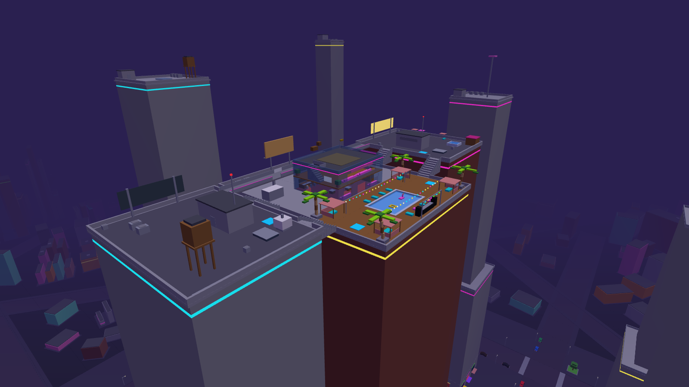

# JANKFIRE on Roblox (step 1: run around Rooftop)

The Roblox version lives here, next to the web game, which carries on unchanged. This first step has the Rooftop map,
converted box for box from `shared/map.js`, and JANKFIRE movement on the default Roblox character: run, sprint, slide,
bhop, air strafing, the grapple, grapple jumps and the jump pads. No weapons yet (that's step 2).

*Top down: the web game's Rooftop (left) and the converted Roblox Parts (right), both drawn by the game's own Three.js.*

## What you need

Everything here is free.

**On your PC, just to play and test:**
- **Roblox Studio**, signed in with your Roblox account. That's all you need to open the place and press Play.

**On your PC, only if you want extras:**
- **Roblox Studio MCP** (optional): lets a Claude session on your PC open the place, press Play and take
  screenshots for you.
- **Git, Node 22, Rojo and the Rojo plugin for Studio**: only needed if you want code changes to show up in
  Studio live as they're made. Rojo is a small program and its plugin is a button in Studio that links the two.
  Without these you just download the newest `.rbxl` file and open it.

**In the cloud (what Claude uses to build it, nothing for you to install):**
- **Rojo**: turns the code and the map into the `.rbxl` place file.
- **Lune**: runs the Luau tests outside Studio.
- **selene**: checks the Luau code for mistakes.
- **Blender**: exports the 3D models in a form Roblox can import.
- **Node**: runs the map converter.

Rojo, Lune and selene install with `cargo install rojo lune selene`. Blender and Node are already in the jankfire
cloud setup.

## Play it in Roblox Studio

1. Download `roblox/build/JANKFIRE-Rooftop.rbxl` (on GitHub: open the file, then the download button).
2. Double-click it. Roblox Studio opens the place. (Or in Studio: **File > Open from File...** and pick it.)
3. Press **Play** (F5). You spawn on a roof.
4. Keys: **WASD** move, **Shift** run, **C** or **Ctrl** slide (while running), **Space** jump (hold it to bhop),
   **hold E** grapple (aim at a wall or roof), **Space while on the rope** = grapple jump, **V** first/third person.
   The cyan pads throw you back up the towers. Falling to the street: INTO THE SMOG.

The `.rbxl` is the binary place file (140 KB). `node tools/roblox/build.mjs` also writes the same place as XML
(`JANKFIRE-Rooftop.rbxlx`, 10 MB, not committed); Studio opens either.

## Put the Blender models in (optional, they look much better)

Until then, the props and buildings show as their JANKFIRE box versions, exactly where the web game draws them.

1. In Studio: **Home > Import 3D** (or **File > Import 3D**), pick the `.glb` files in `roblox/assets/rooftop/`
   (16 files: `p_*` props, `arch_*` buildings). Import each as a **Model** and keep the name it gets from its file
   (`p_acunit`, `arch_penthouse`...).
2. In the Explorer, drag the imported models into **ServerStorage > JankfireMeshes**.
3. Press Play. The server swaps every placeholder for its model (the boxes stay as the invisible collision, like the
   web game). To see them in edit mode too, paste this in the Command Bar (View > Command Bar) and press Enter:
   `require(game.ServerScriptService.Jankfire.MeshSwap).run()`
4. **File > Save to File** keeps them in the place.

`roblox/assets/rooftop/placements.json` lists every copy (which file, where, how big) and `export_report.json` the
triangle counts: every piece is under Roblox's 20k cap, so nothing needed slimming.

## For a Claude session driving Studio (Roblox Studio MCP)

- Open the latest place: `git pull`, then open `roblox/build/JANKFIRE-Rooftop.rbxl` in Studio.
- Live code: install Rojo (`cargo install rojo`, or the Rojo plugin's own installer) and its Studio plugin, then from
  `roblox/` run `rojo serve` (it serves `default.project.json`: the scripts only) and press **Connect** in the Rojo
  plugin. Edits to `roblox/src/**` sync straight into the open place; the map stays as it is in the place.
- Rebuild the whole place from the repo: `node tools/roblox/build.mjs` (needs Node and Rojo; runs the tests too if
  Lune is installed). It regenerates the map from `shared/map.js`.
- Useful checks from the MCP: Play, then read `game.Players.LocalPlayer.Character.HumanoidRootPart.AssemblyLinearVelocity`
  while running/sliding; `workspace.Map.Rooftop.ModelMarkers` has a marker per Blender model.

## How it's built

| Piece | Where |
| --- | --- |
| Map converter (JS map -> Rojo JSON model, Parts in studs) | `tools/roblox/convert.mjs` |
| Material colours (pulled out of the web renderer) + Roblox materials | `tools/roblox/matcolors.cjs`, `matcolors.json`, `rbxmat.mjs` |
| Blender models -> Roblox-ready `.glb` | `tools/roblox/export_models.py` (`blender -b -P ... -- <out> <files>`) |
| Place build (convert, `rojo build`, tests) | `tools/roblox/build.mjs` |
| Pictures (web map vs Roblox parts) | `tools/roblox/preview.cjs` |
| Movement numbers / maths (Luau) | `src/shared/Config.luau`, `src/shared/Movement.luau` |
| Client: movement controller, HUD | `src/client/Move.client.luau`, `src/client/Hud.luau` |
| Server: grapple checks, the street, teleport check, model swap | `src/server/Main.server.luau`, `HookCheck.luau`, `MeshSwap.luau` |
| Tests | `tests/run.luau` (`lune run tests/run`), `tools/roblox/test-convert.mjs` |

**Scale: 1 m = 3 studs.** A JANKFIRE player is 1.8 m tall = 5.4 studs, about an R15 character. Speeds and accelerations
scale by 3 (run 10 m/s = 30 studs/s, gravity 26 m/s² = `Workspace.Gravity` 78, jump 9.2 m/s = `JumpPower` 27.6); rates
like friction don't. Axes are the same (y up), so a point is just (x, y, z) × 3, no offset: the roofs are at y 0 and the
street 486 studs down (`Workspace.FallenPartsDestroyHeight` is -1500).

**Movement:** the Humanoid still stands, steps, jumps and animates; a `LinearVelocity` on the root (horizontal plane)
holds the sideways velocity at what JANKFIRE's maths says each physics step: quake-style ground accel and friction,
air strafing with W-steering, slide friction, bhop (no friction on the landing tick), the classic grapple (checked
against `shared/hookphys.js` to 1e-6 m). Movement is the client's, like the web game. The server checks every hook
(real point, in range, in sight from your head, at most 6 a second), kills you at the street, and puts you back if you
move impossibly far between checks.

**Map:** every box is an anchored Part. Solid boxes collide and can be grappled; look-only ones (`deco`, the city
below) don't. Long city roads are split under Roblox's 2048-stud Part limit. Each Part keeps its JANKFIRE material in
a `Mat` attribute; pads have `Pad` (launch velocity, studs/s); signs and ads have `Picture` (a colour for now).

## What doesn't port (yet)

- **Pictures on signs and ads** (JANK BANK, HOTEL 4 HOURS, the billboards) are flat colours: they need their images
  uploaded as Decals.
- **Sounds:** none yet. `public/js/audio.js` synthesizes them live; Roblox needs files, so they'll be rendered to `.ogg`
  and uploaded.
- **Render presets / shaders** (Potato pixelation, outlines, the haze over the street) don't exist in Roblox; the place
  uses Future lighting and plain fog.
- **Model looks:** the Blender models' paint and vertex colours become one colour per piece (Roblox shows a MeshPart
  in one colour, plus textures), and the glossy clear-coat becomes Roblox's standard PBR. Per-placement paint
  (the lift rooms' blue/pink stripe) isn't applied yet.
- **New effects** will be Blender meshes / flipbooks (the owner's rule), not code effects.
