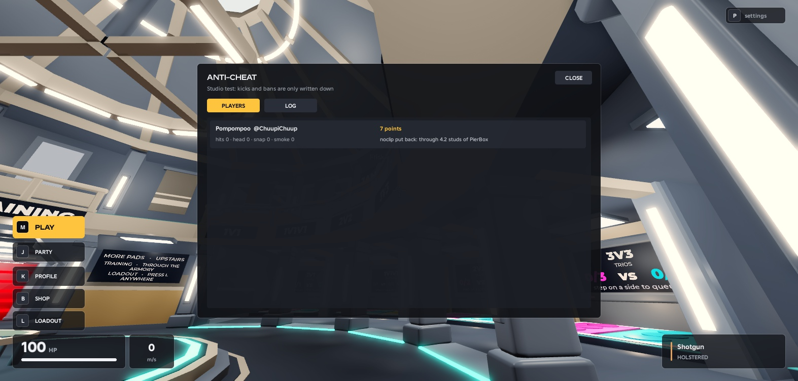
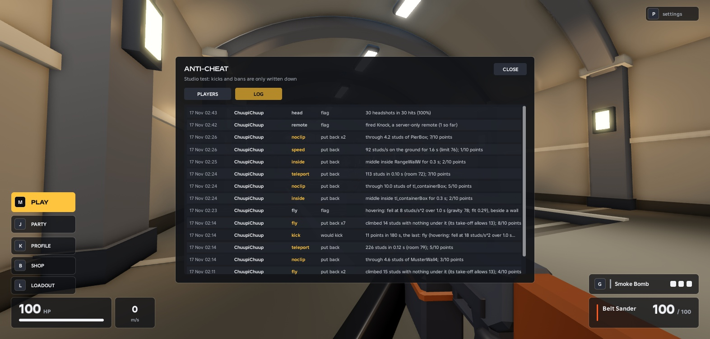
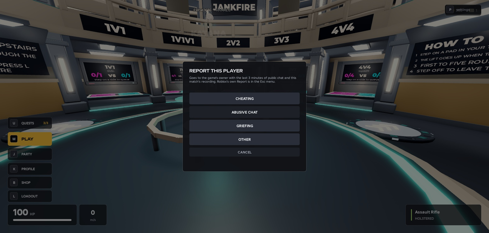
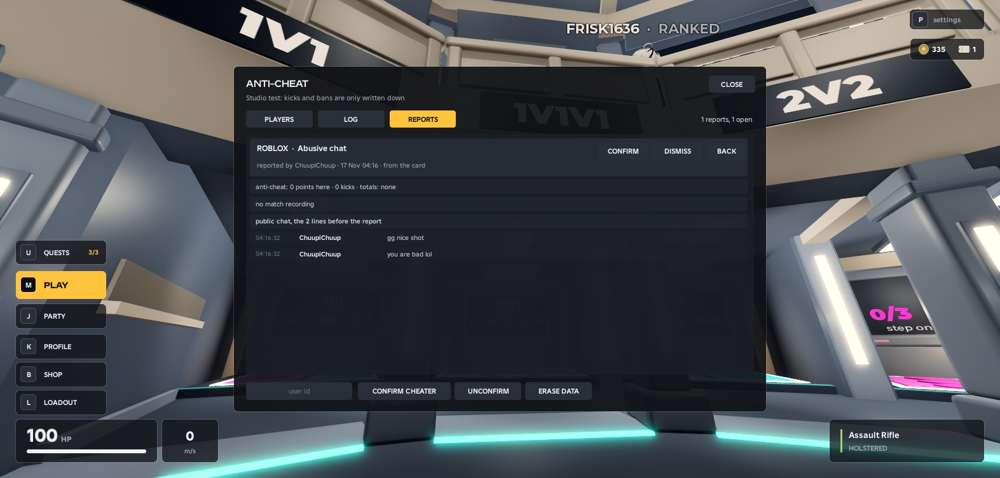

# Anti-cheat (Roblox)

The owner asked: "How do we combat cheaters? People that have fly, no clip, aimbot etc!!" This is the answer, built 17 Nov 2026.

Later the same day the owner also asked: "Can we have a built in report that saves public chat?" and "If someone is caught cheating give back any ranked stuff or stats!!". Both are in the "Reports" section below.

Short version:

- **Movement cheats** (teleport, noclip, fly, speed) are checked on the server ten times a second against what the game itself can do to a body. A catch puts the player back and scores points. Enough points from catch after catch would be a kick, but **movement kicks are off** (`KICK_MOVE = false`) since a friend was kicked for lag on 18 Nov. Lag itself is no longer a catch: see "Lag" below.
- **Bans** exist but are switched **off**: banning is the owner's call.
- **Aim cheats** are only written down for the owner to read. The server never acts on them.
- **Every remote** was audited. The gaps that were found are fixed, or handed to the session whose file it is.
- The **owner's panel** (`/ac` in chat, or F7) shows who has points, the review log from every server, and buttons to kick, clear, and (when bans are on) ban or unban.

## What Roblox already covers, and what it can't

- **FilteringEnabled** (always on). A client can't change the world for anyone else. It can't spawn parts, delete the map, change another player, set its own HP, or give itself ammo or items: all of those are the server's. In this game the server owns HP, kills, ammo, mags, reloads, fire rate, hits (line of sight along the target's lag trail, range, the melee cone, parry timing), items and their charges, loot, the shop and saves (Combat.server.luau, Rules.luau, Utility.luau, Loot.luau).
- **Hyperion** (Roblox's client anti-tamper on desktop). It makes it hard to inject an exploit into the Roblox client. "Hard" isn't "impossible": paid executors still turn up. So the server has to assume some clients run arbitrary code.
- **What FilteringEnabled does NOT cover: the player's own character.** Each client owns its character's physics, so it can put its body anywhere and send that to everyone. Roblox does this for every game; JANKFIRE leans on it more than most, because movement is the client's, like the web game (bhop, slides, the rope, pads, knockback). Fly, noclip, teleport and speed cheats all live here. That's what the movement checks below are for.
- **What no server can fully stop.** The client sees everything it draws, and it aims for itself.
  - **Aimbots and triggerbots** that smooth their aim like a person look like a very good player. The server sees only where shots went.
  - **ESP / wallhacks.** Every client is told where every player is, because it has to draw them.
  - **"No knockback" and "no slip".** The client applies knockback, marble slips and Shredder pulls to itself, and a cheat can ignore them. The server could compare the body's motion after a knock with the knock it sent. That isn't built yet: it's the next check worth adding.
  - **Small speed edges.** A boost that stays inside the margins the game's own moves need (sprint, slides, bhops) isn't distinguishable from good movement.
  - **Lag switching.** A player who freezes their connection gets the gap back when they reconnect (a second at full speed, then 150 studs/s for the rest, up to 4 s), and nothing is judged while they're frozen, because real lag looks the same. A frozen client can't shoot or use anything, so the most it buys is a short head start.

## The movement checks (server/AntiCheat.server.luau)

Every body is looked at every 0.1 s. Each look checks, in order:

| Check | What it catches | How | The line |
|---|---|---|---|
| **teleport** | a jump between two looks | distance vs. `(maxSpeed + push) × dt + slack + ping room` | maxSpeed 420 studs/s (past any bhop, rope, pad or knock); slack 30 studs |
| **noclip** | walking or teleporting through a wall | a straight line from the last clear look to this one, at three heights of the body. It must go **in one face of something solid and out the opposite face** at two of the three heights. | a fast body cutting a corner enters one face and leaves by the next (at right angles), so it never counts. Any thickness from 0.1 studs counts, because many walls are two thin skins round a hollow. |
| **inside** | standing inside a wall or the floor, hiding in geometry | the body's middle (a 0.6 × 1.4 × 0.6 box round the root) overlaps something solid's real shape for 3 looks in a row | 0.3 s |
| **fly** | hovering, flying up, floating | a parabola is fitted through a window of free-flight looks: its curvature is the body's vertical acceleration. A real body in the air falls at gravity (78 studs/s²); a flyer shows about 0. | the window (1.2 s, 9+ looks) must show at least 45% of gravity, with a fit within 1.5 studs. A bad fit (a bump, a lag burst) proves nothing and is skipped. |
| **climb** | flying up, "infinite jump" (jumping again in mid-air) | since its last take-off a body can rise at most v0² / 2g: nothing in the air pushes it up. v0 is the most the take-off could give, from the list below. | the climb may reach 1.15 × that + 4 studs |
| **stall** | an anchored body hanging in the air | no movement at all while nothing is under it, **timed only while the client is talking** (its beat or a remote arrives). A frozen connection pauses the clock. | 3 s |
| **speed** | a ground speed hack | flat speed over 0.5 s, only after 1.6 s on the ground without a break | 1.3 × (run 30 × sprint 1.45 × the lightest gun 1.2 × the gold star 1.25 when on) + 8: 76 studs/s, 93 with the gold star |

**The climb's take-off speed (v0)** is the most generous case:

- **From the ground**: a jump (the slide jump's 33 studs/s, +1) on top of 1.3 × the body's speed then, because a ramp can turn speed into height. If a jump pad is within 14 studs, its throw goes on top of that.
- **From a push**: the push's size plus a jump. That includes a push that lands while the body is still standing (within 1.5 s plus a round trip of the take-off). Before 18 Nov a knock straight up from the ground was caught as a climb ("climbed 33 studs, its take-off allows 24").
- **From a rope**: 180 studs/s (a grapple jump is 1.12 × the rope's 126 pull, plus 33 up).

The ten looks a second can miss a bhop's ground contact, which lasts a few ticks. So a sudden upward kick between two looks, with ground within 6 studs under it, counts as a landing and a new take-off. Each kick also starts a new fit window: an early version fitted two hops and the bounce between them as one curve, and called it hovering. That was the only false catch in the first test, fixed the same day.

**Why the fly check is a curve fit.** It needs no list of every way a player can go up. A pad throw, a grapple jump, a slide jump, a ledge launch: each one starts a free-flight arc, and every free-flight arc falls with gravity. Only a force that keeps acting in the air breaks the parabola. The game has few of those, and the server knows all of them (the "pushes" below).

**Why speed waits 1.6 s on the ground.** Carried speed is legit: a slide keeps it for up to 0.8 s, and a bhop touches the ground for 3 ticks. Ground friction (6/s) then eats it in under half a second. Holding a sprint-and-a-half for over a second and a half on the ground is something only a cheat does.

**What counts as standing.** "Standing" means something solid within 2.5 studs under the body (a box cast). That includes another player's head, a dummy, a ledge's edge, water (the pool), or a seat. The few solids that rays can't see are checked by hand: the hub's invisible barrier box and some roofs (CanCollide but not CanQuery).

**Pushes: what the game does to a body is never a catch.** After a push the fly window starts again 0.3 s later. A push the server sends, which lands on the client a round trip later, gets 2.5 × the player's ping on top of that.

- The server's knockback. `Fight.knock` is wrapped, so it covers guns, the katana, frags, the Rubber Duck's black-hole pull, popper shoves and parry staggers.
- A shot with a big recoil (8+ studs/s: the shotgun, the sniper, the DMR, the autoshot, the revolver, the sawn-off, the marbles). Smaller recoils can't hold a body up, even sprayed straight down at full rate: the Redline's 0.9 × 22 a second is 20 of gravity's 78.
- Any item use (the popper's recoil, the frag at your feet).
- A swing.
- A rope: the server's own `Rope_<userId>`, drawn only for a hook it accepted. A refused hook also counts for one round trip, because it still swings the client until the "cut" arrives, but only while the client asks at most 4 times in 10 s. A cheat spamming hook requests to keep the fly check paused gets nothing from it. (A cheat holding a real, accepted rope while flying elsewhere isn't caught: checking that motion fits the rope would be the next step.)
- A ledge launch or a BONK (ImpactRemote).
- A marble slip (`Fighter.slipT`).
- A parry stagger.
- The Shredder: its victim's parts are in the `JFShredded` collision group while it pulls.
- A soap bubble, the speed-trap cage or a pop quiz. While the attributes `Trap`, `Jail` or `Quiz` are on, there are no fly or speed checks at all.

**Server teleports** start the watch afresh from the new spot. This covers anything that stamps the player's `TeleportT` attribute: laser doors, the playground, matches and lobbies (Party), items, the VIP room's door (stamped since today), and the test recipes. It also covers any server script that writes the root's CFrame (the anti-cheat listens for that, and physics never fires it), and every spawn.

**Collision groups are respected.** Rays and overlaps use the player's own collision group. So a VIP walks through the VIP door, and a Shredder victim passes through players, without either counting.

**Things moved on clients only are skipped**, because the server's copy stands still or stays shut:

- the hub's spinning bits (`HubSpin`) and holograms;
- the training area's roll-up doors and shutters;
- laser gates;
- the back lot's garage door;
- anything marked with the attribute `ACPass`.

Mark any new client-animated solid with `ACPass = true`.

**For future killstreaks that bend the rules** (Moon Boots, Wrecking Ball), set these on the Player:

- `ACGravity` (a number): the gravity multiplier the fly check uses.
- `ACGrace` (an `os.clock()` time): no movement checks until then.
- `ACSpeed` (a multiplier above 1): for a mode that runs everyone faster, set for the whole match. It multiplies the ground-speed limit and a rope's throw (the climb check). The classic modes' Spoons & Grapples sets 1.6.

**The owner's dev menu (18 Nov 2026, `OwnerDev.server`, docs/OWNER-DEV.md).**

- `devOn(p)` is true only while the server's `DevOn` attribute is set and the player is the place's creator. `DevOn` is set while any dev power is on (fly, noclip, run speed, weapons in the hub), and for 3 s after the last one goes off.
- While it's true:
  - No movement checks run.
  - The verdict "dev powers on: movement not checked" is the owner's last line in the panel.
  - The owner's aim flags are written with a `[dev]` prefix.
- When it goes off, the checks start afresh after a 1 s grace.
- Nobody else gets this pass. A fling, freeze or bring victim gets only the usual server-move pass (`ACGrace`, `TeleportT`), the same as a TV Remote rewind.

### The ladder

1. **Put back.** The body goes back to its last clear look; a flyer goes back to its last spot on the ground. The trusted spot stays there. A client that ignores the put back is measured from that spot again and caught again.
2. **Points.** Each catch scores: noclip 3, teleport 2, inside 2, fly 2, stall 2, speed 1. A catch within 5 s of a gap with no updates, or while the player's ping has lately been over 300 ms, scores half. **Every catch's points halve every 40 s** (since 18 Nov; before that they counted in full for 180 s).
3. **Kick** at 10 points, and only from a pattern: at least 4 catches in the last 60 s, the first and last at least 5 s apart. A flyer who keeps flying is caught every second or two and reaches it in about 10 s. A teleporter caught every 10 s reaches it after about 10 teleports. One clump of catches (a lag spike can trip three checks at once) never kicks, and neither does a false catch now and then. Player A's catches (see "Lag": eight climbs over 19 minutes, the last three within about 20 s) come to about 6 points this way, and only 3 of them fall in the last 60 s.
   - **Movement kicks are off** since 18 Nov: `KICK_MOVE = false` in `server/AntiCheatRules.luau`. A full ladder writes "would kick" to the log and starts counting again. `KICK` (still on) is the master switch; the owner's panel KICK button doesn't read either.
4. **Ban** only if the owner switches it on. In `server/AntiCheatRules.luau`:
   - `BANS = true` turns on the panel's BAN and UNBAN buttons.
   - `AUTO_BAN = true` also bans after 3 kicks in 7 days.
   - `BAN_DAYS` sets the length (0 = for good).

   Bans use `Players:BanAsync` (ApplyToUniverse, alt accounts included). The reason and duration go into the review log.

Unsure cases are only written down, never punished. That covers a fly or stall verdict right beside a wall (wedged on an edge, or climbing), a climb in an arc that a gap with no updates broke, a noclip line across such a gap, and every aim signal.

### Lag (18 Nov 2026)

The owner, about 02:00 UTC: "my friend got server movement checked because of lag". Movement kicks went off at once (place version 745, commit 363ca82), then the checks were made lag-tolerant.

**What the live log showed** (`JankAntiCheat_v1`, key `log`, read-only; players are A and B here, never their ids):

- **Player B, kicked 01:48:58 UTC (the friend).** Four minutes on one server: a hover fit with a ragged curve (fit 0.70, almost the 0.8 limit), then **"still in the air for 3.1 s"** three times (01:46:43, 01:48:08, 01:48:58), and a climb 1 stud over its line. That's 10 points in 3 minutes. B's other servers show the same ragged connection: hovers beside walls, a 0.3 s "inside" a door. The stall check can't tell a body hanging in the air from a body the server has stopped hearing about: when a connection freezes, the server's copy of the body stays wherever the last update left it, in mid-jump.
- **Player A, kicked 23:27:12 UTC on 17 Nov.** Eight climb catches over 19 minutes ("climbed 57 studs, its take-off allows 54"), the last three within about 20 s. The catch always lands just past the line because the put back stops the climb there, so the small overshoot proves nothing either way. One cause was found in the tests below: a knock that lands while the body is still standing wasn't counted as the take-off. A could still be a cheat; the new ladder wouldn't have kicked A for this (about 6 points).

**What changed:**

1. **A beat.** Every client fires `JankfireRemotes.ACBeat` (an UnreliableRemoteEvent) 8 times a second, from `client/AntiCheatPanel.client.luau` (it runs for everyone; the panel itself is still owner-only). It's unreliable on purpose, so it stops when the connection does, like physics updates. The server also counts the gameplay remotes (Fire, Equip, Reload, Swing, MeleeHit, Parry, Aim, Item, Grapple) as the client talking.
2. **Stale looks.** If the body hasn't moved since the last look, nothing has come from the client for 0.5 s, and its beat was going right up to then, the server's copy is old. Nothing is judged on it: no stall, no inside, no fly. A gap of 1 s or more shows in the test hook's verdicts as a `lag` "pardon". It isn't written to the review log: that log is evidence, and a player's first line there dates a CONFIRM's restores (`Reports.evidenceSince`). A catch's own line says whether a gap came just before it.
   - The beat must have been going until the quiet. A client that drops its beat but keeps shooting isn't lagging.
   - A body that moves proves its updates are coming, so there's no pardon for a moving body.
   - The stall clock only pauses during a gap; it never resets. A cheat that hovers and goes quiet now and then is still caught after 3 s of talking time.
3. **The catch-up.** The first step after a gap gets the usual room for up to a second at full speed, plus 150 studs/s for the whole gap (at most 4 s). A noclip line across the gap is only written down, because the path in between wasn't seen (a walk round a door frame cuts through it in a straight line). The fly fit starts a new window 0.3 s after the gap. A climb in an arc that a gap broke is only written down until the body stands again, because the take-off, a landing or a pad may have come in the gap. The fly fit still judges that arc against gravity.
4. **Ping.** The room every check gives for ping uses the highest ping lately, falling 20 ms a second, instead of the ping at that instant. Spikes come back.
5. **Half points on a bad connection.** A catch within 5 s of a gap, or while the ping has lately been over 300 ms, scores half.
6. **The ladder** (above): points halve every 40 s, and a kick needs 4+ catches in the last 60 s spread over 5+ s.
7. **Every catch's log line carries the connection:** `[ping 80 ms, high 340 ms, 1.2 s without updates 3 s ago]`.
8. **The take-off from a push** (see "The climb's take-off speed"): a knock that lands while the body still stands counts.

What a cheat gains from this: going fully quiet (no beat, no remotes, no movement) for a while. A quiet client can't shoot, use items or swing, so it can only hang where it is. When it talks again it's judged from where it is, with a gap's travel room for one step.

In a Studio Play test the movement checks are **off** unless the test turns them on. Other sessions' tests move their player in ways no client could. To turn them on, set the attribute `StudioOn = true` on `ServerScriptService.Jankfire.AntiCheat` in the Play server. Studio never kicks or bans: it writes "would kick" / "would ban".

## Aim signals (written down, never acted on)

All three come from the server's own view of each hit (`Fight.onHurt`):

- **Headshot share**: over 30+ hits with one-bullet guns, more than 65% headshots. Good players land 25 to 40%. The server already re-checks every claimed headshot (`Rules.headAimed`), so these are real headshots.
- **Snaps**: the aim jumped 35+ degrees in the 0.15 s before a hit, on more than 35% of 30+ hits.
  - Yaw comes from the body: first person and the shoulder camera both turn it with the view.
  - Pitch comes from the third-person pose's `TP` attribute.
  - The shot's own direction gives the aim at the moment of the shot.
- **Hits through smoke**: 6+ hits that crossed a smoke cloud (`Fight.smokeBlocks`), and more than 30% of all hits.

A flag goes into the review log at most once every 5 minutes per player and kind, with its numbers. The owner decides.

**Hooks with no charge** are written down. In a ranked match the grapple has 2 charges (the play/party/ranked session's `HookChargeServer`, which sets the attributes `HookLimit` and `HookN`). A real client never asks for a hook with none left, so 3 requests with `HookN` at 0 within 60 s mean its own gate was skipped. The server refuses those hooks anyway.

**Remote probes** are also written down. A client that fires one of the 14 server-only remotes (Ammo, Callout, Dmg, Fx, Kill, Knock, Patch, Round, Shot, Slip, Spawn, ItemFx, LootShow, PlayPush) is poking at the game: no real client ever does. Each of those remotes also has a server listener now, so those fires no longer pile up in Roblox's queue and spam warnings.

## The review log and the owner's panel

- **DataStore `JankAntiCheat_v1`**, written every 30 s and when a server closes; nothing leaves Roblox.
  - `log`: the newest 300 lines from every server.
  - `u_<userId>`: one player's totals across servers (points, kicks and kick times, flags by kind).
  - A Studio test writes to its own store, `JankAntiCheat_v1_studio` (since 18 Nov, like the Profiles `_studio` stores), under the keys `log_studio` / `su_<userId>`. Test catches never reach the live store. The live `log` key only ever held lines from live servers, so a review of it needs nothing filtered out.
  - ERASE (right-to-erasure) clears both stores and both key sets, even from Studio.
- A line has: when, who, the kind (teleport, noclip, inside, fly, stall, speed, head, snap, smoke, remote, admin, kick, ban), what was done (put back, flag, kick, ban, clear) and the numbers. A repeat within 10 s adds to the last line (`x12`).
- **The panel** (`client/AntiCheatPanel.client.luau`): F7, or `/ac` in chat.
  - The server checks the owner on every call: user 2833796200, or the game's creator.
  - Anyone else never gets the panel built, and a non-owner calling its remote is itself written down.
  - **PLAYERS**: everyone in this server, with their points, their aim counts (hits, headshots, snaps, smoke) and their last catch. The buttons are KICK, CLEAR and BAN (BAN only with bans on); each asks "SURE?" first.
  - **LOG**: the review log from every server.
  - **UNBAN** by user id (with bans on).



## Reports (players report players)

The owner asked: "Can we have a built in report that saves public chat?"

**Where players report.** Each opens a small window with four reasons: cheating, abusive chat, griefing, other (`client/ReportUI.luau`).

- A REPORT button on anyone else's player card (ProfileUI, top right next to close).
- A REPORT button on each row of the end-of-match board (`client/ReportClient.client.luau` adds it to FightHud's rows).
- A REPORT button on each party-panel row (PartyUI), except your own row and stand-ins.

Players can still use Roblox's own Report in the Esc menu. Ours is extra evidence for the owner.

**What a report keeps** (`server/Reports.luau`):

- **The last 3 minutes of public chat in that server.** Each line is filtered the way Roblox filters text for everyone (`TextService`, public chat, the broadcast version). The raw words are never kept: a line the filter couldn't answer for is stored as "(not kept)". Whispers, team chat (`/t`, `%`) and chat commands (anything starting with `/`) are never kept.
  - This place uses the legacy chat. In a Studio test, neither `Player.Chatted` nor the chat server's own "All" channel (as a separately required copy) heard anything. The legacy chat's remote did: `DefaultChatSystemChatEvents.SayMessageRequest` with the channel "All". Whispers go to "To <name>" and team chat to "Team", so neither is kept. All three hooks are in, and a line two of them hear is kept once.
  - If the place moves to TextChatService, check this again: its public channel is `RBXGeneral`.
- **The reported player's anti-cheat state** when the report was made: their points in that server, their last 12 catches, their aim counts, and their totals across servers.
- **The match:** its id and mode, and **its recording** (`Recorder.forReport`, the play/party/ranked session's recorder; it's given the Player, or the user id of someone who left) when the reported player is in a match or left one in the last 10 minutes. Only reported matches are ever stored. The names in a recording are taken out first.
- **Who reported whom, as user ids only. No names are stored**, here or in the anti-cheat log. The panel looks names up when it shows them.

**Limits:**

- A player can send 3 reports in 10 minutes and 10 a day.
- The same reporter reporting the same player again within 24 hours is kept once.
- They can report someone in their server, or someone who left it in the last 10 minutes.
- They can't report themselves.

**Storage:** DataStore `JankReports_v1`. A Studio test uses its own store, `JankReports_v1_studio` (since 18 Nov), with `s_` keys, so test reports never mix with real ones. Erasing a real player's reports has to be done from a live server.

| Key | Holds |
|---|---|
| `index` | the newest 500 reports' summaries (who, by whom, why, when, state) |
| `r_<id>` | one report: its chat, its flags, the match id |
| `rec_<id>` | its recording (up to 3.5 MB of JSON; a DataStore key holds 4 MB) |
| `inv_<userId>` | which reports a user appears in (their chat lines, a recording): an erasure finds them |
| `c_<userId>` | the confirm-cheater record: who confirmed or unconfirmed, when, since when |

Reports **expire after 30 days**: every 6 hours one server removes the older ones and their recordings.

**Reviewing** (the panel's REPORTS tab):

- The list, newest first. Open reports are bright; dismissed or acted-on ones are dim.
- Click a report to see: who reported whom, why and when; the match and its recording (size); the reported player's anti-cheat state; and the chat transcript. The reported player's own lines are in the accent colour.
- The buttons are DISMISS, KICK (if they're in this server), BAN (only with bans on) and CONFIRM. Each asks "SURE?" first.

**Confirm cheater** (the owner: "If someone is caught cheating give back any ranked stuff or stats!!"):

- Only the owner can trigger it, from the panel's CONFIRM: on a report, on a player row, or by user id in the bottom row. A panel BAN also counts as a confirm. **Never an automatic flag, kick or auto-ban.**
- It calls, each in its own thread, behind a FindFirstChild and a pcall, retrying a "try again" answer twice:
  - `Stats.restoreFor(userId, since)`: victims' deaths and losses off; the cheater's stats voided.
  - `RankedData.restoreFor(userId, since)`: losers' RP and MMR back; the cheater's season voided.
  - `Quests.restoreFor(userId, since)`: rewards earned since then come off.
- **since** is the earliest evidence on record (their first anti-cheat catch, or the first report about them), minus one day. With nothing on record it's 0, which means everything those modules still have.
- Every module's restore runs once per match, so pressing CONFIRM twice refunds nothing twice. `c_<userId>` and the review log say who confirmed and when, and each module's answer is logged.
- **UNCONFIRM** (a wrong catch) calls `Stats.undoRestore`, `Quests.undoRestore` and `RankedData.undoRestore`: the player's own numbers come back. The victims keep their refunds.
- **UNBAN does not undo anything.** A served or forgiven ban isn't a wrong catch. A timed ban running out never calls an undo either.

**Right to erasure** (Roblox sends these to the game's creator). Type the user id in the panel's bottom row and press **ERASE DATA** (it asks "SURE?").

- Every report by or about them goes, with its recording.
- Their lines in other reports become "(erased)", and any recording they're in goes.
- Their `inv_` and `c_` records go.
- Their anti-cheat totals (`u_<userId>`) and their lines in the review log go.

The panel shows what was removed. The log keeps one line saying an erasure happened, without the user id. From a script, the same thing is `require(ServerScriptService.Jankfire.Reports).erase(userId)` in a running server. The Studio command bar won't do, because its copy of the module isn't the running one.

## The remote audit (17 Nov 2026)

Every client→server remote and its handler was read. No high-severity gap was found.

Already sound, no change needed:

- Combat (Equip, Reload, Fire, Swing, MeleeHit, Aim, Parry): a 120-token budget, finite and capped vectors, capped arrays, every claim re-checked.
- Profile, Vip, ImpactRemote, PoseRemote and TPState: whitelists or clamps, plus rate limits.

Fixed here:

| Where | The gap | The fix |
|---|---|---|
| `HookCheck.point` (Grapple) | a huge but finite point (1e300) overflowed the distance to inf before the range check, so the ray got a NaN direction | points past ±1e6 refused |
| `Loot.addStock` (Loot "buy") | while containers are free, `buy crate 10` added 10 to the saved stock every call, a hoard that would still open after paid launch | while `LOOT_FREE`, stock is capped at 10 a kind |
| `ShopReceipts` (ShopBuy) | the paid-random-item policy (`ArePaidRandomItemsRestricted`) was only enforced by the shop's screen; the server would prompt a container to a restricted player | the server refuses containers to restricted players |
| `ShopReceipts` | `asked[userId]` was overwritten by a second ask, stranding a paid single's receipt | keyed by user and product |
| `Utility` (Item: radar, camera) | a nil root mid-life threw (error spam) | checked |
| `ShredderServer` | a player the fight system didn't know yet could be pulled in the hub; the swivel attribute could replicate 40 times a second | refused; capped at 15 a second |
| `HubVip` | the VIP room's "out you go" teleport didn't stamp `TeleportT` | stamped |
| server-only remotes | client fires queued up with no listener | listened to and written down |

Found here, then fixed by the session working on that file (it had uncommitted changes, so it wasn't edited here):

| Where | The gap | Fixed |
|---|---|---|
| `Party.luau` (Play "play" / "leave") | alternating them ran `LoadCharacter` and built or tore down a lobby room each time, up to 6 a second: a lag lever | a cooldown per player on the heavy ops (commit 793001d, place version 551) |
| `Loadout.luau` ("arm") | re-arming anywhere outside a match refilled mags and reset reloads mid-life (beat RangeTest's best board) | re-arm only in the hub, the training hall and the playground (ab096ef, v555) |
| `Loadout.luau` | `handle()` wasn't in a pcall, so an error went to the client with its script path | pcall'd (ab096ef) |
| `FlairServer` ("state") | answers before its rate limit | passed to its session |

## Testing it

`ServerStorage.JankAC` (a BindableFunction that only exists in Studio):

- `:Invoke("state", player)` returns `{ points, verdicts, worst, aim, cfWrites, errors, lag, catches }`. `worst` is how close each check came on that player, where 1 = right at the line. `lag` (since 18 Nov) has `heard` and `beat` (seconds since anything, and since the last beat, came from the client), `stale` (a gap going on now), `len` and `ago` (the last gap's length and how long ago it ended), `pingHi`, `stillHeard` (how long the body has hung still while talking) and `arcLag`. Points come back as a decimal now that they halve.
- **Simulating lag.** `settings().Network.IncomingReplicationLag` freezes nothing in a solo Play test (tried from both sides on 18 Nov). What works is a frozen client. On the Client side, set `ACMute = true` on the player's copy of the script (`PlayerScripts…AntiCheatPanel`, Studio only), and anchor the root mid-jump for a few seconds. With the beat still going, the same anchor is a hover cheat.
- `"reset"` clears the player's points, verdicts and `worst`.
- `"knock"` sends a real `Fight.knock` with a given velocity.
- `"shred"` does what the Shredder does to its victim: the `JFShredded` group and "pull" messages.

Results of the 17 Nov tests: see "Test results" below.

## Test results

### The lag fix (18 Nov 2026, place version 751)

Studio Play tests with `StudioOn` and one player, on the Rotunda's open dais. "Before" is place version 745 (the old checks with kicks off); "after" is 751.

| Test | Before | After |
|---|---|---|
| **A frozen client**: beat muted (`ACMute`) and the root anchored 0.2 s into a jump, 3.6 s, twice | "still in the air for 3.1 s": put back, 2 points | **0 points.** Two `lag` pardons ("no updates for 3.9 s" / "4.0 s"), nothing put back |
| A frozen client that moves 80 studs during a 3 s freeze (the catch-up) | not run | 0 points; the catch-up step used half its room (teleport worst 0.50) |
| A server knock straight up from standing, (0, 110, 0), then (0, 80, 40) | **"climbed 33 studs with nothing under it (its take-off allows 24)"**: put back, 2 points | 0 points (climb worst 0.29) |

The cheats, after (all still caught):

| Cheat | Caught as |
|---|---|
| Hover: anchored mid-jump for 4 s with the beat going | stall, "still in the air for 3.1 s". This one landed beside a balcony wall, so it was a flag, as before |
| **Fake lag, then hover**: beat muted 2 s while hanging, then talking again and still hanging 3.8 s | a `lag` pardon for the 2.5 s quiet, then stall, "still in the air for 3.1 s … 2.5 s without updates 3 s ago" (beside the same wall: a flag) |
| Teleport 250 studs up | teleport, "132 studs in 0.12 s (room 79)", put back |
| Fly up at 10 studs/s for 13 s | fly, "rising", put back every 1.3 s; **"would kick" after 6 catches in 8 s (11.3 points)**, then counting again |

What the tests couldn't cover: a real network freeze. `settings().Network.IncomingReplicationLag` freezes nothing in a solo Play test, so the lag tests freeze the client instead. The server sees the same thing in both cases: no updates and no beats. Noclip wasn't re-run, because its check only changed for the first step after a gap.

**Movement kicks stay off** (`KICK_MOVE = false`). The lag case passes, but the real-network version is untested, and in a friends-only preview a false kick costs more than a missed cheat. A cheat is still put back on every catch. Every catch line now carries the ping and any gap, so a day of live logs shows whether any "would kick" line lands on an innocent player. If none does, set `KICK_MOVE = true`.

### The first build (17 Nov 2026)

All in Studio Play tests on 17 Nov 2026, with `StudioOn` set and one player. Saved as place version 542. `worst` is how close each check came on that player (1 = the line).

**Legit moves: zero catches.**

| Run | What was done | Catches | Worst |
|---|---|---|---|
| 1 | Three real pad launches: the Rotunda pad, the playground's express pad (+105 studs), a training pad (+73). The server's CFrame-write signal fired 3 times for its 3 teleports and never for the body's own movement, so a server teleport can be told from physics. | 0 | fly −0.06, teleport 0.14 |
| 1 | Bhop (6 hops with A/D strafing), sprint, slide, slide jump, slide again, real key presses | **1 false "hovering"**: two hops and the bounce between them fitted as one curve. Fixed: the fit window restarts at any upward kick, the fit must be within 0.8 studs, and the climb check replaced judging the kicks. | |
| 2 | The same bhop and slide sequence again | 0 | speed 0.62 |
| 2 | Knockback on the ground (0, 60, 90), again mid-air (60, 70, 0), a sniper-sized one (−225, 42, 0), 20 black-hole pulses 0.1 s apart, a 1.5 s Shredder pull (the real `JFShredded` group and "pull" messages) | 0 | fly 0.60, climb 0.49, teleport 0.23 |
| 2 | Teleported onto pads directly (the take-off happened inside the half-second teleport grace) | **2 false climbs**. Fixed: a take-off the server never saw gets the most any take-off can give. | |
| 3 | All three pads stepped onto from beside them (+25, +105, +72); the Rotunda→training laser door | 0 | climb 0.24, fly −0.06, teleport 0.15 |
| 4 | The popper (G: thrown 47 studs back); the rope hooked 230 studs away, pulled, and a grapple jump (180 studs travelled); swimming the Rooftop pool and climbing out at its edge; a death and respawn | 0 points. One **log-only** note, no put back: climbing out of the pool up its wall read as "hovering, beside a wall". Fixed: water counts as support within 6 studs of the pool (its Terrain fill reaches past the part). | climb 0.19, teleport 0.16 |

**Simulated cheats (the client moving its own body, like an exploit): each one caught.**

| Cheat | Caught as |
|---|---|
| Teleport 4.6 studs through `MusterWall4` | noclip, "through 4.6 studs of MusterWall4", put back |
| Teleport 350 studs up | teleport, "226 studs in 0.12 s (room 79)", put back |
| Hover 12 studs up for 3.5 s | fly, "hovering: fell at 1 studs/s² over 1.1 s (gravity 78)", put back three times, then **would kick** at 11 points |
| Fly straight up at 15 studs/s | fly, "climbed 25 studs with nothing under it (its take-off allows 23)", put back four times |
| Walk through the range's wall at 12 studs/s with collisions off | run 3: not seen. Two later walks showed why: the test client's walk didn't actually cross the wall. The minimum was lowered to 0.1 studs anyway, because many walls are thin skins. Run 4, walking straight through `RangeWallW` + `YardWallE` (a 6-stud slab): **inside, "middle inside RangeWallW for 0.3 s", put back** |
| Speed hack: 90 studs/s on the ground (round a 10-stud circle on the Rotunda floor) | speed, **"92 studs/s on the ground for 1.6 s (limit 76)"**, put back. The circle also ran through a `PierBox` twice: noclip, put back. |
| Speed hack round a 14-stud circle in the training yard | it ran through a container: inside, "middle inside tl_containerBox", then noclip, then put back |
| A 113-stud hop by the client before a walk | teleport, "113 studs in 0.10 s (room 72)", put back |

**Aim signals (run 5, the LMG against the training dummy `Stand`, shots fired through the real Fire remote):**

- **Snaps.** 34 shots, each after the view jumped 70° away and back onto the target. The server paid all 34 as body shots: the test aimed at the model's Head part, not the server's head box, and the server re-checks every headshot claim. The flick showed in the body's yaw on 5 of the 34; the next 32 flicks added 7 more.
  - So snaps are a **weak** signal. The body turns after the view, a little late, and a 0.2 s flick often lands inside that lag. That's one more reason they're only written down.
  - Making it strong would need a small aim stream from the client: easy to fake, but its jumps would at least be visible.
- **Headshot share.** 32 shots at the server's head box: all 32 were headshots. Mixed with the 34 body shots, 32 of 66 (48%) stayed under the line: no flag, correctly. After a reset, 32 clean headshots gave the flag **"30 headshots in 30 hits (100%)"**.
- **Remote probe.** Firing the server-only `Knock` remote from the client was flagged: "fired Knock, a server-only remote (1 so far)".
- **Smoke.** Not exercised live: the test's smoke grenade wasn't thrown (its charges didn't drop), so no cloud stood between. The check uses the game's own `Fight.smokeBlocks`, the same one the bots' eyes use.
- No movement points came up while standing and shooting.

The review log in the owner's panel after the runs (read back from the DataStore, so catches from every Play run are there):



**Reports (runs 6 and 7, place versions 561 and 574).** A solo test has nobody else to report, so `JankAC "left"` registered user 1 as having just left.

- **The report window** opened from `ReportUI` (photo below).
- **Sending:**
  - A report went through, and the same one again within 24 h came back "already reported" (kept once).
  - Reporting yourself is refused ("that's you"), and so is a reason that isn't one of the four.
- **Chat:** two public lines and a whisper and a team line were sent through the legacy chat. The report kept exactly the two public lines, filtered and with names looked up only for showing.
- **The owner's side:**
  - The REPORTS tab listed it ("1 reports, 1 open") and opened it: reason, reporter, the anti-cheat state ("0 points here · 0 kicks"), "no match recording" (not in a match), and the transcript.
  - CONFIRM ran with since = the report's day minus one.
  - ERASE DATA removed the report and the user's log lines ("1 reports, 0 scrubbed, 2 log lines"); the list was empty after.
- **The party panel's REPORT** (installed by the play/party/ranked session, place version 587, commit b0fb76c): in Play, REPORT on a row opened the report window above the panel, and your own row had no button. Photos: `docs/matchmaking/22_party_report.jpg` and `23_party_report_window.jpg`.
- **Not tested live:**
  - The REPORT button on the end-of-match board, which needs a second player on the board.
  - Storing a match recording with a report. The recorder's `forReport` is the play/party/ranked session's, and the store path is the same SetAsync as the report itself.





**Hooks (run 8, place version 663).**

- A real grapple (E held, then a grapple jump) on the training floor pulled the body about 80 studs: 0 points.
- Hovering 12 studs up while firing 22 refused hook requests (each at empty sky) was caught three times: "hovering: fell at 0 studs/s² over 1.0 s". Before this fix, every hook request counted as a rope, so that spam would have kept the fly check paused.
- The no-charge flag isn't tested live: outside a ranked match `HookChargeServer` sets `HookLimit` back to false at once, so it needs a real ranked match.

Log excerpt (run 3, the server's own verdict list via `JankAC`):

```
points=8
[noclip put back] through 4.6 studs of MusterWall4
[teleport put back] 226 studs in 0.12 s (room 79)
[fly put back] hovering: fell at 1 studs/s^2 over 1.1 s (gravity 78; fit 0.04)
[fly put back] hovering: fell at -0 studs/s^2 over 1.0 s (gravity 78; fit 0.00)
[fly put back] hovering: fell at 18 studs/s^2 over 1.0 s (gravity 78; fit 0.50)
[kick would kick] 11 points in 180 s, the last: fly (hovering: fell at 18 studs/s^2 over 1.0 s ...)
[fly put back] climbed 25 studs with nothing under it (its take-off allows 23)
[fly put back] climbed 16 studs with nothing under it (its take-off allows 13)
```
