# The utility slot and its items (G)

The owner, 16 Nov 2026: "So a lodout will consist of a primary, a secondary, a melee, and a utility". The web game
calls these items (key G, `ITEMS` in `shared/weapons.js`); the spec is `WEAPONS.md`, "Phase 2: ITEMS" and "Items
basics", plus one section per item. Every number below is the web game's, unchanged (distances x3 for studs).

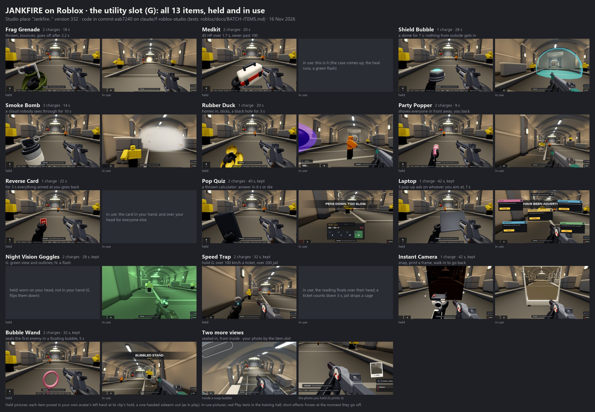

## What's in

| | |
| --- | --- |
| The slot | `Roster.SLOTS` = primary, secondary, melee, **utility**. The 13 web items are rows in `Roster.luau` (slot `utility`); the live ones show on the loadout screen with their own model, the rest as "coming soon" crates. |
| The numbers | `src/shared/Items.luau`: charges and recharge (the final values after the web game's gadget override), each item's numbers, the charge clock, the dome and smoke tests, and the thrown items' flight (the web `stepProjectile`, run the same on the server and every client). |
| The server | `src/server/Utility.luau`: owns everything. The item you carry and when a new pick goes in (at once while you're dead or in the first 5 s of a life, else next life; charges used stay used), the charges and their clock, every throw, bounce, fuse and blast, the heal, the domes and every hit they stop (through `Fight.blocks`, asked first by `Fight.hurt`), the clouds (`Fight.smokeBlocks`). |
| The loadout | `Loadout.luau` picks, saves (`pick.utility` in the same DataStore entry) and checks it like the weapons; `LoadoutUI` has a fourth card (key G), item cards show charges and recharge, items take no paint and no hat. |
| Your client | `src/client/Utility.client.luau`: G, the HUD plate above the ammo (name, one pip per charge, the next one filling as it recharges), the item in your own avatar's left hand while it's used, and everything the server says happens in the world. |
| Models | `tools/roblox/item_models.py` (headless Blender, on the guns' kit `gunkit.py`): every item's model (frag, smoke can, medkit case, shield puck, popper, card, duck, calculator, laptop, goggles, radar gun, cage, instant camera, the printed frame, bubble wand). `tools/roblox/item_import.luau` puts the upload in `ReplicatedStorage.JankfireItems`. |
| Sounds | `tools/roblox/render_items.mjs` renders the web recipes (boom, heal, reverse, pop, blow, and each later batch's own) to .wav; ids in `roblox/assets/sounds/items.json`. |

## Batch 1: Frag Grenade, Medkit, Shield Bubble, Smoke Bomb

The core kinds: thrown with a blast (frag), thrown with an area (smoke), used on yourself (medkit), placed (shield).

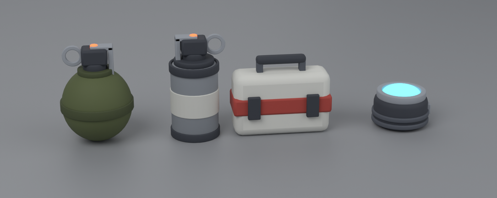

### Tested against the web numbers (solo Play test, training hall, 16 Nov 2026)

Measured from the server's own events in Play (the client recorded `ItemFx`, `Dmg` and `Knock`; the server's numbers
through `ServerStorage.JankTest` `"item"`). The target was the training hall's still Stand (root at y 243.19, so its
middle, feet + 0.9 m, at y 242.89). Distances in studs.

| what | web game | expected in Roblox | measured | |
| --- | --- | --- | --- | --- |
| frag fuse | 2.2 s | 2.2 s | thrown at 5.16 s, went off at 7.36 s: **2.20 s** | ok |
| frag damage on the Stand, 10.28 from the blast | 105 x (0.3 + 0.7 f), f = 1 - d / 7.5 m | f = 0.543: **71.4** | **71** (the hit event rounds) | ok |
| frag shove on the thrower, 1.90 below the middle | 34 x (0.4 + 0.6 f) + 6 f up, m/s | 102 x 0.949 + 18 x 0.915 = **113.3 studs/s** up | **113.3** up (0.4 sideways) | ok |
| frag damage on the thrower | 0 | 0 | no damage event | ok |
| frag charges | 2, 18 s each | 2, then 1 with the clock running | 2 -> 1; the next one due 9.65 s later, 8.4 s after the throw | ok |
| frag bounce corrections | (the web game sends none while it rolls) | only on real bounces | 4 in a throw straight down (was 16 while rolling, fixed) | ok |
| medkit | +45 at 26 HP/s, never past 100 | 40 -> 85 | **40 -> 85** after 2 s | ok |
| medkit charges | 2, 20 s each | | 2 -> 1, the next one due 12.1 s later, 7.9 s after | ok |
| shield dome | 4.4 m radius, 1 m over your feet, 7 s | 13.2 studs, 3 over the feet, 7 s | r **13.2**, centre at y 243.2 for feet at 240.2, gone after **7.02 s** | ok |
| shield blocks a hit from outside | dropped (no damage, no shove) | | a Redline shot at the Stand (inside) from 18 studs to the side (outside): **dropped**, the blocked flash, no damage event | ok |
| a hit from inside the same dome | lands | | the same shot from inside the dome: **10** damage | ok |
| smoke fuse and cloud | fuse 1.3 s, a 6.5 m cloud for 10 s | 19.5 studs, 10 s | thrown at 0.06 s, cloud at 1.36 s: **1.30 s**; cloud r **19.5**, **10 s** | ok |
| smoke blocks sight (server) | a sight line passing within 6.5 m of the middle is blocked | 19.5 studs | a line through the middle: **blocked**; passing 19.43 off: **blocked**; 20.02 off: clear; 30.1 off: clear | ok |
| smoke looks thick enough to hide a player | | | first photo: the far door showed through it, so the puffs were doubled, made bigger and fully solid; now the far end of the hall is gone behind it (photo below) | ok |
| the loadout screen | four slots | a fourth card, G | four cards, the utility card on G ("2 charges · 18 s each"), "7 live · 6 coming soon", the item's stats, "ON G", "items don't take paint" (photo below) | ok |

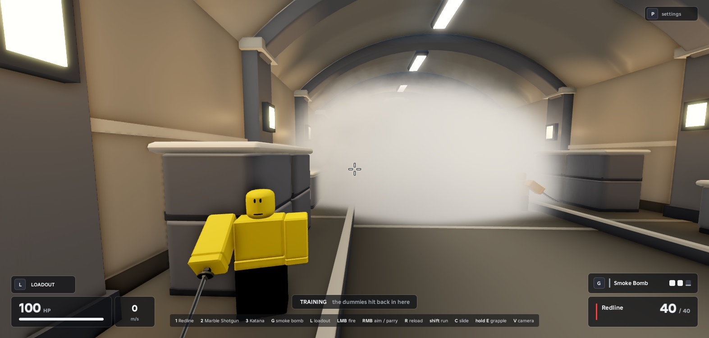

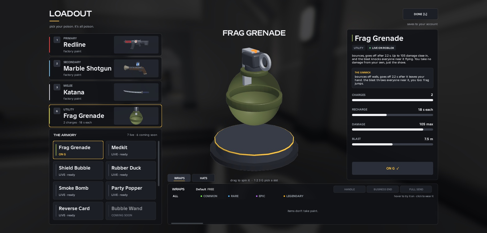

(The Studio place was closed from 09:39 to 09:57 UTC: an account moderation warning about another session's uploaded
image, not these items. The place reopened with Studio's recovered state, which held this batch; the rest went in at
10:05 and was saved as place version 302.)

### Where the web server trusts the client, and what this port does instead

The web server takes the client's throw point within 4 m of its eye and the client's look. Here the throw point must
also be in clear sight of the server's own eye position (no throwing from the far side of a wall), the look must be a
real direction, and the velocity a throw inherits (35 % of yours) is held to 1.25 x the speed the server saw you move,
so a faked velocity can't fling a grenade across the map. Item use is refused in the hub (weapons-free) as well as when
dead, out of charges, too soon (0.4 s) or not your item; every refusal sends the real count back so the HUD can't
drift. Blast hits, heals and blocks are never reported by a client.

### Kept as the web game has it (on purpose)

- The frag's blast goes through walls (web `explodeAt` has no wall check), and the thrower takes the full shove but no damage.
- Thrown items slide along floors with no friction (web `stepProjectile`).
- The medkit keeps draining while you're at full health (it doesn't eat overheal).
- A dome protects everyone inside it from anyone outside, enemies included.

### Not yet

- The Plinker (the training hall's bot) should not see through smoke (web bots can't). `Fight.smokeBlocks` is there;
  the one line in `Dummies.luau` waits for the training session, which has that file open.
- Third person shows no throw pose on other players (the web game doesn't either); the item just leaves their hand.
- The other 9 items: Rubber Duck, Party Popper, Reverse Card (batch 2), then the gadgets (batch 3).

## Batch 2: Rubber Duck, Party Popper, Reverse Card (live since place version 311)

| what | web game | expected in Roblox | measured | |
| --- | --- | --- | --- | --- |
| popper shove on the Stand, 8 studs ahead | 50 m/s along you -> them + 12 up, no damage | (0, 45.2, -149.7) studs/s | **(0, 43.7, -135.1)** at its first physics step (one frame of gravity, and the floor's grip on a standing dummy) | ok |
| popper kick on you | 17 m/s back along your look + 5 up | (0, 15, 51) | **(0, 13.7, 50.8)** (one frame of gravity and friction) | ok |
| reverse card | for 3 s every hit on you goes back (1.8 s since 18 Nov: the nerf below) | | the Plinker's burst while the card was up: the **Plinker** took the 7, credited to you, "reflect" fx; its bursts after the 3 s hit you again (13, 7) | ok |
| duck flight | homes on the nearest enemy ahead | | thrown at 0.05 s, homing on the Stand at once, stuck at **0.25 s** | ok |
| duck hole | opens 0.3 s after sticking, 3 s, then pops | pops 3.55 s after the throw | opened on the Stand (age -0.30), popped at **3.55 s** | ok |
| duck end blast | 45 x f (f = 1 in the middle) | 45 on the Stand it's stuck to | **45** | ok |
| duck crush | 1 every 0.1 s on the one it's stuck to | 30 or 31 in 3 s (a pulse as it opens, then every 0.1 s) | first **26**: the pulse clock lost a tick in six to rounding (every 0.117 s). Fixed (the clock adds 0.1 instead of restarting): **31**, then 45 at the pop | ok |
| the thrower in their own hole | pulled, not hurt (web rule) | | 27 pulls toward it, no damage | ok |

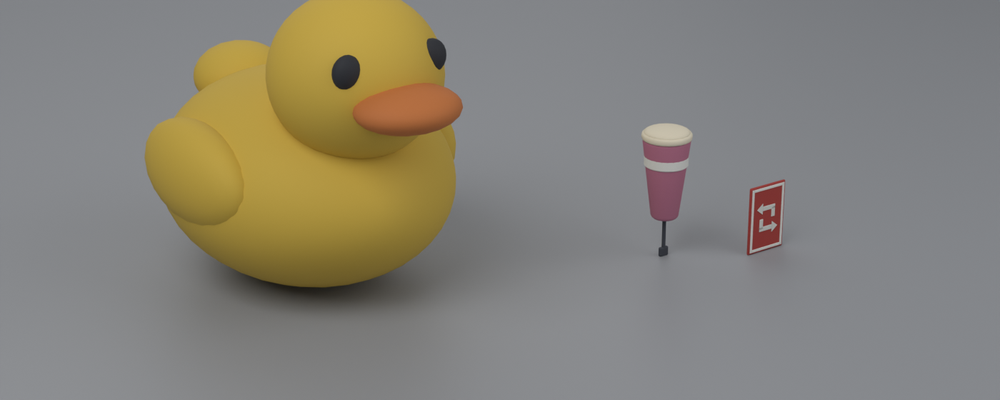

- **Party Popper.** The web client picks who is in its cone and the server re-checks with a wide slack; here the
  server picks them itself at the pop (`popperUse`): the cone from your eye along your look (0.6 rad, any angle within
  1.5 m), 9 m plus a speed allowance, against where each target is and was a moment ago (lag), in clear sight. Each gets
  50 m/s along you -> them (feet to feet) + 12 up, no damage, and is tagged (a fall is yours). Your own kick back
  (17 m/s back along your look + 5 up) is your client's, like the web game.
- **Reverse Card.** 3 s (cut to **1.8 s** on 18 Nov, the owner's nerf); `Fight.hurt` asks `Fight.reflects` after the dome check and swaps attacker and victim (the
  shove mirrored in x and z), so every hit that goes through `hurt` comes back: bullets, swings, blasts with a
  thrower, popper shoves, the duck's end blast. Ends on death.
- **Rubber Duck.** Homes (25 m, 60 degree cone, 3 rad/s, in sight, faster than 4 m/s), sticks to whoever it touches;
  the hole opens on them 0.3 s later and rides their middle; every 0.1 s it pulls everyone within 15 m (as `Knock`,
  not reflected: web rule), crushes the one it's on (1) and hurts anyone within 2 m (3), straight to HP (`Fight.hurt`'s
  new `plain`, like the web `damage()`); after 3 s it pops (9 m, 45 x f, the thrower: shove only). The momentum eater
  runs in your own movement step (`Body.onStep`, called by `Move.client.luau`); a rope within 6 m of the middle snaps.

## Batch 3a: Pop Quiz, Laptop, Night Vision Goggles (all live since place version 320)

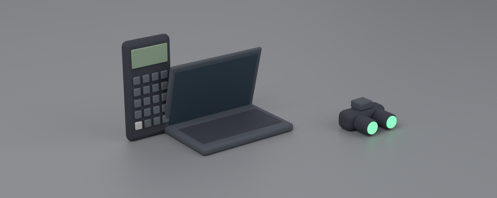

| what | web game | measured | |
| --- | --- | --- | --- |
| the calculator | thrown like a frag (30 m/s + 2 up + 0.3 x your speed), hits the first enemy it touches | thrown at 0.05 s, hit the Stand at 0.22 s | ok |
| a reverse card sends the exam back | the thrower sits it | the Stand held a card (test hook `"rev"`): the quiz came to me ("reflect", then "quiz" on me) | ok |
| the exam | a question, four answers, 6 s; the right one never leaves the server until it's over | "84 − 74", answers 9 / 1 / 17 / 10 on keys 1-4, the clock running down; the right one (10) shown green only at the end | ok |
| slow | dead, the thrower's kill | 6.38 s after it started: "PENS DOWN. TOO SLOW.", dead, the feed "Stand · Pop Quiz" (the card holder threw it back) | ok |
| right | a gold star: +25 HP up to 125, nothing hurts you for 2.5 s, x1.25 run speed for 4 s | answered "24 + 38" right after 0.9 s: HP **100 -> 125**, the speed boost on for 4 s | ok |
| no weapons while sitting it | | the server's own stagger clock runs to the end of the exam (no shots, swings or guards); keys 1-4 answer and don't switch weapons | ok |

| laptop target | the enemy nearest your aim within 45 m and 0.3 rad, in sight | the Stand (a card held, so the ads came home: "reflect", then "ads" on me) | ok |
| the ads | 5 pop-ups for 7 s, 2 "ARE YOU SURE?" can come back; keys 1-5 close them | 5 windows, each with its key, the tip line counting them; keys 1-5 held off the weapons while they're up; all gone after 7 s | ok |
| closing one with its key | the number on an ad closes it; sometimes an "ARE YOU SURE?" comes back in its place | key 3 closed ad 3 in **0.18 s** and an "ARE YOU SURE?" opened on 3 at 0.28 s; key 5 closed ad 5 in 0.17 s; key 1 pressed before ad 1 opened did nothing (keys sent while the ads were up, read off the screen every 0.03 s) | ok |
| laptop charges | 1, 42 s, kept across deaths | 1 -> 0 | ok |
| goggles on | free, G | the green view, an outline on everyone in sight (30 here: Roblox draws at most 31, the nearest), the HUD "Goggles · on" | ok |
| goggles flash | lerp(0.6, 3.2 s, k) x 2 in goggles x (1 - 0.3 d / 34 m), k = how straight they look at you | sent back by the Stand's card onto me, looking straight at it, in goggles, 18 studs: 3.2 x 2 x 0.947 = **6.06 s**; measured **6.06 s**, the screen fully white | ok |
| flash charges | 2, 28 s, kept | 2 -> 1 | ok |

How straight someone looks at you is judged from their body's facing (the server doesn't get the camera's pitch).

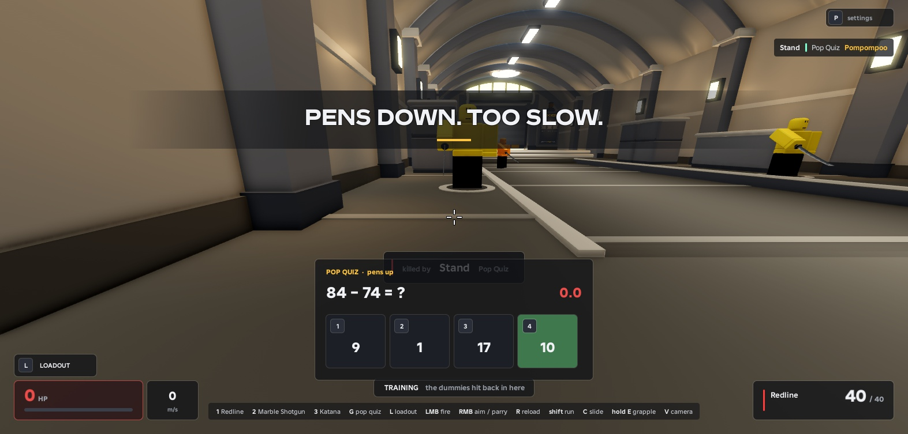

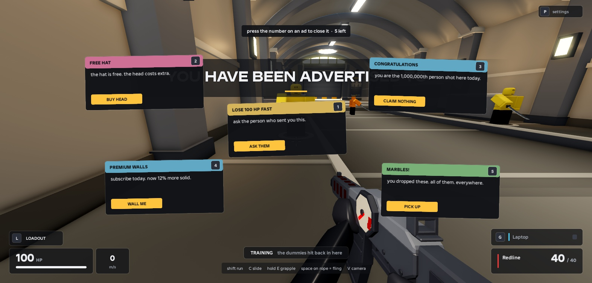

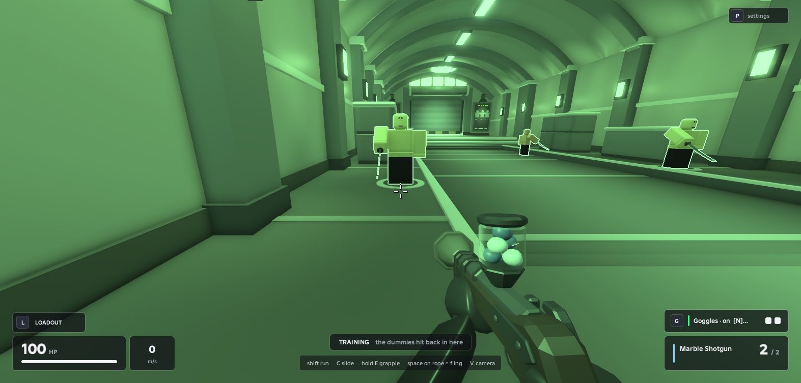

## Batch 3b: Speed Trap (live since place version 323), Instant Camera, Bubble Wand (live since place version 330)

The Speed Trap reads speed from the server's own record of where you've been (`Fight.trail`, 30 a second), never
from the client. In the test the Stand was driven back and forth along the hall at a set speed by a server loop.

| what | web game | measured | |
| --- | --- | --- | --- |
| holding G | free; the radar gun comes up, a reading every 0.15 s on whoever is under the crosshair | the gun up in the left hand, its readout on its back; readings 0.15-0.17 s apart | ok |
| the reading | path length over the last 0.5 s, km/h of metres (studs/s x 1.2) | the Stand at 120 studs/s (144 km/h): **125-144** (the lower ones span a turnaround) | ok |
| over 100 | a ticket (one charge): 3 s to get back under | a ticket at 135 km/h, charges 2 -> 1 | ok |
| still over at the end | jailed | 3.00 s later: "out of time", jailed for **3.52 s** (3.5) | ok |
| over 200 at once | jailed on the spot, no ticket first | the Stand driven at 190 studs/s (228 km/h): first full reading **215 km/h**, jailed in the same message, no ticket; charges 2 -> 1; the cage drawn | ok |

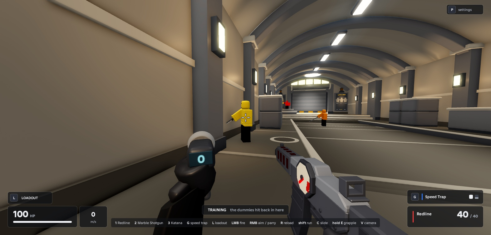

### Instant Camera

Nobody uploads a picture: the server says where a photo was taken (the spot under you, which way you looked) and every
client builds that view itself, a ViewportFrame of the map's parts round the spot (the nearest 700 in front of it within
200 studs). The photo shows on a print by your item slot while you hold it, on the print as it comes out of the
camera, and in the frame. Tested in the training hall: the photo taken looking down the hall, the frame printed 8 m
further along, then walked into.

| what | web game | measured | |
| --- | --- | --- | --- |
| the snap | free; needs a floor within 3 m under you | G: the camera comes up to your eye, the shutter, a white flash; "PHOTO TAKEN · G TO PRINT IT"; the print by the item slot shows the hall (551 map parts); charges stayed **1** | ok |
| the print | spends the charge; a frame 1.9 m in front of you on the floor, facing you, for 20 s | charges **1 -> 0**; the camera turned round, the print sliding out toward you developing from brown; the frame at **5.7 studs** (1.9 m) ahead on the floor, its picture developed in 1.6 s | ok |
| walking in | out where the photo was taken, facing its way, each person once every 1.6 s | **0.35 s** after stepping in: on the photo spot (x 2, z -8159 against -8158), facing the photo's way (yaw 0) | ok |
| telefrag | whoever stands within 0.9 m (flat) and 1.6 m (up) of the spot: 999 | the Stand moved onto the spot: dead, thrown up | ok |
| the frame's life | 20 s | gone 20 s after printing ("framex: time") | ok |
| crossing at speed | a fast mover is caught crossing the opening between two ticks | stood 4 studs in front of the frame, then moved 8 studs straight through it in one step (never inside the opening on any tick): sent through **0.016 s** later (the next tick), onto the photo spot facing its way | ok |

### Bubble Wand

The soap bubbles fly on one formula (`Items.soapAt`, the web game's shared/wand.js) on the server, which does the hits,
and on every client, which draws them: nothing about their path is synced.

| what | web game | measured | |
| --- | --- | --- | --- |
| a blow | 4 bubbles 0.09 s apart, 11 m/s (+-15%) slowing to a 1 m/s drift, 4 s each | bubbles at **0.06 / 0.16 / 0.25 s**; the 4th wasn't blown because the blower was already sealed in (as on the web) | ok |
| sealed in | the first enemy one touches: 5 s, floating 2 m/s up and 1.5 m/s along | the Stand sealed and floated up into the ceiling; me (below) up **6.5 studs in 1.2 s** | ok |
| reverse card | the blower goes in instead | the Dummy held a card (test hook `"rev"`): "reflect", and I was sealed in **0.31 s** after blowing | ok |
| how long | 5 s, then it pops and drops them | popped ("time") **5.00 s** after sealing; back on the floor | ok |
| inside | no moving, no shooting, no items, the world through the film | the film over the view with its rim, "IN A BUBBLE · pops in 1.4s"; the float is the client's own (held within lag slack of the path by the server) | ok |
| charges | 2, 32 s each, kept | 2 -> 1 | ok |
| a hit pops it | the first hit (a friend's too) only pops it, no damage | the Stand sealed in, then two 10-damage hits through `Fight.hurt` (test hook `"hurt"`): after the first **100 HP** and "trapx: hit" popped by me; after the second **90 HP** | ok |

Choices of mine: a bubble isn't put on anyone sitting a pop quiz or in a speed-trap cage (both already hold them in
place); dummies don't use frames (the web game's training dummies don't either).

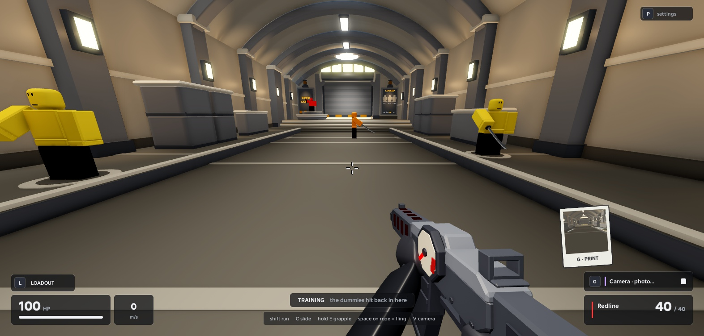

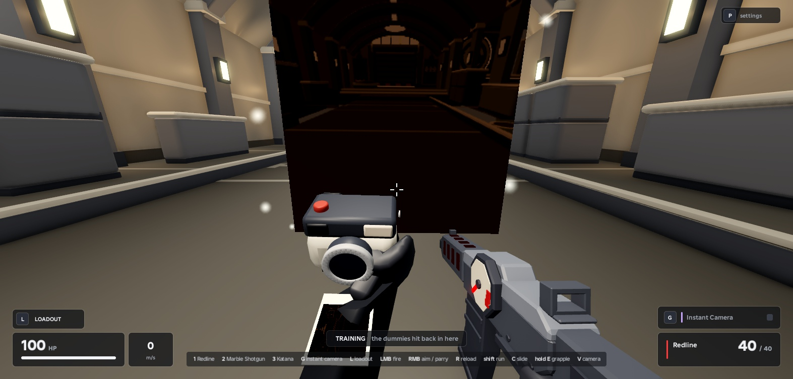

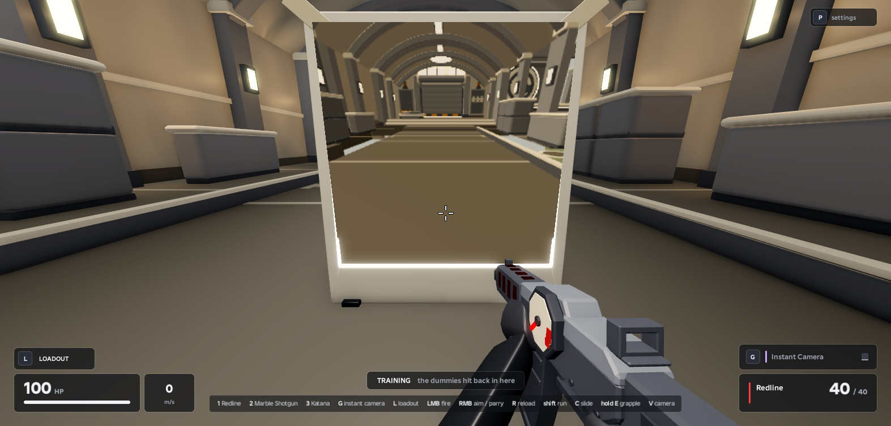

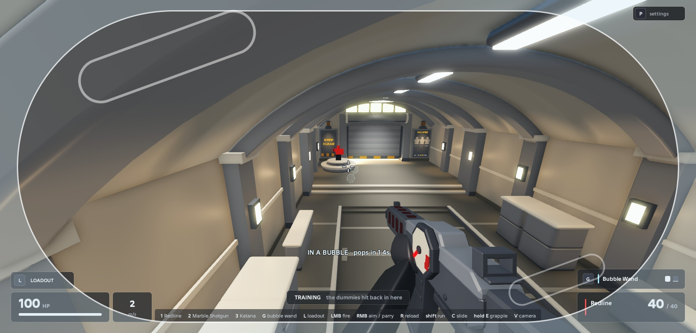

### Sounds

Every item sound is approved on Roblox (Open Cloud: moderation "Approved", state "Active"), and in a Play test all 20
load (`ContentProvider:PreloadAsync`, each with its length) and the batch 2 ones (popper, squeak, quack, hole,
ropesnap) play.

Nothing here needs a second player to check: the dummies and the test hook (`"rev"` for a reverse card, `"hurt"` for a
hit) stand in for one.

### The calculator faces you, the laptop opens (owner's asks, place version 362)

- The Pop Quiz calculator is held turned round about your fist, so its screen and keys face you. Over someone sitting
  a quiz it faces them; everyone else sees its back, which now shows the question on its own LCD panel too (the sign
  over their head still shows it as well).
- The laptop is held facing you by its left edge. Its lid (with the screen) swings up from shut about the hinge at the
  deck's back edge, 0.06 to 0.4 s, 4 degrees past open and back (measured in Play: 69 degrees shut, open at 0.2 s, -4
  at 0.3 s, settled at 0.4 s), with a click; the screen lights at 0.3 s (a white blink, then pale blue, with a soft light
  on the keys and your hand); then it goes out toward them and is held while it "loads". The ads go out on the press,
  as before: the animation doesn't hold them up.

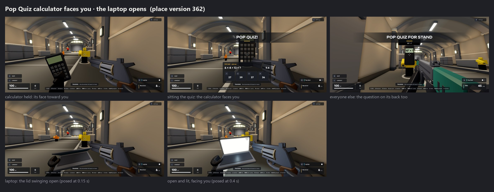

### Solid models, livelier hands (owner's asks, place version 371)

- **The see-through frag.** Every round piece the item builder makes (`egg()` in `tools/roblox/item_models.py`) came out
  inside-out: making the ball swaps two axes, which mirrors it, and Roblox draws only the front of a face, so you saw its
  inside and the hand behind it. That was the frag's body, the shield puck's lens, the duck's body, eyes and beak and the
  popper's cap. `egg()` now turns the faces out (normals brought up to date first: `recalc_face_normals` goes by the stored
  ones). A check over every piece of all 15 models, one connected part at a time, finds none inside-out and no open
  edges. The four were re-exported and re-imported (asset 126223521855944).
- **Livelier hands.** The hand's path now runs smoothly through its keys (cubic, by time) instead of easing to a stop at
  every key. Every item comes up on a quick arc past its hold and settles. Throws (frag, smoke, duck, calculator) wind up
  by your shoulder, snap forward and follow through forward and down, with a small lean of your view; the item still
  leaves your hand 0.1 s after the press, as before (a real throw traced in Play: up by 0.05 s, back at 0.07, out of the
  hand at 0.1, down by 0.3). The medkit twists open and is pulled in to your chest; the reverse card flicks up spinning
  and is thrust out; the shield puck is lifted and slammed down; the popper kicks your view; the camera's shutter kicks;
  the wand wiggles while it blows; the goggles get a hand that pulls them down over your eyes (and pushes them back up).

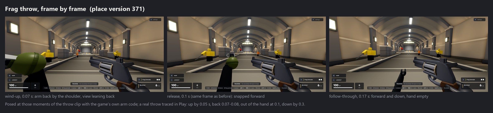

### The Rubber Duck with real throws (place version 456, the VFX session's black hole v2 in)

| what | web game | measured | |
| --- | --- | --- | --- |
| sticks | the first enemy it touches, homing on the nearest one ahead in plain view | thrown at a Stand 16 studs off: stuck **0.25 s** after the throw; thrown down the hall it homed on the walking Dummy and stuck to it | ok |
| opens on them, follows them | 0.3 s after sticking, riding their middle | the Stand walked 12 studs sideways while it was open: every position update had the hole on it (12.9, 8.8, 4.7, 3.2); on the walking Dummy it rode back and forth across the hall | ok |
| pops on time | 3 s after it opens | **3.31 s** and **3.28 s** after sticking (0.3 + 3) | ok |
| damage | 1 a pulse to the one it's on (30 in 3 s), 45 at the pop | the Stand it was on: 100 -> **24 / 25** | ok |
| pull on a dummy | everyone within 15 m dragged in | **was broken for dummies**: the server pushed their bodies, and a standing Humanoid's grip on the floor cancelled it. Now the server runs a dummy's pull itself (the same pulses into a velocity the hole's drag eats, moved step by step, stopped by walls, at most 20 m/s). The second Stand, 33 studs off: dragged right onto the hole in about 1 s, crushed and blasted (100 -> 72) | fixed |
| on the floor | opens where it is when the 1 s fuse runs out | thrown down the hall: opened at 1.02 s, popped 3.02 s later | ok |
| a player joining while a hole is open | the hole drawn as it is, no second opening | needs a second player: open, for the owner to try | open |

### The camera's print "not working" (owner's report, place version 467)

The owner: "when you take a picture with camera, it doesn't let you place it". Reproduced with real key presses
(G, G) in Play, first and third person: both steps work and nothing else takes G. What they hit is the charge. The
camera has one, 42 s to come back. The first print spends it; the next snap is free, so G seems to work, and then the
HUD invited a print it couldn't do yet: the card by your item said "G · PRINT", the plate "Camera · print", while G
only gave a small "instant camera: recharging" under the crosshair. Also, a second G within 0.42 s of the snap was
dropped without a word.

Fixed (the web's rules unchanged: the snap is free, the print spends the charge):
- While the print waits for the charge, the card says **G · PRINT IN 25 S** (counting down), the plate **Camera · 25s**,
  and the snap's note **PHOTO TAKEN · PRINT READY IN 25 S**.
- G then says **PRINT READY IN 26 S** in the big line.
- A G pressed right after the snap waits its moment and prints (0.26 s apart: printed at 0.56 s).

Real-key runs: training (snap, quick second G, walked into the frame, sent back to the photo spot); the playground
(printed a photo taken in training, walked in, landed on the photo spot in training, 1.1 s after the print). The
printing itself is never refused for the ground: a wall pulls the frame back, no floor leaves it at your feet' height
(as in the web game).

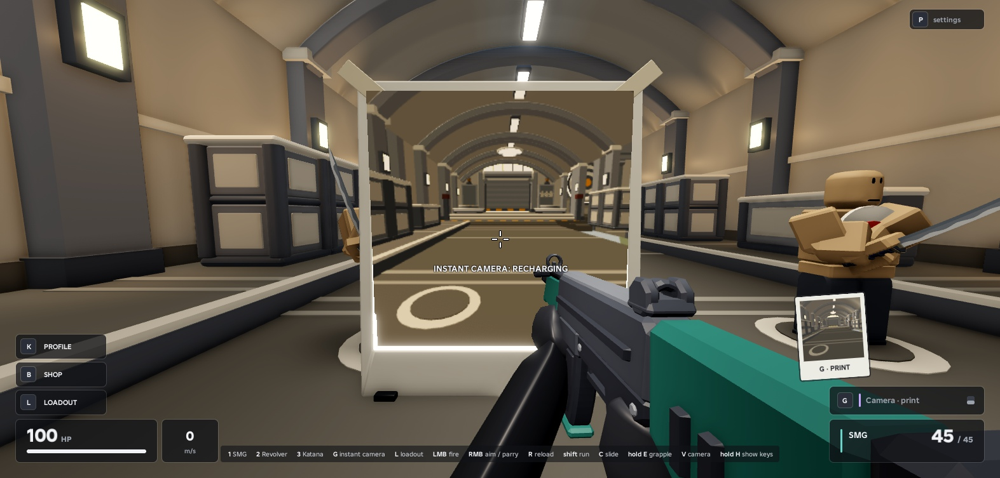

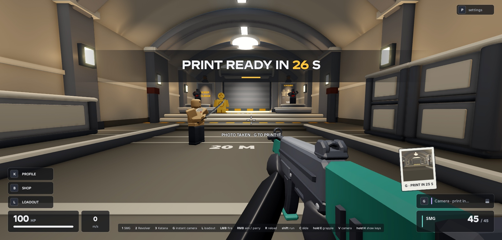

### Free items in training (owner's ask, place version 682)

The owner: "training room should also have no cooldown on stuff since its for training". In the training hall, its
back lot and basement, and the playground, every item is free: all its charges all the time, nothing starts a clock.
Everywhere else nothing changed.

- **Who decides:** the server, from its own zone (`Zones.luau`: `Zones.training(p)` asks `Matches.zoneOf`, the same
  answer the `Zone` attribute is made from). The shop session's try-anything-in-training layer (Loadout) uses the same
  helper, so a new training room is one line in `Zones.TRAINING`.
- **What the client sees:** player attribute `ItemFree` (true in training). The plate's pips stay full and the
  client's own "one gone" guess is skipped.
- **The one gap left:** 0.2 s between two uses (0.22 s on the client; 0.4 s elsewhere), so a held G can't flood the
  room. The room caps (40 thrown items, 24 domes, 30 clouds, 12 holes) still hold.
- **Dummies you practise on** get none of their "safe" seconds from you: a new quiz, laptop ads, a speed trap ticket or
  cage, or a soap bubble can land on the same dummy straight away. The speed trap's 0.9 s gap between your tickets is
  gone in training too.
- **Kept on purpose:** the goggles' on/off debounce, the photo frame's 1.6 s before it can send the same person again,
  the slide's and the parry's cooldowns, reloads and magazines. The grapple is already free outside ranked.
- **Anti-cheat:** no exception needed. It doesn't rate-limit the item remote (an item use only gives a short movement
  grace); Utility's own message budget (20, +8 a second) leaves room for 5 uses a second.

Play test (real G presses, solo): in training, Rubber Duck 4 presses 0.3 s apart = 4 ducks (it holds 1, 20 s to come
back), Shield Bubble 3 presses = 3 domes (holds 1, 28 s), Frag 5 presses 0.25 s apart = 5 frags (holds 2); `ItemN`
stayed full, `ItemAt` 0, the plate's pips full. Back in the hub `ItemFree` was gone. In a one-player match: Frag 4
presses 0.55 s apart = 2 frags, then `ItemN` 0, the 18 s clock running and the plate filling from empty: as before.

### Cooking grenades, and a shorter Reverse Card (owner's asks, place version 756)

The owner: "allow us to cook grenades pls". The frag and the smoke bomb cook; the Rubber Duck (it homes and sticks) and
the Pop Quiz's calculator (it hits) stay as they were.

- **Hold G** (your item key: Binds "item", so a pad's LB and the phone's item button too) to pull the pin; **let go** to
  throw. The server notes when the pin came out (its own clock) and throws with what is left of the fuse: the first
  0.2 s are free, so a tap throws with the whole fuse as before (`Items.COOK`: grace 0.2, min 0.05).
- **Too long:** past 0.2 + the fuse (2.4 s for the frag, 1.5 s for the smoke bomb) it goes off in your hand. The frag's
  blast hurts you like anyone (`explode(..., held)`): your own kill, nobody's credit. The smoke bomb just smokes.
- **Killed with the pin out:** it drops where you fell with what is left of its fuse, still yours. Carried into the hub,
  it's gone.
- **On screen:** a ring of 28 ticks round the crosshair drains clockwise from the top over the whole fuse, warm in the
  last second (no text). Your hand pulls the pin (it and its ring disappear), holds it up by your shoulder with the lamp
  blinking faster, and snaps it forward on release. Thrown grenades fly without their pin now.
- **Others:** hear the pin where you stand and see your left hand up at the top of the throw's wind-up with the
  grenade, pin out (`ThirdPerson` item kind "cook", from ItemFx "cook" / "cookx").
- **Sounds:** `pin` as you press, `fuse_tick` four times in the last second: recordings from the sound session.
- Same charges and cooldowns everywhere (the charge is spent at the pin pull); free in training like everything else.

Play test, real G presses (solo, training):

| check | expected | result | |
| --- | --- | --- | --- |
| cooked throw, airburst | blows in the air | held 1.87 s: thrown with **0.53 s** left, burst **5.3 studs over the floor**, no bounce | ok |
| cooked throw (first try) | fuse = 2.2 - (held - 0.2) | held 1.26 s: thrown with 1.14 s, went off 1.15 s later | ok |
| tap | whole fuse | thrown with **2.2 s** | ok |
| held 3 s | goes off in hand at 2.4 s | "cookx" boom at **2.40 s**, 102 damage from yourself, dead, kills still 0 | ok |
| let go on the last frame | thrown with the minimum | let go ~17 ms before the end: thrown with **0.05 s**, burst 4.7 studs ahead; no damage to you (your own frag only shoves you, as always) | ok |

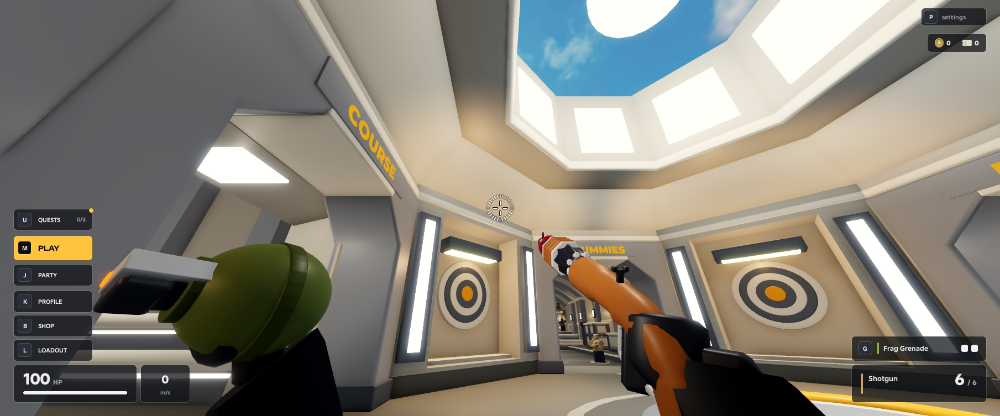

**Reverse Card** ("can you nerf duration of reverse card"): **3 s -> 1.8 s** (40% off), charges 1 and recharge 22 s
kept. Play: the card's broadcast says 1.8 s and the server's clock ran out on time.

## Second models (owner, 18 Nov 2026: "Gadgets need better models")

`tools/roblox/item_models2.py` rebuilds the gadgets on the same contract as `item_models.py`. That file is kept as the
"before" and stays one switch away.

**What stays the same:**
- each item's size class (within a few mm), its grip and gripRot, and its pivot (the middle);
- the node names the game reads:
  - frag and smoke: `lamp`, and the `pin` / `ring` pair, hidden once the pin is out;
  - calc: `screen` and `body`;
  - radar: `screen`;
  - camera: `flash`;
  - laptop: `body` / `lid` / `screen`, with the hinge on the deck's back edge.
- None of the gadgets carries hat seats.

**The pipeline:**
- before/after cells: `tools/roblox/item_sheet.py`;
- the sheet: `tools/roblox/item_sheet_tile.py`;
- the upload: `item_models2.py -- <dir> <ids> --name=items_v2a.glb`;
- the install: `item_import.luau`.

The install first copies the model each one replaces into `ServerStorage.PolishBackup.ItemSets.v1`. To go back, copy
those models into `ReplicatedStorage.JankfireItems`.

**Batch 1** (place version 802, asset 130837559389880, `roblox/assets/items/items_v2a.json`):
- **frag:** an egg cut into 8 x 3 chunky blocks, a spoon hugging the body, a big round pull ring;
- **smoke can:** a ring of vents on the shoulder cap, four low side vents, the spoon down the side;
- **medkit:** a hard case in two halves with a dark seam, a red panel front and back (no cross), latches, feet and a
  handle;
- **shield bubble:** a glowing dome under two crossing steel arcs, cyan slots round the side;
- **duck:** one body sweeping up into a tail, a two-part beak, eye glints;
- **popper:** a fluted cone, a crimped paper cap, a pull loop.

The solo Play in training checked the cooking pose (frag, smoke), the frag and duck in flight, and the bubble and
medkit in hand. The console showed no errors from the items.

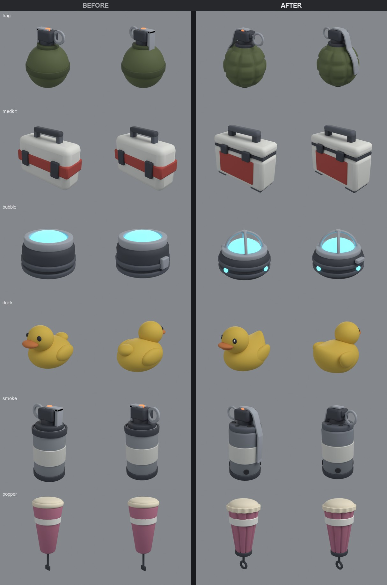
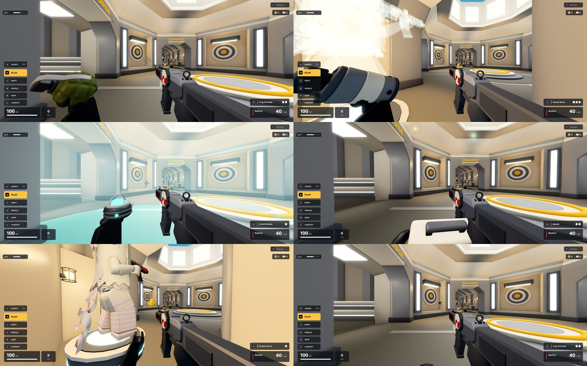

## Medkit v3, wrappable gadgets, gadget skins (owner, 18 Nov 2026: "Compare medkit to rivals! Gadgets should have skins and be wrappable")

Place version 815. The Rivals comparison and the plan are in the notes folder (`gadget-quality-skins-plan.md`). In
short, Rivals gives every utility 2 to 7 skins (whole other objects, each with its own sound and animation) and
per-utility wraps.

**Medkit v3** (`item_models2.medkit`; v2 kept as `medkit_v2`):
- a chunky red hard case with a thick rubber bumper and steel latches;
- pale raised plus signs on both faces (pale on red: no Red Cross emblem);
- a fat arched handle;
- a lid with a tray under it (bandage roll, bottle, gauze).
- While you heal, every `lid*` part swings up and away from you about the lid's front bottom edge (`X.medkitIn` /
  `X.medkitStep` in Utility.client).
- The batch 2 gadgets went in at the same time, with a thicker card and a chunkier wand.

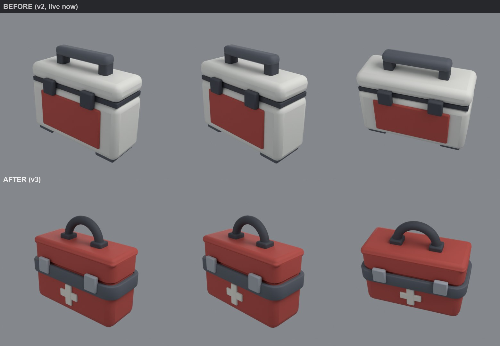
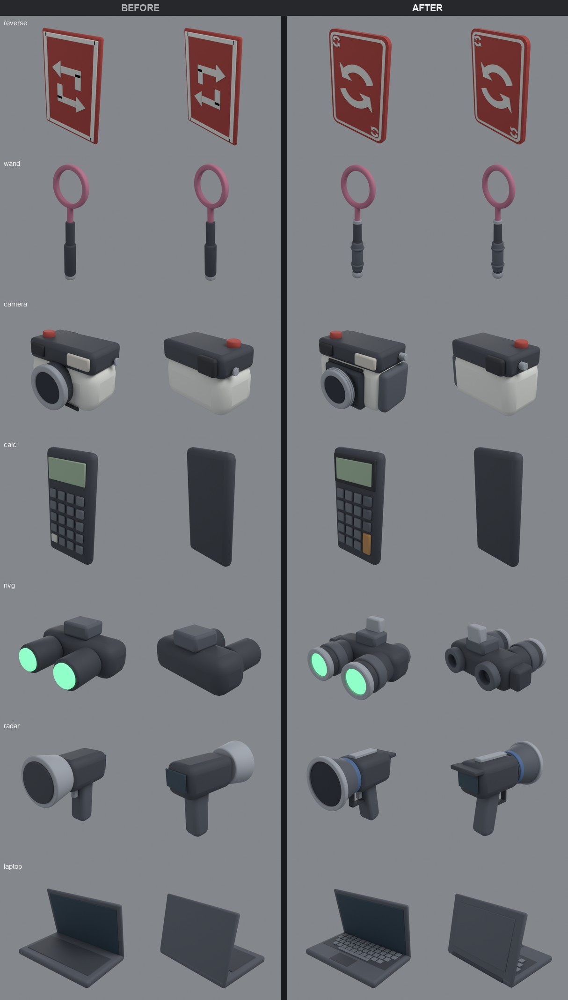

**Wraps on gadgets.**
- All 13 have unfolded UVs (`gun_uvs.unwrap` at `UV_SCALE` 1.4). Round bodies are wrapped round their upright axis
  (`ROUND_UV`).
- `item_models2.WRAP` lists each gadget's zone a (shell) and zone b (secondary) pieces. The import sets `WrapUV` and
  `WrapZone` on those pieces. Lamps, lenses, screens, glass, the pin and its ring keep their own colour.
- The held model, the thrown one, the card over a head, the duck on its hole and goggles on a head all wear the
  owner's wrap through `WeaponModels.wrap(m, WeaponModels.wrapFor(owner, gadgetId))`. The third-person rig does too.
- The `Wraps` attribute keys them by the gadget's id (`medkit=galaxy/normal`).
- A picture renders as the part's plain colour until the client has fetched it. The game preloads the wraps a player
  wears.

**Gadget skins.**
- `tools/roblox/item_skins.py` builds 8 skins on the same contract (frame, size class, grip, `lamp` / `pin` / `ring`,
  `lid*`):

  | gadget | rare | legendary |
  |---|---|---|
  | frag | Powder Keg | Paper Lantern |
  | medkit | Doctor's Bag | Bento Box |
  | smoke bomb | Camp Coffee Pot | Incense Burner (its holes are the lamp) |
  | duck | Decoy Duck | Origami Duck |

- `tools/roblox/item_skin_import.luau` puts them in `ReplicatedStorage.JankfireSkins` as `<gadget>_<skin>`, with
  `Weapon` = the gadget id and `Item` = true (asset 98860977994294, `roblox/assets/items/skins_v1.json`).
- `GunSkins.template` finds them. The held, thrown and third-person models wear the skin the `Skins` attribute picks
  (`smoke=smoke_censer`).

**Picking, winning and buying** (place version 823, the shop session's commit 676b161, with my LootTable hunks ccce051):
- The loadout's wrap and skin pickers open on the utility slot, and the server Loadout takes gadget wraps and skins
  (hats stay guns-only).
- `LootTable.weapons("wrap")` includes the live gadgets, so a wrap is owned per gadget ("galaxy@frag") and spray cans
  can give one.
- `Shared.ItemSkins` rows merge into `LootTable.SKINS`: crates roll gadget skins and the shop rotation can offer them.
  `LOOT_FREE` applies as for everything else.
- The shop session's previews (`GunPreview.itemModel(id, skin)`) draw them in LoadoutUI, the match picker and the shop
  cards.

**Tested** in one solo Play in training, with the attributes set by hand:
- the medkit with Galaxy in hand;
- the frag with Camo (full) while cooking;
- the Incense Burner skin while cooking, its holes lit.
- The medkit lid first swung toward the camera, so its hinge moved to the front edge. Seen in a second Play
  (05:29 UTC): the lid swings away and you look into the tray.
- In that Play the Bento Box skin and a wrap were picked for the medkit through the real loadout remote (training's
  try layer: nothing saved), and the bento's own lid opened over its food.

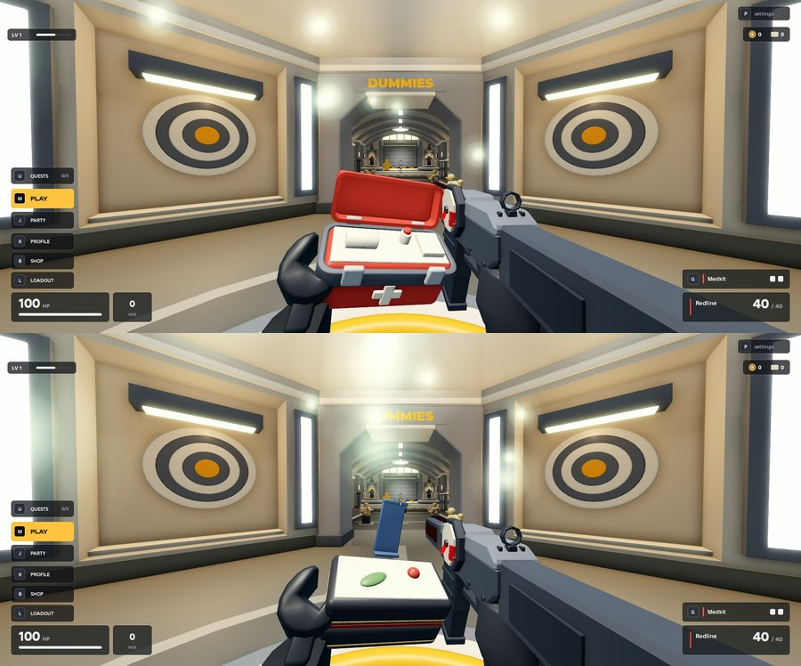

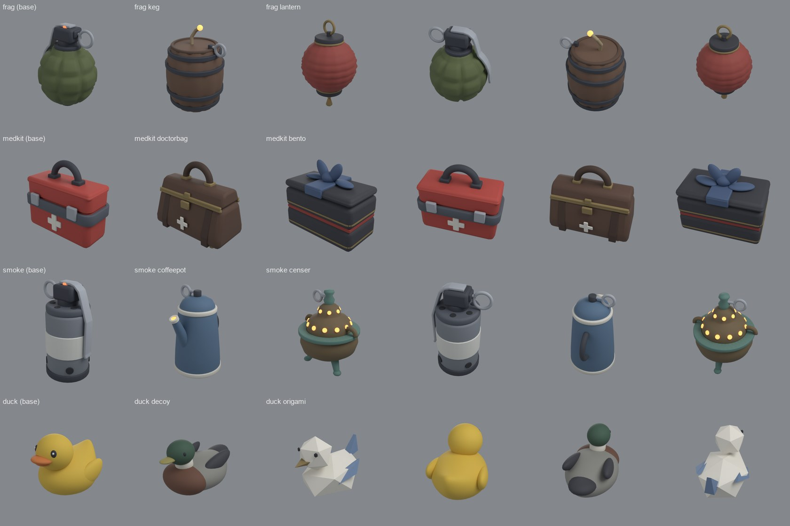
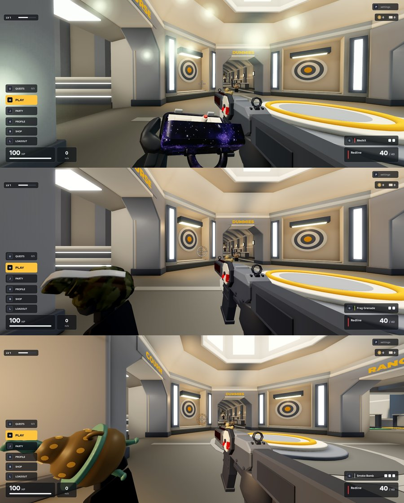
