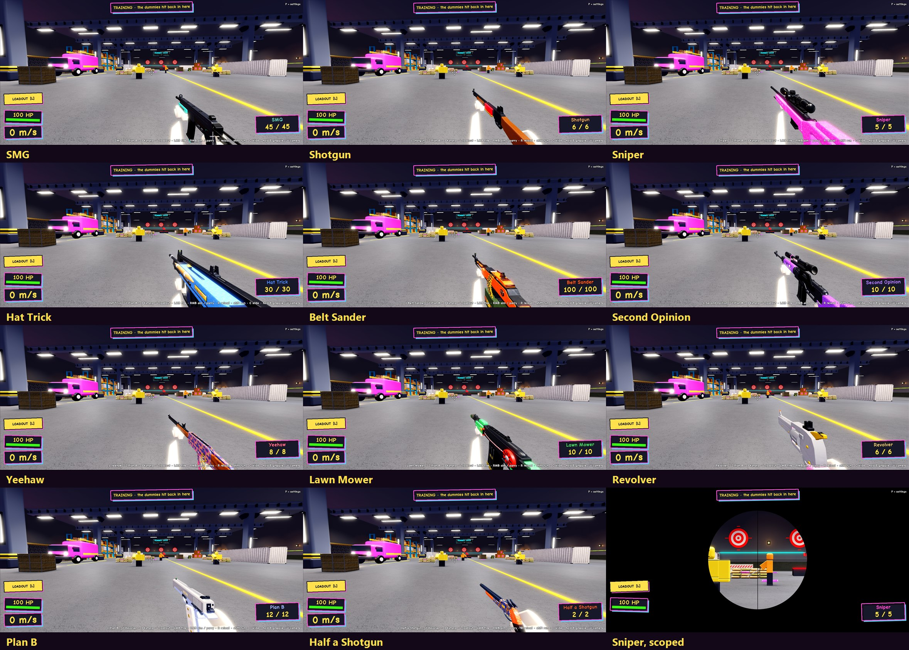
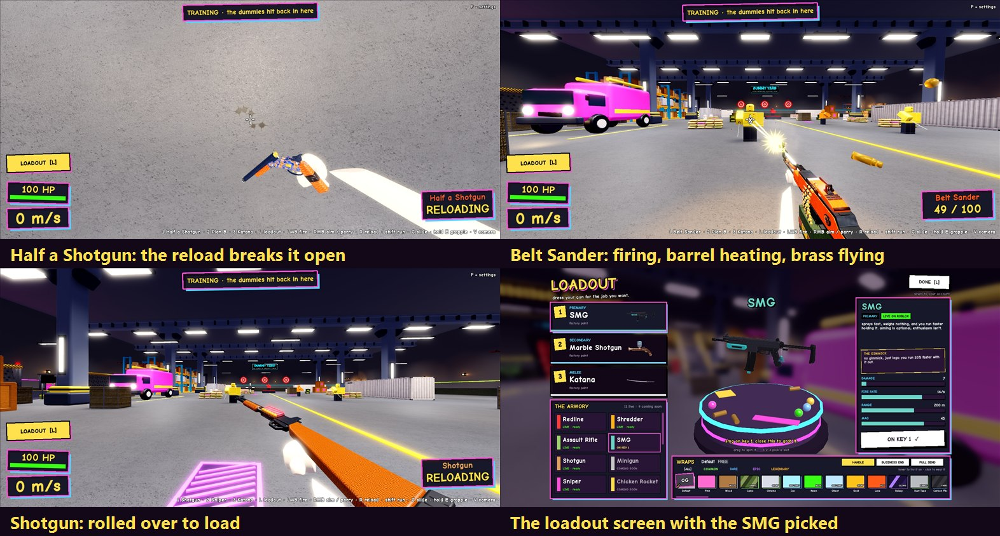

# Batch 3: the eleven plain guns, web against Roblox

Ported 15 November 2026. Web numbers come from `shared/weapons.js` and `roblox/docs/WEAPONS.md`; the Roblox numbers
were **measured in a Studio play test** in the training hall (solo, real mouse and key input, the server's own damage
events), not read back out of the table. Distances and speeds: 1 m = 3 studs.

How to read "measured": damage is what the server paid per hit on a test dummy; reload is the time the ammo panel
showed RELOADING; the gimmick column says what was seen happen.

## The numbers

| gun | slot | damage body / head | fire rate | mag | reload | measured in Roblox |
| --- | --- | --- | --- | --- | --- | --- |
| **SMG** | primary | 7 / 10.5 | 16 a second, full auto | 45 | 1.5 s | 7 and 10.5 paid; mag 45; killed a 100 HP dummy in 13 hits. reload: the web clip, stretched to 1.5 s (time not measured) |
| **Shotgun** | primary | 8 a pellet, 10 pellets (80) | one every 0.75 s | 6 | 2.0 s | 80 at 4 m; reload 2.00 s; the pump travels its full 10 cm after every shot |
| **Sniper** | primary | 55 / always lethal | one every 1.1 s | 5 | 2.2 s | 55 unscoped and scoped; a scoped headshot killed a dummy with 99,835 HP; reload 2.20 s; the bolt lifts and runs back |
| **Burst Rifle** | primary | 15 / 30 | bursts of 3 at 14 a second, 0.28 s pause | 30 | 2.0 s | 15 a hit; a tap fired exactly 3; held: bursts 0.35 s apart; reload 2.01 s (head not measured) |
| **LMG** | primary | 10 / 16 | 12 a second, full auto | 100 | 4.2 s | 10 a hit, one every 0.083 s; reload 4.22 s (head not measured) |
| **Marksman Rifle** | primary | 52 / 104 | one every 0.55 s | 10 | 2.1 s | 52 and 104; reload 2.12 s |
| **Lever Rifle** | primary | 30 / 60 | one every 0.42 s | 8 | 2.6 s | 30, then 35, 39, 44, 44 on the same dummy; shots 0.45 s apart; reload 2.62 s (head not measured) |
| **Auto Shotgun** | primary | 5 a pellet, 8 pellets (40) | 3 a second, full auto | 10 | 2.4 s | 40 a shot, one every 0.333 s; reload 2.40 s |
| **Revolver** | secondary | 40 / 96, fanned 28 | tap every 0.4 s, fan 6 a second | 6 | 2.0 s | 40, 96 and 28; fanned shots 0.17 to 0.22 s apart; reload 2.00 s |
| **Pistol** | secondary | 20 / 44 | up to 5 a second | 12 | 1.35 s | 20 and 44; reload 1.35 s |
| **Sawed-Off** | secondary | 9 a pellet, 12 pellets (108) | one every 0.3 s | 2 | 2.3 s | 108 at 4 m; reload 2.30 s |

## The gimmicks

| gun | web game | Roblox, as tested | who decides |
| --- | --- | --- | --- |
| SMG | you run 20% faster with it out | top run speed 12.7 m/s with it out, 8.6 m/s with the LMG (base 10) | your own game (movement is the client's, as on the web) |
| Shotgun | shoot the floor: 17 m/s up, about 5.5 m of height | straight down from standing: 16.6 studs = **5.5 m** up. one shot at a dummy shoved me back 9 studs | your own game |
| Sniper | body shot launches them 75 m/s (+14 up); headshot always kills; scope; no-scope callout | the dummy left at 207 studs/s (225 = 75 m/s asked for) and landed 87 studs away; scope overlay at zoom 4; "NO SCOPE 8m" on an unscoped hit | server: damage, lethal headshot, launch, the no-scope callout |
| Burst Rifle | a press is always a whole burst; all three on one person = BURST! | BURST! on every burst that landed all three | server judges BURST! from its own hit times and caps shots at one burst per 0.37 s |
| LMG | barrel glows with heat, a belt you can watch run out, slow sights, slow walk, 0.25 m/s shove per bullet | barrel white-hot after about 50 shots; 12 belt links showing; walk speed x0.86 | looks: your own game. damage and shove: server |
| Marksman Rifle | fired within 0.3 s of the scope coming up: +10 damage and a 9 m/s shove, once every 1.2 s | 62 and "QUICK SCOPE" on a quick shot, 52 after | server (see below) |
| Lever Rifle | every hit on the same person within 0.8 s: x1.15, x1.3, x1.45; a lever to crank after each shot | 30, 34.5, 39, 43.5, 43.5, then back to 30 after a 2.3 s pause; the lever swings 0.95 rad after each shot; the reload ends in a spin-cock | server (the ramp, from its own hit times) |
| Auto Shotgun | none: an automatic shotgun | 5.5 m/s shove back a shot (same code as the Shotgun's) | - |
| Revolver | tap = accurate, hold = fan the hammer; bullets bounce off walls twice; a twirl after each tap | a bullet aimed at the floor bounced up into the dummy for 40; fanned shots at 28 | server: tap or fan (from its own clock), the 6 shots, every bounce |
| Pistol | slide locks back on empty; quick draw; x1.05 run speed | fires, reloads with the mag sliding out of the grip | - |
| Sawed-Off | point blank they go flying; shoot the floor for a hop | the dummy left at 81 studs/s (122 asked for, dummies brake hard); straight down: 5.8 studs = 1.9 m hop; the reload breaks it open | server: the shove on the victim. the hop: your own game |

## What the Roblox server checks that the web server took on trust

Tested by sending the server's remotes fake messages from a client, the way an exploiter would:

| claim | web server | Roblox server | result in the test |
| --- | --- | --- | --- |
| any shot | no ammo, held-weapon, sight-line or aim check | all four (already there since step 2) | a Sniper shot sent while holding the Burst Rifle paid nothing |
| Revolver ricochet | the shooter's word; only straight-line range is checked | walks the claimed bounce points with its own rays: each must be on the map, in sight of the last, and leave the wall the way a bounce does | a bounce "off thin air" paid nothing; a real floor bounce paid 40 |
| Revolver tap or fan | counts hits, pays fan damage if faster than the tap rate | same rule, on shots: unflagged shots faster than the tap rate are paid as fanned | three unflagged shots 0.18 s apart paid 40, 28, 28 |
| Revolver cylinder | 6 hits, then a reload-length pause | the server's own mag of 6 | shot 7 paid nothing |
| Burst Rifle burst | at most 3 hits per 0.37 s | at most 3 shots per 0.37 s | 6 shots sent in 0.45 s: 4 paid (3, then the window moved on) |
| Marksman Rifle quick-scope | the shooter's word, capped at once per 1.2 s | the client says when the sights go up and down; the claim has to fit the server's own clock for the scope, and the 1.2 s cap stays | claimed with the sights never up: 52. sights up 0.25 s, then the shot: 62. a second claim 0.6 s later: 52 |
| headshot | the shooter's word | for one-bullet guns the bullet must cross the (slightly padded) head box | Sniper "headshot" claimed for a bullet through the chest: paid 55, not a kill. an honest one killed. a hit claimed with the bullet 40 studs wide: nothing |
| knockback direction | the shooter's word | from the server's own positions (shooter to victim) | - |

## What differs from the web game

- **Reloads show the gun's own moving parts** (mag, charging handle, pump, bolt, lever and hammer, feed cover and
  belt, slide, the sawn-off breaking open, the cylinder), driven by the web game's own keyframes. **The things the
  off hand fetches are not ported** (the spare mag, shells, the stripper clip, the speedloader). Since the hold
  rework (15 November, `GUN-PAINT.md`) the left hand stays in the picture: it goes down and back with the
  magazine, rides the Shotgun's pump, holds the Redline's can and the marble bag, steps clear of the Lever Rifle's spin,
  and otherwise keeps its place on the gun.
- **The Revolver's twirl** after a tap and its spin while fanning are fixed clips, not the web game's spring, and
  other players don't see them.
- **The Sniper's extras are not ported:** the full-screen "NO-SCOPED" overlay, the fireworks that spell your name,
  Sniper Royalty and its golden skin, the locked killcam. The plain "NO SCOPE 12m" callout is.
- **Sounds:** one shot sound per gun, rendered from the web game's own recipes. Reload noises reuse the clicks
  already uploaded, and BURST! / YEEHAW / QUICK SCOPE share one ding (audio uploads are capped at 100 a month; 44 are
  used). The LMG gets louder and lower as it heats by changing the playback, not by re-making the sound.
- **Aiming slows you to x0.75** for every gun now (the web rule). The Redline, Assault Rifle and Marble Shotgun did
  not have it before this batch.
- **Looks:** each gun keeps its pictures (stickers, wood grain, dials) with a flat colour underneath in case a
  picture fails to load; shiny metal is Roblox's Metal. The web game's clear-coat gloss is not there.
- **No inspect animations** (there is no inspect key yet), no Plant & Defuse numbers (the mode isn't ported), no
  hip-fire lobby setting, no bots.
- **Tracers** all last 0.2 s (the web game shortens fast guns' to 0.07 s); the Sniper's and the Marksman Rifle's are
  as thick as the web's.

## Not tested

- **Anything with two players:** what the other player sees (the gun in your hand, tracers, a bent ricochet
  tracer), the Sniper launching a real player off the map and the kill being credited, spawn protection, parrying
  these guns with the katana, a match from a pad.
- Ranges, spread and bloom numbers, aim zoom and aim spread (they are copied from the table, not measured).
- Head damage for the Burst Rifle, LMG, Lever Rifle, both shotguns and the Auto Shotgun (same code path as the ones
  measured).
- Pistol's slide locking back, and its fire-rate cap of 5 a second (the test tool can't click that fast).
- The SMG's reload time (its clip is the web game's, stretched to 1.5 s like every other reload that was timed).
- `roblox/tests/weapons.luau` has a new block for these rules. It has not been run: Lune is not installed on this PC.
- Phones and controllers (the game is keyboard and mouse only).

## How they look: repainted on 15 November

The owner's direction on 15 Nov, after these guns were built: the weapons and mechanics come from JANKFIRE, the
finish should be serious and polished, and less colourful. When this batch went in, every gun still wore the web
game's factory colours (hot pink Sniper, orange LMG, an all-white Revolver and Pistol) and the first-person
arms were bare white shapes.

**That is done now** (place version 215): all eleven guns, and the five older weapons, wear a calm paint, and the
arms wear gloves and sleeves. Numbers, names, mechanics and gimmicks are untouched, and the web paint is one switch
away. What each gun looks like, the judge's scores before and after, what paint could not fix and how to switch:
`GUN-PAINT.md`. Pictures: `gun-paint/before-after-1.jpg` to `-4.jpg`.

Still true from this batch: the off hand is hidden during these guns' reloads (it swept across the screen), and
nobody has looked at the third-person hold with a second player.
