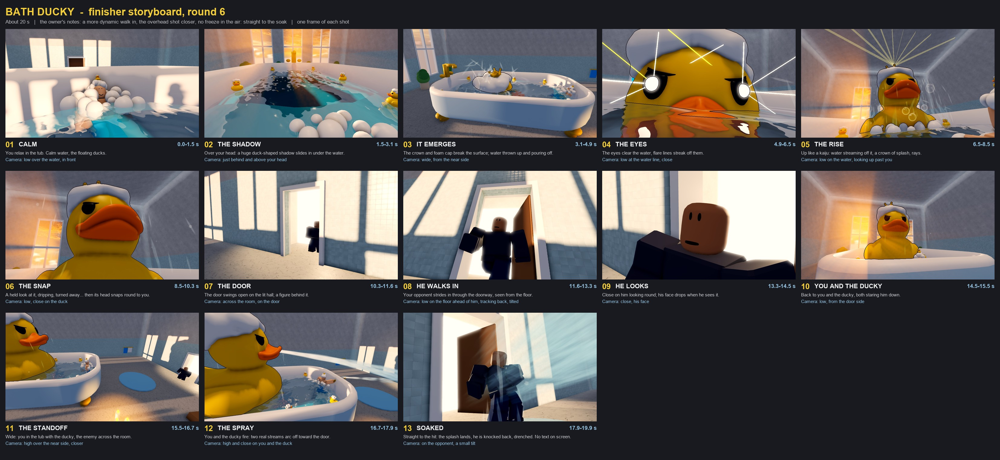
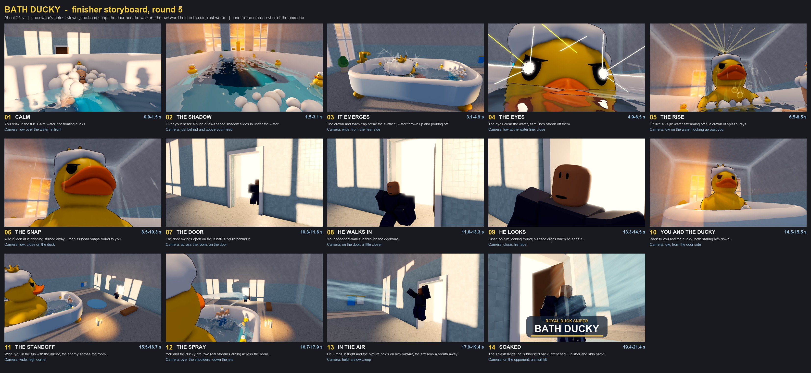
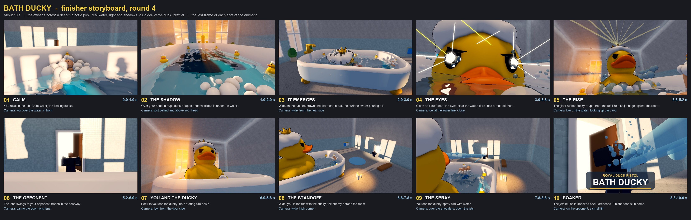
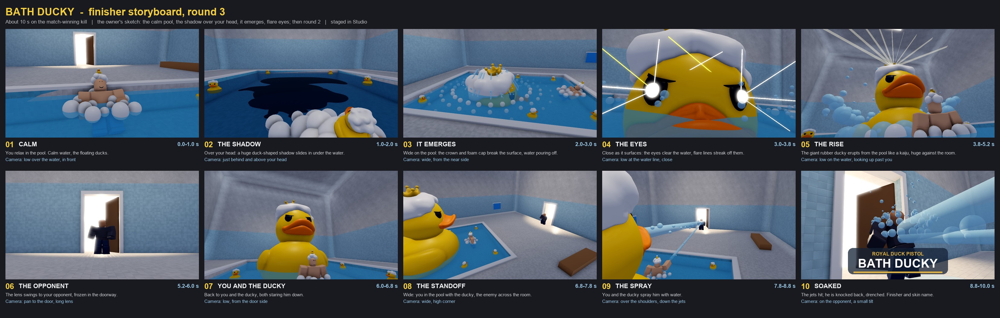
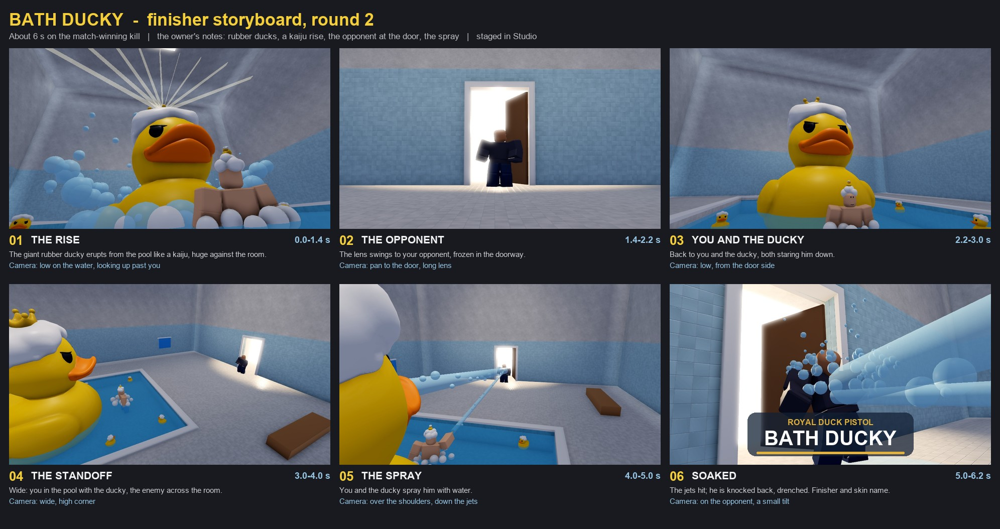
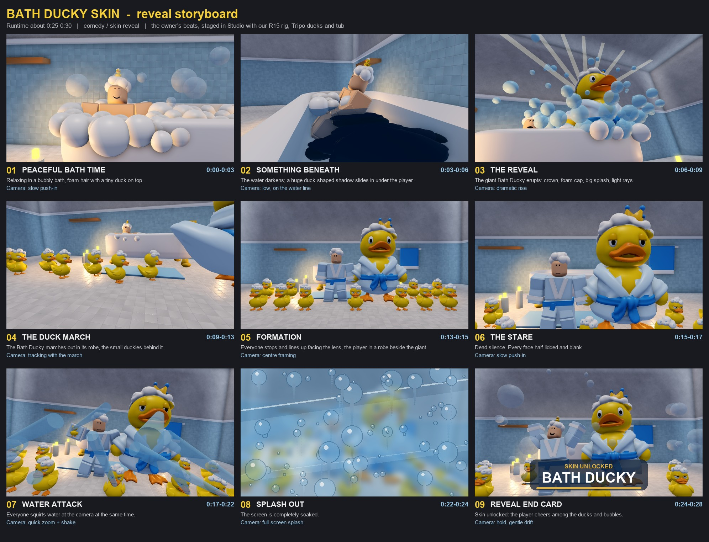

# The Bath Ducky skin reveal (storyboard, 19 Nov 2026)

## Which gun: the Royal Duck Sniper only (20 Nov)

The owner (relayed by the finishers session): "Special cutscene should be applied to one gun in the set. Cowboy revolver,
maybe the ducky sniper seraph ar etc". So this cinematic is the **Royal Duck Sniper's** (`sniper_ducky_tripo`) finisher:
the finishers session's `Finishers.splashdown` row now lists only that skin, and the Bath Ducky scene is what it plays
once built (on `client/FinisherScene.luau`, as planned below). Rounds 2-4 show the Royal Duck Pistol in your hand and on
the name card; the stage and the cut now default to the sniper (`HELD_SKIN` in `bath_ducky_board3.luau`, the card in
`bath_ducky_video.py`), so the next shoot holds it.

## Round 6 (20 Nov): a dynamic walk in, closer overheads, no freeze, no text

The owner on the round-5 animatic (relayed by the finishers session): "I think guy walking in needs a different more
dynamic angle, also the overhead shot needs to be closer in theres like a freeze frame of him in the air get rid of that
and cut straight to him getting drenched which is the scene aright after", then "Get rid of the text that says royal
duck sniiper bath ducky".

The video is `bath_ducky_animatic_v4.mp4` (19.9 s, 24 fps, sound), in the notes folder
`local_f6d4e505.../finisher-boards/video/` and the vault. The sheet:

What changed (same stage, `bath_ducky_board4.luau`; cut `bath_ducky_video.py <caps> <out> comic r6`, sheet `v6`):
- **HE WALKS IN:** a low lens on the floor ahead of him, tracking back as he strides through the doorway, looking up
  at him, tilted (11 to 5 degrees), a little bob with his steps (`F[13]`).
- **The overhead shots, closer:** both high shots came in. THE STANDOFF is about 40% closer, high over the near side,
  you and the duck on the left and him at the door on the right; THE SPRAY is high and close on you and the duck
  firing, the two streams arcing off toward the door.
- **No freeze:** IN THE AIR is out of the cut; the spray cuts straight to the soak (P[15]/F[15] stay in the stage
  script for the record). The owner reversed round 5's "pause it for a second".
- **No text:** the name card ("ROYAL DUCK SNIPER / BATH DUCKY") is gone from the cut and the sheet; the in-game plan
  below now has nothing on screen but SKIP.
- Only the three changed shots were reshot (42 frames, Studio turn 08:43 UTC, everything removed, nothing saved); the
  rest are round 5's captures.

## Round 5 (20 Nov): slower, the new beats, real water

The owner on the round-4 animatic (relayed by the finishers session): "Ducky cinematic goes by too quickly!! Ducky
emerges pause on him, his head snaps!! Enemy walks in after opening door shot of enemy looking the shot of in air like I
mentioned it's supposed to be awkward and silly so pause it for a second then he gets splashed used some of the new vfx
we got for the water, also the water that comes off the duck should be actual water with physics rn it's just like code
built tubes ??"

The video is `bath_ducky_animatic_v3.mp4` (21.4 s, 24 fps, sound), beside the others in the notes folder
`local_f6d4e505.../finisher-boards/video/` and in the vault. The sheet is one frame of each shot:

What changed (stage `tools/roblox/bath_ducky_board4.luau`, shared.BD4; cut `bath_ducky_video.py <caps> <out> comic r5`):
- **Slower:** 14 shots, about 21 s (round 4 was 10 s): CALM 1.5, THE SHADOW 1.6, IT EMERGES 1.8, THE EYES 1.6, THE RISE
  2.0, THE SNAP 1.8, THE DOOR 1.3, HE WALKS IN 1.7, HE LOOKS 1.2, YOU AND THE DUCKY 1.0, THE STANDOFF 1.2, THE SPRAY 1.2,
  IN THE AIR 1.5, SOAKED 2.0. The duck's shots are captured at 12 a second (on twos at 24 fps).
- **The pause and the snap:** after the rise, a held low look at the duck, dripping, turned a little away; then it snaps
  round to face you in two frames (a small overshoot), with a white kick, focus lines and a jolt in post.
- **The door, the walk in, the look:** the door swings open on the lit hall with him behind it; he walks in (Roblox's
  own R15 walk, his root carried through the doorway); a close shot of him looking round, his face dropping at the end.
  He is no longer in the doorway before the door opens (round 4 had him there from the rise).
- **The awkward hold:** as the streams come at him he jumps in fright (a frame of Roblox's R15 jump, lifted off the
  floor) and the picture holds on him in the air for 1.5 s, the streams frozen a breath away, silent but for one quack;
  then the splash lands.
- **Real water:** every drop is a particle now (ParticleEmitters with gravity and drag), no more parts: water sheeting
  off the duck's body and pouring off its head as it rises, a crown of water thrown up round it, rings spreading on the
  surface, bubbles, and the two jets as real streams that arc under gravity (aimed a little high so they fall onto him).
  Edit-mode particles do simulate in Studio: `BD.frame(i)` runs every emitter for the frame's slice of time
  (TimeScale 1, wait, TimeScale 0), so each capture is the next moment of the same simulation. Frames must be shot in
  order; a shot's first frame restarts its water.
- **The pack's VFX:** the hit is the bought Combat pack's slam (`ReplicatedStorage.JankfireVfx.HitSlam`: streaks and a
  ring) recoloured to water and shrunk, with our own splash crown (the Tidecrest sprite) and thrown drops. The pack's
  `KillIceBurst` was tried first: its snowflake sprites read as snow.
- Shot in Studio turns at 06:29, 06:34, 06:46 and 06:56 UTC (219 frames by capture helpers, in order); stage, Terrain
  water and grade removed each time, nothing saved (the place is unchanged).
- Still rough: in THE EYES little water shows (the head is mostly under); HE LOOKS ends on the back of his head as he
  turns; the door swings out into the hall, so the shot reads as light flooding in rather than the door itself moving.

## Round 4 (20 Nov): a deep tub, real water, sunlight, a Spider-Verse duck

The owner on the round-3 animatic (relayed by the finishers session): "Can the water be actual water and have lighting
shadows? Can the ducky can you try to have like spiderverse style animation for fun? Also that's a pool not a tub! The
water also has to be deeper?.. make the scene look prettier".

The video is `bath_ducky_animatic_v2.mp4` (10 s, 24 fps, sound), beside the other finisher videos in the notes folder
`local_f6d4e505.../finisher-boards/video/` and in the vault. The sheet is the last frame of each shot:

What changed (stage `tools/roblox/bath_ducky_board3.luau`, the same ten shots and frame plan as round 3):
- **A tub, not a pool:** a giant clawfoot tub (`bd3_tub`, asset `107087577101161`, built in `bath_ducky_models.py
  bigtub`): blue-grey outside, white enamel and a rolled rim, gold claw feet and tap, 42 x 26.
- **Real, deep water:** Roblox Terrain water, shaped to the tub's inside (two blocks and four corner cylinders), with the
  place's own water look (the Rooftop v3 pool water the owner likes). Chest-deep where you stand on a hidden step. It
  starts at a 4-stud voxel boundary: a lower start spills under the tub. Filled for the shoot and cleared after.
- **Light and shadows:** tall open windows on the west wall, where the saved Lighting's late sun sits low, so warm
  shafts and the window frames' shadows fall across the room and backlight the duck; a warm lens grade on the camera
  (removed after). Candles, plants, gold, a bath mat.
- **Spider-Verse duck:** an ink outline round the giant (a Highlight); its own motion (rising, the shadow, the flare
  lines) stepped on twos while the lens moves on ones; in post, a comic print on its shots (Ben-Day dots in the shadows,
  the red and blue plates a few pixels off register) with held frames instead of cross-fades (`bath_ducky_video.py comic`).
- The water jets are plain light blue now: glass jets read as grey pipes (that cut's spray and soak were reshot).
- Shot in Studio turns at 05:03 and 05:14 UTC (place versions 1142, 1144); stage, Terrain water and grade all removed.

## Round 3 (20 Nov): the owner's opening sketch

The owner on round 2 (typed in the VFX session, with their own three-panel sketch, notes folder
`local_f6d4e505.../bath-ducky-owner-sketch-opening.png`): "I want a shot of the pool with the shadow in it like over the
head and behind, and it emerges then blame that the rise shot and them everything folows your story board", then
"actually maybe a shot focus on it emerging from the water with anime flare lines from the eyes".

Single shots: `bath-ducky/r3_shot_01.jpg` to `r3_shot_04.jpg` (the opening); shots 05-10 are round 2's `shot_01.jpg` to `shot_06.jpg`, unchanged:

| # | shot | time | what happens | camera |
|---|---|---|---|---|
| 01 | Calm | 0.0-1.0 s | you relax in the pool, leaning on the edge, eyes shut (sketch 1) | low over the water, in front |
| 02 | The shadow | 1.0-2.0 s | over your head: a huge duck-shaped shadow slides in under the water (sketch 2) | just behind and above your head |
| 03 | It emerges | 2.0-3.0 s | wide on the pool: the crown and foam cap break the surface, water pouring off, foam rings (sketch 3) | wide, from the near side |
| 04 | The eyes | 3.0-3.8 s | close as it surfaces: the eyes clear the water, anime flare lines off them (warm white, one gold line) | low at the water line, close |
| 05-10 | round 2 | 3.8-10.0 s | the rise, the opponent, you and the ducky, the standoff, the spray, soaked | as round 2 |

About 10 s in all, past the finishers' 4-6 s match-win window: the end screen would wait longer (the owner's call).
Shot in one Studio turn (place version 1102); the stage is `tools/roblox/bath_ducky_board2.luau` shots 7-10, the sheet
`bath_ducky_sheet.py ... v3`. A continuity note for the build: in the opening you lean on the pool's edge; from the rise
on you stand in the middle of the pool (the cut can cover it, or the rise can be re-blocked at the edge).

### The animatic (20 Nov): round 3 in motion

The owner judges finishers as video (the finishers session relayed "Where duck finish"), so round 3 is also a moving
animatic: `bath_ducky_animatic_v1.mp4` (10 s, 24 fps, 1280x720, sound), kept out of git like the other finisher videos:
in the notes folder `local_f6d4e505.../finisher-boards/video/` and the vault's `References/Animation/Bath Ducky reveal/`.
- 107 Studio frames (place version 1132, the stage removed after): `BD2.frame(i)` in `tools/roblox/bath_ducky_board2.luau`
  stages each shot once and then only moves things (the duck rising, the shadow sliding in, the flare lines growing, the
  jets reaching out, the opponent playing his clip, the lens pushing, rising, whip-panning). Two subagents shot them,
  an execute + capture pair per frame, about 1.7 s a frame.
- `tools/roblox/bath_ducky_video.py` stretches each shot to its length at 24 fps with cross-fades, adds the letterbox,
  manga focus lines on the rise, streaks on the whip pan, a flash on the rise and the glint, the name card; then
  `finisher_video_mp4.py` (the finishers session's) cuts it with the sound.
- Sound: CC0 recordings already in our library (no voices): a drip, a low hit for the shadow, a gust and an impact for
  the surge, a singing bowl for the glint, a hit-and-whoosh plus one quack for the rise, a woosh for the pan, an air hiss
  for the jets, a hit and a body fall for the soak, a last quack. **There is no water recording in the library yet**: a
  real splash and bubbles would need a new CC0 download.
- Rough spots: the whip pan's first frames pass through the player's foam hair; the light rays read white.

## Round 2 (20 Nov): rubber ducks, a kaiju rise, a finisher on the opponent

The owner on round 1 (relayed word for word by the VFX session): "I dont like how the ducks look theyre supposed to be
rubber ducks, I want the reveal to look like the iamge, like a kaiju emeging from the water with a perspective shot!
then it pans to your oppenent at the door, and then back at you and the ducky, a ide shot of you in the pool staring at
your enemtn then you and the ducky spray hjim with water".

Single shots: `bath-ducky/shot_01.jpg` to `shot_06.jpg`.

| # | shot | time | what happens | camera |
|---|---|---|---|---|
| 01 | The rise | 0.0-1.4 s | the giant rubber ducky erupts from the pool like a kaiju, huge against the room: splash, light rays | low on the water behind you, looking up past you (the owner's image, beat 03) |
| 02 | The opponent | 1.4-2.2 s | the lens swings to the opponent, frozen in the doorway | pan to the door, long lens |
| 03 | You and the ducky | 2.2-3.0 s | back to you and the ducky, both staring him down | low, from the door side |
| 04 | The standoff | 3.0-4.0 s | wide: you in the pool with the ducky, the enemy across the room | wide, high corner |
| 05 | The spray | 4.0-5.0 s | you (the skin in your hand) and the ducky spray him with water | over the shoulders, down the jets |
| 06 | Soaked | 5.0-6.2 s | the jets hit, he is knocked back drenched; the finisher's name and the skin's name | on the opponent, a small tilt |

What changed:
- **The ducks are classic rubber ducks now:** glossy, round, bright yellow, a wide orange beak, stern black eyes, a white
  foam cap (the giant wears the gold crown on it). New Tripo takes, four per idea (sheet in the vault:
  `Assets/tripo-19nov-bath-ducky/bath_ducky_takes_round2.jpg`): giant take 2 `80995e0c` kept (stern eyes, foam cap and
  crown, like the owner's image). The small floating ducks are that same duck without its crown, as in the owner's
  image (small take 1 `87a276c7` was picked first, but Tripo's Segment job on it never finished). Gloss is the MeshPart's
  Reflectance. Uploads: giant `85544912707294`, small `116208755186622`.
- **It is a finisher now** (the VFX session: "it now plays on an opponent, finisher-style"): about 6 s, so it fits the
  finishers' match-win scene (`client/FinisherScene.luau`, 4-6 s, the end screen waits; everyone in the match sees it;
  SPACE / B / SKIP). The set: a tiled pool room with a door and a lit hall behind it, built far off the map.
- **The opponent** is a real R15 avatar posed from the finisher session's own uploaded victim clips:
  `victim_lookaround_t2` at the door (the frame where the head turns furthest) and `pulled` when the jets hit (the
  frame where the head is furthest back). The player stands in the pool in Roblox's own idle, and sprays in the
  `point` frame with the furthest reach, the VIP Ducky pistol in the hand.
- The stage script is `tools/roblox/bath_ducky_board2.luau`; the sheet `tools/roblox/bath_ducky_sheet.py ... v2`.
  Shot in one Studio turn on 20 Nov (place version 1096, the stage removed). The victim clips carry their own root
  turn, so the script turns the opponent until his chest faces the pool.
- Still rough on the board: in shot 06 his face is lost in the splash, and the giant's light rays read white, not gold.

The plan further down (round 1's reveal) still holds for how the camera and the skip are built; what changes is when it
plays: as the skin's finisher on the match-winning kill instead of a one-time unlock reveal.

## Round 1 (19 Nov): the nine-beat reveal

The owner sent their own storyboard for a "BATH DUCKY SKIN" reveal (runtime about 0:25-0:30, comedy / skin reveal),
asked "are you able to story board this?" and then "we can meshy or tripo the ducks!". This is that storyboard, staged in
Studio with our own pieces, and a plan for building it as a real in-game cinematic. **Nothing is in the game yet: the
build waits for the owner's OK on the plan below.**

Single panels: `bath-ducky/panel_01.jpg` to `panel_09.jpg`. The same sheet is in the vault under
`References/Animation/Bath Ducky reveal/`.

## The nine beats (the owner's)

| # | beat | time | what happens | camera |
|---|---|---|---|---|
| 01 | Peaceful bath time | 0:00-0:03 | the player relaxes in a bubbly bath, foam hair with a tiny duck on it, candles, tiles | slow push-in |
| 02 | Something beneath | 0:03-0:06 | the water darkens; a huge duck-shaped shadow slides in under the player | low, on the water line |
| 03 | The reveal | 0:06-0:09 | the giant Bath Ducky erupts: crown, foam cap, big splash, light rays | dramatic rise |
| 04 | The duck march | 0:09-0:13 | the Bath Ducky marches out in its robe, an army of small foam-capped duckies behind | tracking with the march |
| 05 | Formation | 0:13-0:15 | everyone stops and lines up facing the lens, the player (robe, foam hair) beside the giant | centre framing |
| 06 | The stare | 0:15-0:17 | dead silence; the player and every duck half-lidded and blank | slow push-in |
| 07 | Water attack | 0:17-0:22 | everyone squirts water at the camera at once | quick zoom + shake |
| 08 | Splash out | 0:22-0:24 | the screen is completely soaked | full-screen splash |
| 09 | Reveal end card | 0:24-0:28 | SKIN UNLOCKED, the player cheering among ducks and bubbles | hold |

## What it is made of

- **Which skin.** The giant duck wears a crown, so the board follows the **VIP Ducky set** (the Royal Duck guns: rubber
  yellow, white foam, sky blue, a gold crown). The end card's name is the owner's own, "BATH DUCKY". If the reveal is
  meant for Ducky Classic's Bubble Bath LMG instead (pink bow, hearts), the ducks get that set's palette; the shapes
  stay.
- **The ducks** are the owner's Tripo account (Smart Mesh, texture off, quad 5k), four takes each, compared side by side
  (the comparison sheet is in the vault, `Assets/tripo-19nov-bath-ducky/bath_ducky_takes.jpg`: Tripo renders stay
  out of git):
  - giant: take 1 (`d1f18221`) kept for the clearest crown, the bubbly foam cap and the tied robe;
  - army duck: take 2 (`4acdb2b6`) kept for the foam cap that reads as foam (with soap bubbles) and its own half lids.
    Take 4 of that run never left Tripo's queue.
  - Both went through Tripo's **Segment** tool (crown, foam, bill, eyes, robe, belt, wings, feet as separate parts),
    so each part takes one flat colour from the set's palette. `tools/roblox/bath_ducky_models.py` paints them, adds the
    giant's pupils and a separate half-lid piece (on for the stare), and builds the clawfoot tub and its water. The
    foam cap and head came as one part on the giant: a tilted "hairline" plane splits them.
  - The Tripo files stay in the vault (`Assets/tripo-19nov-bath-ducky/`), never in git.
  - Uploads (Model, all approved): giant `119395047122064`, army duck `111415394427988`, tub + water `112698164363965`.
- **The player** is a real R15 avatar (`Players:CreateHumanoidModelFromDescription`). Every pose is one keyframe of
  Roblox's own R15 animations, picked by a measurement, never keyed by hand: sit (the bath), idle (the line-up), point
  (the squirt: the frame with the furthest reach), cheer (the frame with the highest hands). Faces are the dynamic
  head's own FaceControls (eyes closed and smiling, jaw drop, half lids).
- **The stage** is `tools/roblox/bath_ducky_board.luau`: a bathroom far off every map, built, photographed panel by
  panel and removed in one Studio turn. Panel 8 is a lens pass over panel 7's frame and panel 9's label is drawn on
  the photo (`tools/roblox/bath_ducky_sheet.py`).

## Plan: the real in-game cinematic (for the owner to approve)

**When it plays.** Once, the first time the skin becomes yours (bought, a VIP pack that grew, a code, a gift). It waits
for a break the way the gift present does (`GiftReveal`): never over a live round; in the hub, between rounds, or at
the end of a match. Afterwards it can be watched again from the shop's inspect panel (a PREVIEW REVEAL button next to
PREVIEW FINISHER).

**Who sees it.** Only the player who got the skin. Nobody else's screen changes and nothing waits on it.

**How it is skipped.** SPACE, B on a gamepad, or the SKIP button (bottom right, as the finishers have it) jumps straight
to the end card; the card closes on any key or CLOSE. A round going live, a respawn or a teleport ends it at once.

**How it is built.** Its own client-only module (agreed with the cinematic-finishers session, 20 Nov): it copies the
pattern of their `client/FinisherScene.luau` (a per-frame plan: the lens CFrame + FOV and each body's clip, moment and
root, on a private set, blended at screen rate with clips paused and `TimePosition` set every frame). It does not call
into `Finisher.luau`, which is built round the match recording.
- **The set** at CFrame (0, 600, -30000) (the finishers' scenes use (0, 600, -24000)).
- **The camera** bound after Roblox's own (`BindToRenderStep`, `RenderPriority.Last` + a margin), set Scriptable every
  frame (other scripts flip it), eased moves between the board's lenses (push-ins, the rise, the tracking shot, the
  zoom-and-shake), letterbox bars in and out. On stop: camera Custom and the old FOV.
- **While it plays:** hide the other screens every frame (new ones open underneath) and turn controls off; the skip is
  bound at priority 3600 with Sink; the player's `Finishing` attribute holds its own value ("reveal", the way LoreLife
  uses "lore"), which DeathCam, the cursor and pad look already treat as "hold"; a safety-net timer clears every flag
  even if a stop is missed.
- **Not needed** from the finishers: the replay's wall test (`Replay.clearTo` / `safe`), `clipTime` / `poseGhost`, the
  theme's effect time scale.
- **Pacing** (the finishers' Blade Ball notes): cut every 0.4-1.2 s on action, flashes 1-3 frames, long holds only for
  the joke beats (the stare earns its 2 s). 25 s is fine at a break with SKIP on screen from the first frame.
- the player's own avatar as a clone (the replay's ghost: set `TPWeapon` nil first and remove the `TPRig` tag about
  0.05 s later, or the drawn gun stays welded), posed from Roblox's R15 clips: sit, idle, point, cheer, plus a walk
  cycle for the march and the dynamic head's expressions; bodies hidden with `LocalTransparencyModifier`, never
  `Transparency`;
- the ducks as client clones of the board's models, waddling (a roll and a bob per step) on a march path;
- water, foam and the splash as chunky parts plus the VFX pipeline's approved bubble and splash sprites; the soaked
  screen as a ScreenGui water sheet with beads that run;
- sound from recordings only, no voices: water lapping, a deep bloop as the shadow passes, the big splash, squeaky
  footsteps for the march, silence for the stare, the squirts, then the loot win sting on the card;
- on screen only SKIP (round 6, the owner: "Get rid of the text that says royal duck sniiper bath ducky": no name or title
  text in the cut; earlier plans had the end card's label);
- cheap on phones: a few dozen parts, particle counts from the settings page.

**Questions for the owner.**
1. Which skin does it reveal: the VIP Ducky set (the crown) or a new "Bath Ducky" skin? (The board assumes the VIP set.)
2. 25 seconds is long for something that plays on its own. Keep the full cut for the first unlock and the shop preview,
   with SKIP always on screen?
