# Finishers (Roblox)

The owner asked on 17 Nov 2026: "Are you able to create a cinematic finisher with effects? Like finishers from Blade
Ball, you can look those up! Except it's for our guns, and only with high tier skins? Like with super dynamic and fluid
movement, angles, perspective."

A **finisher** is a short cinematic that plays when a high-tier skin that owns one lands the kill that wins a round or
the match. It is ours: inspired by how other games stage a winning kill, never copied (no names, shots, art or sounds of
theirs).

## Research, in short

The full note is in the vault: `Research\Finishers.md` (sources and clips to watch are listed there; nothing was saved
from them).

- **Blade Ball:** a cutscene on the kill that wins a round, the last one of a 1v1 standoff. The loser is its target.
  Ordinary kills only get a small kill effect. A finisher is a separate, very rare item on top of a top-rarity weapon.
  No skip was found. It fills the gap at the end of a round that is there anyway.
- **Valorant:** premium skin lines have a finisher at their top upgrade level. It plays on the last kill of a round,
  inside the fixed post-round window, so it never delays the next round. It is an effect in the world round the
  victim. The killer keeps their own view. Since 2025 the player who dies to one gets a cinematic camera of it,
  partly because the plain view misbehaved and the effects were too busy.
- **RIVALS:** no cinematic finisher. Its "finishers" are kill effects on every kill (ours: `FLAIR.md`). Its only staged
  camera moment is the win screen, where the winners pose in the arena.
- **Camera craft that works:** about 2 to 3 s in all, never over 3. Each shot held long enough to read (about 0.5 to
  1 s). Cuts on an impact. Ease every move. Orbits no faster than about 60 degrees a second. Little roll, and no shake
  in slow motion. At most a flash or two. Any input skips it. Never take the camera of someone still fighting.
  Roblox has no global time scale, so slow motion has to run on local copies of the bodies with slowed effects.
- **The owner's reference (17 Nov, an X post):** a breakdown of an anime-style special move: camera blocked on a
  mannequin first, then the video, then a VFX pass with an energy glow and orb, impact smoke, a cut-in and a two-tone
  grade. From it we took ideas, never its look: the CHARGE close-up on the gun with the light gathering at the muzzle,
  a two-tone impact frame in the skin's colour, and smoke at the hit. Blocking the camera on stand-in bodies before
  the effects is how `Finisher.preview` works too.

## What ours does

### When it plays, and who sees it

| the kill | the cut | who sees it | when |
|---|---|---|---|
| the one that **wins the match** | **the full scene**, about 4 to 6 s | **everyone in the match** | at the match's end, nobody is playing. The end screen and the play of the match **wait** until it ends or is skipped |
| the one that **wins a round** (not the match) | **the payoff only**, about 1.5 s | the **killer** and the **victim** only | the 3 s between rounds (the round is over, nobody can be hurt) |
| a classic mode's last kill (Gun Game, Infection…) | **the full scene** | everyone in the match | that mode's end |
| any other kill | none (only the kill effect) | | |

The owner set this on 18 Nov: *"these big cinematic finishers are if you win the game and will play at the end of winning
the entire match"*. Each scene is a small story with full-body acting (a set-up, the action, a stillness, the payoff),
the weapon's own choreography with the skin's theme on top.
- The storyboards (19 Nov) are in the side-session notes, `finisher-boards/`: Tidecrest, the Dust standoff, Sniper,
  Shotgun, Scythe, Chicken Rocket and Minigun.
- **Built so far:** the 17 Nov cuts, about 2.9 s for the match and 1.7 s for a round, inside the old windows. The scenes
  and the waiting end screen come next, once the owner has seen the boards.

Rules:

- **Who triggers it:** the killer's skin on the weapon that made the kill must own a finisher. The killer must still be
  standing (a trade has no hero). The victim must be a player. A fall or the Shredder never plays one, because there
  is no shot to show.
- **Round finishers are only for the two of them.** The other players are between rounds anyway, but a cinematic every
  round for everyone would wear thin in a first-to-5 match. Everyone gets the big one at the end, as Blade Ball does.
- **Nothing waits on it** (the 17 Nov cuts; the match-end scenes above will hold the end screen instead). The cuts fit
  windows that already exist:
  - A round's short cut (1.7 s) ends well inside the 3 s between rounds. A round going live or a respawn ends it anyway.
  - The match's full cut starts at the kill and is over before the play of the match is due (3.5 s after the end screen
    opens, which is itself 1.2 s after the kill).
  - The end screen opens under it and shows once it ends. Respawns, rounds and the trip home are untouched.
- **Skippable:** SPACE, B on a gamepad, or the SKIP button.
- **The killcam:** for the victim, the finisher is that death's camera. Their killcam is skipped for that one death.
- **Settings:** GRAPHICS > OTHER PLAYERS > OTHERS' FINISHERS (`gfx.othersFinisher`, default on; the settings
  session's, place v602). Off skips finishers you only watch. Your own, as the killer or the victim, always play.

### How it fits the replay system

The finisher is built on the match recording and the replay player that the play-party-ranked session made
(`REPLAY.md`). There is no second recorder and no second set of bodies:

1. The server (`FinisherServer`) takes the last 1.65 s of the recording (`Recorder.recent`), cuts it down to the two
   fighters and sends it on `JankfireRemotes.Finisher`. That is about 2 KB.
2. The client plays it on the replay's **ghosts** (`Replay.makeGhost` / `poseGhost`): clean copies of each player's
   own avatar, posed by ThirdPerson with their real skin, wrap and gun hat, aiming and firing as recorded.
3. The camera uses the replay's **wall test** (`Replay.clearTo`). Every lens spot is pulled in front of anything solid
   between it and what it looks at. The side of each shot is the one with the most room.
4. Live bodies and the other screens are hidden while it plays, the same way a replay does it.

### The camera: one cut, four shots

| shot | full | short | what the lens does | the recording |
|---|---|---|---|---|
| *EYES* (High Noon) | 0.72 s | – | In place of HERO and CHARGE: the standoff. Straight in on the shooter's eyes from in front, pushing from 7.5 to 2.6 studs while the lens widens from 17 to 46 degrees. They hold their size and the world behind them stretches away (a dolly zoom). | runs at about half speed up to the shot |
| **HERO** | 0.5 s | – | Low and in front of the shooter, off to the side with more room. It pushes in and up as they line up the shot (FOV 54 → 43, a slight tilt). | runs at about half speed up to the shot |
| **CHARGE** | 0.38 s | – | Tight on the gun from beside the muzzle, looking back along it, a slow push (FOV 44 → 36). The skin's light gathers into a swelling orb at the muzzle, motes drawn in from all round. | held a breath before the shot |
| **CHASE** | 0.48 s | 0.45 s | The killing shot becomes a slug in the skin's colours, leaving its trail and the theme's bits behind. The lens rides just behind and beside it with a wide FOV punch that settles (84 → 58). It whips in from the previous view. | frozen (bullet time) |
| *WHIP* (a blade) | 0.62 s | 0.45 s | Instead of the chase: the lens whips 150 degrees round the shooter through the swing. | runs through the swing |
| **IMPACT** | 0.42 s | 0.32 s | Close on the hit, tilted, pushing in (FOV 50 → 40). An impact frame: for 0.08 s the whole picture goes two-tone, black and the theme's colour, with a soft flash. Then smoke thrown back along the shot, a shock ring and the theme's burst. That is the cut's one flash. Effects run at a third of their speed. | the victim's last moment, slowed |
| **RESOLVE** | 1.12 s | 0.9 s | An orbit round the victim of 60 to 72 degrees, eased, rising and pulling out, while the theme plays out. The finisher's name and the skin's name come in. Then a fade to black and back. | the shooter barely moving |

Around the shots:

- **Letterbox bars** slide in over 0.2 s and out at the end.
- A **colour grade** per theme (tint, saturation, contrast) eases in.
- **On screen:** the finisher's name, the skin's name, and SKIP. No other words.

### The finishers

Each finisher belongs to a skin set. The skins that own one are that set's high-tier pieces (and the VIP Ducky set). All
eight are built: the first three on 17 Nov, the other five in the second pass the same day.

| finisher | set | skins that own it | the theme |
|---|---|---|---|
| **Ascension** | Seraph | Seraph Rifle | A column of gold-white light falls on the victim. Two big emblem wings open behind them (see "The wings" below). They rise into the light and go to white. A gold halo settles over the head, feathers drift down, and they end in a burst of feathers. |
| **Hellgate** | Infernal | Infernal Rifle | Seven glowing cracks race out across the floor from under the victim. A pit opens with a molten rim. Flames, embers and smoke climb out. The victim tips forward and sinks into it, burning dark. A last gout of fire, and it seals over. |
| **Splashdown** | Ducky (VIP) | Bubble Bath, Wish Duck, Ribbon Duck | A giant rubber duck in the VIP set's look drops out of the sky: rubber yellow, an orange bill, a pink bow with a gold star clip. It stretches as it falls and casts a real shadow. It squashes on landing in a burst of soap bubbles and a pink ring, wobbles, quacks, then pops into bubbles and gold sparkles. |
| **High Noon** | Dust Drover | Dust Drover, Iron Horse | Its own shot list: the EYES standoff zoom instead of the hero and charge shots. Then the victim drops in the dust, a dust devil turns off to one side, a tumbleweed of thin dry sticks rolls through, and a low sun glares behind. |
| **Inkfall** | Tidecrest | Sakura (a blade: the WHIP cut) | One black ink-wash brush stroke is drawn across the victim in the slowed impact, with ink thrown off it. They drop to a knee and come apart into sakura petals while the stroke fades. The grade is nearly monochrome. |
| **Warp Out** | Star Drover | Star Drover, Streamliner | A teal hard-light ring of 28 glowing segments spins open behind the victim. Star streaks rush out of it past the lens. The victim is pulled back through it, and it snaps shut in a ring burst. |
| **Lantern Light** | Witching Hour | Pumpkin Patch | A giant ribbed pumpkin rises out of the floor round the victim. Its carved face (triangle eyes and nose, a zig-zag mouth) lights up from inside and flickers, and smoke curls off the stem. Then it sinks back down in a puff. |
| **Starchart** | (a lone skin) | Triangulum | Stars light on the victim's joints one by one and the lines of their figure draw between them. The body fades, and the constellation rises into a field of sparkles and goes. The grade is a night blue. |

**The wings (second pass).** The first cut's wings were a fan of thin rounded blades. That is a look the owner had
already rejected for the Seraph guns, as "plucked chicken" wings. The rule they set after about nine wing rounds is
classic emblem wings: one smooth curved leading edge sweeping to a point, with 4-5 long feathers with crisp pointed tips
stepping down underneath, white with gold trim.
- The silhouette follows the owner's side-wing rifle reference, nothing else of it.
- The wings are built in Blender as one curve profile a side, extruded and bevelled: `tools/roblox/finisher_wings.py`.
  - Five pointed feathers fan from one wrist, each 11 degrees further down and shorter than the one above.
  - Behind the white silhouette sits a slightly bigger copy of it as the gold rim (Neon in the game), with a gold line
    along each feather.
- They are uploaded once (model 90841956601094) and kept as MeshParts in `ReplicatedStorage.JankfireFinisherKit.Wings`.
- They open from folded down the back to spread wide and raised, at 1.3x size (about 9 studs a side), and beat once.

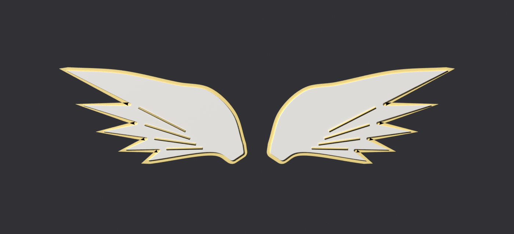

**Which skins qualify.** Each high-tier skin owns its set's finisher, and the VIP Ducky set owns one. The high tier
today is:

| | skins |
|---|---|
| built | all 12: Seraph Rifle, Infernal Rifle, Bubble Bath, Wish Duck, Ribbon Duck, Dust Drover, Iron Horse, Star Drover, Streamliner, Sakura, Pumpkin Patch, Triangulum |

These are all 12 high-tier skins in `SkinSets` (the gun models session checked the list, 17 Nov). The Lantern Light and
Starchart ideas come from that session's special-skins sheet. The gun models session will say when a new skin
ships as high tier.

### The victim's body

At the impact the victim leaves the replay's control: no gun, no walk cycle, no third-person pose. The theme then
moves them: lifted, sunk or squashed, tinted with a Highlight, and faded at the end.

Their body reaction comes from Studio's prompt-to-animation tool (`generate_animation`), following the owner's rules:
4 takes a clip, the best kept. There are eight clips (`Finishers.ANIMS`), one per finisher, each 2.5 s, made on 17 Nov.
The first three:

| clip | finisher | the prompt's idea | kept | why |
|---|---|---|---|---|
| `lift` | Ascension | struck, then rising onto the toes with the arms spreading wide and the head back | take 4 (120752615367600) | the widest arms and the clearest head-back. Take 3 was close; 1 and 2 kept the arms by the head or on a hip |
| `kneel` | Hellgate | struck, staggering back, down onto both knees, slumping forward | take 3 (102848812527442) | kneels and hunches forward. Take 4 collapses flat (nothing left to sink); 1 and 2 crouch with the arms out |
| `shield` | Splashdown | struck, stumbling back, looking straight up in fear with both arms raised | take 3 (99441068703478) | the face turned up at the falling duck, both arms high. The 4th take (timed out, no id) shields with the head down, so the face is lost |

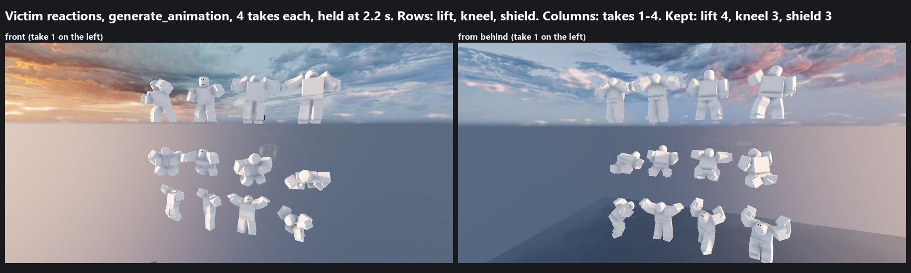

The second pass's five got their own clips the same afternoon (17 Nov, about 14:30 to 15:30 UTC), one call at a
time, 4 takes each:

| clip | finisher | the prompt's idea | kept | why |
|---|---|---|---|---|
| `spinfall` | High Noon | shot in the shoulder, spins half round and falls back to the ground | take 1 (80430806221753) | the clearest turn before the fall, and it ends down on the ground (a duel's fall). Its call timed out, so the clip had no id: it was exported from Studio and uploaded as an Animation |
| `bowdown` | Inkfall | stands frozen after the sword cut, then sinks to one knee and bows the head | take 1 (108121066232094) | one knee down, head bowed: the still beat a blade finisher wants. The other three came from timed-out calls with no id |
| `pulled` | Warp Out | yanked backwards off the feet as if by a rope round the waist, arms reaching forward | take 3 (122059547987683) | thrown back off the feet with the arms out toward the lens, so the ring visibly takes them |
| `cower` | Lantern Light | looks up in fright, stumbles back, crouches low with both arms over the head | take 4 (137185623825862) | the lowest crouch with both arms over the head. Take 3 stays standing; 1 and 2 hunch or twist |
| `starpose` | Starchart | struck, rises onto the toes, arms and legs spread wide like a star, head up | take 4 (125088229863050) | the widest arms and legs, so the stars on the joints make the clearest figure. Take 3 is close; 1 and 2 bend the arms |

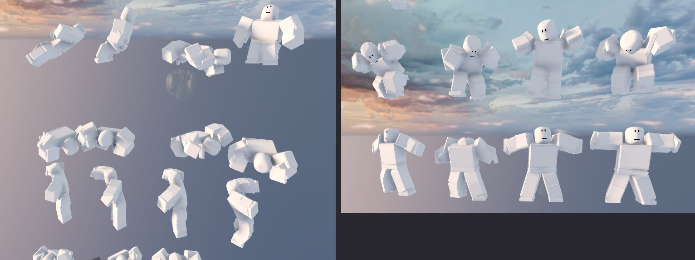

The generator was slow all day: about half its calls timed out. A timed-out call sometimes still leaves a clip in
`ServerStorage.RBX_ASSISTANT_ANIMGEN` with no id. To use one, export it (`SerializationService:SerializeInstancesAsync`
and base64, read in slices under the MCP's 100,000-character result cap), save it as an .rbxm, and upload it through
Open Cloud with `assetType = "Animation"`.

**Checked in Play (place version 647).** Each of the five previews (High Noon, Inkfall, Warp Out, Lantern Light,
Starchart) loaded its own clip (length 2.47 s, so the asset loaded) and played it on the victim. Each ended cleanly in
2.8 to 3.0 s, with no ghosts left behind and no errors from the finisher code.

The clips play at 1.6 times their speed (a third of that through the slowed impact), so most of each clip fits in the
cut. A clip with no id falls back to a code-only shove back and tilt. The shooter is never animated by a generated
clip, because the tool can't hold a weapon. Their gun pose is ThirdPerson's, as recorded.

### Cheap on phones

- Client-only parts and particles, at most a few dozen parts and about a dozen emitters per finisher.
- Particle counts follow the settings page's particle amount and drop to 60% on a phone.
- No depth of field and no bloom changes. The only screen effect is one ColorCorrection on the camera.
- The effects use the VFX pipeline's approved sprites (feather, spark, flame, smoke, bubble, heart, ring, glow,
  sparkle). Nothing new was uploaded.
- Removed on the spot at the end or on SKIP.
- **Scene sets are built ahead (20 Nov).** A scene's set, its kit town and the onlookers used to be built in its first
  frame (a 97-99 ms hitch). Now the server sends `{ kind = "warm", scenes }` to everyone in the match. It goes out in
  the gap after a round that leaves a team one win from the match, and at a classic mode's start. The scenes are the
  ones the skins its players wear own. Each client builds those sets then, about 120 boxes or 40 town pieces a frame,
  parked at the scene's spot far off every map, and fetches their clips and sounds (`FinisherScene` `Scene.warm`).
  `Scene.start` takes the parked set as it stands. Going home drops an unused one (`Scene.unwarm`).

### Selling and showing it

A finisher comes with its skin. There is no separate purchase, unlike Blade Ball, so it raises the value of the high
tier (as Valorant's top level does).

The shop shows it (the shop session, place v603):
- A **FINISHER** pill in the finisher's colour on every card of a skin that owns one: daily, deals, inventory, inspect,
  and the set and VIP pack rows. It comes from `Finishers.forSkin(skinId)`. The skin's blurb names the finisher.
- **PREVIEW FINISHER** in the inspect panel calls `Finisher.preview(id, { skin = skinId })`. That plays the full cut
  in front of you, from a made-up recording of you and a stand-in. The shop's blur and tint are off while it plays.

## Where it lives

| file | what |
|---|---|
| `src/shared/Finishers.luau` | the data: `LIST` (each finisher's name, set, skins, theme, colours, grade, victim clip, `built`, an optional own shot list `cut`), `BY_SKIN`, `ANIMS`, the shot lists `CUTS`, `LEAD`, `FRESH`, `forSkin`, `cut`, `length`, the pure `decide` |
| `src/server/FinisherServer.server.luau` | the kill and round hooks, the clip cut to two, the remote, the Studio test hook |
| `src/client/Finisher.luau` | the player: ghosts, the shots, the wall test, the overlay, the grade, SKIP, `preview` |
| `src/client/FinisherFx.luau` | the slug, the charge, the smoke, the kit wings (`kitWings`, `placeWings`) and the eight themes |
| `src/client/FinisherClient.client.luau` | the remote, stopping on a round or a respawn, the settings row, the test attribute |
| `Recorder.luau` (small) | `Recorder.recent(fighter, secs)` |
| `Replay.luau` (small) | exports `decode`, `makeGhost`, `poseGhost`, `eyeOf`, `clearTo`, `hideLive`, `ghostFolder`; a ghost may be built from a given body (`info.template`) |
| `tools/roblox/finisher_wings.py` | the emblem wings in headless Blender: the curve profile, the gold rim and lines, a Cycles preview |
| `ReplicatedStorage.JankfireFinisherKit` | the uploaded wing MeshParts (`place/ReplicatedStorage/JankfireFinisherKit.rbxm`) |
| `ReplayClient.client.luau` (one line) | no killcam while a finisher is that death's camera (the player attribute `Finishing`) |

**To add a finisher:**
1. Add a row to `Finishers.LIST`.
2. Add a theme to `FinisherFx.THEMES`: its slug look, flash and smoke colours, orbit, sounds, and `impact` / `resolve`
   functions. Add `impactStep` if it moves during the impact, and a row `cut` if it needs its own shots.
3. Set `built = true`.

The shot lists are shared. A theme only says how its orbit moves and what happens in it.

## Testing alone (Studio)

- `ServerStorage.JankFinisherTest`:
  - `("arm", player, skinId, "full" | "short", all?)`: the player's next kill plays that skin's finisher.
  - `("kill", player, n | name, weapon)`: kills a training dummy through `Fight.hurt`.
  - `("decide", t)` and `("state")`.
  - `("round", player, "full" | "short", skin)`: the match path. It runs the real round handler (the function
    `Matches.onRound` calls) on the player's real match and their real last kill in it. Start with
    `JankMatchTest("ghost", pad, nil, secs, player)`, then record and kill a dummy.
- Recording a test kill: `ServerStorage.JankReplayTest("record", player)` first (the training hall, every dummy
  recorded), then arm, then kill.
- The player attribute `FinisherTest`:
  - `preview:<id>` or `preview:<id>:short`: the cut, staged in front of you;
  - `stop`;
  - `warm:<sceneId>` builds that scene's set ahead, as the match's warning does (the workspace attribute
    `FinisherWarm` says when it is ready); `unwarm` drops it. The player attribute `FinisherProf` (Studio) breaks the
    scene's start down in ms: ghosts, set, look, bodies and the first steps.
- Workspace attributes for photos:
  - `FinisherSpeed`: 0 to 1, slows the whole cut;
  - `FinisherFreeze`: holds the cut at that many seconds.
  - The player attribute `FinisherT` shows where the cut is.

## Tested (17 Nov 2026, place version 617)

**A real kill, end to end.** In the training hall:
1. `JankReplayTest("record", p)` started recording me and every dummy.
2. `JankFinisherTest("arm", p, "ar_infernal", "full")` armed the finisher.
3. `JankFinisherTest("kill", p, "Dummy", "ar")` killed a dummy through `Fight.hurt`.

The server cut the clip to two, the remote carried it, and the client played the full cut. Nothing in the output.
Afterwards the camera was Custom again, and LoadoutOpen and `Finishing` were back to how they were.

**Previews.** Ascension and Splashdown went through `Finisher.preview`, the path the shop uses.

**Photos.** The frames were held with `FinisherFreeze`. Captures of a cut that is moving kept timing out.

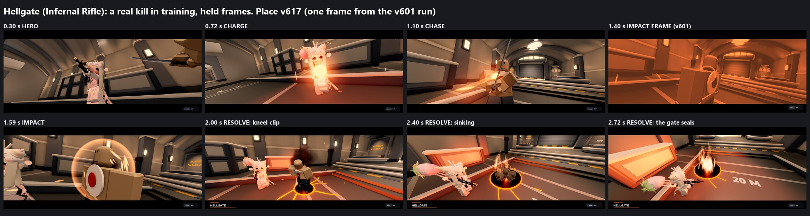
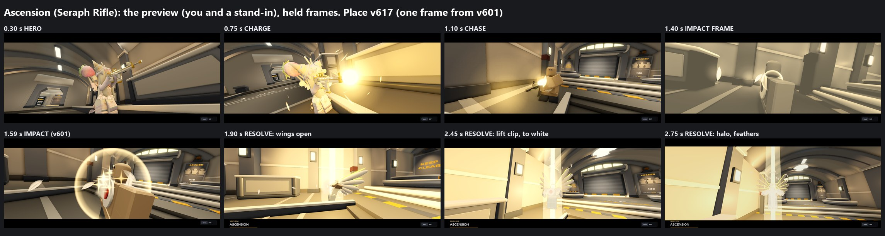
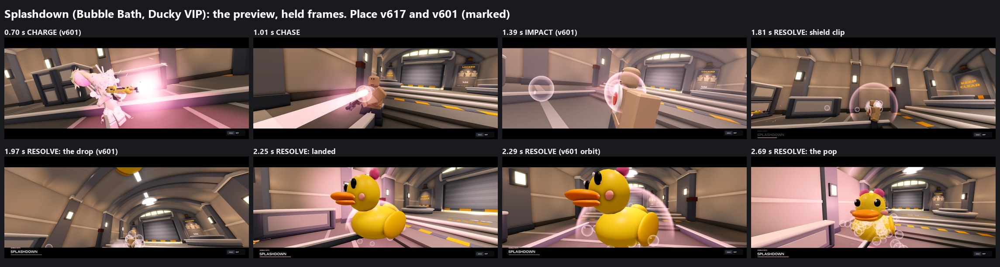

## Tested, second pass (17 Nov 2026, place version 624)

**All eight run clean.** High Noon, Inkfall (the blade's WHIP cut), Warp Out, Lantern Light, Starchart and Ascension
with its new wings each ran as a preview, at normal speed, end to end:
- Each reached its full length (2.78 to 2.88 s).
- No errors.
- `Finishing` cleared, and the effects were removed.
- The most effect instances at once: 14 (Inkfall) to 97 (Starchart).

**The match path.** The setup was a real match from `JankMatchTest("ghost", "1v1", nil, 40, player)` with me on team 1,
the Recorder on, and a real kill of a training dummy. Then the round handler that `Matches.onRound` calls ran on that
match:
- "full" sent Ascension's full cut to everyone in the match, and my client played it to its end (2.9 s).
- "short" sent Hellgate's short cut to the killer.

Below this test sits the same `Finishers.decide` and the same clip, remote and player as a real round.

**Not proven: a round won by killing a real second player.** `Matches.onRound` only fires then, and one tester can't
make that. A Studio solo test has no second player:
- the lobby's stand-ins are display models, not fighters;
- the classic modes' test "ghosts" die outside Fight.

It needs Studio's **Test > Clients and Servers** with 2 players, which the owner can run (the MCP only starts solo Play),
or a live server with two accounts. The wiring is two lines: `Matches.onRound(fn)` and `Matches.onEnd(fn)` in
FinisherServer.

**The preview's facing: fixed.** In the first photos the preview's HERO and CHARGE shots showed the shooter from
behind; real kills showed the front. The aim flag was set on the preview's made-up frames (a real recording had it
off). It is now off, and the v629 photos show the shooter's face (the Ascension strip's first frame).

**Fixed after the second pass's first photos (place v629):**
- **Lantern Light's carved face** stuck out of the pumpkin as small prisms and faced the shooter, so the orbiting lens
  saw it side-on. It now lies flat in the surface and turns toward the lens.
- **Inkfall's ink stroke** didn't draw: the streak sprite runs the wrong way for a Beam. It now uses the beam texture.
- **A blade's preview** stood the stand-in 16 studs away; it is now 5.
- **The skin's name** is missing under a finisher whose skin isn't in a set (the Triangulum). The name now comes from
  the skin id.

**The strips** (held frames, place v624 to v629; Studio was minimised for an hour in between):

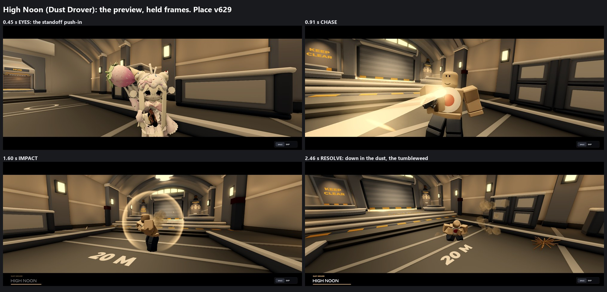
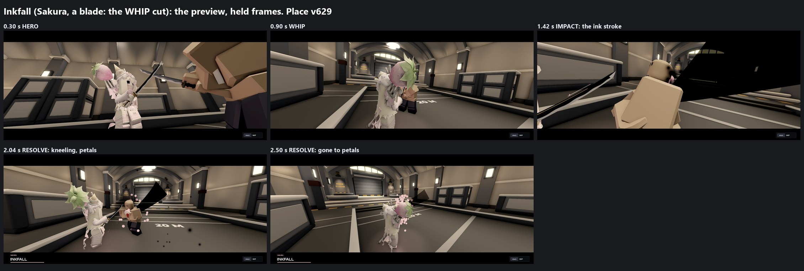
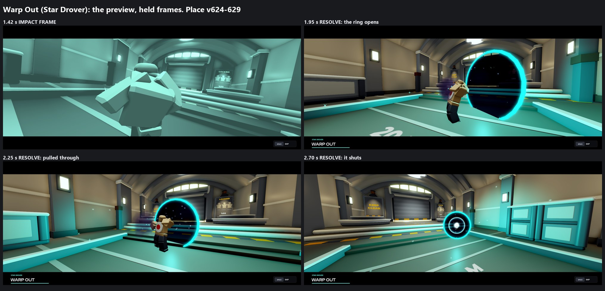
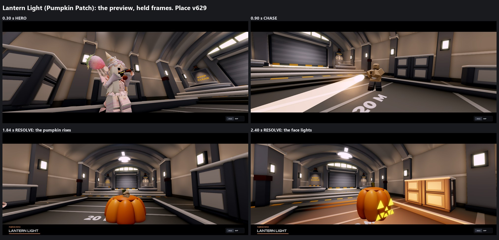
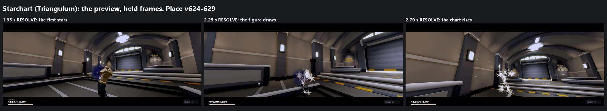

**Not tested yet:** a real phone.

**Sounds:** the cut uses recordings already in the game: the gun and the skin's own fire layer, photoin, hit,
round_end, reverse, boom, death, squeak, blub, quack, bigpop and bloop. Each finisher's own layer is for the sound
session.
