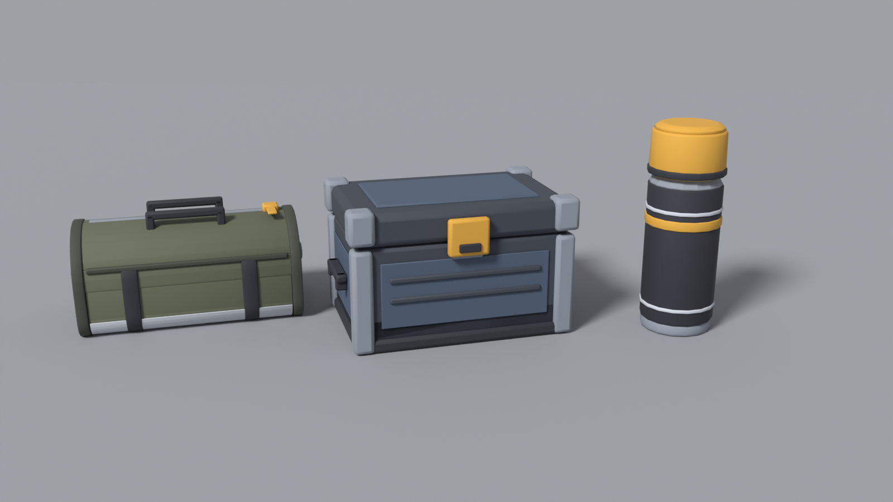
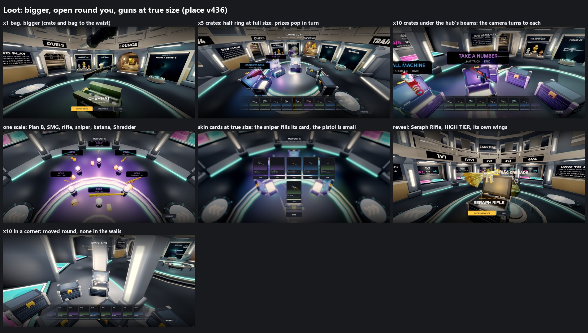
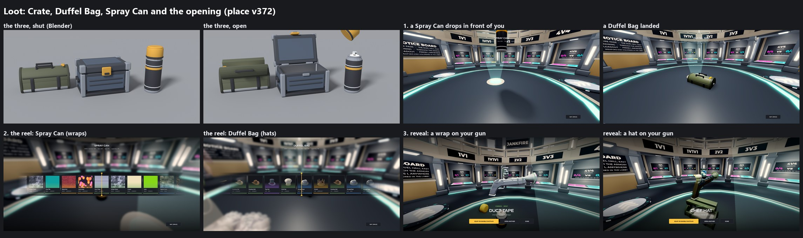
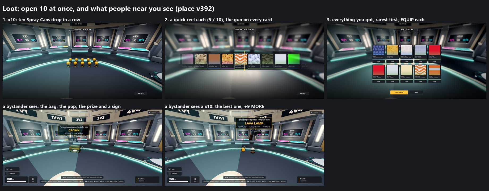

# Loot: Crates, Duffel Bags and Spray Cans

The owner, 16 Nov 2026: "can we get loot our own crates duffel bags and like spray cans? reference the rivals crates
for the crates and go off that for the bags and cans … eventually they'll cost robux but free for now while we test!
when you open them, should they drop on the ground and have a csgo style opening?" The main session's call: yes to
both (drop on the ground, then a CS:GO-style reel).

Built by the loot session, 16 Nov 2026. The shop screen that sells and opens them is the shop session's
(`roblox/docs/SHOP.md`).

**One gun at a time** (the owner, later the same day: "spray cans should give you a wrap for only one gun at a time!
some with the charms/hats"). A wrap or a hat is won for ONE weapon: "Galaxy · Assault Rifle", "Top Hat · Sniper".
What you own is (cosmetic, gun) pairs, written `<id>@<weapon>` (`galaxy@ar`, `crown@katana`). Free items stay usable
on every gun. A weapon skin already belongs to one gun, so its key is just its id.

## What is in each container

From the web game (`shared/cosmetics.js`: `CONTAINERS`, `RARITY`, `rollPick`). Only what exists on Roblox can come
out; nothing was invented.

| container | id | the web game's contents | on Roblox today |
| --- | --- | --- | --- |
| Crate | `crate` | weapon skins (`COSMETICS.model`, `SKINS_2`, streak skins) | the 25 skins whose models are in (`ReplicatedStorage.JankfireSkins.<skin id>`, the guns session's; place v385). Each new skin model joins by itself. A skin is already one gun's |
| Duffel Bag | `bag` | hats, effects, kill effects, grapples | the 8 hats that aren't free, each won for one gun: 8 x 16 = 128 pairs |
| Spray Can (six sets) | `spraycosmic`, `sprayjapan`, `sprayluxe`, `spraywild`, `spraydiner`, `sprayoffice` | wraps and sprays (the web game's Box) | the 99 wraps that aren't free, in six themed sets of 13 to 21 (below), each won for one gun |
| Spray Can · Mixed (legacy) | `spray` | | all 99 wraps. Not sold or given since 20 Nov; unopened ones in saves still open from this whole pool |

**Names and sets** (20 Nov 2026, the owner: "the current skins in the case set is case 1, duffel bag set 1, but can
you divide the sprays into different sets?"). Each container has a `set` and a one-line `label` in
`LootTable.CONTAINERS`: the Crate is CASE 1 ("Crate · Case 1"), the Duffel Bag DUFFEL BAG SET 1 ("Duffel Bag · Set 1").
Later cases and bags become Case 2, Set 2. The shop card shows the set above the name, INVENTORY and the opening's title
show the label.

**The spray sets** (same day). The Spray Can's one pool became six themed sets, each its own container with its own
pool, odds, shop card and products: COSMIC, JAPAN, LUXE, WILD, DINER and OFFICE (`LootTable.SPRAY_SETS`, the lists
in `SPRAY` there). Every wrap that can roll is in exactly one set, and every set has exactly three Exotics (below).
Never a mastery camo, a VIP wrap, the daily-only Triangulum or the coin packs' Bullion. Each can is the Spray Can
model with its cap and stripe in the set's colour (`LootTable.tint` repaints its amber parts; `band`). The sheet of the
sets, with every wrap and its odds: the notes folder's `spray-sets.md`.
- Ids start with "spray" (`LootFloor` sizes every can as the first one by that) and are letters only (`LootStock` is
  read with `%a`). `LootTable.base(kind)` = "spray" for all of them: the model, the floor room, the cap that pops.
- A wrap added to Roster and in no set goes in the newest set (`L.SPRAY_LOOSE`), and Studio's output warns: give it a set.
- The first Spray Can, `spray`, is legacy: `Shop.onSale` and `Shop.coinPrice` refuse it, the loot server's "buy" says
  "not sold any more", it opens only from stock, and its redeem price is gone (QuestData.PRICES). Its three products stay
  for late receipts.
- **Anything that still grants "spray"** (the VIP daily reward's Spray Can, Dale's gift, a gift or receipt from before)
  gives a spray set at random instead: `Loot.grant` -> `grantOffer` -> `LootTable.fresh`, one roll per can.
- The owner's GIFT menu lists the Crate, the Duffel Bag and the six sets (`LootTable.SOLD`). Dev "stock" gives 5 of every
  kind, the legacy can too (for tests). Trading lists every kind (`TradeRules.KINDS` = `LootTable.KINDS`; trading is off).
**EXOTIC** (same day, the owner: "If theyre animated theyre exotic rarity"). Every wrap whose pattern moves is Exotic,
the tier above Legendary: `Roster.EXOTIC` (the wraps session's list: Galaxy, Nebula, Black Hole, Koi Pond, Sakura Storm,
Big Wave, Kintsugi, Holo Foil, Stained Glass, Lava, Aurora, Opal, Lava Lamp, Vaporwave, Tokyo Night, CRT, Circuit
Board, Neon Hex, plus Triangulum and Mastery Gold, Diamond and Galaxy, which keep their own routes). `LootTable.RARITY`
weight 1 against 55 / 28 / 13 / 4, in its own rose (232, 74, 108); `Roster.RARITY`, `Shop.RARITY_ORDER` and the ranks
have it. Three per spray set, so each set's Exotic chance is about 1% and each Exotic about 0.33% a can. The reveal: the
Legendary sting, a stronger glow and shake, a bigger burst and a rising rose-to-white shimmer (`particles` "exotic").
Priced as a Legendary for now (`Shop.MONEY.singles[kind].exotic`), so no single or bundle price moved. Words like
GLOWS / SHINY / METAL on wrap chips are gone (the loadout's `finishWord`, removed): a wrap shows its name and rarity.

**The wraps audit** (27 Nov, the wraps session: the owner's "remove camos that people will look at and think ai right
away, also an redundant camos"). `Roster.RETIRED` takes Opal, Galaxy, Damascus, Receipt and QR Code out of
`Roster.wraps`: no can, crate or bundle has them, and the odds shown come from the smaller pools. Whoever owns one keeps it.
Liquid Chrome and the new Molten became Exotic. The spray lists were rebalanced to three Exotics a set again:
- Holo Foil moved to Cosmic, Molten into Wild and Market Crash to Luxe (its Legendary).
- Cosmic, Japan, Luxe and Diner hold 13, 13, 13 and 21 wraps; Wild 19 and Office 16.
- Every set except Japan has a Legendary.

**Pass 2** (same day, final): nine more retired, fourteen in all:
- six that read AI: Lava, Kintsugi, Urushi Maki-e, Verdigris, Marble, Moss;
- three flat twins of other wraps: Cream, Hot Magenta, Gold.

Liquid Chrome stays a plain Legendary. That leaves 15 Exotics for six sets:
- Japan, Diner and Office keep three Exotics; Cosmic, Luxe and Wild have two (Holo Foil is back in Luxe), so an Exotic
  there is about 0.5% a can instead of 0.33%.
- Tiger moved to Japan and Amethyst Geode to Luxe.
- 86 wraps can roll, each in one set.

The shop's bundles were refilled too:
- Tea House: Koi Pond on the katana.
- Deep Space: Holo Foil.
- Machine Shop: Anodized Ti leads, with Hazard Stripes and Chrome.
- Quarry: Amethyst Geode leads, with Crackle Glaze and Ice.
- The armory's Assault: Digital Camo.
- The armory's Explosives: Molten leads, with Barcode.

**Pass 3** (the repeats-and-circles audit, same day): 21 more retired, 35 in all. 12 Exotics are left, so every set has
two:
- Vaporwave and Market Crash moved to Office.
- 65 wraps can roll: Cosmic 10, Japan 7, Luxe 10, Wild 13, Diner 15, Office 10.

Bundles refilled:
- Night Shift: Circuit Board leads (was Neon Hex).
- Tea House: Washi Paper, Mint and Tiger.
- Machine Shop: Duct Tape.
- The armory's Assault: Arctic Camo.
- The armory's Explosives: Cherry Pop and Tangerine.

**12 back** (same day, the owner: "Stamped ones are okay if it's a pattern"; Roster c68a332): Asanoha, Seigaiha,
Shibori, Hazard Stripes, Checkered Flag, Missing Texture, Spreadsheet, Neon Hex, CRT, Bubble Wrap, Candy Corn and ☺ CORP
returned to their sets. 14 Exotics:
- Diner gets Neon Hex and Office gets CRT, so those two have three; the other sets have two.
- Market Crash went back to Luxe.
- 77 wraps can roll.
- The bundles got their original wraps back: Night Shift's Neon Hex, Tea House's three patterns, and Hazard Stripes in
  Machine Shop and Explosives.

- The CONTAINERS page scrolls: CRATES AND BAGS (two cards), then SPRAY SETS (three to a row): `ShopBundles.boxes`, each
  card `ShopUI.boxCard`.

The guns are the 16 live weapons that take paint (`LootTable.weapons`: Roster live, not an item on G; the Shredder
included). A hat only goes on a gun with a seat for it (`GunHatData.SPOTS`): all 16 today.

**Skin sets and tiers** (16 Nov, the owner: "can the weapon skins, not all of them but a couple, be like sets?").
The guns session's `Shared/SkinSets.luau` owns the sets (Seraph and Infernal, a Halloween set, a Japanese set: five
skins each), their names, rarities and tiers. `LootTable` merges `SkinSets.SKINS` into `LootTable.SKINS` when it loads
(only ids it doesn't have), so the crate rolls a set skin like any other once its model is in `JankfireSkins`. A set
skin's rarity follows its tier (basic rare, mid epic, high legendary); the older skins keep their web rarities.
`LootTable.tier(id)` gives every weapon skin's tier (basic: small changes to the base gun; mid: a new model; high: a
remodel with its own effects). A skin's card has a small "MID TIER" plate in its picture's corner (high in the amber
accent), the reveal says "LEGENDARY · SKIN · HIGH TIER", and a high-tier prize wears its effects as it turns
(`SkinSets.FX` through the VFX session's `Fx.skinIdle`). New sets need nothing here: the Dust Drover and Star Drover
pair (place v478) rolled from the crate as soon as their rows and models were in, 55 skins in the crate at v479. The
guns session's concepts (`SkinSets.CONCEPTS`, read when the module loads: the ids come and go as the owner picks) have
models in `JankfireSkins` for the owner to choose from, but `LootTable.concept(id)` keeps them out of every roll, even if
one gets a row. A concept picked for a set is rebuilt under that set's own keys (Tidecrest, v498), and rolls as that.

**Gun-less cosmetics from other sessions: hooks** (17 Nov, the owner: "kill effects and grapples should be gacha
too!!"). `LootTable.HOOKS = { "CardStyles", "Flair" }`: modules next to LootTable, all of CardStyles' shape (`TYPES`,
`info(t, id)`, `ORDER[t]`, `CONTAINER`, optional `forSale(t)`, `isVip(t, id)`, `picture(t, id, frame)`). CardStyles is
the player card's looks (border / banner / title); Flair is the flair session's kill effects (`kill`) and emotes
(`emote`). Their types are owned like skins: key = the bare id, `Loot.owns(p, "kill", "ember")`, `LootTable.gunless`
true, in `LootTable.ownTypes()` (so the save, dev "unlock" / "reset" / "set" cover them). The Duffel Bag rolls what
`forSale(t)` lists (Flair leaves out the free ones, VIP ones and emotes whose clip isn't uploaded), never a free or VIP
one. In a roll each gun-less type is one more "gun": the card looks share `card`, a kill effect is `kill`, an emote
`emote`, a grapple `grapple`, so a bag lands on one about as often as on one gun's hats. A type only gets a share of
the rarities it has: with the web game's kill effects (Flair, after v515: 14 that roll, common to legendary) the
chances owning nothing (`LootTable.odds`) are hats 84.4%, kill effects 5.3%, emotes 5.1%, titles 2.3%, banners 1.7%,
borders 1.2%; at v515, with no common kill effect, it was 2.4%. No extra weight: kill effects came level with emotes by
themselves. Grapples (Flair's `grapple`, the web's eight, Rope free) roll only once their head model is in
`ReplicatedStorage.JankfireGrapples` (`Flair.forSale` / `grappleReady`); each will take about one more gun's share.
The reel's card draws the module's `picture`; the prize that comes up out of the bag is a flat dark tile with the
picture on both faces (0.6 m by 0.75 m at the guns' scale), and its sign says KILL EFFECT / EMOTE / GRAPPLE (a card
look: PLAYER CARD). No EQUIP button for these: what's worn lives in the owning session's store (Flair:
`JankfireFlair_v1`).

**VIP only** (16 Nov, the owner's design: the Ducky set comes with the VIP game pass, which the shop session leads).
`LootTable.vipOnly(type, id)`: an item listed in `LootTable.VIP_ONLY`, or whose own row says `vip = true` (a Roster
wrap, a GunHats hat, a card look's info), or a skin of `set_ducky` or of any SkinSets set marked `vip = true`. A VIP
item is in no container and no odds. Only `Loot.grant` gives it: the shop's offer `vip` (type `pass`; its `Vip` server
module grants it once the player is VIP, receipt `vip-<signature of the list>`, so items added later are granted once),
whose items have no weapon, so wraps and hats come on every gun. `("buy" / "claim", ...)` refuses a `pass` offer
("comes with VIP"); and `Loot.owns` counts a VIP wrap or hat owned on one gun as owned on
every gun, guns added later included.

**The VIP daily reward's exclusives** (17 Nov, the shop session's `Shared.VipDailyData`: a VIP talks to Trisangle in the
VIP room once a day). `VipDailyData.EXCLUSIVE` names a wrap (`triangulum`), a hat (`tricorne`) and a skin
(`sniper_triangulum`) only that reward gives. `LootTable.exclusive(type, id)` checks its own `LootTable.DAILY_ONLY` (the
trio by name, so a model that lands before VipDailyData can't roll meanwhile), then asks `VipDailyData.isExclusive`;
`LootTable.cosmetics` leaves them out of every container (and so out of the odds and the reels). The reward pays them
through `Loot.grant(p, "vipdaily:<kind>:<id>", "vd-<uid>-<day>")` (a one-item `pass` offer, which buy / claim refuse);
`LootTable.SKINS.sniper_triangulum` is there so the skin's pair can be written (a SkinSets row for it wins). Like a VIP
one, an exclusive wrap or hat owned on one gun counts as owned on every gun (`Loot.owns`). They aren't marked vip: the
VIP pack gives every vip thing. Containers from the reward go through `Loot.grant(p, "spray", ...)`.

Free items (the Default / Pink / Wood wraps, the Party Hat and Traffic Cone) belong to everyone and never roll.
Achievement items (`ach`, e.g. the Golden Sniper) are never in a container.

## The roll (server only, the web game's rule)

`Shared.LootTable.roll(kind, owned, rng)`, called only by the server (`Loot.luau`):

1. Take the rarities you still have a pair left in, in that container.
2. Pick one by weight: common 55, rare 28, epic 13, legendary 4 (`RARITY` in the web game).
3. Pick a gun, evenly, among the guns that still have something of that rarity left for them.
4. Pick any cosmetic of that rarity you don't own for that gun, all equally likely.

The gun and the cosmetic are rolled separately, the cosmetic keeps the web game's rarity weights, and a gun never
comes up with nothing left for it. **Duplicates: none.** The web game's rule (a roll only gives what you don't own)
now works on pairs: Galaxy on the AR and Galaxy on the SMG are different prizes, so a duplicate pair can't happen and
there is no refund to decide. The odds change as you own more (a rarity you have finished drops out and the others
share its weight). Only when you own every pair in a container does it refuse to open ("you own everything in it
already"); the web game turns that into +100 XP, and Roblox has no XP yet.

`LootTable.odds(kind, owned)` gives the exact chances for a player: per rarity (adding up to 100%, with how many pairs
are left), per cosmetic (its chance over all the guns it can still land on) and how many guns are in play.
`LootTable.oddsLine` gives one line ("Common 55% · Rare 28% · Epic 13% · Legendary 4%"). The shop shows them before
every open and every buy ("the gun is picked evenly"); the opening shows the line again at the top. The reel's cards
and the reveal name the gun ("ASSAULT RIFLE · RARE", "for your Assault Rifle only"), and EQUIP puts it on that gun.

## The pieces

| file | what |
| --- | --- |
| `src/shared/LootTable.luau` | containers, rarities and weights, pools, odds, the roll, the reel strip |
| `src/server/Profiles.luau` | a session-locked save (one server writes a player's save at a time), the job ProfileStore does |
| `src/server/Loot.luau` + `LootServer.server.luau` | what you own, your stock, the `Loot` remote, `Loot.owns`, `Loot.grant`, `Loot.restricted`, `Loot.grandfather` |
| `src/client/LootOpening.luau` | the opening: drop, pop, reel, reveal. `LootOpening.play(kind, res, opts)` |
| `src/server/Loadout.luau` | the loadout only takes and shows wraps and hats you own |
| `tools/roblox/loot_models.py` | the three models (headless Blender, the gun kit) -> `assets/loot/loot_upload.glb` |
| `studio-tools/LootImport.luau` | `PolishBackup.LootImport`: the upload -> `ReplicatedStorage.JankfireLoot` |
| `tools/roblox/render_loot.mjs` | the seven loot sounds -> `assets/sounds/loot_*.wav` |

### The remote: `ReplicatedStorage.JankfireRemotes.Loot` (RemoteFunction)

Always answers a table `{ ok, why?, ... }`.

| call | answer |
| --- | --- |
| `("inventory")` | `free`, `robux`, `restricted`, `stock = {crate, bag, spray}`, `owned = {wrap, hat, skin}` (lists of `"<id>@<gun>"`; skins: skin ids), `inv` (the same, the shop's shape), `left` (pairs), `soon`, `save`, `dev`, `devAll` |
| `("buy", offerId, n?)` | a shop offer (`Shared.Shop`): `"crate"`/`"bag"`/`"spray"` = n (1 to 10) into your stock; `"bundle_<name>"` = its pairs (`{kind, id, weapon}`; an item with no weapon = every gun); `"wrap:<id>@<gun>"`/`"hat:<id>@<gun>"` = one pair from today's rotation. Free while `Config.LOOT_FREE`. |
| `("claim", offerId)` | the same as buy |
| `("open", kind)` | `prize`, `item` (the shop's field names; both carry `weapon` and `key`), `strip` (52 cards, each on a gun), `stop` (the prize's card), `stock`. Uses one from stock if you have any; with `LOOT_FREE` it opens even at none |
| `("setting", "showOpenings", on)` | others see your openings or not; saved |
| `("dev", "unlock" / "lock" / "reset" / "stock" / "show")` | Studio and the place's owner only. `unlock`: wear anything, for this session only (nothing is saved, and containers still roll on what you really own). `lock`: back to what you own. `reset`: own nothing, no stock (saved). `stock`: +5 of each container. `set`, `{wrap = {keys}, hat = {keys}}`: an inventory back as it was (saved) |

Player attributes for the clients: `LootStock` (`"bag=0;crate=1;spray=2"`), `LootOwned` (goes up when what you own
changes), `LootSave` (`loading` / `cloud` / `off` / `lost`).

## Saving: our own session lock

The port plan has wanted ProfileStore since step 1. I wrote `Profiles.luau` instead of bringing outside code into the
game, with the same guarantees:

- Loading writes a lock into the save itself (`UpdateAsync`): a fresh session id and a time.
- A save only writes while the lock in the store is still this server's. Every save renews it: every 60 s when
  something changed, every 120 s otherwise, on leaving, and on shutdown (`BindToClose`).
- A load that finds another server's lock waits for it to be let go: 45 s live (8 s in Studio), or at once if the lock
  is older than 4 minutes (a dead server). Then it takes the lock.
- A server that finds its lock taken stops writing for good and kicks the player ("your stuff was opened in another
  server").
- One write at a time per profile, so two saves never land out of order.
- An open is saved 3 s after it lands; a buy 10 s after.
- Studio without API access: everything runs in memory and says so (`LootSave = "off"`).

Data (`JankfireLoot_v1`, key `u<UserId>`): `v` (2), `inv = {wrap, hat, skin}` (lists of `"<id>@<gun>"`; skins:
ids), `stock`, `opened` (counts), `receipts` (the last 100 purchase ids), `migrated`, `since`.

**The v1 -> v2 migration (per-gun ownership).** Saves written before the one-gun rule (`v` 1, bare ids, owned on every
gun) are turned into pairs when they load: each old wrap or hat becomes owned **on every gun that takes it**. I picked
this over "only on the gun it was equipped on" because the only v1 saves were that afternoon's test saves (the owner's
and testers'), and nobody should lose something they had. Done once (`v = 2` is saved).

**Nobody lost what they wore.** Before ownership, any wrap or hat could be worn. The first time a player loads,
whatever wraps and hats are in their saved loadout become theirs **on the gun they wear them on** (`Loot.grandfather`,
once per player). The loadout only saves what you own from now on, so this can never hand out anything new.

## The loadout only takes what you own

`Loadout.luau`: the `wrap` and `hat` ops refuse what you don't own **for that gun** ("you don't own that one for this
gun yet. it's in spray cans"), the `Wraps` and `Hats` attributes everyone reads only carry owned pairs (a saved pick
you don't own stays saved, and goes on the moment you win it), the Shredder tool follows the same rule, and
`Loot.changed` republishes the moment you win something. The loadout screen's wrap and hat bars put a lock on what you
don't own for the gun being edited ("Galaxy for the smg comes in spray cans"); you can still hover it to try it on.

## Robux (off)

- `Config.LOOT_FREE = true`: containers, bundles and singles cost nothing; containers open without stock.
- `Config.LOOT_ROBUX = false`. When the owner turns it on:
  - The shop's `ShopReceipts.server.luau` shows Roblox's prompt and owns `ProcessReceipt` (only one script may set it).
  - On a receipt it calls `Loot.grant(player, offerId, purchaseId)`, which gives the offer, **saves it with the
    purchase id before answering true**, and answers true again for a purchase id it already has. False = not
    written: the receipt is answered `NotProcessedYet` and Roblox sends it again later.
  - My `buy` op refuses paid offers then, so paid always goes through the prompt.
- Developer products are not created yet: the owner makes one per offer on Creator Hub and puts the ids in
  `Shop.luau` (`productId`).

## Roblox's rules for paid random items

Checked 16 Nov 2026 (vault `Research/Rivals crates and opening.md` has the sources). What applies once Robux is on:

- **Odds before any spend**, for anything bought with Robux or with a currency bought with Robux: every outcome as a
  percentage, adding to exactly 100, on a button with a word on it (a bare (i) icon does not count). Done:
  `LootTable.odds` (the shop shows it); the numbers update as you own more, which the rule asks for when items are
  once-only.
- **`ArePaidRandomItemsRestricted`** (`PolicyService:GetPolicyInfoForPlayerAsync`, in a pcall): true for some players
  (UK under-18s since August 2024; others may follow). Those players must get another way. `Loot.restricted(player)`
  gives it (true until Roblox answers); the shop must not prompt a container for them. Bundles and singles are not
  random and stay on sale.
- **Trading:** if `IsPaidItemTradingAllowed` is false, paid random results can't be traded. There is no trading.
- Rewards earned only through play are exempt from the odds rule (we still show them).
- The experience questionnaire on Creator Hub must say it has paid random items once they cost Robux.

## The containers

New models in headless Blender on the gun kit (`gunkit.py`, style C: one crisp chamfer, round tubes with faceted
outlines, flat colours, SmoothPlastic), so they sit with the guns. A charcoal and steel family; one muted colour each
so they are told apart at a glance; the house amber on the one part the eye should go to. No text, logos or pictures.

| | shape | colour | what opens |
| --- | --- | --- | --- |
| Crate | a flight case: charcoal shell, slate panels, steel corner posts, skid, side handles | slate | the lid, on a back hinge (108°), amber latch; a lit floor inside |
| Duffel Bag | a barrel bag: olive canvas, darker round end panels, two straps underneath, a handle on each flap | olive | the amber zip pull runs end to end, then the two top flaps fall open (80°); lit inside |
| Spray Can | a tall aerosol can: charcoal label, amber and pale stripes, steel foot and shoulder | charcoal + amber cap | the cap pops up and tumbles off; the nozzle and a light |

Rivals' cases (the research note) are long, flat rifle cases that open in the 3D lobby with no reel. Ours are
different shapes on purpose, and the reel is the owner's CS:GO idea.

**Shown bigger than the models.** The owner, 16 Nov: "can the bags be larger? I think they're small or get small when
you open multiple". Every copy the opening makes is scaled by `LootFloor.SIZE`: the crate 1.25 (3.0 studs tall, 5 wide:
your waist), the bag 1.4 (2.8 tall, 5.6 long), the can 1.1 (3.9 tall). The templates stay at size 1 (the shop's own
previews use them). `LootFloor.room(kind)` holds each one's open footprint at its shown size (the crate's lid swinging
back, the bag's flaps folding out, the can's cap landing beside it) for the ring and the wall checks.

## The opening (`LootOpening.luau`)

1. **The drop.** The container falls from 15 studs onto the ground about 7.5 studs in front of you (`LootFloor.layout`
   with one: if a wall, a rail or a drop is there, it comes in closer or moves round, up to 90° to a side),
   lands with a heavy thud, a dust puff and a small camera shake, then hops twice and rocks. The camera eases round
   to a three-quarter view from your side. The HUD steps aside and your hands go (the same `LoadoutOpen` flag the
   loadout screen uses).
2. **The pop.** It rattles harder and harder while light leaks from the seam (at least 0.25 s, and for as long as
   the server's answer and the reel's pictures take: see Speed below), then the lid / zip / cap goes with a latch snap
   and a spark burst, and the inside lights up.
3. **The reel.** The world blurs and greys; a band of 52 cards slides past a fixed amber marker for 2.4 s (an ease-out
   curve: fast, then a crawl over the last few), with a tick per card. Only the cards over the band are drawn. Each card: the item's picture (a wrap's
   own texture, a hat's model), its name, its type and rarity, a rarity bar and a soft wash of the rarity colour. The
   reel stops somewhere across the prize card's width, never always dead centre.
4. **The landing.** The winner grows, the rest go dark, the screen breathes the rarity colour and a sting plays (one
   per rarity); epic and legendary add a shake and a burst of sparks in their colour.
5. **The reveal.** The reel goes, the blur clears to a soft depth of field, and the prize rises out of the open
   container and turns slowly: a wrap or a hat **on your own gun** (the one in your hands, else your primary), a skin
   as its weapon. Below: the rarity and type, the name, "shown on your …", and **EQUIP ON <GUN>**, **OPEN ANOTHER**,
   **DONE**.
6. **Away.** The prize goes, the container sinks into the floor, the camera eases back to where it was.

The opening keeps its field of view while it runs (your own for one container, as before; 62° for a ring's overview,
68° for the camera that turns): the settings' FOV and the guns' zoom set the camera's every frame, so any change from
them is put straight back until it ends.

**Guns at their true size** (16 Nov, the owner: "when opening chests, make sure the weapons are scaled properly when
displayed!"). Every gun shown in an opening is built at its true size, as in the game, and all are shown at ONE scale:
the assault rifle 4.6 studs long (what every prize used to be fitted to), so a pistol reads smaller than a sniper. Never
fitted per gun. A ring's prizes are all made smaller together if the longest would touch its neighbour's as it turns;
a long gun in the reveal pulls the camera back. Skin cards (the reel, the grid) show the gun built at its true size and
every gun from the same distance, so a pistol is small in its card and a sniper fills it. The Shredder isn't a built gun: its prize is a copy of its
tool (`JankfireTools.Shredder`, or `Shredder@<skin>`), without its suck field, at the hands' scale (4.5 studs a metre)
brought to the same scale. Trails and beams are stripped from prizes (a blade's swing trail smeared as it turned).

**SKIP [SPACE]** (a button too): at any point before the landing, the reel lands at once. A death or a match taking
you ends it at once.

**Speed** (19 Nov, the owner: "opening crates and stuff is still really slow"; it took about 10 s from the press to
the landing). The shop hands `play()` a function that asks the server instead of the answer (`LootOpening.ASYNC`), so
the container drops the moment you press OPEN; the answer comes while it falls (the server's roll, the odds, the
receipts and the paid-random checks are all as they were: only the asking moved). As soon as it's in, `prep()` builds
the reel's 52 cards a few a frame and the prize's model, and loads their pictures and meshes (`ContentProvider:
PreloadAsync`, at most 0.6 s); the rattle waits for that. The odds line fills in on its own when the inventory comes
(it no longer holds the drop). Times: camera in 0.45 s, fall 0.3, bounce 0.32, rattle 0.25+, pop 0.3, reel 2.4, landing
0.45: about 3.7 s to the landing, 4.2 s to the reveal. **QUICK OPEN** (the switch left of SKIP on the opening screen, remembered in your
settings as `loot.quick`): a short drop, no reel, the prize comes straight up with its rarity's flash and sting.
**OPEN ANOTHER** goes straight into the next drop: the camera stays where it is and the screens stay hidden
(`restore(R, keep)` holds them for the next `play()`, given back after 1.5 s or by `Opening.release()`), and the
button only shows when there is another to open. **Several at once** (x5, x10) drop round you in a quick ripple, all
pop together with their prizes and signs, the best one's sting, a moment to look (1.4 s; 0.6 with QUICK OPEN), then
the grid: no reel for each one. Every opening writes its phases to the player attribute `LootTiming` (`name=seconds`
from the press: play, reply, inv, drop, made, loaded, rattled, popped, built, landed, reveal, answer, closed; grid for
several), which is how the before and after numbers were taken.

| Measured in Studio, 19 Nov (place v1085) | before | after |
|---|---|---|
| one Crate: press to the drop / to the landing / to the reveal | 0.10 / 8.87 / 9.59 s | 0.01 / 3.70 / 4.15 s |
| one Duffel Bag / Spray Can, to the reveal | 9.52 / 9.78 s | 4.19 / 4.41 s |
| Crate x5 / x10, to the grid | 10.80 / 20.19 s | 2.82 / 3.47 s |
| OPEN ANOTHER to the next drop | 0.65 s (camera home and back) | 0.26 s (camera stays) |
| QUICK OPEN, one Crate to the reveal | (none) | 1.30 s |
| SKIP during the drop, to the reveal | (short 1.4 s reel) | 0.90 s |
| worst frame: one Crate / x10 | 78 / 154 ms (14 over 50 ms) | 28 / 181 ms (2 over 50 ms) |

(The server's answer took 0.05 s in Studio, 0.33 s for ten; the old wait was the animation, not the server.)

Rarity colours are muted versions of the web game's hues (`LootTable.RARITY`): common green-grey, rare blue, epic
violet, legendary gold.

Sounds (synth, `render_loot.mjs`): `loot_tick`, `loot_land`, `loot_pop`, `loot_win_common` / `_rare` / `_epic` /
`_legendary`. Until an upload clears review the opening falls back to the old `click`, `bonk`, `bigpop`, `ting` and
`round_start`.

The pop: a crate's lid swings back past open and settles; the bag's flaps fall open; the can's cap flies up, over and
lands on its side on the floor beside the can. A soft dark band at the top and bottom of the screen keeps the words
readable over any room, and the camera stands a couple of studs in front of you so your own body is never in shot.

All seven sounds were approved by Roblox on 16 Nov (asset ids in the shared notes, `loot-progress.md`).

**A reward that isn't from a container: `Opening.reward(spec)`** (17 Nov, for the shop session's VIP daily reward).
`spec = { title = "DAILY REWARD", who = "Trisangle"?, line?, prize = P, reel = { P, ... } }` with
`P = { kind = "brass" | "container" | "wrap" | "hat" | "skin" (or a hook's type), id, n?, name, rarity, weapon? }`.
No container and no camera move: the world goes soft, the reel (the given entries, round again to 36 and shuffled) lands
on the prize, then the prize's card comes up big in the middle with its name, EQUIP (a wrap, hat or skin on its gun) and
DONE. It yields until DONE and returns "done" ("busy" if an opening is running); it gives nothing (the caller grants
first). Brass draws the quests session's `QuestUI.icon("brass")`, a container its own model. Tested at place v547
(made-up rewards: a Duffel Bag on a computer, the Hairdryer skin in an 844 x 390 box).

**Phones** (17 Nov, the mobile-controls session: the 1920 x 1080 stage scaled to fit made the buttons about 18 points).
The opening's ScreenGui keeps to the device's safe area (`ScreenInsets = DeviceSafeInsets`; the dark bands, the flash
and the click catcher reach past it). `fit(ui)` runs every frame: the stage scale `s` fits the safe area; under
`PHONE = 0.62` the title, the reel and the reveal are boosted by `b = min(0.62 / s, 2)` round their own anchors, SKIP
moves to the top right (touch screens say just SKIP), and every button is at least `TAP = 44` points tall (`tapH`,
`layRow`). After a ring, on a phone, the whole card is its EQUIP button (a tag on its corner says EQUIP or OWNED) and the
list is as big as fits between the title and the buttons. The reward's big card fits the space between the title and
the reveal. A test: `Opening.setTestBox(Vector2.new(844, 390))` lays it out in a box that size mid-screen (nil to stop).
Measured at v547 in an 844 x 390 box: the reveal's buttons 155 x 44 and 93 x 44, after a five-ring the cards 109 x 131
and OPEN 5 MORE / DONE 196 x 44 and 149 x 44. At v565: a single opening in the 844 x 390 box, reel cards 109 x 131 and
SKIP 162 x 44 in the top right; in a 1133 x 744 box the reveal's EQUIP ON SMG / OPEN ANOTHER / DONE 154 / 136 / 92 x 44.
Not yet seen on a real phone (the camera framing of the 3D prize follows the real screen, not the test box).

## Several at once, and others seeing it

The owner, after the per-gun change: "make sure you can open multiple and when they're on the ground, other people can
see it and what you get! you can disable that option in the settings like hide it from other people".

**x1 / x5 / x10.** `("open", kind, n)` rolls n pairs in one request, one after another (each prize is yours before the
next roll, so a batch never repeats a pair), with the same odds. It uses your stock first, then (while `LOOT_FREE`)
opens the rest free. If fewer than n pairs are left you get what there is (`res.short`). A batch can't come sooner than
1.2 s after the last open. The reply keeps the single fields for the first prize and adds `prizes`, `items`, `strips`
(26 cards each), `stops` and `n`. The shop puts x1 / x5 / x10 on its container card.

`LootOpening.play` with several prizes. The owner, 16 Nov: "instead could they open around you to compensate that": no
shrinking into a row any more.
1. **The ring.** They drop one after another (0.08 s apart) round you at full size: five in a half ring in front (45°
   apart, left to right), ten in a ring all round (36° apart, clockwise from straight ahead), each facing you, as far
   out as they need not to touch (about 9.5 studs for five crates, 11.3 for ten; the cans come in to 6.5). One thud at
   the first landing and one at the last, a dust puff under each.
2. **The camera** eases back and up until it sees every container and the space over it (`frameAll`: from behind you,
   34° down for five, 56° for ten, as near as fits, field of view 62°). It must stay under the ceiling over your head,
   with nothing between your head and it and nothing (a wall, a beam) between it and most of the containers; if not,
   it looks down more steeply, never more than 16 studs over your head. If no such view exists (ten round you: a ring
   that wide needs more height; or the hub's beams), the camera stands
   over you, as high as the ceiling lets it (5.5 to 10 studs), turns to each container as it opens, and at the end turns
   once all the way round the ring.
3. **In turn.** Each container pops (lid, flaps or cap, its light on) as its quick reel (0.95 s) runs low on the
   screen, smaller, so the ring stays in view above it, `3 / 10` in the title; when the reel lands, the prize comes up
   out of that container and turns over it, with a small sign (its name in its rarity colour, its gun and rarity).
   Only epic and legendary get a sting and a flash (ten chimes would be noise).
4. **A look round** (2.2 s): every prize turning over its container, "YOU GOT 10".
5. **The grid** of everything you got, rarest first, each card with **EQUIP** (on its own gun: a wrap, a hat or a skin);
   **OPEN 10 MORE** and **DONE**. Leaving: containers and prizes shrink into their footprints and fade.

SKIP [SPACE] during the drop cuts to the reels; during the reels every container left pops and shows its prize at
once; during the look round it goes to the grid.

**Where they stand: `LootFloor.layout(character, flat, kind, n)`** (shared: the server uses it for what others see).
The planned spot (angle, radius) is tested first: nothing solid (walked into, or visible) inside the open container's
space from 0.4 studs over its floor up; nothing solid between you and it (rays at knee and chest height, the knee ones
to both ends); and a floor a ray can find under it near your feet's height (not a drop or a table top). A blocked spot
comes in toward you 0.75 studs at a time (no nearer than clear of you); still blocked, the container moves round to the
nearest free angle (6° steps both ways) where it doesn't touch the ones already placed (their footprints, 0.6 studs
apart). If they still don't all fit (a cupboard), all of them are made smaller, 15% at a time down to 60%; past that
they may touch. Invisible zones and prompts don't count as walls. Characters are ignored.

**What others see.** After an open, the server sends one small `LootShow` event (`JankfireRemotes.LootShow`) to every
other player within 160 studs: who, which container, where they land (`cfs`: the same `LootFloor.layout` ring round
you, as the server sees you, and its scale `k`), and the prizes. `LootShow.client.luau` hands it to `LootOpening.show`,
which draws, for about seven seconds:
- the containers, full size, dropping round the opener one after another, a hop and a dust puff each, one quiet
  positional thud;
- the pops, 0.2 s apart, each in its prize's rarity colour;
- every prize rising over its container and turning (on its gun), each with a small sign (its name in its rarity colour,
  "<GUN> · <RARITY>"); the best one's sign also says "<name> opened 10 spray cans" (or "a spray can");
- then it all shrinks away.
No reel, at most four drawn at once, nothing further than 170 studs, no sound from the extra ones in a crowd.

**The setting.** Settings (P) has **SHOW MY OPENINGS** (on by default). It's a row added by its own script
(`LootSettings.client.luau`, so the settings script stays the player-profiles session's) and saved with your things
(`settings.showOpenings`, op `("setting", "showOpenings", on)`, attribute `LootShowOpenings`). Off: the server sends
nothing at all.

**Testing the bystander view alone:** `("dev", "show", { kind, n, rarity?, ahead?, side? })` (Studio + the owner)
sends you the event for a made-up opening a few studs away; nothing is given.

**Tested** (16 Nov, solo Play in the hub, place v424; a check after each that looks for any solid map piece inside
every container part, containers touching each other, the lowest visible corner of every container every frame against
the floor, and the camera inside a wall):

| where | what | layout | walls inside | touching | lowest point vs floor |
| --- | --- | --- | --- | --- | --- |
| open floor (rotunda, 12 studs off the middle) | 1 bag | 8.3 studs ahead, full size | 0 | - | +0.04 |
| open floor | 5 crates | half ring, 9.4 studs (one came in to 7.9 off a pad), full size | 0 | 0 | +0.04 |
| open floor | 10 bags | ring at 12.8; three came in (10.6, 7.6, 4.6) round the dais' pieces | 0 | 0 | +0.04 |
| open floor | 10 crates | ring at 9 to 9.8, two in at 3.8, all at 85% (no full-size fit there) | 0 | 0 | +0.04 |
| corner (two walls within 3.2 studs, facing into it) | 1 crate | moved round to open floor, 7.6 studs out | 0 | - | +0.04 |
| corner | 5 cans | half ring at 6.5, turned away from the walls | 0 | 0 | +0.04 |
| corner (place v436) | 10 crates | round the open side at 85%, 6.5 to 13.3 studs out | 0 | - | +0.04 |

**Guns at one scale** (place v436, a made-up opening, nothing given): one wrap on six guns, shown lengths in studs:
Pistol 0.86, SMG 1.64, Shredder 1.22, katana 2.43, assault rifle 2.99, sniper 5.24 (the ring made them all 0.65 of
the display scale together, the sniper being the longest). In the reveal the assault rifle is 4.6. The Shredder's size
comes from its tool (1.96 studs at 4.5 studs a metre): if the tool isn't made at the hands' scale it will read wrong.
Skin set check: the crate's pool has 45 skins with the set skins in (Seraph Rifle, Sakura ...), none of the Ducky ones
(VIP); `LootTable.tier("ar_seraph")` = High; the reveal reads "LEGENDARY · SKIN · HIGH TIER" with the rifle's wings.

The first x10 tries showed the overview camera rising through the rotunda's ring of beams (24 studs up); it is now capped
under every ceiling over you and the containers and at 16 studs, so a ten-ring in the hub gets the camera that turns.
The prize signs were sized in studs and filled the screen over a container right under that camera; they are now a fixed
size on screen.

## Nothing goes through the floor

The owner, 16 Nov: "make sure the stuff doesnt clip through the ground". What was wrong, and what keeps it right
(`LootOpening.luau`, `Shared/LootFloor.luau`, the spot in `Loot.luau`):

- **The pivot.** A container stands on its pivot, which must be the middle of its bottom face. The imported models'
  pivots were their body's centre (0.61 to 1.38 studs up): `LootImport` set `WorldPivot`, which Roblox overrides once a
  model has a `PrimaryPart`. So every container stood that far *into* the floor. Now `LootImport` sets the
  `PrimaryPart`'s `PivotOffset`, the three templates were fixed in place, and `LootOpening` sets the bottom-centre pivot
  on every copy it makes anyway.
- **The floor.** `LootFloor.at`: your feet are measured from the foot parts (HipHeight was 1.2 studs off with this
  game's movement); a downward ray is trusted only near your feet; then the container stands on the highest visible
  piece over that spot that rays can't see (the hub's dais has round decorative tops in another folder, up to 0.12 studs
  over the floor the ray hits; round parts are tested as discs). The server uses the same rules for what others see,
  and each container in a batch's row finds its own floor (a step or a pad lifts that one).
- **Tipping.** The drop, the hops, the rock and the rattle tip the container about its bottom centre; every pose is
  lifted by exactly what the tip would push an edge under (half the depth or width times the sine), plus 0.04 studs.
- **The prize** rises from just over the open top, never through the container.
- **Leaving.** Containers and prizes shrink into their own footprint and fade, instead of sinking into the floor.

Measured (place v414; a Play test that records, every frame, the lowest visible corner of every container, then
compares it with the true visible floor found by checking every map piece, rays or not, round ones as discs): single
crate, single can, a x5 batch and both bystander views, nine containers on the hub's dais: the lowest point was exactly
0.04 studs over the visible floor every time (the dais' decorative tops at 241.28 to 241.32). Before the fix the same
test had them up to 1.2 studs under it.

## Testing (16 Nov 2026, solo, place version 372)

**The odds, on the server's own roll** (`LootTable.roll`, 30,000 rolls each, in Studio):

| case | common | rare | epic | legendary |
| --- | --- | --- | --- | --- |
| Duffel Bag, own nothing | 54.81% | 27.95% | 13.15% | 4.09% |
| Spray Can, own nothing | 54.77% | 28.35% | 12.82% | 4.05% |
| expected (web weights) | 55% | 28% | 13% | 4% |
| Duffel Bag, own both common hats | 0% | 61.90% (exp 62.22) | 29.31% (exp 28.89) | 8.79% (exp 8.89) |

Inside a rarity every item is equally likely (the bag's two legendaries 607 and 620 times; the can's 17 legendaries
59 to 86 times each, about 71 expected). The Crate answers "coming soon"; a bag you fully own refuses. Every reel
strip (52 cards) had the prize at its `stop`.

**Play test 1:**
- After `dev reset`, the loadout refused an unowned wrap (Galaxy) and hat (Crown) with "you don't own that one yet.
  it's in spray cans / duffel bags", took a free hat (Party Hat), and took the Crown once it was won.
- Buy: 3 Duffel Bags went into stock (`LootStock` = `bag=3;crate=0;spray=0`); 99 at once was refused (1 to 10).
- A full Spray Can opening and a Duffel Bag opening, start to finish; the camera, HUD, `LoadoutOpen` and controls came
  back as they were.
- Eight Duffel Bags gave eight different hats (stock used first, then free), the ninth refused. Fourteen Spray Cans:
  no duplicates. Two opens in the same instant: the second was told to slow down.

**Saving and a rejoin:**
- After the test stopped, the DataStore held the new inventory (16 wraps, 8 hats) and the session lock was let go
  (`lock` nil).
- Play test 2, a fresh session: it loaded the same 16 wraps and 8 hats from the cloud.
- Then the owner's inventory was put back to what it was before my tests (`dev set`: the shop session's Field Issue
  camos, Camo, the Cowboy Hat and the Crown).

**One gun at a time (place version 385):**
- The pair roll (6,000 rolls each, in Studio): Spray Can 54.7 / 28.1 / 13.1 / 4.0%, Duffel Bag 55.8 / 27.7 / 12.6 /
  3.8%, against 55 / 28 / 13 / 4. Every one of the 16 guns came up 350 to 409 times (375 expected). The per-cosmetic
  chances add to exactly 1. Pairs: 1,584 in the can, 128 in the bag.
- The Crate is live: the guns session's 26 skin models are in, 25 of them roll (the Golden Sniper is an achievement
  reward). A Crate opened a Cap Gun skin for the Lever Rifle, shown on it.
- The owner's v1 save migrated on load: 5 wraps became 80 pairs, 3 hats became 48 pairs, saved as `v = 2`.
- A Spray Can gave Jersey for the Marble Shotgun. The loadout put it on the Marble Shotgun, and refused it on the AR
  ("you don't own that one for this gun yet. it's in spray cans"). A migrated Camo went on the Katana.
- The owner's inventory was put back to its migrated state afterwards.

**Several at once and others seeing it (place version 392):**

- x10 Spray Cans: ten pairs, no duplicates, 4 from stock and 6 free; ten strips of 26 cards; the row, the reels
  (`5 / 10`, the gun on every card) and the grid (rarest first, EQUIP on each) all played, and closing gave the camera
  and HUD back. (The first photo shows the row before it was sized by footprint: cans now stand at full size.)
- The setting: `("setting", "showOpenings", false)` -> `LootShowOpenings` false; true -> true; saved with the rest.
- The bystander view, through `dev show` (a solo test has nobody else in it): a Duffel Bag dropped 11 studs away,
  opened, a Crown on the Redline rose over it with "<name> opened a duffel bag / CROWN / REDLINE · LEGENDARY"; a x10
  showed the best of the ten ("LAVA LAMP · REVOLVER · LEGENDARY · +9 MORE").
- The owner's inventory was put back afterwards.
- The shop session's end-to-end check (place v398): CLAIM x5 -> buy 5 -> open 5 -> five reels -> the "YOU GOT 5"
  grid -> DONE -> the shop's inventory, stock back to 0; a bundle of card looks went through the CardStyles hook.
- Not tested with two real players (only the event path through `dev show`), nor the setting's row in the panel by eye.

**Not tested:** two real servers fighting over a lock (the steal path is code-read only); real Robux; a phone; a death
or a match interrupting an opening; the shop's screen calling the opening (the shop session tested that path).

## Open

- A few skin cards on the Crate's reel come out with an empty picture (seen: Keytar, Leaf Shredder): their models
  probably need framing in `modelPicture` (a Shredder-style marker model, or a very long/thin one).
- Effects, kill effects, grapples and sprays are not on Roblox yet; when one lands, add its type to `LootTable.info`
  / `LootTable.pool` and to `TYPES` in `Loot.luau`.
- Developer products, then `LOOT_ROBUX = true`, then the questionnaire.
