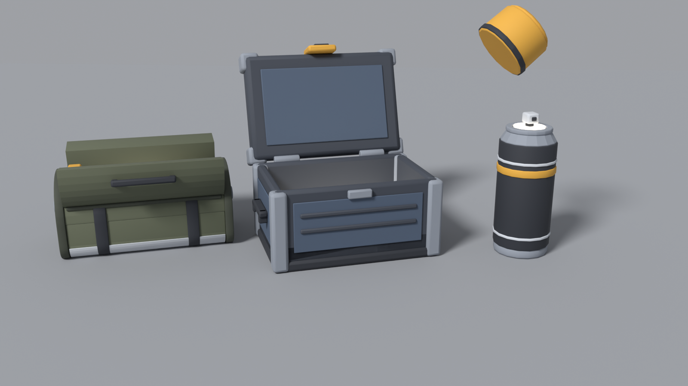

# Loot: Crates, Duffel Bags and Spray Cans

The owner, 16 Nov 2026: "can we get loot our own crates duffel bags and like spray cans? reference the rivals crates
for the crates and go off that for the bags and cans … eventually they'll cost robux but free for now while we test!
when you open them, should they drop on the ground and have a csgo style opening?" The main session's call: yes to
both (drop on the ground, then a CS:GO-style reel).

Built by the loot session, 16 Nov 2026. The shop screen that sells and opens them is the shop session's
(`roblox/docs/SHOP.md`).

**One gun at a time** (the owner, later the same day: "spray cans should give you a wrap for only one gun at a time!
some with the charms/hats"). A wrap or a hat is won for ONE weapon: "Galaxy · Assault Rifle", "Top Hat · Sniper".
What you own is (cosmetic, gun) pairs, written `<id>@<weapon>` (`galaxy@ar`, `crown@katana`). Free items stay usable
on every gun. A weapon skin already belongs to one gun, so its key is just its id.

## What is in each container

From the web game (`shared/cosmetics.js`: `CONTAINERS`, `RARITY`, `rollPick`). Only what exists on Roblox can come
out; nothing was invented.

| container | id | the web game's contents | on Roblox today |
| --- | --- | --- | --- |
| Crate | `crate` | weapon skins (`COSMETICS.model`, `SKINS_2`, streak skins) | the 25 skins whose models are in (`ReplicatedStorage.JankfireSkins.<skin id>`, the guns session's; place v385). Each new skin model joins by itself. A skin is already one gun's |
| Duffel Bag | `bag` | hats, effects, kill effects, grapples | the 8 hats that aren't free, each won for one gun: 8 x 16 = 128 pairs |
| Spray Can | `spray` | wraps and sprays (the web game's Box) | the 99 wraps that aren't free, each won for one gun: 99 x 16 = 1,584 pairs |

The guns are the 16 live weapons that take paint (`LootTable.weapons`: Roster live, not an item on G; the Shredder
included). A hat only goes on a gun with a seat for it (`GunHatData.SPOTS`): all 16 today.

Free items (the Default / Pink / Wood wraps, the Party Hat and Traffic Cone) belong to everyone and never roll.
Achievement items (`ach`, e.g. the Golden Sniper) are never in a container.

## The roll (server only, the web game's rule)

`Shared.LootTable.roll(kind, owned, rng)`, called only by the server (`Loot.luau`):

1. Take the rarities you still have a pair left in, in that container.
2. Pick one by weight: common 55, rare 28, epic 13, legendary 4 (`RARITY` in the web game).
3. Pick a gun, evenly, among the guns that still have something of that rarity left for them.
4. Pick any cosmetic of that rarity you don't own for that gun, all equally likely.

The gun and the cosmetic are rolled separately, the cosmetic keeps the web game's rarity weights, and a gun never
comes up with nothing left for it. **Duplicates: none.** The web game's rule (a roll only gives what you don't own)
now works on pairs: Galaxy on the AR and Galaxy on the SMG are different prizes, so a duplicate pair can't happen and
there is no refund to decide. The odds change as you own more (a rarity you have finished drops out and the others
share its weight). Only when you own every pair in a container does it refuse to open ("you own everything in it
already"); the web game turns that into +100 XP, and Roblox has no XP yet.

`LootTable.odds(kind, owned)` gives the exact chances for a player: per rarity (adding up to 100%, with how many pairs
are left), per cosmetic (its chance over all the guns it can still land on) and how many guns are in play.
`LootTable.oddsLine` gives one line ("Common 55% · Rare 28% · Epic 13% · Legendary 4%"). The shop shows them before
every open and every buy ("the gun is picked evenly"); the opening shows the line again at the top. The reel's cards
and the reveal name the gun ("ASSAULT RIFLE · RARE", "for your Assault Rifle only"), and EQUIP puts it on that gun.

## The pieces

| file | what |
| --- | --- |
| `src/shared/LootTable.luau` | containers, rarities and weights, pools, odds, the roll, the reel strip |
| `src/server/Profiles.luau` | a session-locked save (one server writes a player's save at a time), the job ProfileStore does |
| `src/server/Loot.luau` + `LootServer.server.luau` | what you own, your stock, the `Loot` remote, `Loot.owns`, `Loot.grant`, `Loot.restricted`, `Loot.grandfather` |
| `src/client/LootOpening.luau` | the opening: drop, pop, reel, reveal. `LootOpening.play(kind, res, opts)` |
| `src/server/Loadout.luau` | the loadout only takes and shows wraps and hats you own |
| `tools/roblox/loot_models.py` | the three models (headless Blender, the gun kit) -> `assets/loot/loot_upload.glb` |
| `studio-tools/LootImport.luau` | `PolishBackup.LootImport`: the upload -> `ReplicatedStorage.JankfireLoot` |
| `tools/roblox/render_loot.mjs` | the seven loot sounds -> `assets/sounds/loot_*.wav` |

### The remote: `ReplicatedStorage.JankfireRemotes.Loot` (RemoteFunction)

Always answers a table `{ ok, why?, ... }`.

| call | answer |
| --- | --- |
| `("inventory")` | `free`, `robux`, `restricted`, `stock = {crate, bag, spray}`, `owned = {wrap, hat, skin}` (lists of `"<id>@<gun>"`; skins: skin ids), `inv` (the same, the shop's shape), `left` (pairs), `soon`, `save`, `dev`, `devAll` |
| `("buy", offerId, n?)` | a shop offer (`Shared.Shop`): `"crate"`/`"bag"`/`"spray"` = n (1 to 10) into your stock; `"bundle_<name>"` = its pairs (`{kind, id, weapon}`; an item with no weapon = every gun); `"wrap:<id>@<gun>"`/`"hat:<id>@<gun>"` = one pair from today's rotation. Free while `Config.LOOT_FREE`. |
| `("claim", offerId)` | the same as buy |
| `("open", kind)` | `prize`, `item` (the shop's field names; both carry `weapon` and `key`), `strip` (52 cards, each on a gun), `stop` (the prize's card), `stock`. Uses one from stock if you have any; with `LOOT_FREE` it opens even at none |
| `("dev", "unlock" / "lock" / "reset" / "stock")` | Studio and the place's owner only. `unlock`: wear anything, for this session only (nothing is saved, and containers still roll on what you really own). `lock`: back to what you own. `reset`: own nothing, no stock (saved). `stock`: +5 of each container. `set`, `{wrap = {keys}, hat = {keys}}`: an inventory back as it was (saved) |

Player attributes for the clients: `LootStock` (`"bag=0;crate=1;spray=2"`), `LootOwned` (goes up when what you own
changes), `LootSave` (`loading` / `cloud` / `off` / `lost`).

## Saving: our own session lock

The port plan has wanted ProfileStore since step 1. I wrote `Profiles.luau` instead of bringing outside code into the
game, with the same guarantees:

- Loading writes a lock into the save itself (`UpdateAsync`): a fresh session id and a time.
- A save only writes while the lock in the store is still this server's. Every save renews it: every 60 s when
  something changed, every 120 s otherwise, on leaving, and on shutdown (`BindToClose`).
- A load that finds another server's lock waits for it to be let go: 45 s live (8 s in Studio), or at once if the lock
  is older than 4 minutes (a dead server). Then it takes the lock.
- A server that finds its lock taken stops writing for good and kicks the player ("your stuff was opened in another
  server").
- One write at a time per profile, so two saves never land out of order.
- An open is saved 3 s after it lands; a buy 10 s after.
- Studio without API access: everything runs in memory and says so (`LootSave = "off"`).

Data (`JankfireLoot_v1`, key `u<UserId>`): `v` (2), `inv = {wrap, hat, skin}` (lists of `"<id>@<gun>"`; skins:
ids), `stock`, `opened` (counts), `receipts` (the last 100 purchase ids), `migrated`, `since`.

**The v1 -> v2 migration (per-gun ownership).** Saves written before the one-gun rule (`v` 1, bare ids, owned on every
gun) are turned into pairs when they load: each old wrap or hat becomes owned **on every gun that takes it**. I picked
this over "only on the gun it was equipped on" because the only v1 saves were that afternoon's test saves (the owner's
and testers'), and nobody should lose something they had. Done once (`v = 2` is saved).

**Nobody lost what they wore.** Before ownership, any wrap or hat could be worn. The first time a player loads,
whatever wraps and hats are in their saved loadout become theirs **on the gun they wear them on** (`Loot.grandfather`,
once per player). The loadout only saves what you own from now on, so this can never hand out anything new.

## The loadout only takes what you own

`Loadout.luau`: the `wrap` and `hat` ops refuse what you don't own **for that gun** ("you don't own that one for this
gun yet. it's in spray cans"), the `Wraps` and `Hats` attributes everyone reads only carry owned pairs (a saved pick
you don't own stays saved, and goes on the moment you win it), the Shredder tool follows the same rule, and
`Loot.changed` republishes the moment you win something. The loadout screen's wrap and hat bars put a lock on what you
don't own for the gun being edited ("Galaxy for the smg comes in spray cans"); you can still hover it to try it on.

## Robux (off)

- `Config.LOOT_FREE = true`: containers, bundles and singles cost nothing; containers open without stock.
- `Config.LOOT_ROBUX = false`. When the owner turns it on:
  - The shop's `ShopReceipts.server.luau` shows Roblox's prompt and owns `ProcessReceipt` (only one script may set it).
  - On a receipt it calls `Loot.grant(player, offerId, purchaseId)`, which gives the offer, **saves it with the
    purchase id before answering true**, and answers true again for a purchase id it already has. False = not
    written: the receipt is answered `NotProcessedYet` and Roblox sends it again later.
  - My `buy` op refuses paid offers then, so paid always goes through the prompt.
- Developer products are not created yet: the owner makes one per offer on Creator Hub and puts the ids in
  `Shop.luau` (`productId`).

## Roblox's rules for paid random items

Checked 16 Nov 2026 (vault `Research/Rivals crates and opening.md` has the sources). What applies once Robux is on:

- **Odds before any spend**, for anything bought with Robux or with a currency bought with Robux: every outcome as a
  percentage, adding to exactly 100, on a button with a word on it (a bare (i) icon does not count). Done:
  `LootTable.odds` (the shop shows it); the numbers update as you own more, which the rule asks for when items are
  once-only.
- **`ArePaidRandomItemsRestricted`** (`PolicyService:GetPolicyInfoForPlayerAsync`, in a pcall): true for some players
  (UK under-18s since August 2024; others may follow). Those players must get another way. `Loot.restricted(player)`
  gives it (true until Roblox answers); the shop must not prompt a container for them. Bundles and singles are not
  random and stay on sale.
- **Trading:** if `IsPaidItemTradingAllowed` is false, paid random results can't be traded. There is no trading.
- Rewards earned only through play are exempt from the odds rule (we still show them).
- The experience questionnaire on Creator Hub must say it has paid random items once they cost Robux.

## The containers

New models in headless Blender on the gun kit (`gunkit.py`, style C: one crisp chamfer, round tubes with faceted
outlines, flat colours, SmoothPlastic), so they sit with the guns. A charcoal and steel family; one muted colour each
so they are told apart at a glance; the house amber on the one part the eye should go to. No text, logos or pictures.

| | shape | colour | what opens |
| --- | --- | --- | --- |
| Crate | a flight case: charcoal shell, slate panels, steel corner posts, skid, side handles | slate | the lid, on a back hinge (108°), amber latch; a lit floor inside |
| Duffel Bag | a barrel bag: olive canvas, darker round end panels, two straps underneath, a handle on each flap | olive | the amber zip pull runs end to end, then the two top flaps fall open (80°); lit inside |
| Spray Can | a tall aerosol can: charcoal label, amber and pale stripes, steel foot and shoulder | charcoal + amber cap | the cap pops up and tumbles off; the nozzle and a light |

Rivals' cases (the research note) are long, flat rifle cases that open in the 3D lobby with no reel. Ours are
different shapes on purpose, and the reel is the owner's CS:GO idea.

## The opening (`LootOpening.luau`)

1. **The drop.** The container falls from 15 studs onto the ground 7.5 studs in front of you (never through a wall),
   lands with a heavy thud, a dust puff and a small camera shake, then hops twice and rocks. The camera eases round
   to a three-quarter view from your side. The HUD steps aside and your hands go (the same `LoadoutOpen` flag the
   loadout screen uses).
2. **The pop.** It rattles harder and harder for 0.8 s while light leaks from the seam, then the lid / zip / cap goes
   with a latch snap and a spark burst, and the inside lights up.
3. **The reel.** The world blurs and greys; a band of 52 cards slides past a fixed amber marker for 6.2 s (an ease-out
   curve: fast, then a long crawl over the last few), with a tick per card. Each card: the item's picture (a wrap's
   own texture, a hat's model), its name, its type and rarity, a rarity bar and a soft wash of the rarity colour. The
   reel stops somewhere across the prize card's width, never always dead centre.
4. **The landing.** The winner grows, the rest go dark, the screen breathes the rarity colour and a sting plays (one
   per rarity); epic and legendary add a shake and a burst of sparks in their colour.
5. **The reveal.** The reel goes, the blur clears to a soft depth of field, and the prize rises out of the open
   container and turns slowly: a wrap or a hat **on your own gun** (the one in your hands, else your primary), a skin
   as its weapon. Below: the rarity and type, the name, "shown on your …", and **EQUIP ON <GUN>**, **OPEN ANOTHER**,
   **DONE**.
6. **Away.** The prize goes, the container sinks into the floor, the camera eases back to where it was.

**SKIP [SPACE]** (a button too): during the drop and pop it cuts straight to a short reel; during the reel it lands at
once. `opts.quick = true` (repeat opens) skips the drop's height and the rattle and spins for 1.4 s. A death or a
match taking you ends it at once.

Rarity colours are muted versions of the web game's hues (`LootTable.RARITY`): common green-grey, rare blue, epic
violet, legendary gold.

Sounds (synth, `render_loot.mjs`): `loot_tick`, `loot_land`, `loot_pop`, `loot_win_common` / `_rare` / `_epic` /
`_legendary`. Until an upload clears review the opening falls back to the old `click`, `bonk`, `bigpop`, `ting` and
`round_start`.

The pop: a crate's lid swings back past open and settles; the bag's flaps fall open; the can's cap flies up, over and
lands on its side on the floor beside the can. A soft dark band at the top and bottom of the screen keeps the words
readable over any room, and the camera stands a couple of studs in front of you so your own body is never in shot.

All seven sounds were approved by Roblox on 16 Nov (asset ids in the shared notes, `loot-progress.md`).

## Testing (16 Nov 2026, solo, place version 372)

**The odds, on the server's own roll** (`LootTable.roll`, 30,000 rolls each, in Studio):

| case | common | rare | epic | legendary |
| --- | --- | --- | --- | --- |
| Duffel Bag, own nothing | 54.81% | 27.95% | 13.15% | 4.09% |
| Spray Can, own nothing | 54.77% | 28.35% | 12.82% | 4.05% |
| expected (web weights) | 55% | 28% | 13% | 4% |
| Duffel Bag, own both common hats | 0% | 61.90% (exp 62.22) | 29.31% (exp 28.89) | 8.79% (exp 8.89) |

Inside a rarity every item is equally likely (the bag's two legendaries 607 and 620 times; the can's 17 legendaries
59 to 86 times each, about 71 expected). The Crate answers "coming soon"; a bag you fully own refuses. Every reel
strip (52 cards) had the prize at its `stop`.

**Play test 1:**
- After `dev reset`, the loadout refused an unowned wrap (Galaxy) and hat (Crown) with "you don't own that one yet.
  it's in spray cans / duffel bags", took a free hat (Party Hat), and took the Crown once it was won.
- Buy: 3 Duffel Bags went into stock (`LootStock` = `bag=3;crate=0;spray=0`); 99 at once was refused (1 to 10).
- A full Spray Can opening and a Duffel Bag opening, start to finish; the camera, HUD, `LoadoutOpen` and controls came
  back as they were.
- Eight Duffel Bags gave eight different hats (stock used first, then free), the ninth refused. Fourteen Spray Cans:
  no duplicates. Two opens in the same instant: the second was told to slow down.

**Saving and a rejoin:**
- After the test stopped, the DataStore held the new inventory (16 wraps, 8 hats) and the session lock was let go
  (`lock` nil).
- Play test 2, a fresh session: it loaded the same 16 wraps and 8 hats from the cloud.
- Then the owner's inventory was put back to what it was before my tests (`dev set`: the shop session's Field Issue
  camos, Camo, the Cowboy Hat and the Crown).

**One gun at a time (place version 385):**
- The pair roll (6,000 rolls each, in Studio): Spray Can 54.7 / 28.1 / 13.1 / 4.0%, Duffel Bag 55.8 / 27.7 / 12.6 /
  3.8%, against 55 / 28 / 13 / 4. Every one of the 16 guns came up 350 to 409 times (375 expected). The per-cosmetic
  chances add to exactly 1. Pairs: 1,584 in the can, 128 in the bag.
- The Crate is live: the guns session's 26 skin models are in, 25 of them roll (the Golden Sniper is an achievement
  reward). A Crate opened a Cap Gun skin for the Yeehaw, shown on it.
- The owner's v1 save migrated on load: 5 wraps became 80 pairs, 3 hats became 48 pairs, saved as `v = 2`.
- A Spray Can gave Jersey for the Marble Shotgun. The loadout put it on the Marble Shotgun, and refused it on the AR
  ("you don't own that one for this gun yet. it's in spray cans"). A migrated Camo went on the Katana.
- The owner's inventory was put back to its migrated state afterwards.

**Not tested:** two real servers fighting over a lock (the steal path is code-read only); real Robux; a phone; a death
or a match interrupting an opening; the shop's screen calling the opening (the shop session tested that path).

## Open

- The reveal has no EQUIP for a skin yet (the loadout's `skin` op is the guns session's; wire it in when it's settled).
- Effects, kill effects, grapples and sprays are not on Roblox yet; when one lands, add its type to `LootTable.info`
  / `LootTable.pool` and to `TYPES` in `Loot.luau`.
- Developer products, then `LOOT_ROBUX = true`, then the questionnaire.
