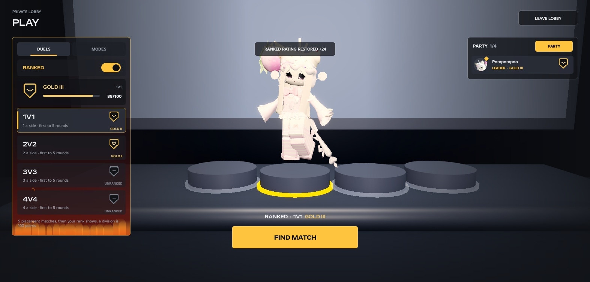
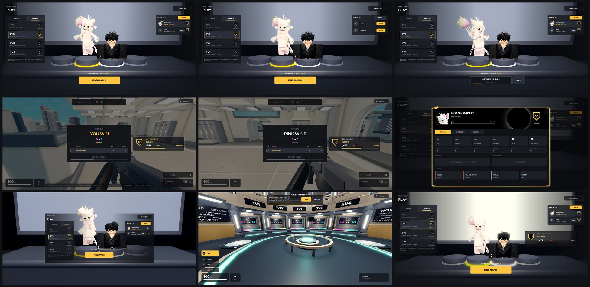

# Play, parties and ranked (Roblox)

The owner asked on 16 Nov 2026: "We need to add some systems, a play button that takes you into a private lobby a
party feature for 1v1 2v2 etc and ranked lobbies with mmr rank system".

What came of it: a **PLAY** button (or **M**) takes you to your own **private lobby**, a small room where your party
stands. From there the party leader picks a mode, casual or ranked, and presses **FIND MATCH**. The whole party is
matched together, lands on the same team, plays a normal match on the usual arenas and comes back to the lobby.
Ranked has its own rating per team size (Glicko-2), placement matches, tiers and divisions, and shows what you gained
or lost after every match. The hub's queue pads still work exactly as before: Play is the other way in.

Everything runs inside one server and is tested in Studio. The cross-server pieces (matchmaking across servers,
invites to friends in other servers, reserved match servers) are written but **off** behind
`PlayConfig.CROSS_SERVER`, and untested until the place is published.

Inspired by the big Roblox duel games and by Valorant, Overwatch and Rocket League; nothing is copied. Research notes
with sources are at the end.

## 0. Second pass: the owner's spec (17 Nov 2026)

The owner, relayed by the main session: "There will be a party button that displays everyone in the lobby, if you
invite them and perhaps even trade and you can view their card. Once invited there will be a play button, press it,
and it will display 1v1 2v2 3v3 4v4 and there will be a toggle for rank that will have a flame like transition and add
like a cool fire effect maybe? It'll also display your rank with a bar and a number on the right of the bar with how
much progression you're missing before next rank up like 34/100 or whatever. Game modes will be there too? ... pads
will be standard gameplay!!"

What changes from the first build (this section wins where it disagrees with sections 1, 2 and 4):

1. **PARTY button** (HUD, under PLAY, key **J**; also in the lobby).
   - It opens a list of everyone in the server, your party first.
   - Each row has the player's headshot, name and ranked badge, then **INVITE**, **VIEW CARD** (opens their player
     card, the player-cards session's screen) and **TRADE**.
   - TRADE is a disabled slot: trading is its own system with confirm screens, and a later session builds it.
   - Your party's rows have LEAD and KICK (for the leader), and the panel has **LEAVE PARTY**.
2. **A party no longer needs the lobby room.**
   - You can invite from the hub, and a party of people walking around the hub is a party.
   - The lobby room opens when someone presses **PLAY**:
     - the leader pressing PLAY takes every member who isn't in a match into the room;
     - a member pressing PLAY goes in alone.
   - **LEAVE LOBBY** takes you back to the hub, still in the party. LEAVE PARTY (in the PARTY panel) takes you out.
   - Accepting an invite to a party whose room is open puts you in the room.
   - FIND MATCH takes every member who isn't in a pad match. After the match the whole party lands in the room.
3. **The Play screen:**
   - Left panel tabs: **DUELS** | **MODES**.
   - DUELS shows the 1V1 / 2V2 / 3V3 / 4V4 cards (1V1V1 too while ranked is off) and a **RANKED** switch.
   - MODES is an empty, hooked slot: `PlayConfig.EXTRA` lists modes when a later session ports JANKFIRE's classic
     modes. The Play screen draws a card per entry and sends the pick to the server's queue unchanged.
4. **The RANKED switch has a flame transition.** Turning it on:
   - sends fire sweeping up the mode panel: a rising front of flame tongues, a warm gradient, a glow along the bottom;
   - bursts embers;
   - then leaves a low flicker of flames and a few rising embers while ranked stays on.
   - Turning it off cools the panel back down.
   - All of it is drawn from frames and gradients (nothing uploaded, so no image moderation). A flipbook from the VFX
     session can replace the tongues later.
5. **Rank points.** The rank shown is a ladder of **rank points (RP)**, 100 per division, on top of the hidden MMR (the
   Glicko-2 rating, which still decides matchmaking). This is the kind of system Valorant's RR is.
   - The rank display is the badge, the rank name, a bar, and right of the bar the points: **34/100**. APEX shows its
     points with no cap ("APEX 245 RP").
   - A win gives about 20 RP and a loss takes about 20. The gap between where your MMR says you belong and where your
     RP is moves both: if your MMR is above your rank, you gain more and lose less, and the other way round.
     - `ΔRP = ±20 + (MMR's ladder spot − your ladder spot) / 10`, then clamped: a win 8 to 40, a loss −6 to −40.
     - MMR's ladder spot: each 50 rating is 100 RP, with BRONZE III at 1150 (the tier table in section 4).
   - Placements: after the 5th, your RP starts at the MMR's ladder spot (rounded down to 10). It is capped at DIAMOND I,
     so 5 lucky wins can't place anyone in MASTER.
   - RP never drops below 0 (BRONZE III, 0/100). 100 RP is a promotion; going below the division's 0 is a demotion.
   - The rating number is no longer shown anywhere. The searching line shows only the time.
6. **Pads stay standard gameplay:** the walk-on duels as they are. The Play menu queues the same duels.

## 1. The flow

(This is the first build's flow. Section 0 changes four things:)

- the PARTY panel invites from anywhere;
- LEAVE LOBBY keeps you in the party;
- CASUAL / RANKED is now a RANKED switch;
- the screens show rank points, not the rating.

1. **PLAY** (button over PROFILE in the hub HUD, or **M**): you go to a private lobby. If you are not in a party you
   become a party of one. The screen fades, you appear on the first plinth of a quiet room, and the Play screen opens
   over it: modes on the left, the party on the right, the lineup in the middle.
2. **Invite:** INVITE lists everyone else in this server. An invite shows on their screen for 60 s (JOIN / DECLINE)
   wherever they are, except in a match: then it waits until they are out. Joining moves them into your lobby.
3. **The leader** (amber ring on their plinth) picks CASUAL or RANKED and a mode. Members see the pick live. Only the
   leader can pick, queue, kick and pass the lead. Anyone may cancel a search or leave.
4. **FIND MATCH:** the party enters the queue for that mode. The screen shows the time searching and, in ranked, the
   rating range being searched.
5. **MATCH FOUND:** a 3 s countdown, then everyone goes to the arena through the same code the pads use (same rules,
   same arenas, same rotation, same copies, same cap of live sites). The party is always on one team.
6. **After the match:** the end screen, then back to the lobby (not the hub), party intact. Ranked shows the rating
   change on the end screen and again in the lobby.
7. **LEAVE** (top right) takes you back to the hub and out of the party. The leader leaving passes the lead on.

## 2. Parties

| rule | value | why |
|---|---|---|
| size | up to 4 | the biggest team is 4v4 |
| who leads | whoever pressed PLAY first; passes to the oldest member when the leader leaves | web `party.js` |
| invites | to players in this server; expire after 60 s; one open invite per pair; 6 a minute per sender | web `HUB_LOBBY.md` §3, rate limits from `party.js` |
| kick / promote | leader only, on someone else in the party | web `party.js` `pkick` / `plead` |
| modes a party can pick | team size ≥ party size (a party of 3 picks 3v3 or 4v4); 1v1v1 is solo only | the party must fit one team |
| ranked party | members within **400 rating** of each other in that mode | stops boosting; Rivals uses about 4 ranks |
| in a match | a member who is in a pad match greys out; the party cannot queue until they are back | web `pbusy` |

Since the second pass (section 0), a party and its room are separate. A party can be people walking around the hub.
Its room is built from code when someone presses PLAY, and removed when no member stands in it, unless a match will
bring them back to it.

## 3. Matchmaking (in one server)

Every 0.5 s the server looks at each queue (casual and ranked, per mode) and tries to make one match:

- Entries are parties (a solo player is a party of one), oldest first.
- Parties are packed into the mode's teams whole (a backtracking search; at most 4 per team, so it is tiny). A party
  never splits.
- **Casual:** the oldest entries that fill the teams go, first come first served.
- **Ranked:** the oldest entry is the anchor. Another entry may join only if both entries' **search windows** cover the
  gap between their ratings, and the two teams' average ratings are within the narrower window of anyone in it.
  - Window = 100 + 8 per second waited (±100 at once, ±340 after 30 s, ±580 after a minute). After 90 s it is open.
  - So a match is found fast when the pool is close in skill and slowly widens when it is not.
- A formed match asks Matches for a site. When every site is busy the match waits, at the front of the line.
- A party that changes while searching (someone joins, leaves, or a member goes to a pad) drops out of the queue.

## 4. Ranked

### The rating: Glicko-2 with a team composite

Each player has, per ranked mode (1v1, 2v2, 3v3, 4v4), a rating `r`, a rating deviation `RD` (how unsure the game is)
and a volatility `σ`. After each match each player is updated as one Glicko-2 rating period with one game:

- The expected result comes from **your team's average rating** against **the other team's average rating**, with
  the other team's RD combined as the root mean square of theirs ("composite opponent").
- Your own RD sets how far you move. Teammates who are new move a lot, settled ones move a little, for the same result.
- Win = 1, loss = 0. Leaving mid-match is a loss. A match always has a winner (Matches has no draws).
- The round score does not change the rating (5-0 and 5-4 count the same). Simple and hard to farm.

| constant | value | effect |
|---|---|---|
| start | r 1500, RD 250, σ 0.06 | RD 350 (the textbook start) swung 5 placement wins up to Master; 250 lands at about Diamond III |
| τ | 0.5 | how fast volatility reacts to upsets |
| RD floor | 80 | a settled player still moves about ±15-20 a match, so the number stays alive |
| RD ceiling | 350 | RD grows back slowly while you don't play (Glicko-2's own rule, per idle day) |

Why Glicko-2 and not plain Elo: it knows how sure it is. New players find their level in a handful of matches,
settled players don't swing, and coming back after a break moves you faster again. Tested by simulation
(`tools/roblox/glicko_sim.mjs`): 2,000 players of known skill, 60 matches each, end with ratings spread
1098 / 1333 / 1500 / 1668 / 1904 / 2062 at the 5th / 25th / 50th / 75th / 95th / 99th percentiles.

### Tiers and divisions

Metal names, each with divisions III, II, I (III lowest), 50 rating per division. The top tier has no divisions and
shows the rating.

| tier | from rating | about |
|---|---|---|
| BRONZE | below 1300 (II from 1200, I from 1250) | lowest fifth |
| SILVER | 1300 | |
| GOLD | 1450 | the middle (1500 = GOLD II) |
| PLATINUM | 1600 | |
| DIAMOND | 1750 | top 15% |
| MASTER | 1900 | top 5% |
| APEX | 2050 | top 1-2%: shows "APEX 2,114" |

The badge is drawn from frames (no uploaded pictures): a rounded shield in the tier's metal, 1-3 chevrons for the
division, a frame from Platinum, side blades from Diamond, a crown point from Master. Unranked is a hollow grey shield.
The colours are the metals the player-cards session drew for its old XP tiers (`Ranks.TIERS`).

**Naming (agreed with the player-cards session, 16 Nov):** "rank" means this ladder. The card's XP side shows the
level only (LV and the XP bar). Its right-hand mark is the ranked badge with its line, drawn by `RankedStyle`.

### Placements

- The first **5** ranked matches of a mode are placements. The rating moves from the first one, but the rank shows as
  `PLACEMENTS 2/5` until the fifth is done.
- After a season reset, **3** placements.

### What you see

(Since the second pass, section 0: what you see is rank points, never the rating.)

- **After a match** (on the end screen, then in the lobby):
  - WIN / LOSS and the new rank;
  - the points won or lost, `+24 RP` / `-18 RP` (in placements, just W / L);
  - the division bar sliding to its new place, with `58/100` beside it.
  - Crossing a division says `PROMOTED` or `DEMOTED`. Finishing placements says `PLACED`.
- **The Play screen:**
  - with RANKED on, your rank in the picked mode: badge, name, bar and `34/100`;
  - each ranked mode card: your badge and rank for that mode (or `PLACEMENTS n/5`).
- **The player card** (Stats.cardExtra → `card.ranked`): the best placed mode this season, or the mode nearest to
  being placed, or `UNRANKED`.
- Player attribute `RankedBest` = "GOLD II" (for nametags or lists later).

### Seasons

`Ranked.SEASON` (now 1). When it goes up, each mode is soft-reset when its owner next joins:
`r = 1500 + (r - 1500) × 0.6`, `RD = max(RD, 180)`, 3 placements, and the old season's peak is kept in `past`.
Rewards are not built.

### The save

- Its own store `JankfireRanked_v1` through `Profiles.luau` (the session-locked layer loot and stats use), key
  `u<userId>`. It never touches another system's store.
- **Studio uses its own store, `JankfireRanked_studio`**, so test matches never reach live ratings.
- `{ v, season, modes = { ["2v2"] = { r, rd, vol, n, w, l, peak, last, placed, lp, s0 } }, past = {}, recent = { last 10 },
  log = { this season's ranked matches }, fixed = { restores applied }, void? }`.

### When a cheater is caught (17 Nov 2026)

The owner: "If someone is caught cheating give back any ranked stuff or stats!!". This works like Valorant's restore
when a cheater was in your match.

**The log.**
- Every ranked match goes in each real player's own save (`d.log`): its key (`m.key`), when, mode, team, teammates'
  and opponents' user ids, the RP and MMR change, and the result.
- It also goes in an index store `JankfireRankedLog_v1` (`_studio` in Studio):
  - `m:<key>` holds the teams and every real player's change;
  - `u:<user id>` lists that player's match keys for 30 days. Stand-ins are listed too, so a stand-in can play the
    cheater in a Studio test.

**The call:** `RankedData.restoreFor(cheaterUserId, since)`.
- The anti-cheat session calls it when a cheater is **confirmed**: an owner ban or confirm, never an automatic flag.
- `since` defaults to the last 14 days of this season.
- It covers every ranked match of the cheater's in that window, once per match (the record is marked restored).

**What changes for whom:**

| who | what happens | why |
|---|---|---|
| the other team's players who **lost** | the RP and the MMR they lost come back; the loss comes off their W/L | they lost to a cheater |
| the other team's players who won | nothing | they lost nothing |
| the cheater's **teammates** | nothing: their result stands, a win's RP and a loss's alike | they didn't cheat, and reversing their win would punish them for a teammate; taking their loss back would reward it |
| the **cheater** | the season is voided: every mode back to the MMR it started the season at (`s0`), RP and placements reset, `d.void` set | their ranked record this season can't be trusted |

**Who gets it, and when:**
- A player in this server gets it at once.
- Anyone else gets a pending fix in `JankfireRankedFix_v1` (`r:<user id>`). It is taken and applied 3 s after their
  next join, inside their own session-locked save. Nothing else ever writes into a player's save.
- With `PlayConfig.CROSS_SERVER` on, MessagingService (`JankRankedFix`) tells the server they're on to take it right
  away.
- The restored player sees `RANKED RATING RESTORED +N`.
- The player-cards session restores stats the same way through `Stats.restoreFor`, with the same call shape.

**Tested 17 Nov, place version 524.** I played ranked 1v1s against a stand-in "cheater" (id -7).
- **Before:** GOLD II at 34/100, rating 1530, losses 3.
- **Two losses to the cheater:** -22 RP and -24 RP, ending at GOLD III 88/100.
- **`restoreFor(-7)`:** 2 matches and 2 refunds, applied at once. Everything came back exactly: GOLD II 34/100,
  rating 1530.2, losses 3. The notice showed.
- **Calling it again:** nothing happens.
- **The cheater's season wipe:** waits in the pending store until they next join.
- **The offline path:** a third loss went to 13/100. The fix was queued in the store, and the join pull took it:
  back to 34/100, store empty, notice "RANKED RATING RESTORED +21".

## 5. How it is built

| file | what |
|---|---|
| `src/shared/Ranked.luau` | the rating maths (Glicko-2, team composite), tiers, placements, windows, season reset. Pure, no Instances |
| `src/shared/RankedStyle.luau` | the badge, label and colour for a rank (the Play screen and the player card draw with it) |
| `src/shared/PlayConfig.luau` | modes, party size, timings, the `CROSS_SERVER` switch |
| `src/server/Party.luau` | parties, invites, kick and promote, the lobby rooms, the remote |
| `src/server/LobbyRooms.luau` | builds a private lobby room from code, its plinths and camera spot |
| `src/server/Queue.luau` | the in-server matchmaker |
| `src/server/RankedData.luau` | ratings: the save, the update after a match, the card's `ranked` |
| `src/server/CrossServer.luau` | MemoryStore queue, MessagingService invites, reserved match servers. OFF, untested |
| `src/server/PlayServer.server.luau` | wires them to Fight, Matches and Stats; the Studio test hook |
| `src/client/PlayUI.luau` | the Play screen, party panel, invite toasts, ranked results |
| `src/client/PlayClient.client.luau` | the PLAY button, M, the lobby camera, the test attribute |
| `Matches.luau` (small edits) | `Matches.startQueued`, `Matches.homeOf` (where a lobby player respawns), ranked in the HUD line, "back to the lobby" |

Remotes: `JankfireRemotes.Play` (RemoteFunction, every request) and `JankfireRemotes.PlayPush` (RemoteEvent, party
state, invites, results). The server checks every request: who leads, sizes, modes, rate limits; the client only asks.

### Studio test hook

`ServerStorage.JankPlayTest` (BindableFunction, Studio only). Extra players are **stand-ins**: a regular's avatar
(`ServerStorage.JankfireNPCs`) on a plinth with a negative id. They take part in parties and the queue, and count in
the ratings, but they never enter a match. A match with stand-ins is held like a Matches ghost match, and ends after
`secs` with the team `win` taking it.

- `:Invoke("standins", n)` puts n stand-ins in the server's invite list (inviting one: it joins after 1 s)
- `:Invoke("rival", mode, ranked, size, rating)` puts a stand-in party in the queue
- `:Invoke("hold", secs, win)` how long a test match lasts and who wins it: a team number, `"party"` (the real
  players' team, the default) or `"rival"`
- `:Invoke("join", player)` a stand-in straight into the player's party (no invite)
- `:Invoke("state")` parties, queues, rooms; `:Invoke("ranked", player)` the player's ratings
- `:Invoke("setranked", player, mode, { r, rd, n, placed, need })` and `:Invoke("resetranked", player)` (Studio
  store only)
- `:Invoke("play", player)` / `:Invoke("leave", player)` what PLAY and LEAVE LOBBY do

Client side: the local player's attribute `PlayTest` = `play`, `open`, `close`, `tab:ranked`, `tab:casual`, `invite`,
`uninvite`, `fake:844x390`, `real`, `state`. The remote also works from a Client `execute_luau`
(`JankfireRemotes.Play:InvokeServer("find")`).

A full run (about 40 s): `standins 3`, PLAY, invite `-2`, `mode 2v2 true`, `setranked` with `n = 4` (the next match
places you), `rival 2v2 true 2 1500`, `hold 8 party`, `find`.

## 6. Across servers (written, OFF, untested until publish)

`PlayConfig.CROSS_SERVER = false`. Teleports and reserved servers can't be tested in Studio solo Play, so this part
has never run.

- **Queue:** each ticket (a party) goes into a `MemoryStoreSortedMap` per queue (`q_ranked_2v2`), sort key = rating,
  60 s expiry renewed while searching. One server at a time is the matchmaker (a lock key renewed every 5 s); it reads
  the map, forms matches with the same rules as §3, and writes each ticket's result (a reserved server's access code).
- **Match servers:** `TeleportService:ReserveServer` gives a server for the match; the parties are teleported there
  with `TeleportOptions.ReservedServerAccessCode` and teleport data `{ match, team, party }`. That server sees it is
  a match server (`game.PrivateServerId ~= ""` and the data), waits up to 30 s for everyone, starts the match through
  `Matches.startQueued`, and at the end teleports everyone back to a public server with their party in the data.
- **Invites to friends elsewhere:** `MessagingService` topic `jf_invite` with `{ to, from, server, code }`; accepting
  teleports you to the leader's server.
- What still needs doing at publish: test the teleports, the lock hand-over, and what happens when a teleport fails
  (`TeleportInitFailed`).

## 7. State (17 Nov 2026, place version 507)

Tested in Studio Play with one real player plus stand-ins (photos in `docs/matchmaking/`):

- **PLAY** (button and test hook): a private lobby room is built, you respawn anchored on the middle plinth, the
  camera frames the lineup and the Play screen opens. **LEAVE LOBBY**: back to the hub, body free, room removed.
- **Invites:** the list shows everyone else in the server. A stand-in invited joins after 1 s and stands on plinth 2.
  The party panel shows 2/4, LEADER and MEMBER, KICK and LEAD; kick works. The invite toast (JOIN / DECLINE, a
  draining bar) shows in the hub.
- **Ranked pick:** the leader picks RANKED 2V2. The mode cards show each mode's rank (UNRANKED, PLACEMENTS n/5, GOLD III).
- **The queue:** FIND MATCH shows SEARCHING with a clock and the widening rating range. A rival stand-in party joins the
  queue, then MATCH FOUND counts 3 s.
- **The match:** RooftopV2, and the HUD line says RANKED 2v2. The end screen says "back to the lobby" with the ranked
  card beside it. Then everyone is back in the lobby on the same plinths, party intact, and the screen comes back by itself.
- **Ratings:** a 5th placement (a loss) gave -53, PLACED, GOLD III. The next match (a win) gave +49, PROMOTED to
  GOLD II. The Studio store (`JankfireRanked_studio`) kept the rating between Play tests.
- **Card and phone:** the player card shows the ranked badge and its line in the player-cards session's slot. An
  844x390 phone box lays out with the compact panels.

**The second pass (section 0), tested 17 Nov, place version 510:**

- **PARTY panel in the hub:**
  - Inviting a stand-in made a party of 2 in the hub, with no room.
  - The panel lists the party (LEADER / MEMBER, IN THE HUB, KICK, VIEW CARD, LEAVE PARTY) and the server (badges,
    INVITE, VIEW CARD, a greyed TRADE).
- **PLAY as the leader** built the room and brought both members onto plinths.
- **The RANKED switch:**
  - Turning it on sweeps flames up the panel with embers.
  - Then it settles to a warm edge, low flames along the bottom and a few embers.
  - The rank block reads GOLD II, a bar, 34/100.
- **A ranked win** gave +27 RP: GOLD II, 61/100 on the result card.
- **LEAVE LOBBY** sent me to the hub, still in a party of 2 (the room closed). **LEAVE PARTY** left the party.

Not tested (needs other real players or a published place):

- Two real players in one party, a real invite answered, a real 2v2 against real players. Stand-ins never enter the
  arena: their side of a test match is empty, so the match is held like a ghost match.
- Leaving the server mid ranked match. The loss is applied at once in code, but this has not been run.
- Everything in section 6 (cross-server): off, never run.
- The nameplates over the lineup are built and attached (checked by code: two plates, one on each head), but Studio's
  capture tool doesn't draw them, so they have no photo.
- Touch on a real phone.

## 8. Research notes (16 Nov 2026)

- **Roblox duel games:** a Play button that matchmakes across lobbies sits beside walk-on duel pads. Ranked is 1v1 to
  3v3 there, with Bronze to Diamond in three divisions, a further named tier, a top tier with no divisions, about 200
  points a division and 10 placement duels. Party members must be within about four ranks of each other.
  (bloxodes.com/wiki/rivals/ranks, allthings.how, dungeonpath.com; fan guides that disagree in places.)
  - We kept: Play beside the pads, placements, three divisions, party rating spread.
  - We changed: our own numbers (Glicko, 50 a division, 1500 middle), our own top tiers (MASTER, APEX), 5 placements,
    a 4v4 ranked queue.
- **Valorant:** placements before a rank, shown rank on top of a hidden matchmaking rating, rank limits for small
  parties (support.riotgames.com). **Overwatch 2:** the rank moves after every match with a bar inside the division
  (esports.gg). **Rocket League:** placements per playlist, soft resets. **CS2 Premier:** the rating is a number.
- **Glicko-2:** 1500 / 350 / 0.06 are the textbook start; τ 0.3 to 1.2. The team "composite opponent" comes from the
  paper "Abstracting Glicko2 for Team Games" (en.wikipedia.org/wiki/Glicko_rating_system, libraries.io/npm/glicko-two).
- **Roblox services** (create.roblox.com docs):
  - MemoryStore sorted maps take numeric sort keys and expire after at most 45 days; quotas grow with players; Studio
    has its own small, separate data.
  - MessagingService messages are 1 KB at most, best effort, usually 1 to 2 s.
  - `TeleportAsync` with a reserved server works in Studio's multi-client Test (a new test server), not in Play solo;
    teleport data is visible to the client and must hold nothing secret.
  - DataStore session locking as in Roblox's own guidance (a lock id written in the same UpdateAsync as the read);
    `Profiles.luau` already does this.
  - Roblox's built-in matchmaking only picks public servers; it has no parties or queues, so it can't form these
    matches (create.roblox.com/docs/matchmaking).
