# Play, parties and ranked (Roblox)

The owner asked on 16 Nov 2026: "We need to add some systems, a play button that takes you into a private lobby a
party feature for 1v1 2v2 etc and ranked lobbies with mmr rank system".

What came of it: a **PLAY** button (or **M**) takes you to your own **private lobby**, a small room where your party
stands. From there the party leader picks a mode, casual or ranked, and presses **FIND MATCH**. The whole party is
matched together, lands on the same team, plays a normal match on the usual arenas and comes back to the lobby.
Ranked has its own rating per team size (Glicko-2), placement matches, tiers and divisions, and shows what you gained
or lost after every match. The hub's queue pads still work exactly as before: Play is the other way in.

Everything runs inside one server and is tested in Studio. The cross-server pieces (matchmaking across servers,
invites to friends in other servers, reserved match servers) are written but **off** behind
`PlayConfig.CROSS_SERVER`, and untested until the place is published.

Inspired by the big Roblox duel games and by Valorant, Overwatch and Rocket League; nothing is copied. Research notes
with sources are at the end.

## 0. Second pass: the owner's spec (17 Nov 2026)

The owner, relayed by the main session: "There will be a party button that displays everyone in the lobby, if you
invite them and perhaps even trade and you can view their card. Once invited there will be a play button, press it,
and it will display 1v1 2v2 3v3 4v4 and there will be a toggle for rank that will have a flame like transition and add
like a cool fire effect maybe? It'll also display your rank with a bar and a number on the right of the bar with how
much progression you're missing before next rank up like 34/100 or whatever. Game modes will be there too? ... pads
will be standard gameplay!!"

What changes from the first build (this section wins where it disagrees with sections 1, 2 and 4):

1. **PARTY button** (HUD, under PLAY, key **J**; also in the lobby).
   - It opens a list of everyone in the server, your party first.
   - Each row has the player's headshot, name and ranked badge, then **INVITE**, **VIEW CARD** (opens their player
     card, the player-cards session's screen) and **TRADE**.
   - TRADE is a disabled slot: trading is its own system with confirm screens, and a later session builds it.
   - Your party's rows have LEAD and KICK (for the leader), and the panel has **LEAVE PARTY**.
   - **REPORT** (17 Nov, the anti-cheat session's button) sits next to VIEW CARD on every row but your own and the
     stand-ins'. It opens the anti-cheat's report window: `ReportUI.open(userId, "party")`; see `docs/ANTI-CHEAT.md`.
     With four buttons the badge and the name give way to the buttons (`row()` measures them first). Before that,
     INVITE covered a ranked player's badge.
   - For a Studio photo, set the LocalPlayer attribute `PartyReportTest = true` and the stand-ins get the button too.
   - Tested in place v587 (17 Nov, 11:05 UTC) with 5 ranked stand-ins and one in the party. Every row was measured
     from code: the four-button rows keep 15 px between the badge and INVITE. This held on the full screen and on
     844x390 and 667x375 fake screens. Clicking REPORT on a row opened the report window above the panel.

     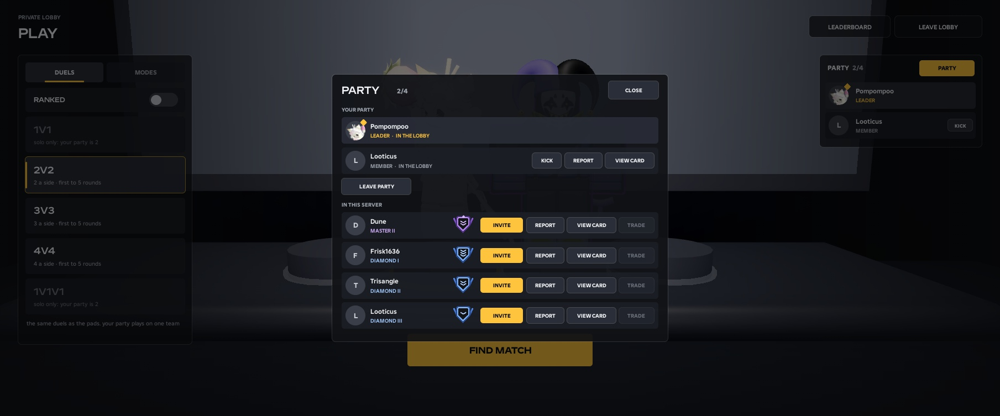
     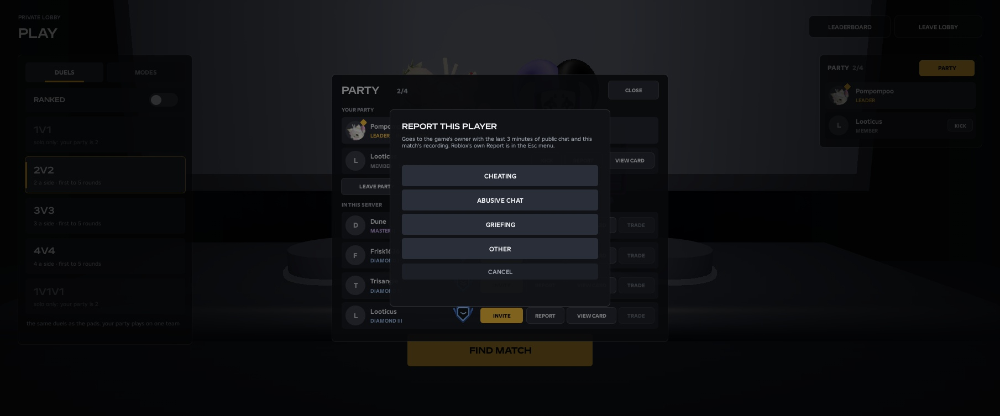
2. **A party no longer needs the lobby room.**
   - You can invite from the hub, and a party of people walking around the hub is a party.
   - The lobby room opens when someone presses **PLAY**:
     - the leader pressing PLAY takes every member who isn't in a match into the room;
     - a member pressing PLAY goes in alone.
   - **LEAVE LOBBY** takes you back to the hub, still in the party. LEAVE PARTY (in the PARTY panel) takes you out.
   - Accepting an invite to a party whose room is open puts you in the room.
   - FIND MATCH takes every member who isn't in a pad match. After the match the whole party lands in the room.
3. **The Play screen:**
   - Left panel tabs: **DUELS** | **MODES**.
   - DUELS shows the 1V1 / 2V2 / 3V3 / 4V4 cards (1V1V1 too while ranked is off) and a **RANKED** switch.
   - MODES is an empty, hooked slot: `PlayConfig.EXTRA` lists modes when a later session ports JANKFIRE's classic
     modes. The Play screen draws a card per entry and sends the pick to the server's queue unchanged.
4. **The RANKED switch has a flame transition.** Turning it on:
   - sends fire sweeping up the mode panel: a rising front of flame tongues, a warm gradient, a glow along the bottom;
   - bursts embers;
   - then leaves a low flicker of flames and a few rising embers while ranked stays on.
   - Turning it off cools the panel back down.
   - The flames are a looping fire flipbook (`FlameStrip.luau`, `vfx_fire_8x8` drawn from maths by the VFX session,
     17 Nov, after the owner's "can the flames be actual flames?"); the gradient, the glow and the embers are frames.
5. **Rank points.** The rank shown is a ladder of **rank points (RP)**, 100 per division, on top of the hidden MMR (the
   Glicko-2 rating, which still decides matchmaking). This is the kind of system Valorant's RR is.
   - The rank display is the badge, the rank name, a bar, and right of the bar the points: **34/100**. APEX shows its
     points with no cap ("APEX 245 RP").
   - A win gives about 20 RP and a loss takes about 20. The gap between where your MMR says you belong and where your
     RP is moves both: if your MMR is above your rank, you gain more and lose less, and the other way round.
     - `ΔRP = ±20 + (MMR's ladder spot − your ladder spot) / 10`, then clamped: a win 8 to 40, a loss −6 to −40.
     - MMR's ladder spot: each 50 rating is 100 RP, with BRONZE III at 1150 (the tier table in section 4).
   - Placements: after the 5th, your RP starts at the MMR's ladder spot (rounded down to 10). It is capped at DIAMOND I,
     so 5 lucky wins can't place anyone in MASTER.
   - RP never drops below 0 (BRONZE III, 0/100). 100 RP is a promotion; going below the division's 0 is a demotion.
   - The rating number is no longer shown anywhere. The searching line shows only the time.
6. **Pads stay standard gameplay:** the walk-on duels as they are. The Play menu queues the same duels.

## 1. The flow

(This is the first build's flow. Section 0 changes four things:)

- the PARTY panel invites from anywhere;
- LEAVE LOBBY keeps you in the party;
- CASUAL / RANKED is now a RANKED switch;
- the screens show rank points, not the rating.

1. **PLAY** (button over PROFILE in the hub HUD, or **M**): you go to a private lobby. If you are not in a party you
   become a party of one. The screen fades, you appear on the first plinth of a quiet room, and the Play screen opens
   over it: modes on the left, the party on the right, the lineup in the middle.
2. **Invite:** INVITE lists everyone else in this server. An invite shows on their screen for 60 s (JOIN / DECLINE)
   wherever they are, except in a match: then it waits until they are out. Joining moves them into your lobby.
3. **The leader** (amber ring on their plinth) picks CASUAL or RANKED and a mode. Members see the pick live. Only the
   leader can pick, queue, kick and pass the lead. Anyone may cancel a search or leave.
4. **FIND MATCH:** the party enters the queue for that mode. The screen shows the time searching and, in ranked, the
   rating range being searched.
5. **MATCH FOUND:** a 3 s countdown, then everyone goes to the arena through the same code the pads use (same rules,
   same arenas, same rotation, same copies, same cap of live sites). The party is always on one team.
6. **After the match:** the end screen, then back to the lobby (not the hub), party intact. Ranked shows the rating
   change on the end screen and again in the lobby.
7. **LEAVE** (top right) takes you back to the hub and out of the party. The leader leaving passes the lead on.

## 2. Parties

| rule | value | why |
|---|---|---|
| size | up to 4 | the biggest team is 4v4 |
| who leads | whoever pressed PLAY first; passes to the oldest member when the leader leaves | web `party.js` |
| invites | to players in this server; expire after 60 s; one open invite per pair; 6 a minute per sender | web `HUB_LOBBY.md` §3, rate limits from `party.js` |
| kick / promote | leader only, on someone else in the party | web `party.js` `pkick` / `plead` |
| modes a party can pick | team size ≥ party size (a party of 3 picks 3v3 or 4v4); 1v1v1 is solo only | the party must fit one team |
| ranked party | members within **400 rating** of each other in that mode | stops boosting; Rivals uses about 4 ranks |
| in a match | a member who is in a pad match greys out; the party cannot queue until they are back | web `pbusy` |

Since the second pass (section 0), a party and its room are separate. A party can be people walking around the hub.
Its room is built from code when someone presses PLAY, and removed when no member stands in it, unless a match will
bring them back to it.

## 3. Matchmaking (in one server)

Every 0.5 s the server looks at each queue (casual and ranked, per mode) and tries to make one match:

- Entries are parties (a solo player is a party of one), oldest first.
- Parties are packed into the mode's teams whole (a backtracking search; at most 4 per team, so it is tiny). A party
  never splits.
- **Casual:** the oldest entries that fill the teams go, first come first served.
- **Ranked:** the oldest entry is the anchor. Another entry may join only if both entries' **search windows** cover the
  gap between their ratings, and the two teams' average ratings are within the narrower window of anyone in it.
  - Window = 100 + 8 per second waited (±100 at once, ±340 after 30 s, ±580 after a minute). After 90 s it is open.
  - So a match is found fast when the pool is close in skill and slowly widens when it is not.
- A formed match asks Matches for a site. When every site is busy the match waits, at the front of the line.
- A party that changes while searching (someone joins, leaves, or a member goes to a pad) drops out of the queue.

### QUICK JOIN on the hub pads (17 Nov 2026)

The owner: "also when someone steps on a pad, make a pop up to quick join and itll teleport them to one of the pad
sides". Built in `server/QuickJoin.luau` and `client/QuickJoinUI.luau`.

- **When it shows:** someone stays on a hub queue pad (either bank) for 1 s and the pad still has room. Then everyone
  else free in the hub gets a pop-up at the top centre, in the invite toast's look. It says who is waiting, the mode,
  how many spots are open, and has QUICK JOIN.
- **Pressing it:**
  - The key is F (the settings session's "quickjoin" bind; the hub is first person, so on a PC the mouse is locked).
    On a phone you tap the button.
  - The server moves you onto the side with room, the emptier one, stamping `TeleportT` first so the anti-cheat
    starts afresh. From there the pad's own queue takes over, as if you had walked on.
- **Who doesn't get one:** anyone on a pad, in a match, in a private lobby (`Lobby` attribute), in training or the
  playground, or in a menu (`LoadoutOpen`). Not the one who stepped on. Not a party member whose leader is someone else.
  A leader brings the members who are free in the hub onto one side, and only gets the pop-up when a side has room
  for all of them.
- **No spam:** one pop-up at a time. It goes after 6 s, the moment the pad fills, or when the one waiting steps off.
  Each player gets at most one every 20 s. Settings > HUD > QUICK JOIN POP-UPS (`hud.quickJoin`) turns them off.
- **Phones:** the card drops to y 64, under the touch buttons' top row. The button is 40 tall.
- **The hook in Matches:** `Matches.padView()` is the pads as the last pad step saw them. QUICK JOIN only reads it.
  Pretend people (Studio tests) count for the pop-ups, never for the pad's own queue.
- **Tested** in place v646 (17 Nov, 16:30 UTC), with stand-ins through `JankPlayTest`:
  - "Dune" stood on 1v1 side 1. The pop-up came up at about 1 s, and F put me on side 2.
  - The pop-up faded at 6 s.
  - It went the moment the other side filled, and when the one waiting stepped off.
  - With the 20 s gap on, new pop-ups within 20 s of the last one were held back.
- Test ops: `qjstand pad side name`, `qjoff pad`, `qjgap secs`, `qjstate player`.
- Place v650 fixed the key cap, which had sat over the words.
- Place v658 turns the camera into the hub after the move. The server turns the body, but a first-person camera
  keeps its own direction, so the client turns it to the direction the server sends back (`look`).

  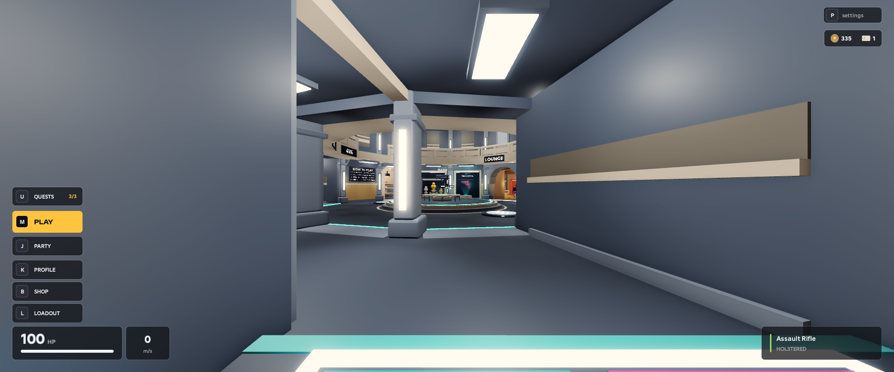

  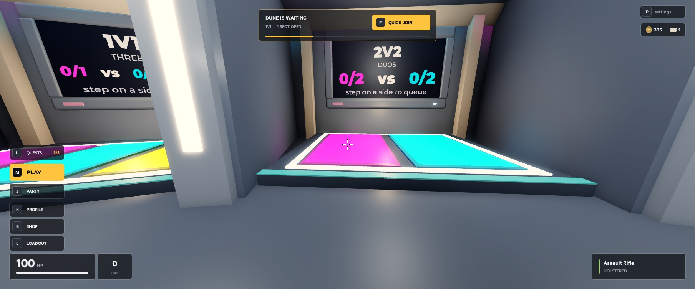

### The MODES tab: QUICKPLAY and PARTY (17 Nov 2026)

The owner: "also modes should be quickplay or party choosing individual modes would be impossible to fill up with
proper matches! maybe". The main session decided the shape; this section replaces "a card per classic mode".

- **The tab** (`client/ModesTab.luau`, called from PlayUI's modeList) is PARTY RANKED, then two cards:
  - **QUICKPLAY:** every mode, 2 to 8 players, "the match votes on its mode", and the modes in rotation along its
    foot.
  - **PARTY:** the leader picks one classic mode (two columns; on a small screen a `< MODE >` row), plus a FILL FROM
    QUICKPLAY switch. The line under it says what the mode takes, or what stops the party playing it alone.
  - The big button reads START MATCH for a party pick without fill: the party plays it alone, now.
- **QUICKPLAY** (`PlayConfig.QUICKPLAY`, an EXTRA entry with `quick = true`) is one queue, casual or ranked.
  - It forms like the free-for-all queue (`Queue.luau` formFfa): whole parties, 2 to 8 players. It goes at 8, or once
    the oldest has waited 15 s.
  - **The vote** (Party.luau, `client/QuickVoteUI.luau`): when a match forms, its players see 3 modes its head-count
    fits and tap one, or press 1, 2 or 3. They have `PlayConfig.VOTE` (8 s).
    - Most votes wins, a tie is drawn at random, and no votes at all is a draw weighted by `PlayConfig.QUICK_WEIGHT`.
    - The pick shows for 2 s, then the match starts through the mode's own start (Modes.luau).
    - This server's last quickplay mode is never on offer again straight away, unless nothing else fits.
  - **What fits:** `PlayConfig.QUICK_COUNTS`. Team Deathmatch, Tags and Infection take 4 to 8; everything else 2 to 8.
    A team mode is only offered when the parties split into two sides at most one apart (`Queue.split`). A mode's own
    `qmin` / `qmax` wins over the table.
- **PARTY with FILL FROM QUICKPLAY** (`Queue.luau` formFill):
  - The oldest party that picked the mode is the anchor. Other parties that picked it, then the quickplay queue
    (oldest first), top it up with whole parties to the mode's head-count.
  - It goes full, or at the mode's least once the anchor has waited 15 s.
  - The quickplay queue is looked at last each pass, so a waiting party gets its fillers first.
- **Ranked:** quickplay and party matches are rated on the PARTY RANKED ladder like any classic mode (rkey "party",
  rated.mode = the picked mode). One party alone is never rated, because friends could farm each other:
  - a party pick without fill is casual, and PARTY RANKED asks for fill;
  - the ranked queues never form a match of one party.
- Test ops (JankPlayTest): `qpvote standInId mode`, `qpfill secs`, `qpfound`. A `rival` group can search
  `"quickplay"` like any mode.
- **Tested** in place versions 646 and 650 (17 Nov), with stand-ins:
  - Head-count: 3 stand-ins were offered Gun Game, Randomizer and Duck Rain, with no team modes or Infection. 8 were
    offered Infection, Spoons & Grapples and Duck Rain.
  - Quickplay with 8 (me and 7 stand-ins): the vote came up with Tags, Infection and One in the Chamber.
    - I pressed 2, two stand-ins voted Infection and one Tags, and the counts showed on the cards.
    - Infection was picked and started with 8 seats on RooftopV3.
  - A party of 4 (me and 3 stand-ins) that picked Infection without fill started at once with 4 seats.
  - Quickplay with 4 (v658): offered Team Deathmatch, Randomizer and Tags. With no votes, Tags was drawn and started
    with 4 seats.
  - Long names shrink to fit (v658), on the vote cards and on the PARTY buttons. On a phone-sized screen (844x390)
    the `< MODE >` row shows ONE IN THE CHAMBER in full.

  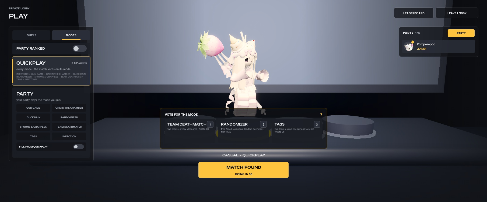
  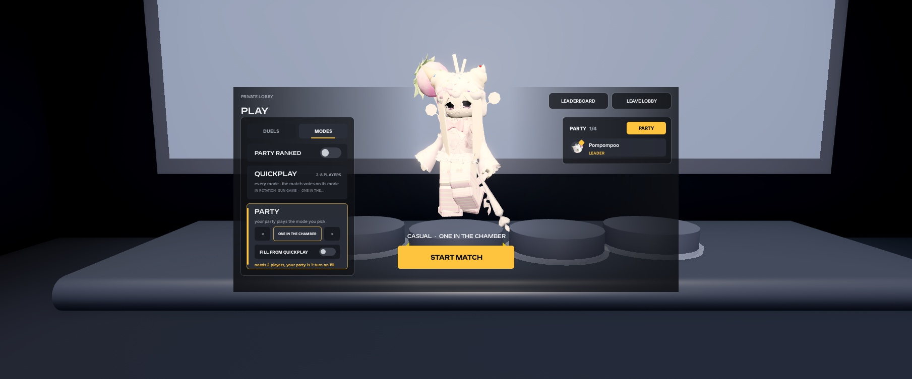
  - With Infection picked and a party of 1, the card says "needs 4 players, your party is 1: turn on fill" and the
    button reads START MATCH.

  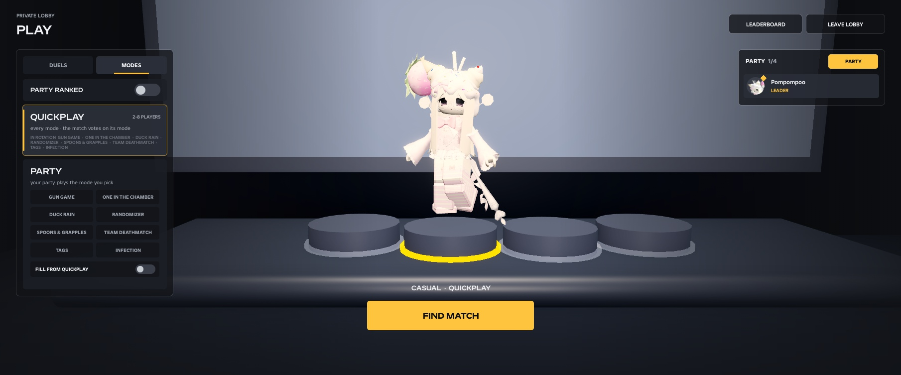
  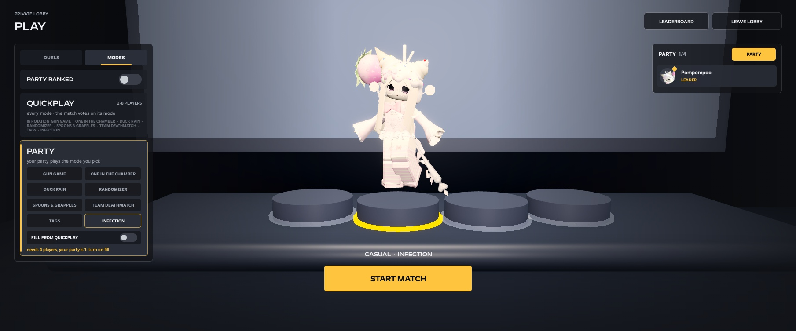
  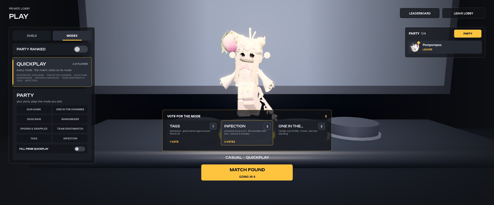
  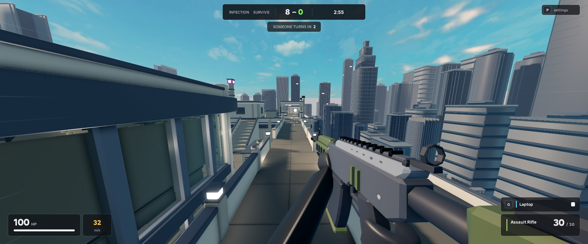
  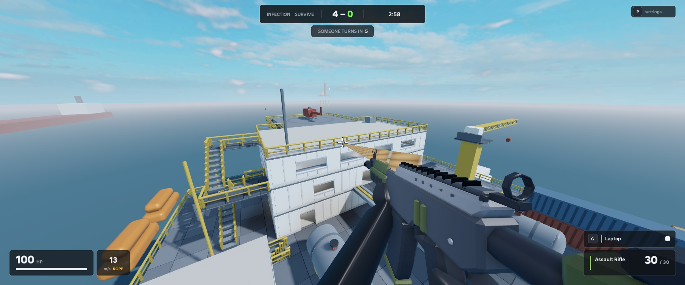

### Picking the map (17 Nov 2026)

The owner: "also add map selector before hand". The maps are the rotation's: `Arena.pool`, built from workspace.Map's
`ArenaPool` and an arena's `Enabled` switch (the hub session's; Suburb v2 is switched off until it's finished). Each
map is named the way its first banner names it (`Arena.title`) and has a card picture (`shared/MapCards.luau`).

- **The pictures:** one per arena, taken in Studio Edit from over a corner of the play area under the arena's own
  look (`HubLook.preview`), then uploaded as decals (no text, signs or logos in any). An arena without a picture gets
  a plain card.
- **A party's own pick** (the PARTY card): a MAP row under the modes, with a picture, a name, and `< >` through RANDOM
  and every map in the rotation. Only the leader can change it; the others see it. The party plays there, alone or
  filled from quickplay. RANDOM is the rotation's draw, as before.
- **QUICKPLAY and casual duels:** a map vote of 3 cards from the rotation, in the same `PlayConfig.VOTE` (8 s) as the
  mode vote.
  - Under a mode vote the keys are 4, 5 and 6; a duel's map vote alone is 1, 2 and 3. Tapping works too.
  - Most votes wins, a tie is drawn at random, and no votes is a draw of the three.
  - The map that vote last picked is never on offer again straight away.
  - Quickplay's maps take half its head-count a side, so Crate (3 a side at most) sits out an 8-player match.
- **The hub's pads, in a map room** (18 Nov). The owner first asked for "map select for pads please" (v726: the vote
  ran on the pad itself), then: "map select should happen after pads itll spawn you in liek a void area where the map
  options appear then itll bring you to said map".
  - A full pad counts down `Matches.COUNTDOWN` (3 s) as before; its sign reads MAP VOTE IN n. Then its group goes to
    a MAP ROOM of its own (`server/MapRooms.luau`), and the pad is free for the next group at once.
  - **The room:** a round charcoal platform in a dark void, with a lower ring under its edge and an invisible rail
    round the rim.
    - On the far side, three big framed displays stand on an arc, each showing one map's picture and name, lit only
      by its own screen.
    - A round plate in front of each display: standing on it votes for that map.
    - One dim lamp hangs over the middle. No colour but the amber edge on the map that wins.
    - Rooms are built from code as they're needed, one per group voting at once (`workspace.MapRooms`, a row at
      y 1,400 far from every map), and taken down after the group has gone.
    - It's out of `Map`, so ZoneCull leaves it drawn while everything else is put aside.
  - **The vote:** `Matches.PAD_VOTE` (8 s) on the three maps, by the card on your screen (QuickVoteUI: keys 1-3 or a
    tap) or by standing on a plate.
    - The three are the site the pad already holds plus two more from the rotation for the pad's size, never the
      pad's last arena, in a random order.
    - Most votes wins; a tie, or no votes at all, is drawn.
    - The winner's site takes the held one's place. If it can't be had right now, the held map is played, and the
      displays show that.
    - The pick shows for 1.5 s (amber frame, the others dim), then the match starts the usual way: everyone respawns
      at that arena's spawns.
  - **The zone:** the room is the "staging" zone (`Matches.zoneOf`), with its own look: HubLook `void` (night, a
    near-black haze from 70 to 260 studs, enough ambient for the charcoal to read), through HubLife.
    - Nobody there is in a match, so there's no damage.
    - Every move into it stamps the anti-cheat's `TeleportT`, and the Spawn remote turns the camera to the displays.
  - **Leavers:** anyone who leaves the game, or ends up in another match, leaves the room. A side with nobody left
    sends the rest back to the hub with "the other side left: back to the hub", and the site goes back.
  - Pads are casual, so there's no ranked case. Parties step on pads like anyone (QUICK JOIN brings a leader's party).
  - Server: `Matches.padVote` (the Play remote's `padvote` through `Party.ops`), PlayPush `{ t = "padvote" }`.
    Test ops: `JankMatchTest("padfill", padName, player)` makes a pad full with one player (its match is held like a
    ghost match); `("padvotefor", padName, voterId, arena)`; `("padstate")` lists the rooms.
  - **Tested** in place v731 (18 Nov, 00:55 UTC), solo with the test fill on the 1v1 pad:
    - After the 3 s count I was in MapRoom1 (zone `staging`, the void look). Its displays were DESERT: CANYON (the held
      site), BAZAAR: ROOFTOPS and ROOFTOP, with the cards on my screen.
    - Standing on ROOFTOP's plate counted as a vote: ROOFTOP 1.
    - At the end ROOFTOP won (shown, with the others dimmed), the held DESERT: CANYON site went back, and I spawned on
      ROOFTOP with the match live. The room was taken down after.
    - An earlier run (a stand-in's vote for BAZAAR: ROOFTOPS) went the same way.
    - The photo of the pick shows the first winner style, a glowing amber frame. It was too loud under the bloom, so
      v731 keeps the frame grey (a shade lighter) and lights the plate amber instead.
    - Not tested: real groups of several players, a leaver mid-vote, two rooms at once.

    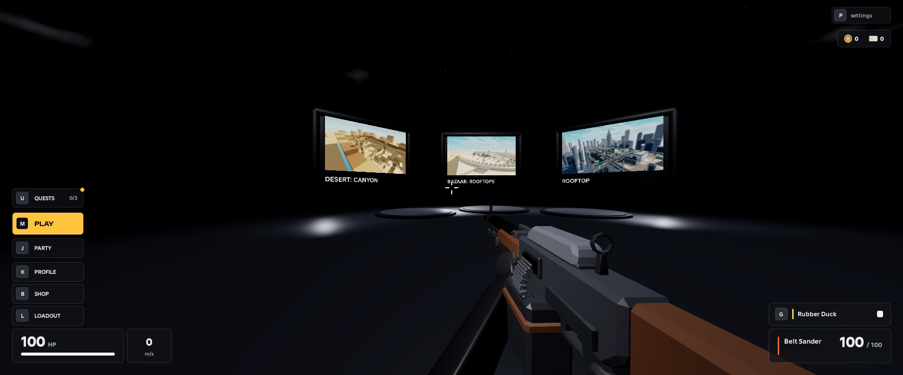
    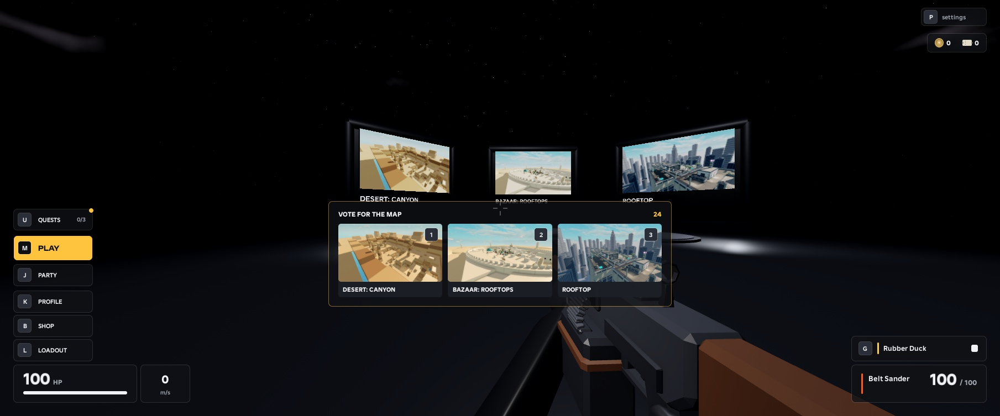
    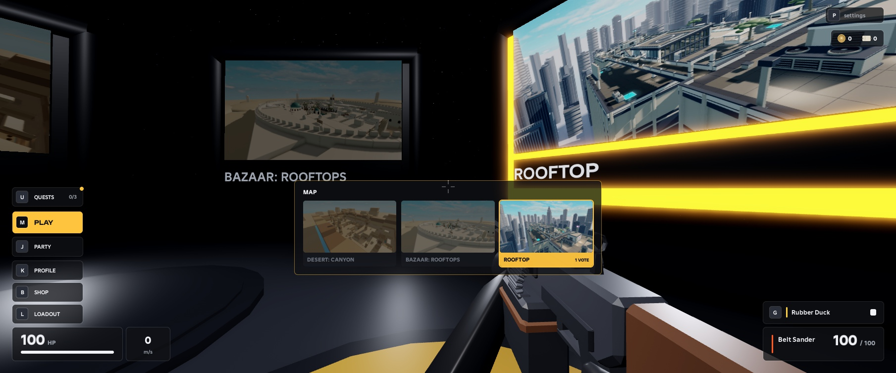
  - **v733 polish** (the main session, from the photos):
    - The screens are about twice the size: 30 x 16.9 in 33-wide frames. They stand on an arc round the spot where
      the group lands: the middle one, the one you face, at 34 studs, the side ones at 42, 54 degrees round.
    - The screen lights are softer (0.45).
    - The hub's left-hand menu (QUESTS, PLAY, PARTY, PROFILE, SHOP, LOADOUT) is hidden in the room, as in a match:
      `client/MapRoomHud.client.luau` switches those five ScreenGuis off in the `staging` zone and back on after. On
      a phone, TouchControls only moves the buttons inside them, so they go there too. The vote cards, the clock, HP,
      the weapon panels and the wallet stay.

    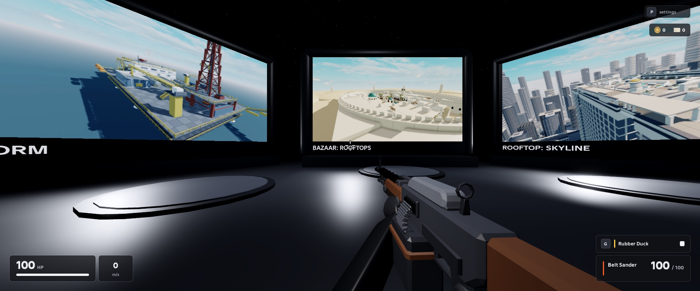
  - v726's on-pad vote, for the record:

    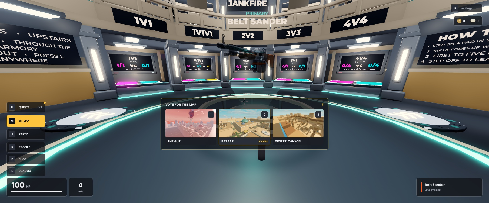
- **RANKED** (duels and PARTY RANKED): no pick and no vote, a fair random draw from the rotation. The DUELS foot and
  the MODES tab say so.
- **Server:** `Party.luau` (Found `mvote` / `map`, ops `map` and `mapvote`, test op `qpmap standInId arena`).
  `Matches.startQueued` and `startMode` take `opts.arena`; one that can't be had right now (while there's room for a
  match) gives way to the rotation's.
- **Tested** in place v716 (17 Nov, 23:41 UTC), quickplay with me and 3 stand-ins: the panel offered Infection, Duck
  Rain and One in the Chamber, and THE GUT, CRATE and DESERT: CANYON with pictures. I pressed 4 and 1, and a stand-in
  voted the same, so both cards showed 2 votes. Infection then started on THE GUT.

  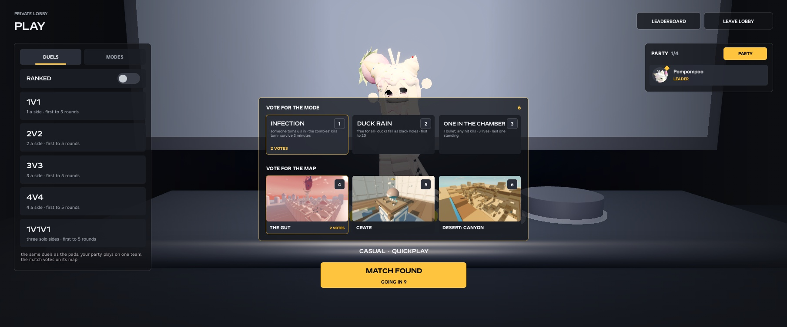
  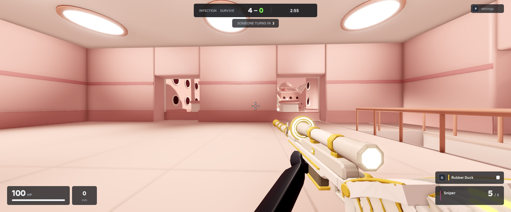
  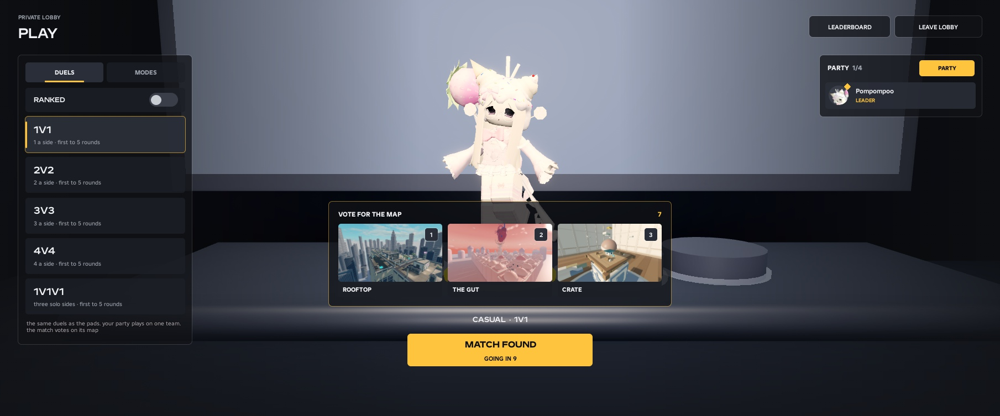
- **Casual duel rechecked** (v720): a stand-in and I (key 1) both voted DESERT: CANYON. The server counted 2 votes and
  the 1v1 opened on DESERT: CANYON. At v719, pressing 1 for ROOFTOP had ended on CRATE; most likely that key press
  didn't register, and with no votes one of the three is drawn.

### Changing your loadout before and between rounds (17 Nov 2026)

The owner: "allow us to change weapons before first round and between rounds".

- **The window** is the server's. `Matches` sets the player attribute `LoadoutWindow` (the server time it shuts) in
  every round-based match (duels and team duels, ranked too) during:
  - the countdown before a round: `READY_FIRST` = 8 s before round 1 (it was 3), `READY` = 3 s before the others;
  - the break between rounds (`BETWEEN`, 3 s).

  It clears the moment the round goes live. A classic mode (`m.rules`) never opens it, so Gun Game, Spoons,
  Infection and the rest keep their own weapons.
- **The server checks** (`Loadout.luau`, the shop session's file, two hunks).
  - A weapon pick in a match outside the window is refused: "the loadout opens before a round and between rounds".
  - Inside it, the pick is checked the same way as in the hub (slot, live weapon). If you're alive (the countdown),
    it goes into your hands at once through the hub's own re-arm (`armed`, `ArmT`). If you're dead (the break), you
    spawn with it at the next round.
- **The picker** (`client/MatchLoadout.client.luau`):
  - "CHANGE LOADOUT [L] · 5" sits over the weapon bar while the window is open (a button on a phone).
  - L opens a small panel: a row for each slot, `< WEAPON >` through the slot's live weapons, big arrows for thumbs,
    and DONE.
  - The window shutting closes it.
  - The full loadout screen stays the hub's. In the window its L now opens nothing, so the picker has the key.
- **Test hooks:** `JankMatchTest("between", player, secs)` ends a held match's round as if it had been won and starts
  the next one `secs` later. The attribute `MatchLoadoutTest` takes `"open"`, `"close"`, `"pick:slot:weapon"` (the
  answer goes on `MatchLoadoutResult`) or `"fake:844x390"`.
- **Tested** in place v719 (17 Nov), a casual 1v1 against a stand-in:
  - Round 1 opened the window with the hint and an 8 s count.
  - Once the round was live, a pick was refused with the line above.
  - I died, then forced the round end. In the break the picker took SMG (LoadoutNext `smg,…`), and round 2 spawned me
    with the SMG.
  - v720: a pick while alive in round 1's countdown went straight into my hands (SMG to Assault Rifle, 30/30) with 7 s
    left on the window.

  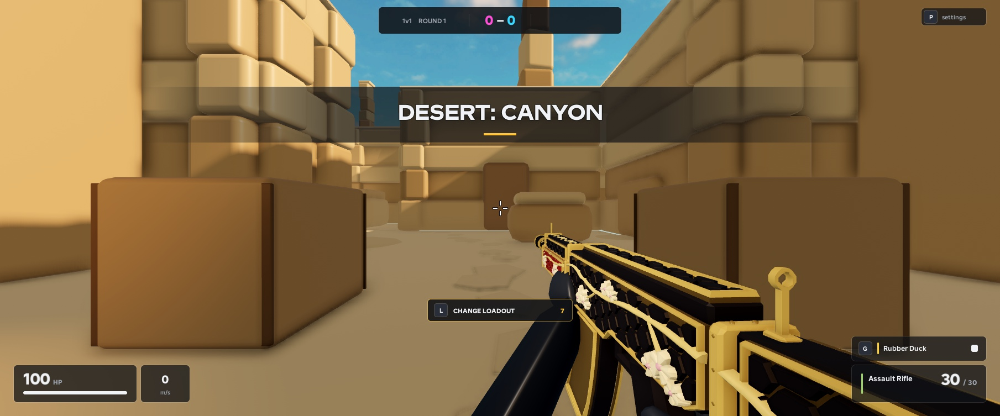

  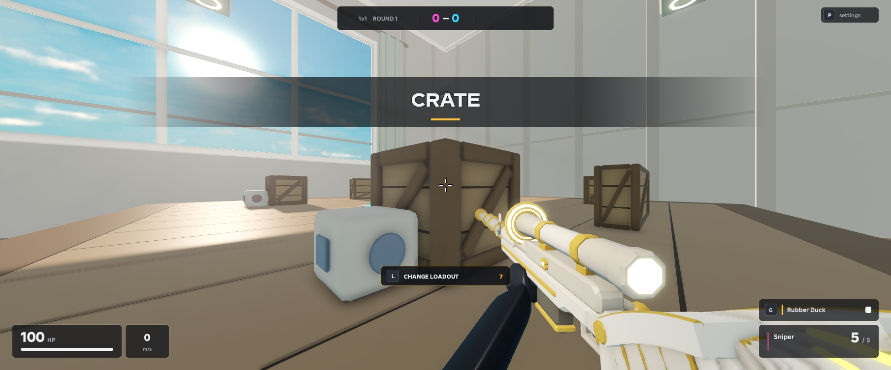
  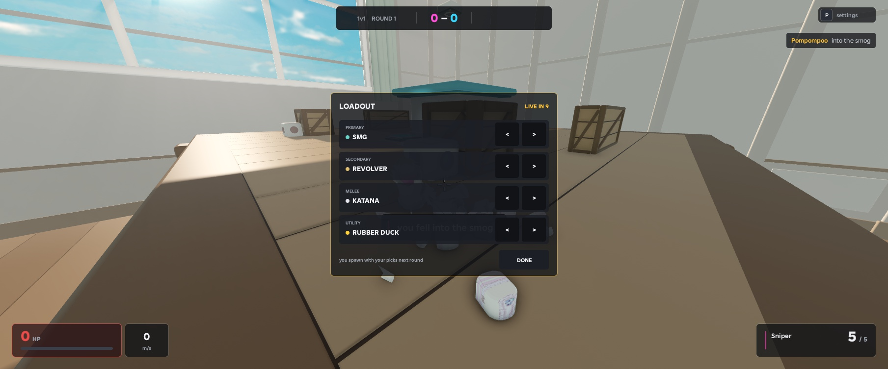

### Spawns rotate every round (18 Nov 2026)

The owner: "rotate spawns".
- **The rule:** `Matches.teamSpawns` asks `sideOf(m, team)`, which is (team - 1 + a random shift drawn once per match +
  round - 1) % teams + 1. Side 1 is the arena's "att" TeamSpawns, 2 is "def", 3 is "mid" (or the fallback spawns
  where an arena has no "mid" parts).
  - In round 1 each team gets a random side.
  - After that, two teams swap ends every round, and in a 1v1v1 each player moves one group round.
  - Which teammate gets which spot within a side is as before.
- Ranked and casual work the same way. Classic modes keep their own spawning (Modes.luau).
- **Everything that puts a body on its round spawn** asks `teamSpawns`: `spawnAt`, and the shop session's round-start
  hold (`spawnSpot`, which puts survivors back exactly on their spot with no speed). So the hold uses the rotated end.
- **Commits:** 1595a79 is my three hunks. They went into Studio with the shop session's install (its 0423565, place
  version 767).
- **Tested** in Studio (18 Nov, 03:11 UTC, solo, ghost matches advanced with `JankMatchTest("between")`):
  - A 1v1 on BAZAAR: my side spawned def, att, def.
  - A 1v1v1 on ROOFTOP: att, def, the middle (the fallback spawns: RooftopV3 has no "mid" parts), then att again.

### A party that fills a duel plays it privately (18 Nov 2026)

The owner: "if you're in a party of 2 you can search 1v1, it'll just send you to a private matching 1v1!"

- **Which parties:** one exactly the size of a duel's whole match (`PlayConfig.private`): 2 for 1V1, 3 for 1V1V1, 4 for
  2V2 (3V3 and 4V4 need 6 and 8, more than a party holds).
- **The screen:** the tile reads "1V1 · PRIVATE" with "your party only · never ranked" (no rank badge), the line over
  the button "PRIVATE · 1V1", and the button START PRIVATE.
- **The match:** it starts at once among the party: no queue, no other servers. It's never ranked, whatever the RANKED
  switch says (it goes on the casual key).
  - The party is split into the sides at random each time.
  - It votes on its map like any casual duel. The READY / loadout window, rounds, finishers and replays are the
    usual ones.
- **Afterwards:** everyone is back in the hub, still a party. The lobby room closes, and PLAY opens it again.
- **It counts for nothing** (`m.private`, like an owner's dev match), so friends can't farm each other:
  - no ranked rating;
  - no player-card numbers or XP (Stats);
  - no weapon mastery (it goes through Stats);
  - no quests, so no Brass or Crate Tickets from it either.
  - The same now holds for a PARTY-card pick played without FILL FROM QUICKPLAY, the other party-alone match. It was
    already never ranked; before this it counted for the rest.
- **Tested** in Studio (18 Nov 21:33 UTC, place v1025, solo with a stand-in in my party, RANKED on):
  - The tile and the button read as above.
  - START PRIVATE formed the match at once (nothing queued). The match's map vote had RooftopV2, Bazaar and DesertV2;
    the stand-in's vote picked DESERT.
  - The match was 1v1, not ranked, private, and the loadout window was open. I was on side 2 this time.
  - After it: the hub, still a party of 2, the room gone, my ranked count unchanged.

  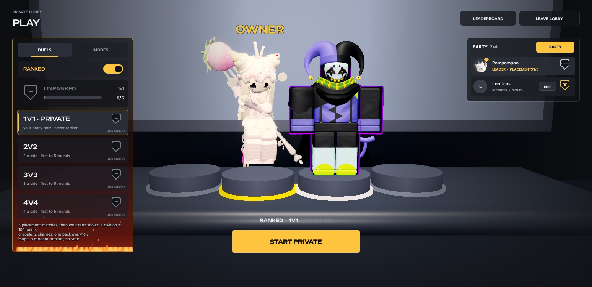

### No hub menus in a match or a map room (18 Nov 2026)

The owner: "disable like all the other menus because I can open shop and stats during a match". Then, from the live
game: "I opened my loadout during map select and this happened". The match had started, the view was only sky, and
an empty MAP panel was left up.

- **The rule** (`client/MenuGate.luau`): in the `match` and `staging` zones, the hub's menus don't open.
  - Blocked: the shop, the profile / stats / player cards, quests, the party panel, the Play screen, the hub's loadout
    screen, the leaderboard, and the customize (flair) screen.
  - Still allowed: settings, the emote wheel, the cursor toggle, REPORT, the match loadout picker in its window, and
    READY.
- **One guard line** at the top of each menu's open function, before it touches MenuCursor or LoadoutOpen, so a
  refused menu leaves nothing stuck. That catches every way in: keys, buttons, ProximityPrompts, server pushes and
  clicks on players.
  - The lines are in `ShopUI.open`, `ProfileUI` `UI.open`, `QuestUI` `UI.open`, `FlairUI.open`, LoadoutUI's `canOpen`,
    plus my own `PartyUI.open`, `PlayUI` `UI.open` and `LeaderboardUI` `Board.open`.
  - PlayClient's `play()` asks it too. On the server, `Party.enter` and `goIn` never take a map-room player out to a
    lobby ("finish the map vote first").
- **Going in** closes any hub menu that's open (`client/MapRoomHud.client.luau`), and hides the five hub button
  ScreenGuis in both zones, phones included. LoadoutUI (a LocalScript) closes itself on `staging` as well as `match`
  (its zone line).
- **The sky bug:**
  - The loadout screen hid the vote panel and switched it back on as it closed, after the vote had emptied it. The
    panel now turns itself off every frame whenever it has nothing to show.
  - The loadout screen's camera was put back after the move to the arena. Leaving the map room now hands the camera
    back to your own Humanoid (Custom unless the shoulder camera, a finisher or a menu has it), 0.3 s and 1.2 s after.
  - The hold session's 58e5baf safety nets (DeathCam's living check, ShoulderCam's Scriptable fallback) don't
    conflict: they act on the same "your body, Roblox's camera" state.
- **Tested** in place v747 (18 Nov, 02:12 UTC, solo with the test fill):
  - The hub loadout was open on L (LoadoutOpen, MenuCursor, Scriptable camera). Going into the map room closed it:
    LoadoutOpen and MenuCursor false, camera Custom.
  - In the room, L, B, K, U, J and M opened nothing.
  - After the vote, I landed on BAZAAR in first person: Custom camera on my Humanoid at 1.5 studs, with no vote panel.
  - In the match, after closing the round-1 picker, B, K, U, J and M opened nothing. MenuCursor and LoadoutOpen stayed
    false, and the hub buttons stayed hidden.
  - Back in the hub, the buttons were back and B opened the shop. With the shop open, a pad fill closed it on the way
    into the room.
  - Settings opened on P in the hub; in matches it isn't gated.

  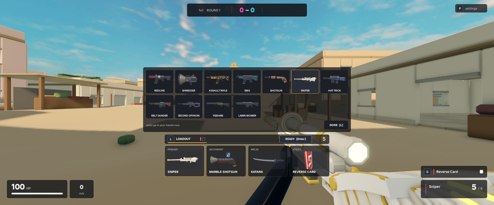

## 4. Ranked

### The rating: Glicko-2 with a team composite

Each player has, per ranked mode (1v1, 2v2, 3v3, 4v4), a rating `r`, a rating deviation `RD` (how unsure the game is)
and a volatility `σ`. After each match each player is updated as one Glicko-2 rating period with one game:

- The expected result comes from **your team's average rating** against **the other team's average rating**, with
  the other team's RD combined as the root mean square of theirs ("composite opponent").
- Your own RD sets how far you move. Teammates who are new move a lot, settled ones move a little, for the same result.
- Win = 1, loss = 0. Leaving mid-match is a loss. A match always has a winner (Matches has no draws).
- The round score does not change the rating (5-0 and 5-4 count the same). Simple and hard to farm.

| constant | value | effect |
|---|---|---|
| start | r 1500, RD 250, σ 0.06 | RD 350 (the textbook start) swung 5 placement wins up to Master; 250 lands at about Diamond III |
| τ | 0.5 | how fast volatility reacts to upsets |
| RD floor | 80 | a settled player still moves about ±15-20 a match, so the number stays alive |
| RD ceiling | 350 | RD grows back slowly while you don't play (Glicko-2's own rule, per idle day) |

Why Glicko-2 and not plain Elo: it knows how sure it is. New players find their level in a handful of matches,
settled players don't swing, and coming back after a break moves you faster again. Tested by simulation
(`tools/roblox/glicko_sim.mjs`): 2,000 players of known skill, 60 matches each, end with ratings spread
1098 / 1333 / 1500 / 1668 / 1904 / 2062 at the 5th / 25th / 50th / 75th / 95th / 99th percentiles.

### Tiers and divisions

Metal names, each with divisions III, II, I (III lowest), 50 rating per division. The top tier has no divisions and
shows the rating.

| tier | from rating | about |
|---|---|---|
| BRONZE | below 1300 (II from 1200, I from 1250) | lowest fifth |
| SILVER | 1300 | |
| GOLD | 1450 | the middle (1500 = GOLD II) |
| PLATINUM | 1600 | |
| DIAMOND | 1750 | top 15% |
| MASTER | 1900 | top 5% |
| APEX | 2050 | top 1-2%: shows "APEX 2,114" |

The badge is drawn from frames (no uploaded pictures): a rounded shield in the tier's metal, 1-3 chevrons for the
division, a frame from Platinum, side blades from Diamond, a crown point from Master. Unranked is a hollow grey shield.
The colours are the metals the player-cards session drew for its old XP tiers (`Ranks.TIERS`).

**Naming (agreed with the player-cards session, 16 Nov):** "rank" means this ladder. The card's XP side shows the
level only (LV and the XP bar). Its right-hand mark is the ranked badge with its line, drawn by `RankedStyle`.

### Placements

- The first **5** ranked matches of a mode are placements. The rating moves from the first one, but the rank shows as
  `PLACEMENTS 2/5` until the fifth is done.
- After a season reset, **3** placements.

### What you see

(Since the second pass, section 0: what you see is rank points, never the rating.)

- **After a match** (on the end screen, then in the lobby):
  - WIN / LOSS and the new rank;
  - the points won or lost, `+24 RP` / `-18 RP` (in placements, just W / L);
  - the division bar sliding to its new place, with `58/100` beside it.
  - Crossing a division says `PROMOTED` or `DEMOTED`. Finishing placements says `PLACED`.
- **The Play screen:**
  - with RANKED on, your rank in the picked mode: badge, name, bar and `34/100`;
  - each ranked mode card: your badge and rank for that mode (or `PLACEMENTS n/5`).
- **The player card** (Stats.cardExtra → `card.ranked`): the best placed mode this season, or the mode nearest to
  being placed, or `UNRANKED`.
- Player attribute `RankedBest` = "GOLD II" (for nametags or lists later).

### Seasons

`Ranked.SEASON` (now 1). When it goes up, each mode is soft-reset when its owner next joins:
`r = 1500 + (r - 1500) × 0.6`, `RD = max(RD, 180)`, 3 placements, and the old season's peak is kept in `past`.
Rewards are not built.

**The season's name and end** are `Ranked.SEASON_NAME` ("SEASON 1") and `Ranked.SEASON_ENDS` (os.time, UTC). The
leaderboard counts down to the end. The end date is a placeholder, 1 Jan 2027, until the owner picks one. The reset
is still done by hand: bump all three together.

### The leaderboard (17 Nov 2026)

Frisk1636, the hub's RANKED regular, opens it with his prompt. The Play screen has a **LEADERBOARD** button beside
LEAVE LOBBY.

- **Tabs:** DUELS | PARTY RANKED.
- **Your own rank** at the top: the badge, the rank and the RP bar ("34/100"), or PLACEMENTS 2/5 with a cell per
  match, or UNRANKED. Your W-L, and your place on the list when you're on it.
- **The list:** this server's placed players by rank points, the top 100. On DUELS each player's best mode counts,
  and its tag shows ("2V2"). Each row has the place, the badge, the name, the rank and the RP.
- **The season** and the time left, top right: "SEASON 1 · 44D 14H LEFT".
- **Global top 100** (behind `PlayConfig.CROSS_SERVER`, off and untested): a THIS SERVER | GLOBAL switch.
  - An OrderedDataStore per ladder and season (`JankfireRankedTop_v1_s1_duels` / `_party`, `_studio` in Studio)
    holds each placed player's rank points.
  - It is written after every rated match and every restore. A voided or unplaced player is removed.
  - A server reads it at most once a minute, with names from UserService.
- Quiet: names and numbers only.
- **Opening it:**
  - a ProximityPrompt with the attribute `RankedBoard = "duels" | "party"` (or `RankedOpen = true`, the hub's name);
  - `Party.openBoard(player, tab?)` on the server;
  - `LeaderboardUI.open(tab?)` on the client.

**Tested 17 Nov, place version 551** (Studio Play, me plus 8 stand-ins spread over both ladders with `boardsample`;
in Studio the board lists stand-ins too):
- DUELS: MASTER I down to GOLD II, my row #9 marked, my block GOLD II 34/100, 5-3, #9.
- PARTY RANKED: BULLETPROOF GLASS II down to CARDBOARD II, the same layout.
- Opened from the Play screen's LEADERBOARD button (`PlayTest` "board").
- Not tested: the global lists (CROSS_SERVER is off) and the hub prompt (the hub session's push).

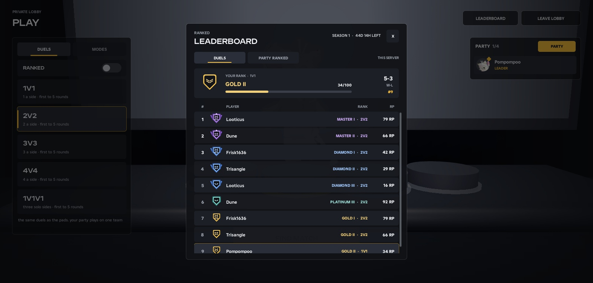
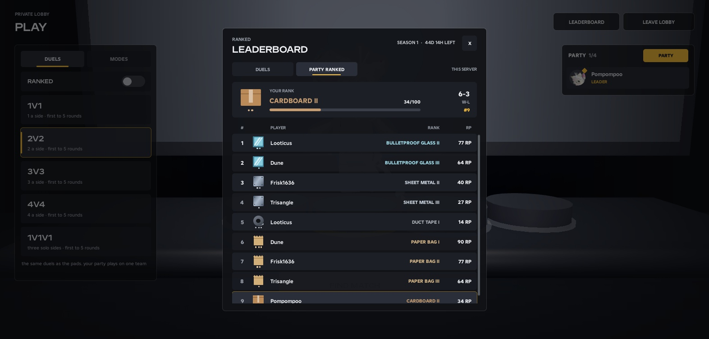

### The save

- Its own store `JankfireRanked_v1` through `Profiles.luau` (the session-locked layer loot and stats use), key
  `u<userId>`. It never touches another system's store.
- **Studio uses its own store, `JankfireRanked_studio`**, so test matches never reach live ratings.
- `{ v, season, modes = { ["2v2"] = { r, rd, vol, n, w, l, peak, last, placed, lp, s0 } }, past = {}, recent = { last 10 },
  log = { this season's ranked matches }, fixed = { restores applied }, void? }`.

### Party Ranked: the classic modes' ladder (17 Nov 2026)

The owner: "You can play party mode ranked with funny more playful ranked. Maybe it starts at wet napkin, cardboard,
paper bag etc to mimic the real ranked system".

The MODES tab (JANKFIRE's classic modes, which a modes session adds through `PlayConfig.addMode`) has its own
**PARTY RANKED** switch and ladder.

- **The same machinery as the duels:** Glicko-2 MMR, 5 placements, 100 RP a division with the "34/100" bar, the
  season field, the cheater restore.
- **One rating for every classic mode**, kept under its own key (`modes.party` in the ranked save), so it never mixes
  with the duels'. `PlayConfig.ratingKey(mode)` gives `"party"` for any mode added with `addMode` (they are ranked
  unless they say `ranked = false`).
  - Why one and not one per mode: the classic modes are many and each is played less than the duels. Per-mode ratings
    would mean five placement runs and thin queues. One rating also matches the owner's words: "party mode ranked".
  - A later split per mode only needs `ratingKey` to return the mode's id.
- **The tiers mirror the duels one for one** (same RP edges, III/II/I, a top tier with no divisions), playful on
  purpose. The owner wants these names funny, so the no-flavour-text rule doesn't apply to them; everything else on
  screen stays plain.

| duels | Party Ranked | its badge |
|---|---|---|
| BRONZE | WET NAPKIN | a pale damp napkin, corner folded, two drips |
| SILVER | CARDBOARD | a box face, its flap seam and a strip of tape |
| GOLD | PAPER BAG | a kraft bag with a crinkled top and a fold |
| PLATINUM | DUCT TAPE | a grey roll with its core and a loose tail |
| DIAMOND | SHEET METAL | a brushed plate with four rivets |
| MASTER | BULLETPROOF GLASS | a framed pane with two clean sheen lines |
| APEX | RUBBER DUCK | the game's duck, in a small three-point crown |

- **Badges** are drawn from frames like the duels' shields, on their own square shapes. The division is 1 to 3 pips
  under the badge, where the duels use chevrons.
- **The switch's effect** is lighter than the duels' flames: soap bubbles rise up the panel, with a soft teal-to-pink
  glow and a teal edge.
- **The player card** gets `card.partyRanked` (only once played). The player-cards session draws it as a smaller
  second badge.
- **Free-for-all matches** (the classic modes session's Gun Game, One in the Chamber, Duck Rain, Randomizer: 2 to 8
  players). The match says `m.ffa`, `m.places[team]` and `m.results`.
  - **MMR:** each player gets one Glicko-2 period with a game against every other player: a win against each one they
    placed above, a loss against each one above them, half against a shared place (`Ranked.updateMany`).
  - **RP from the place** (`Ranked.placePoints`): +20 for first down to -20 for last, pulled toward the MMR's spot
    like the duels. First gets at least +8, last at most -6.
  - A leaver counts as last.
  - **Cheat restore:** in an FFA match everyone faced the cheater, so every other player who lost RP or MMR in it gets
    it back.
  - The result card says the place: "2ND OF 6  ·  PARTY RANKED GUN GAME".

**The badges were made bigger at place version 551.** The player-cards session found the art only about 30 px in a
53 px box. It is now drawn 1.3 times larger, so it fills its box like the shields. The napkin's folded corner is drawn
from straight pieces now: a turned frame doesn't clip, and its fold used to stick out past the sheet.

**Tested 17 Nov, place version 538** (Studio Play, one player plus three sample modes from `samplemodes`):
- The maths, from GOLD II 0/100 in a 6-player FFA: 1st +35 RP (MMR +86), 3rd +7 (MMR +17), 6th -35 (MMR -86).
- The name at RP 734 on the Party ladder: PAPER BAG II.
- The badge sheet (both ladders, every tier at III / II / I, unranked and in placements) and the MODES tab with
  PARTY RANKED on: the bubbles, the rank block "PAPER BAG II 34/100", the bottom line "PARTY RANKED · QUICK PLAY",
  the party panel showing the Party rank.
- **Not tested yet:** a real classic-mode match rated on this ladder (the modes session's FFA matches and team
  modes need their `Matches.startMode` to land), and the card's second badge (the player-cards session).

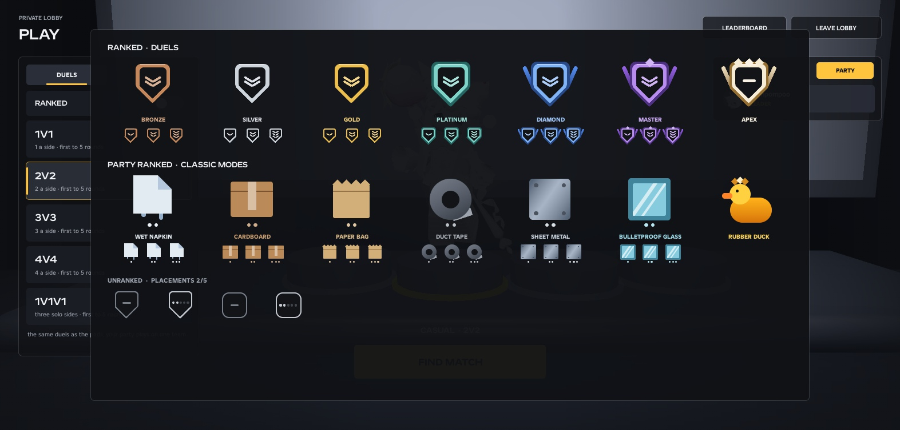
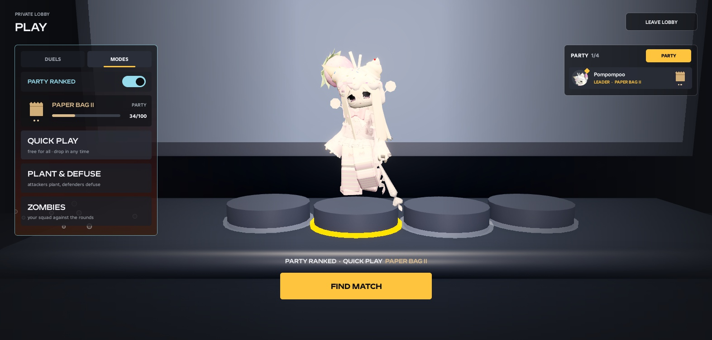

### Grapple charges in ranked (17 Nov 2026)

The owner: "For competitive should we limit the grapple to like 2 grapples with a short cooldown between recharge?"
Main's decision: yes, with the web game's own Jank Royale rule (`shared/royale.js` `BR.hook = { charges: 2, cd: 8 }`).

- **Where it counts:** a RANKED duel and a PARTY RANKED match: `Matches.matchOf(p).ranked`. Casual duels, casual
  quickplay, training and the hub keep the free grapple.
- **The numbers** are in `shared/HookCharges.luau`: 2 charges, coming back one at a time every 6 s. The web's 8 s
  was for the royale's big map, and the owner asked for a short cooldown.
- **The server counts** (`server/HookChargeServer.luau`).
  - Main's grapple check calls `HookChargeServer.allow(p)` once a hook has passed range and sight.
  - In a ranked match the hook spends a charge. With none left the rope is cut ("recharging").
  - A new body (each round, each respawn) starts full.
  - It publishes the attributes `HookLimit`, `HookN` and `HookT0` (the server time the returning charge started).
- **The client predicts** (`client/HookChargesUI.luau`, asked by Move's tryHook):
  - With no charge it doesn't fire. It says "GRAPPLE RECHARGING · N S" on the quiet line and plays `hook_empty`.
  - Two pips sit under the crosshair while the charges count. A used one fills from the bottom as it comes back, and
    `hook_ready` plays when it lands.
  - A cut from the server resyncs the count: the server spends nothing on a hook it refused. This was added after
    the test below, where a hook the server refused for range left the screen one charge short; it is compile-checked
    only.
  - The two sounds are the sound session's recordings; until they exist nothing plays.
- **The rules line:** under the RANKED duel cards, and under the MODES cards with PARTY RANKED on: "grapple: 2
  charges, one back every 6 s".
- **Tested** in place v658 (17 Nov, 17:10 UTC), a ranked 1v1 against a stand-in:
  - Two hooks went, and the third was refused with the line and the pips.
  - On the server: n 1, then 0, then the third was cut "recharging". One charge came back at 6.2 s and the second at
    12.2 s.
  - In the hub, three hooks in a row all went (`HookLimit` false).
  - The sounds (place v665, the sound session's recordings), checked in Play: the refused third hook played
    `hook_empty` once, and each charge coming back played `hook_ready`, at 6.2 s and 12.2 s.

  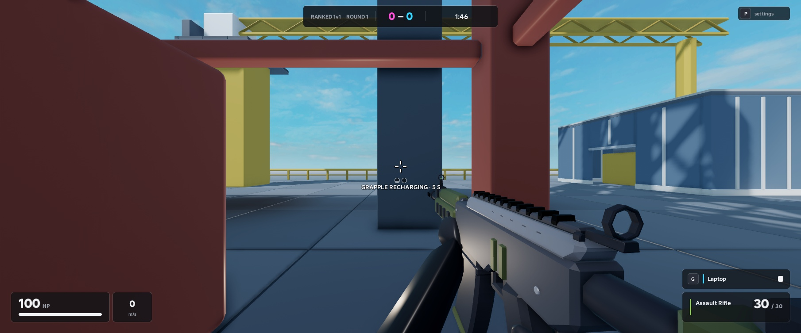

### Ranked draft: weapon bans, map bans, 2 switches (19 Nov 2026, place version 1066; tested in 1080)

The owner: "limit switches on comp to 2, weapon ban at the start of match along with map select and banning maps too".
The reading below was confirmed by the owner ("yes"). Casual play is untouched. Code: `server/RankedDraft.luau`, plus
`Matches.draftRoom` and its draft pieces, a block in Party's start, CrossServer's ranked arrival, two hooks in
Loadout, and QuickVoteUI's `kind`.

- **When:** every RANKED match, before it starts, in a map room (the pads' rooms, zone "staging", the grapple locked).
  Both an in-server ranked match (Party) and a cross-server one (CrossServer's arrival) go through it. No room free:
  the match starts without a draft, on the rotation.
- **Weapon ban** (`RankedDraft.WBAN`, 10 s): every live primary is a tile ("BAN A WEAPON"). Your side's votes show on
  the tiles, yours lit. Each side bans its most-voted weapon (a tie is drawn; no votes, no ban). Tiles only, no
  number keys (too many).
- **Map ban** (`MBAN`, 10 s): three maps from the rotation for the match's size, as cards and plates. Each side bans
  one the same way. The map left is played (two left: one is drawn). The header shows "BAN A MAP · BANNED: <weapons>",
  and the banned cards say BANNED. `SHOW` (2.5 s) shows the result, then the match starts.
- **The bans hold all match** (`BannedWeapons` on the player). Picking a banned weapon is refused ("banned this
  match"). A banned weapon in your saved loadout is carried as the slot's default instead (`RankedDraft.carry`); your
  own saved pick isn't changed.
- **Switches:** your picks in the loadout window before round 1 are free. After that, each break between rounds in
  which you change anything counts as one switch (several changes in one break are one). At most 2 a match
  (`SwitchesLeft`); the third is refused ("no switches left: 2 a ranked match"). Counted by rounds gone live
  (`RankedDraft.live` in goLive), because the break opens before the round number goes up.
- **The knobs:** `RankedDraft.ON = false` plays ranked as before; `MAX_SWITCHES`, `WBAN`, `MBAN`, `SHOW` are the
  numbers. Studio: the Matches attribute `TestDraft` = both phases' seconds.
- **Tested** (place 1080, a ranked 1v1 against a stand-in, `TestDraft` 7):
  - The draft room opened (zone staging, `RoundLock` on). The grid showed 20 primaries; my vote on SNIPER took and lit.
  - Map ban: the header read "BAN A MAP · BANNED: SNIPER"; I banned Platform; the match played Bazaar: Rooftops.
  - In the match: `SwitchesLeft` 2, `BannedWeapons` "sniper"; picking the sniper was refused "banned this match".
  - A pick in the round-1 window was free (2 left). Break 1: two changes, one switch (1 left). Break 2: one switch
    (0 left). Break 3: refused "no switches left: 2 a ranked match".
  - Before GO, E and X were both refused with "GRAPPLE AT GO" and no rope.
  - Restored after: the owner's Studio loadout save (primary and secondary) as it was before the test.

  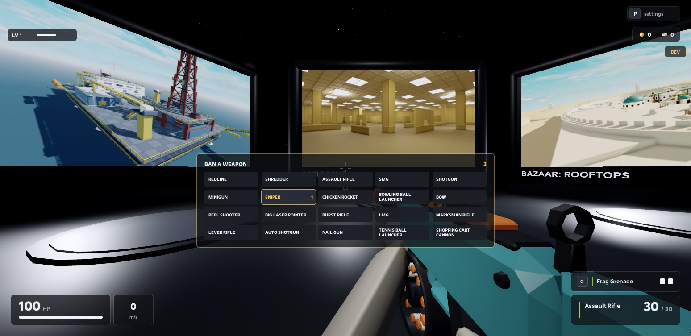
  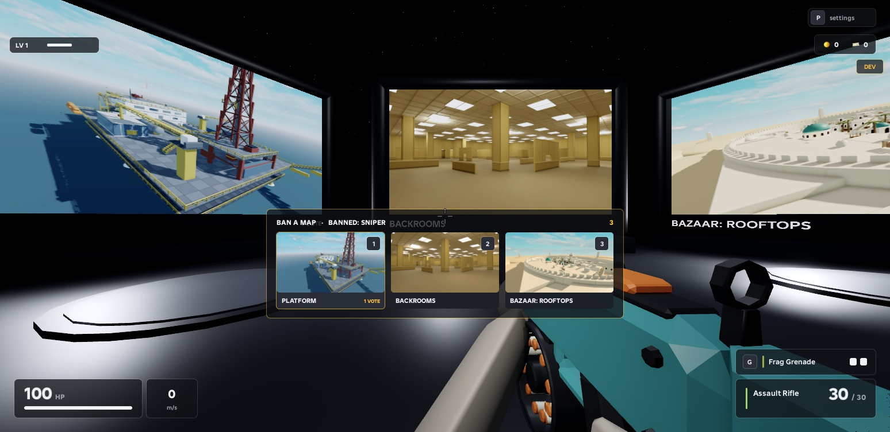

### When a cheater is caught (17 Nov 2026)

The owner: "If someone is caught cheating give back any ranked stuff or stats!!". This works like Valorant's restore
when a cheater was in your match.

**The log.**
- Every ranked match goes in each real player's own save (`d.log`): its key (`m.key`), when, mode, team, teammates'
  and opponents' user ids, the RP and MMR change, and the result.
- It also goes in an index store `JankfireRankedLog_v1` (`_studio` in Studio):
  - `m:<key>` holds the teams and every real player's change;
  - `u:<user id>` lists that player's match keys for 30 days. Stand-ins are listed too, so a stand-in can play the
    cheater in a Studio test.

**The call:** `RankedData.restoreFor(cheaterUserId, since)`.
- The anti-cheat session calls it when a cheater is **confirmed**: an owner ban or confirm, never an automatic flag.
- `since` defaults to the last 14 days of this season.
- It covers every ranked match of the cheater's in that window, once per match (the record is marked restored).

**What changes for whom:**

| who | what happens | why |
|---|---|---|
| the other team's players who **lost** | the RP and the MMR they lost come back; the loss comes off their W/L | they lost to a cheater |
| the other team's players who won | nothing | they lost nothing |
| the cheater's **teammates** | nothing: their result stands, a win's RP and a loss's alike | they didn't cheat, and reversing their win would punish them for a teammate; taking their loss back would reward it |
| the **cheater** | the season is voided: every mode back to the MMR it started the season at (`s0`), RP and placements reset, `d.void` set | their ranked record this season can't be trusted |

**Who gets it, and when:**
- A player in this server gets it at once.
- Anyone else gets a pending fix in `JankfireRankedFix_v1` (`r:<user id>`). It is taken and applied 3 s after their
  next join, inside their own session-locked save. Nothing else ever writes into a player's save.
- With `PlayConfig.CROSS_SERVER` on, MessagingService (`JankRankedFix`) tells the server they're on to take it right
  away.
- The restored player sees `RANKED RATING RESTORED +N`.
- The player-cards session restores stats the same way through `Stats.restoreFor`, with the same call shape.

**A wrong catch:** `RankedData.undoRestore(userId)`, called by the anti-cheat session on UNCONFIRM or UNBAN.
- The accused's season comes back from a copy kept when the void was applied. It goes through the same path: at once
  if they're here, else on their next join. A void still waiting in the store is applied first, then undone.
- The players who got RP back keep it. The matches stay marked restored, so a later CONFIRM can void the season again
  but never pays anyone twice.
- Ranked matches the accused played after the void are dropped with the undo.
- **Tested 17 Nov, place version 551:** GOLD II 34/100 (5-4); `restore` on my own id voided it (unranked, a copy
  kept); `unrestore` brought back GOLD II 34/100, 5-4, with no void and no copy left.

**Tested 17 Nov, place version 524.** I played ranked 1v1s against a stand-in "cheater" (id -7).
- **Before:** GOLD II at 34/100, rating 1530, losses 3.
- **Two losses to the cheater:** -22 RP and -24 RP, ending at GOLD III 88/100.
- **`restoreFor(-7)`:** 2 matches and 2 refunds, applied at once. Everything came back exactly: GOLD II 34/100,
  rating 1530.2, losses 3. The notice showed.
- **Calling it again:** nothing happens.
- **The cheater's season wipe:** waits in the pending store until they next join.
- **The offline path:** a third loss went to 13/100. The fix was queued in the store, and the join pull took it:
  back to 34/100, store empty, notice "RANKED RATING RESTORED +21".

## 5. How it is built

| file | what |
|---|---|
| `src/shared/Ranked.luau` | the rating maths (Glicko-2, team composite), tiers, placements, windows, season reset. Pure, no Instances |
| `src/shared/RankedStyle.luau` | the badge, label and colour for a rank (the Play screen and the player card draw with it) |
| `src/shared/PlayConfig.luau` | modes, party size, timings, the `CROSS_SERVER` switch |
| `src/server/Party.luau` | parties, invites, kick and promote, the lobby rooms, the remote |
| `src/server/LobbyRooms.luau` | builds a private lobby room from code, its plinths and camera spot |
| `src/server/Queue.luau` | the in-server matchmaker |
| `src/server/RankedData.luau` | ratings: the save, the update after a match, the card's `ranked` |
| `src/server/CrossServer.luau` | MemoryStore queue, MessagingService invites, reserved match servers. OFF, untested |
| `src/server/PlayServer.server.luau` | wires them to Fight, Matches and Stats; the Studio test hook |
| `src/client/PlayUI.luau` | the Play screen, party panel, invite toasts, ranked results |
| `src/client/PlayClient.client.luau` | the PLAY button, M, the lobby camera, the test attribute, the `RankedBoard` prompts |
| `src/client/LeaderboardUI.luau` | the ranked leaderboard panel |
| `Matches.luau` (small edits) | `Matches.startQueued`, `Matches.homeOf` (where a lobby player respawns), ranked in the HUD line, "back to the lobby" |

Remotes: `JankfireRemotes.Play` (RemoteFunction, every request) and `JankfireRemotes.PlayPush` (RemoteEvent, party
state, invites, results). The server checks every request: who leads, sizes, modes, rate limits; the client only asks.

**Rate limits.**
- Every request: 6 a second, in bursts of up to 20.
- PLAY, LEAVE LOBBY, LEAVE PARTY, accepting an invite and KICK respawn bodies or claim and free rooms. They go once
  every 2 s per player (the anti-cheat session's audit). One inside the gap waits out the rest of it, so a quick LEAVE
  then PLAY still works. Another one while that waits is refused with no message.
- Tested at place version 551: PLAY answered at 0.09 s, a LEAVE sent right after waited to 2.08 s, a PLAY sent while
  it waited was refused with no message, and the next PLAY waited to 4.10 s.

### Studio test hook

`ServerStorage.JankPlayTest` (BindableFunction, Studio only). Extra players are **stand-ins**: a regular's avatar
(`ServerStorage.JankfireNPCs`) on a plinth with a negative id. They take part in parties and the queue, and count in
the ratings, but they never enter a match. A match with stand-ins is held like a Matches ghost match, and ends after
`secs` with the team `win` taking it.

- `:Invoke("standins", n)` puts n stand-ins in the server's invite list (inviting one: it joins after 1 s)
- `:Invoke("rival", mode, ranked, size, rating)` puts a stand-in party in the queue
- `:Invoke("hold", secs, win)` how long a test match lasts and who wins it: a team number, `"party"` (the real
  players' team, the default) or `"rival"`
- `:Invoke("join", player)` a stand-in straight into the player's party (no invite)
- `:Invoke("state")` parties, queues, rooms; `:Invoke("ranked", player)` the player's ratings
- `:Invoke("setranked", player, mode, { r, rd, n, placed, need })` and `:Invoke("resetranked", player)` (Studio
  store only)
- `:Invoke("play", player)` / `:Invoke("leave", player)` what PLAY and LEAVE LOBBY do
- `:Invoke("restore", userId, since, viaStore)` / `:Invoke("unrestore", userId, viaStore)` the cheat restore and
  its undo; `:Invoke("log", player)` the season log, fixes and void
- `:Invoke("samplemodes")` three sample classic modes (QUICK PLAY, PLANT & DEFUSE, ZOMBIES unranked); use
  `setranked` with mode `"party"` for the Party ladder

Client side: the local player's attribute `PlayTest` = `play`, `open`, `close`, `tab:duels`, `tab:modes`, `invite`,
`uninvite`, `fake:844x390`, `real`, `state`, `badges` / `nobadges` (both ladders on one sheet), `samplemodes` (the
same sample modes on the client), `board` / `board:party` / `noboard` / `boardfake:844x390` (the leaderboard). The remote also works from a Client `execute_luau`
(`JankfireRemotes.Play:InvokeServer("find")`).

A full run (about 40 s): `standins 3`, PLAY, invite `-2`, `mode 2v2 true`, `setranked` with `n = 4` (the next match
places you), `rival 2v2 true 2 1500`, `hold 8 party`, `find`.

## 6. Across servers (ON since 18 Nov 2026, place version 1017: live from the owner's next publish)

The owner: "can you also enable cross matchmaking", then on 18 Nov "also can you enable custom matchmaking for queue
outside of pads". `server/CrossServer.luau` and `crossTick` in `server/Party.luau` are built and Studio-tested
(below). The switch was on in v720, held off from v722 so it could go out on a publish of its own, and is on again
since v1017 (`PlayConfig.CROSS_SERVER = true`). The PLAY button's queue reaches other servers; the hub pads stay in
their own server. **To turn it off:** set it to false, save, publish; nothing else to undo. Studio tests don't need the
switch: `JankPlayTest("cross", "on")` turns Studio's own part on, whatever the saved switch says. The ranked extras
across servers are a separate switch, `PlayConfig.GLOBAL_RANKED`, still off and untested: the leaderboard's global
top 100 and a cheat restore telling another server to take it now.

- **Which queues:** every duel (casual and ranked) and QUICKPLAY. A PARTY card pick, filled from quickplay, stays in
  its own server.
- **Home first:** a party searches in its own server as before. After `CrossServer.HANDOFF` (20 s) without a match it
  also offers a ticket and keeps searching at home; whichever finds a match first wins.
  - The ticket is one entry in a `MemoryStoreSortedMap` per queue (`jf_q_casual:1v1`), sort key = rating, a 30 s
    expiry renewed while it searches. It carries the time the party started searching (since 18 Nov; before, every
    renewal reset it), so the matchmaker widens a ranked rating range with the whole wait, as the home queue does.
  - The players see "searching other servers too".
  - A party matched at home, or one that cancels or leaves, takes its ticket back.
- **The matchmaker:** one server at a time (a lock in `jf_mm`, renewed every 5 s).
  - It reads the duel and QUICKPLAY queues, forms matches with `Queue.form` (the same rules as in one server), and
    reserves a server for each (`TeleportService:ReserveServer`).
  - It writes each ticket's result (`jf_results`) and the match's own record (`m:<match id>`: mode, ranked, sides with
    everyone's rating).
  - **QUICKPLAY can't vote on its mode across servers:** the matchmaker draws the mode (`QUICK_WEIGHT`, a team mode
    only when the parties split into two sides). The map is voted on the match server (below).
  - One party alone is never rated.
- **The move:** a ticket with a result takes the party out of its home queue ("match found on another server: moving
  you there") and teleports its players with the match id in the teleport data.
- **The match server:** teleport data passes through the client, so it only takes the match id from it.
  - The mode, sides and ratings come from the matchmaker's record, and each player goes on the side they're listed
    on.
  - Each arrival sees "match server: waiting for everyone to arrive". It waits up to `ARRIVE` (30 s) for everyone.
  - **The map (18 Nov):** a casual match (duels and QUICKPLAY) goes to a map room and votes there, the same void room,
    displays, plates and cards as a hub pad's (`Matches.voteRoom`, 8 s, then the pick shows 1.5 s). The maps are three
    from the rotation for the sides' size. Ranked plays the rotation, no vote, as at home. With no map room free, it
    starts straight away on the rotation.
  - Then the match starts (a duel through `Matches.startQueued`, a classic mode through its own start), with the usual
    READY / loadout window, rounds and finishers: the same code as any queue match at home.
  - When the match ends, everyone goes back to a public server (`AFTER` + 0.5 s, 3 tries).
- **Failing safe:**
  - A memory store call that fails means no ticket; the party simply searches at home.
  - A teleport that fails puts the whole party straight back in its home queue with "couldn't reach the match server:
    searching here again". That covers an error from `TeleportAsync`, a `TeleportInitFailed` later, or the players
    still being there `AWAY` (20 s) on.
  - On a match server, a player not on the match's list, a match already started, a side that never arrived, a whole
    side leaving the map room, or a match that won't start sends the players back to a public server with a note (3
    tries). A player who left the map room this way gets a fresh body in the hub first, so a failed teleport never
    leaves them in the void.
- **Studio:** never takes part on its own. It uses its own memory store names (`jfs_`), so a play test never touches
  the live queues, and it has no teleports.
  - Tests switch it on: `JankPlayTest("cross", op, …)` with `on` / `off`, `handoff secs`, `ticket key size rating` (a
    ticket from "another server"), `peek key`, `mm` (one matchmaker pass with stand-in server codes), `result id`,
    `arrive player data`, `start` (`start "ghost" secs`: a side that never arrived plays as a ghost side, the match held
    secs), `home` (the matches sent back to a public server so far).

- **Tested in Studio** (place v720, 18 Nov 00:07 UTC, cross switched on with a handoff of 2 s):
  - My party searching casual 1V1 offered a ticket (in `jfs_q_casual:1v1`).
  - A stand-in ticket from "another server" joined it, and one matchmaker pass formed a 1v1 with both and removed both
    tickets.
  - My server read the result. The teleport can't happen in Studio, so the party went straight back to searching at
    home, kept its time, and offered a fresh ticket.
  - On the match-server side, arriving with that match id put me on my listed side, and the check said "a side never
    arrived" (the stand-in's).
  - A made-up match id showed "THAT MATCH IS GONE: BACK TO A PUBLIC SERVER".
  - Not testable in Studio: the real teleports, reserved servers, `TeleportInitFailed`, the lock hand-over between
    servers. They're in the live check below.

  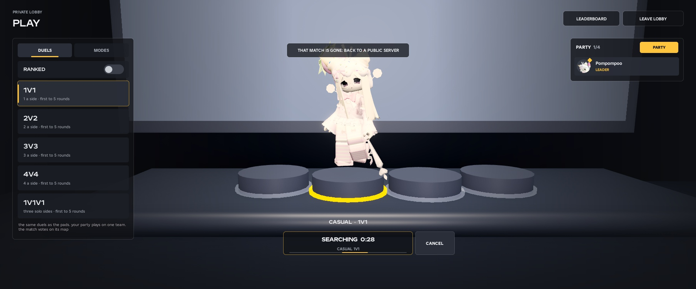

- **Re-tested in Studio** (18 Nov 21:15 UTC, place v1014 + these changes, saved switch still false, Studio's test
  switch on, handoff 2 s), one solo Play:
  - **The PLAY button with no pad:** PLAY, casual 1V1, FIND MATCH. After 2 s my ticket was out (`jfs_q_casual:1v1`).
  - **The fallback:** a stand-in rival joined the home queue. The match formed at home, its map vote picked THE GUT
    (the stand-in's vote), the match started there with the loadout window open, and my ticket was taken back.
  - **Across servers, casual:** a ticket from "another server" plus mine, one matchmaker pass: a 1v1, both tickets
    removed. My server read the result; with no teleport in Studio the party went back to searching (its wait kept)
    with a fresh ticket.
  - **The match server, casual:** I left the party and arrived with that match id. I went to a map room (zone
    "staging") with ROOFTOP: SKYLINE, SUBURB: CUL-DE-SAC and THE GUT. I voted SUBURB, and the match started on
    SuburbV2 with the loadout window open. After it, the return to a public server fired.
  - **Across servers, ranked:** my ranked 1V1 ticket and another server's at 1500 made a ranked 1v1. On the match
    server it started straight on the rotation (BACKROOMS, no vote), the HUD read RANKED 1v1, and the win was rated
    (placement 1/5, +117 MMR from a fresh rating). The return to a public server fired.
  - Not run in Studio: QUICKPLAY across servers on the match server (same path, through the mode's own start) and a
    finisher (needs a real opponent).

  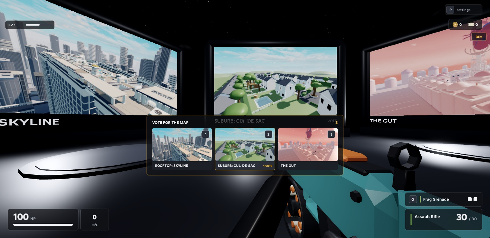

### What needs a live check after the owner publishes

Two or more real players, each alone in their own public server (or two friends who join different servers):

1. Both press PLAY, pick casual 1V1 and search. After 20 s each sees "searching other servers too".
2. Within about 5 s more, both see "match found on another server: moving you there" and are teleported to the same
   new server.
3. Both land in a map room, vote, and the match starts on the pick (at most 30 s to arrive, then 8 s of vote), with
   the arena banner and both on opposite sides. The READY / loadout window works there.
4. After the match, both are teleported back to a public server (not necessarily the one they came from).
5. Ranked 1V1 the same way: the rating changes at the end, and the leaderboard shows it after the return.
6. QUICKPLAY with 2+ players in different servers: the match starts on a drawn mode.
7. Fail-safe: one player leaves the game during the move. The other should be sent back to a public server with a
   note after 30 s, not left in an empty server.
8. Watch the server log for "cross-server teleport failed" and "[jankfire]" warnings.

**Live since the owner's publish of v1023 (18 Nov 2026, about 21:30 UTC).** The two-player check above is still to
run. Meanwhile the live queues can be watched without anyone playing:
- Open Cloud `GET /cloud/v2/universes/10776367667/memory-store/sorted-maps/jf_q_<key>/items` (scope
  `memory-store.sorted-map:read`; the key URL-encoded, e.g. `jf_q_casual%3A1v1`, `jf_q_ranked%3A1v1`,
  `jf_q_casual%3Aquickplay`). Studio's own are `jfs_q_…`.
- A ticket lives 30 s unless renewed, so an entry there is a party searching right now for more than 20 s. One that
  stays for minutes while its server is up means the matchmaker isn't running.
- The results and the matchmaker's lock are hash maps (`jf_results`, `jf_mm`), which Open Cloud can't read.
- First reading, 21:37 UTC: `casual:1v1`, `ranked:1v1`, `casual:2v2`, `casual:quickplay` and Studio's `jfs_q_casual:1v1`
  all empty. Nobody was searching; nothing was stuck.

## 7. State (17 Nov 2026, place version 507)

Tested in Studio Play with one real player plus stand-ins (photos in `docs/matchmaking/`):

- **PLAY** (button and test hook): a private lobby room is built, you respawn anchored on the middle plinth, the
  camera frames the lineup and the Play screen opens. **LEAVE LOBBY**: back to the hub, body free, room removed.
- **Invites:** the list shows everyone else in the server. A stand-in invited joins after 1 s and stands on plinth 2.
  The party panel shows 2/4, LEADER and MEMBER, KICK and LEAD; kick works. The invite toast (JOIN / DECLINE, a
  draining bar) shows in the hub.
- **Ranked pick:** the leader picks RANKED 2V2. The mode cards show each mode's rank (UNRANKED, PLACEMENTS n/5, GOLD III).
- **The queue:** FIND MATCH shows SEARCHING with a clock and the widening rating range. A rival stand-in party joins the
  queue, then MATCH FOUND counts 3 s.
- **The match:** RooftopV2, and the HUD line says RANKED 2v2. The end screen says "back to the lobby" with the ranked
  card beside it. Then everyone is back in the lobby on the same plinths, party intact, and the screen comes back by itself.
- **Ratings:** a 5th placement (a loss) gave -53, PLACED, GOLD III. The next match (a win) gave +49, PROMOTED to
  GOLD II. The Studio store (`JankfireRanked_studio`) kept the rating between Play tests.
- **Card and phone:** the player card shows the ranked badge and its line in the player-cards session's slot. An
  844x390 phone box lays out with the compact panels.

**The second pass (section 0), tested 17 Nov, place version 510:**

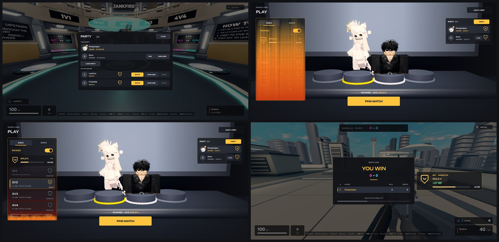

- **PARTY panel in the hub:**
  - Inviting a stand-in made a party of 2 in the hub, with no room.
  - The panel lists the party (LEADER / MEMBER, IN THE HUB, KICK, VIEW CARD, LEAVE PARTY) and the server (badges,
    INVITE, VIEW CARD, a greyed TRADE).
- **PLAY as the leader** built the room and brought both members onto plinths.
- **The RANKED switch:**
  - Turning it on sweeps flames up the panel with embers.
  - Then it settles to a warm edge, low flames along the bottom and a few embers.
  - The rank block reads GOLD II, a bar, 34/100.
- **A ranked win** gave +27 RP: GOLD II, 61/100 on the result card.
- **LEAVE LOBBY** sent me to the hub, still in a party of 2 (the room closed). **LEAVE PARTY** left the party.

Not tested (needs other real players or a published place):

- Two real players in one party, a real invite answered, a real 2v2 against real players. Stand-ins never enter the
  arena: their side of a test match is empty, so the match is held like a ghost match.
- Leaving the server mid ranked match. The loss is applied at once in code, but this has not been run.
- Everything in section 6 (cross-server): off, never run.
- The nameplates over the lineup are built and attached (checked by code: two plates, one on each head), but Studio's
  capture tool doesn't draw them, so they have no photo.
- Touch on a real phone.

## 8. Research notes (16 Nov 2026)

- **Roblox duel games:** a Play button that matchmakes across lobbies sits beside walk-on duel pads. Ranked is 1v1 to
  3v3 there, with Bronze to Diamond in three divisions, a further named tier, a top tier with no divisions, about 200
  points a division and 10 placement duels. Party members must be within about four ranks of each other.
  (bloxodes.com/wiki/rivals/ranks, allthings.how, dungeonpath.com; fan guides that disagree in places.)
  - We kept: Play beside the pads, placements, three divisions, party rating spread.
  - We changed: our own numbers (Glicko, 50 a division, 1500 middle), our own top tiers (MASTER, APEX), 5 placements,
    a 4v4 ranked queue.
- **Valorant:** placements before a rank, shown rank on top of a hidden matchmaking rating, rank limits for small
  parties (support.riotgames.com). **Overwatch 2:** the rank moves after every match with a bar inside the division
  (esports.gg). **Rocket League:** placements per playlist, soft resets. **CS2 Premier:** the rating is a number.
- **Glicko-2:** 1500 / 350 / 0.06 are the textbook start; τ 0.3 to 1.2. The team "composite opponent" comes from the
  paper "Abstracting Glicko2 for Team Games" (en.wikipedia.org/wiki/Glicko_rating_system, libraries.io/npm/glicko-two).
- **Roblox services** (create.roblox.com docs):
  - MemoryStore sorted maps take numeric sort keys and expire after at most 45 days; quotas grow with players; Studio
    has its own small, separate data.
  - MessagingService messages are 1 KB at most, best effort, usually 1 to 2 s.
  - `TeleportAsync` with a reserved server works in Studio's multi-client Test (a new test server), not in Play solo;
    teleport data is visible to the client and must hold nothing secret.
  - DataStore session locking as in Roblox's own guidance (a lock id written in the same UpdateAsync as the read);
    `Profiles.luau` already does this.
  - Roblox's built-in matchmaking only picks public servers; it has no parties or queues, so it can't form these
    matches (create.roblox.com/docs/matchmaking).
