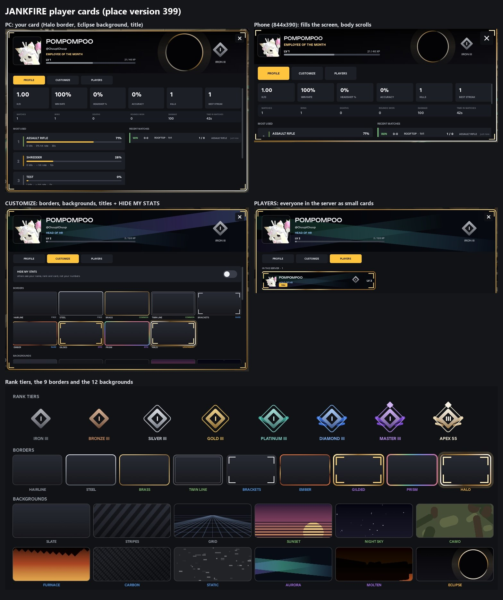

# Player cards: stats, rank and custom profiles (Roblox)

The owner asked on 16 Nov 2026: "when you click on someone you should see their track record their most used weapons,
their rank, kills in percentage etc we can maybe have those custom profiles or something idk custom borders
backgrounds idk".

What came of it: every player has a **card**. It shows:

- the background, border and title they wear;
- their headshot, name, rank badge and XP bar;
- their numbers: K/D, win rate, headshot %, accuracy, kills, best streak, and a row of smaller facts;
- their three most used weapons, with usage bars;
- their last 10 matches;
- the loadout they carry.

Ways to open a card:

- **Someone else's:** click them in the hub (the crosshair or the mouse arrow on them, a tap on a phone), or tap them on the card's PLAYERS tab.
- **Your own:** press **K**, or use the **PROFILE** button over SHOP (hub only).

On your own card you pick your border, background and title. The settings panel (**P**) has **HIDE MY STATS**. With it
on, others see only your name, rank and card.

## Where it lives

| file | what |
|---|---|
| `src/shared/Ranks.luau` | XP, level and rank: the web game's level curve, our tiers, the drawn badge |
| `src/shared/CardStyles.luau` | the borders, backgrounds and titles: ids, names, rarities, and how each is drawn |
| `src/server/Stats.luau` | the numbers, the XP, the card's look and the privacy switch; the remote; the test hook |
| `src/server/ProfileServer.server.luau` | starts Stats with the Fight and Matches modules |
| `src/client/ProfileUI.luau` | the card screen (PROFILE / CUSTOMIZE / PLAYERS tabs) |
| `src/client/ProfileClient.client.luau` | K, the PROFILE button, click / tap on a player in the hub, the test hook |
| `src/client_root/JankSettings.client.luau` | the HIDE MY STATS row in the P panel |
| hooks in `Fight.luau`, `Combat.server.luau`, `Matches.luau` | `Fight.onShot` / `Fight.shot` (every attack the server took), the headshot flag on `Fight.onHurt`, `Matches.onStart` / `onRound` / `onEnd` / `matchOf` |
| `ReplicatedStorage.JankfireRemotes.Profile` | RemoteFunction (in `default.project.json`) |

## What counts

Only real matches count:

- both players are in the same match, on opposite teams;
- the round is live.

The hub, the training hall and its dummies count for nothing. The web game's lobby and training mode give no XP either.

| number | how |
|---|---|
| kills, deaths | a kill on a player on the other team, and your deaths in a live round. A fall into the void is a kill for whoever shoved you (the weapon is what they last hit you with) |
| K/D | kills ÷ deaths |
| matches, wins, win rate | a match ends as W or L. Leaving mid-match is an L |
| rounds played / won | each round of a match |
| accuracy | attacks that hurt somebody ÷ attacks. An attack is a shot the server took (after `Rules.fire`) or a swing. A shotgun volley that hits two people counts once |
| headshot % | hits that were headshots ÷ hits (the web game's Headshot % is the same, hsh / hits). The server decides the headshot (`Rules.headAimed` for one-bullet guns) |
| best streak | kills in one match without dying |
| per weapon | kills, attacks, attacks that hurt, headshots, seconds held while alive in live rounds, damage. **Most used** = longest held |
| last matches | newest first, 10 kept: when, mode, arena, W/L, the score, kills / deaths, the weapon held longest, damage |

There are no assists. The web game has none, and its `tag()` only remembers the last attacker for kill credit.

## Rank

- **XP and level are the web game's, exactly.**
  - `levelOf(xp) = floor(sqrt(xp / 40)) + 1` and `xpForLevel(l) = (l - 1)² × 40`, with no cap (`server/accounts.js`).
  - XP on Roblox comes from what exists here (`server/room.js`): **+20** a kill on a player, **+50** a round won, **2 a minute** of live match time.
  - Web XP sources that have no Roblox mode yet (coop waves, zombies, bomb plants, board game night) aren't ported.
- **The rank is ours**, because the web game has none. It has eight tiers over the levels, with three divisions each (III → II → I):

| tier | from level |
|---|---|
| Iron | 1 |
| Bronze | 5 |
| Silver | 10 |
| Gold | 15 |
| Platinum | 22 |
| Diamond | 30 |
| Master | 40 |
| Apex | 55, then it shows the level: APEX 61 |

- Roughly, a match is worth 150 to 350 XP. Silver takes about 13 matches, Gold about 35, Diamond about 135.
- The badge is drawn from frames, so there are no pictures to moderate:
  - a diamond in the tier's metal;
  - a ring from Silver;
  - wings from Platinum (two pairs from Diamond);
  - a crest from Master.
  - Inside the diamond, 1 to 3 bars show the division.

**Ranked (17 Nov, place version 502).** Agreed with the play/party/ranked session (option B): "rank" means the ranked ladder, and the XP side is a level.
- **The card:** shows LV and the XP bar (amber). On the right is the player's ranked badge with its line (for example "GOLD II · 2v2 · 1,640", "PLACEMENTS 2/5" or "UNRANKED"), drawn by the ranked session's `ReplicatedStorage.Jankfire.RankedStyle` (`badge(parent, size, ranked)`, `label(ranked)`, `color(ranked)`) from `card.ranked`. The player list rows show the same.
- **Until that module and data exist:** a quiet plate with the level number ("LEVEL 17").
- **The ranked data:** comes in through `Stats.cardExtra(fn)`, where `fn(target, viewer, card)` runs for every card and list row (private players too), each one pcall'd. The ranked session keeps its own store `JankfireRanked_v1`.
- **The XP tier names** (Iron..Apex) left the card. Ranked may use those names and colours for its own badge.

## Custom profiles

Everything is drawn in the GUI from frames, gradients and strokes. Nothing is uploaded, and no picture holds text,
codes or logos (see `roblox-upload-content-rules`).

| type | free (everyone owns) | in the loot pool |
|---|---|---|
| border (9 + Ducky, VIP) | Hairline, Steel | Brass, Twin Line (common) · Brackets, Ember (rare) · Gilded, Prism (epic) · Halo (legendary) |
| background (12) | Slate, Concrete, Metal | Sunset, Night Sky, Camo (common) · Furnace, Carbon, Static (rare) · Aurora, Molten (epic) · Eclipse (legendary) |
| title (16 + VIP) | none, ROOKIE, NEW HIRE | the web game's end-of-match medals: FIRST BLOOD, TWO FOR ONE, FILED A COMPLAINT, CONSCIENTIOUS OBJECTOR (common) · HEAD OF HR, LONG DISTANCE CALL, HANDS-ON MANAGER, WASTE DISPOSAL (rare) · BULK DISCOUNT, ON A TEAR, OVER THE LIMIT (epic) · UNTOUCHABLE, EMPLOYEE OF THE MONTH (legendary) |

- **VIP only** (rarity `vip`, added 16 Nov for the shop session's VIP pack):
  - **Ducky** border: a yellow-gold shimmer, a warm glow, gold corners, and a small duck drawn from rounded shapes, sitting on the top edge;
  - **VIP** title (the shop session picks its words).

  They are granted only through `Loot.grant` of the VIP offer. LootTable's card hook skips rarities it doesn't know, so they never roll from a container. `CardStyles.forSale` leaves them out of the shop's rotation. In the picker, a VIP item you don't own shows locked: "VIP pack only".
- **Night Sky:** round stars and four-point sparkles (the owner: stars "should be actual stars and not little squares"). Static keeps its square pixels on purpose.

**Backgrounds are real pictures (since 16 Nov, place version 461).** The owner said: "The banners look very ai ish, can we take some free to use ones from internet?". So every background except Slate (a plain gradient) and Static (drawn TV noise) is now a photo or texture that is free to use with no conditions: public-domain NASA photos and CC0 Poly Haven / ambientCG skies and textures. Each was checked at full size (no text, logos, faces or watermarks), cropped to 1024x320, graded quieter, and uploaded as an Image (all Approved). Two candidates were turned down: both NASA sun photos carry printed timestamps, a web address and a logo.

| id | name | source | licence | image |
|---|---|---|---|---|
| concrete | Concrete (free) | Poly Haven `concrete_wall_008` | CC0 | rbxassetid://80093131602053 |
| metal | Metal (free) | Poly Haven `metal_plate_02` | CC0 | rbxassetid://119268820513573 |
| sunset | Sunset | Poly Haven HDRI `the_sky_is_on_fire` (the sky, cropped above the buildings) | CC0 | rbxassetid://131169722023201 |
| stars | Night Sky | Poly Haven HDRI `satara_night_no_lamps` (the Milky Way over trees) | CC0 | rbxassetid://109006184975619 |
| camo | Camo | Poly Haven `japanese_sycamore` (plane-tree bark, nature's camo) | CC0 | rbxassetid://131795114784336 |
| flames | Furnace | ambientCG `Lava004` | CC0 | rbxassetid://76170896329040 |
| carbon | Carbon | ambientCG `Fabric004` (carbon fibre) | CC0 | rbxassetid://126045915944582 |
| aurora | Aurora | NASA `iss058e005282` (an aurora over the Earth's limb, seen from the ISS) | public domain | rbxassetid://88607740740565 |
| molten | Molten | ambientCG `Lava001` | CC0 | rbxassetid://77558571123420 |
| eclipse | Eclipse | NASA / Carla Thomas `AFRC2017-0233-005` (2017 total eclipse; ring placed right on black) | public domain | rbxassetid://76928894691984 |

The free Stripes and Grid are gone. Nobody could own them (free), and a card still wearing one falls back to Slate on load. The crops and grading are `CardStyles.CREDITS` / `C.IMAGES`. The working files (crop boxes, grades) were `cardbg_work/crop.py` in the session scratchpad.

- **Backgrounds** first started from the web game's name-card backgrounds (`public/js/cards.js`: stripes, grid, sunset, stars, camo, flames, static), made quieter.
- **Left out:** the web game's magenta "missing texture" checker (too loud), and ORGAN DONOR (gore).
- **Animated pieces:** Ember, Prism and Halo turn slowly, and so do Aurora, Molten and Eclipse. One loop drives every gradient on screen.

**Ownership** sits in the loot save, as gun-less types like a weapon skin (`Loot.owns(p, "border", id)`). Until the
loot session adds the types to `LootTable`, only the free ones are owned. The others show locked: "from Duffel Bags
or the shop".

## Save

- **Store:** `Profiles.new("JankfireStats_v1", …)`, key `u<UserId>`. This is the loot save's session-locked layer, as a store of its own, so a stats write never touches inventory or receipts.
- **Writes:** autosave every 60 s while it changed, and a save right after every finished match. On leaving or shutdown the save is written and released.
- **Shape (v 1):** `xp k d m w rp rw sh hi hc hs hk dmg best time`, plus:
  - `wpn[weapon] = { k s h hs t dmg }`;
  - `recent` (10 matches);
  - `look = { border, banner, title }`;
  - `private`;
  - `since`.
- **Looks you don't own:** a worn look you no longer own goes back to the default once the loot save has loaded.

## The remote and the attributes

The remote is `JankfireRemotes.Profile:InvokeServer(op, …)`. It always answers a table `{ ok, why?, … }`:

- `("card", userId)`: anyone in this server. A private player's card has no `stats`, `weapons` or `recent`.
- `("list")`: everyone here: id, name, display, xp, look, private.
- `("owned")`: which card looks you may wear.
- `("look", "border" | "banner" | "title", id)`: wear one. It must be free or yours.
- `("private", bool)`: the switch.

Player attributes:

- `Xp`, `Level`;
- `StatsSave` (`loading` / `cloud` / `off` / `lost`);
- `StatsPrivate`.

The loadout on a card is read from the player's own attributes (`LoadoutNext`, `Wraps`, `Hats`).

## Testing in Studio

- **`ServerStorage.JankStatsTest`** (BindableFunction, Studio only):
  - `("begin", p)` / `("finish", p, "W")`: a test match;
  - `("ghost", "Stand")`: that training dummy counts as an enemy player while you're in a match;
  - `("data", p)`, `("card", p, viewer)`, `("save", p)`, `("reset", p)`, `("xp", p, n)`;
  - `("unlock", p, true)`: wear any look this session; nothing about owning is saved.
- **`JankMatchTest:Invoke("ghost", padName, nil, secs, player, winTeam)`** now puts the test player in the ghost match (team 1) and picks who wins when its time is up.
- **The player's `ProfileTest` attribute** (from the Client):
  - `open`, `open:<userId>`;
  - `tab:profile|customize|players`;
  - `close`;
  - `fake:844x390` (a phone-sized layout), `real`;
  - `scroll:<y>`.

## Test results (16 Nov 2026, solo Play, place versions 393 and 399)

| check | result |
|---|---|
| a ghost match with the player in it (JankMatchTest `ghost` 1v1, arena RooftopV3, team 1 wins) | recorded: m 1, w 1, recent[1] = { map RooftopV3, mode 1v1, W, 1 / 0, weapon ar, dmg 100 } |
| attacks and time | Fire shots count (`sh`); seconds held per weapon and match time count while the round is live |
| real AR shots at the ghost dummy in the training hall | 10 shots, 10 hits counted (`hi`), damage and the kill credited to `ar`, streak 1 |
| kills and XP | kill +20, 2 XP a minute: 21 XP after the first test, 41 after the second |
| privacy | with HIDE MY STATS on, a stranger's card has no stats, weapons or recent, but keeps XP and look; your own card keeps everything |
| rejoin | the save was released on stop (GetAsync shows it with no lock); the next Play test loaded m 1, w 1, k 1, xp 21 |
| click | a real mouse click (crosshair) on a stand-in in the hub opened the card |
| layout | PC 1289x753 and a phone-sized 844x390 box (fills it, the body scrolls, buttons ≥ 46 px) |

| looks you own, through real grants (place version 435) | the shop's Head Office bundle, claimed into the owner's loot inventory, shows in the picker as owned: Brackets, Carbon, HEAD OF HR. They can be worn; Halo and Ducky (not owned) are refused and shown locked. Ducky's lock reads "VIP pack only" |
| VIP looks (Studio unlock) | the Ducky border (the duck on the top edge) and the gold VIP title draw on the card and in the player list |

| test data kept out (place version 445) | only real live weapons count (`Roster`, `live`): a test hook's "test" damage adds nothing. A Studio ghost match with the player in it adds no match, time or XP. The stand-in dummy and ghost matches count only while `JankStatsTest("ghost", name)` is on, and `"ghost", ""` turns it off again (the default). Real AR shots still count (3 of 3) |

After the tests the owner's stats were reset to zero (saved). Their look was left as they wear it (Ducky border, Eclipse background, from the VIP pack).

Not checked end to end:

- **Headshots.** My hand-made headshot claims were judged body shots by the server's own head check. The headshot flag reaches the stats through `Fight.onHurt`; the counting itself is the same code path as hits.
- **A card look won from a Duffel Bag.** Ownership itself is proven by the shop's grants (the same `give` path). The loot dev `set` erred on card types; the loot session has fixed it.
- **A real second player.** Studio's MCP only starts solo tests.

