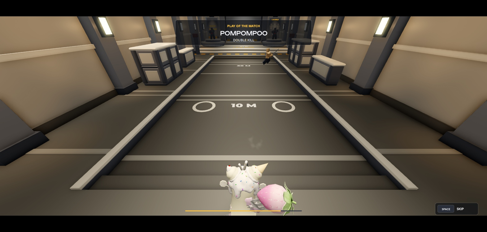
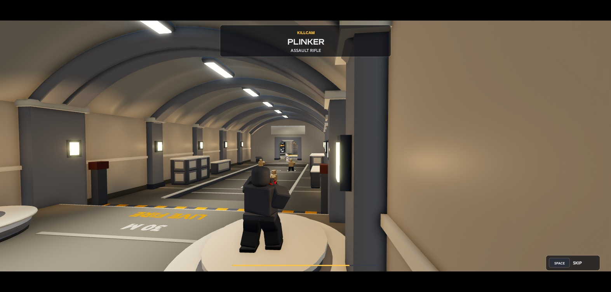
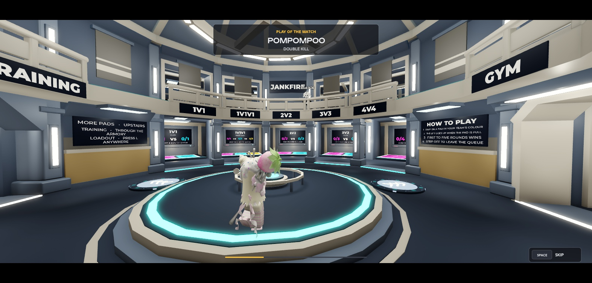

# Match recording, killcam and the play of the match (Roblox)

The owner asked on 17 Nov 2026: "can every match be recorded or is that cray cray? Can there be an end of match
replay". It isn't too much, because a recording is **data, not video**. Every player's position, look and weapon, a
dozen times a second, plus the events (shots, hits, kills) is a few dozen kilobytes a minute.

This ports the web game's replays (`public/js/replay.js`, `server/room.js`: the server keeps a recording, a clip is
frames plus events plus who's who, the play of the round is picked by a score) to Roblox.

## What it does

1. **The recorder (server).**
   - From a match's start to its end, the server takes a snapshot about 12 times a second. Each snapshot holds every
     player in the match: position, facing, look pitch, aim / reload flags, crouch / slide, weapon, HP, alive.
   - It also logs the events: shots (with their end points), swings, hits (with headshots), kills, round results.
   - Snapshots are packed into Luau `buffer`s, 24 bytes a player. Events stay small tables.
   - The recording lives in server memory for the match only. When the match ends it is kept 10 minutes more, so a
     report can still save it, then dropped. **Nothing is stored by default.**
2. **The killcam.** When another player kills you in a match:
   - after a short beat you watch the last ~5 s again from over your killer's shoulder;
   - their real body and skins, their shots and your death are drawn;
   - a KILLCAM bar names who and with what;
   - SKIP (Space, or the button) ends it, and so does the next round starting.
3. **The play of the match.** Every kill in the match is scored the web game's way (`room.js` `hlCandidate`):
   - **The score:** 10 for each kill in the same 8 s run, up to 6 for distance, 3 for a headshot, 5 for a fall, a dash
     of chance. A clutch (the last one standing on your team who takes the round) adds 6.
   - **The best one** becomes the play of the match: 3.2 s before its first kill to 1.3 s after its last, at most 8 s.
   - **After the end screen** (about 3.5 s, with the ranked card), everyone watches it from over the hero's shoulder:
     - every player's body with their real skins, wraps and gun hats;
     - shots and kills drawn again from the events;
     - a short slow-down at each of the hero's kills;
     - a banner (PLAY OF THE MATCH, the name, DOUBLE KILL / HEADSHOT / CLUTCH · 1V2 …) and SKIP.
   - It is under 10 s. Then everyone goes back to the lobby or the hub as before.
   - A match with no kills has no replay, and the end screen runs as it always did.
4. **Reports.** `Recorder.forReport(player)` gives the anti-cheat session the current or last match's recording of
   that player, as plain strings (base64 frames + JSON events + who's who), to save with a report in its own moderation
   store with its own expiry. Only reported matches are ever kept. It also takes a user id, for a player who has left:
   a match still running that recorded them, or their last match for 10 minutes after it ended.
5. **Every match:** casual, ranked, pad matches, and the Modes tab later (anything that runs through Matches).

## How the pieces fit

| file | what |
|---|---|
| `src/server/Recorder.luau` | sessions (one per match), the snapshot loop, the event log, clips, the killcam, the play-of-the-match pick, `forReport`, the Studio test hook `ServerStorage.JankReplayTest` |
| `src/client/Replay.luau` | playback: ghost bodies, the camera over the focus's shoulder, effects from events, slow-mo, the KILLCAM and PLAY OF THE MATCH overlays, SKIP |
| `src/client/ReplayClient.client.luau` | takes the server's clips (`JankfireRemotes.Replay`), caches each player's clean look for ghosts, the test attribute |
| `Fight.luau` (small) | `Fight.onShotFx(fn)` / `Fight.shotFx(f, wid, ends, kind)`: a shot's end points and swings for anyone who wants them |
| `Combat.server.luau` (small) | calls `Fight.shotFx` where it already sends everyone the tracers and swings |
| `Matches.luau` (small) | `Matches.afterHook(m)`: a match with a replay stays on the end screen for `wait` s, then the replay, then home |
| `ThirdPerson.luau` (one line) | a test rig (tag `TPRig`) may name its player in `TPPlayer`, so a ghost's gun gets that player's wrap and hat |

**Ghosts** are clones of each player's own character, taken when it last spawned, without scripts. They are tagged
`TPRig` with `TPWeapon` / `Skin` / `TPPlayer` attributes, so `ThirdPerson.luau` poses them exactly like live players
(the gun in their hands at its real skin, wrap and hat, the aim, the kick of each shot). The recorded look and flags
go on their `TP` attribute. Walking legs come from their own Animate script's run animation.

## Clip format (the web game's, in Luau)

```
clip = {
  t0, t1,                       -- server os.clock() span
  frames = { { s = time, b = buffer } },  -- one record per player per frame, 24 bytes:
      -- u32 slot, f32 x y z, i16 yaw (0.01 rad), i8 pitch (deg), u8 flags, u8 pose, u8 weapon index, u8 hp, u8 alive
  ev = { { s = time, t = "shot" | "swing" | "hurt" | "kill" | "round", ... } },
  info = { [slot] = { id, name, kind = "player" | "dummy", skins } },
  weapons = { "ar", "katana", ... },        -- weapon index -> id
}
```

## Measured (17 Nov 2026, place version 519)





**The camera (re-shot at place version 531).** Most of the map's kit has CanQuery off, so a raycast passes through it, and the first photos had a pillar filling a third of the frame. The replay camera now tests the boxes of the solid map parts near the action itself, like a popper cam. It tries the hero's shoulder, the other shoulder, up and behind, then higher and closer spots, and it wants room beside a shoulder spot (no wall right next to the lens). A raised spot looks at a nearer point, so the hero stays in the frame, and the hero fades when the lens gets close.

**The test.** A Studio Play test recorded the training hall: me plus all 32 dummies, so 33 fighters. I killed two
dummies, then:
- **the play of the match:** my ghost over the shoulder, wearing my avatar, holding the rifle at its skin; banner,
  progress bar, SKIP;
- **a killcam:** from over the Plinker's shoulder, its rifle in hand, the KILLCAM banner with the weapon.

**Size.** It came to about **15.5 KB of frames a minute per fighter**: 384 KB of frames for 33 fighters over 45 s.

| players | memory a minute | a 5-minute match as a report export |
|---|---|---|
| 2v2 | about 62 KB | about 0.4 MB of base64 |
| 4v4 | about 124 KB | about 0.8 MB |

A DataStore key holds 4 MB, so even a long 4v4 fits.

**Not yet tested.** The play of the match and the killcam in a real match need two real players. With one tester,
stand-ins never fight. The pieces they run on were tested here: the end-screen hold, the kill hooks and the clips.
