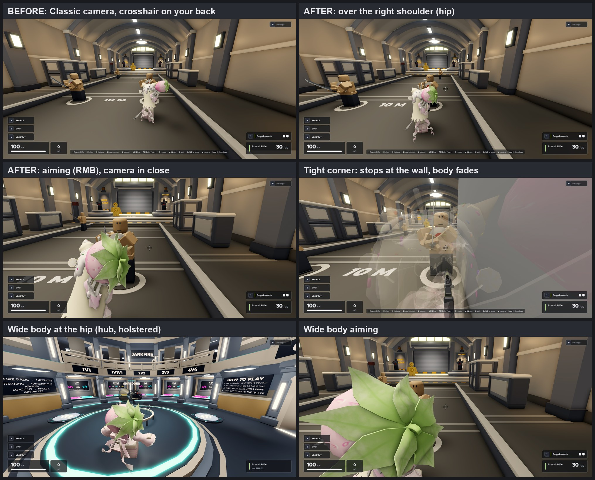
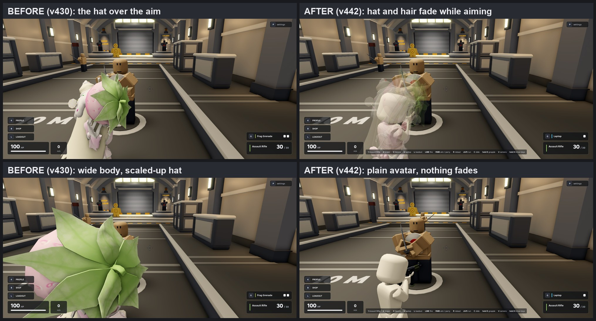
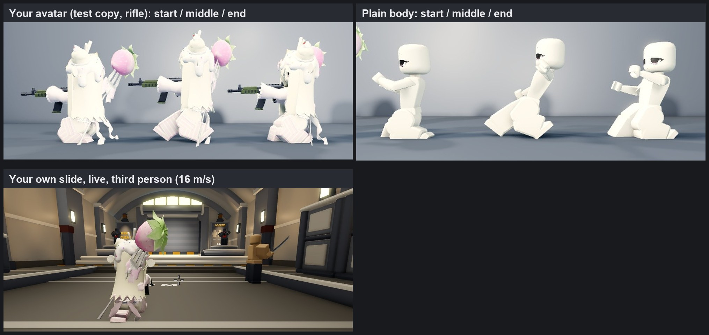
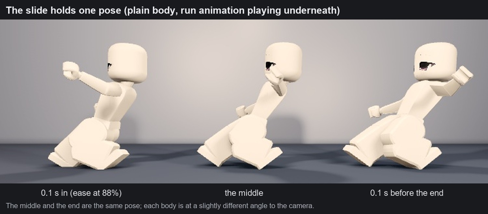
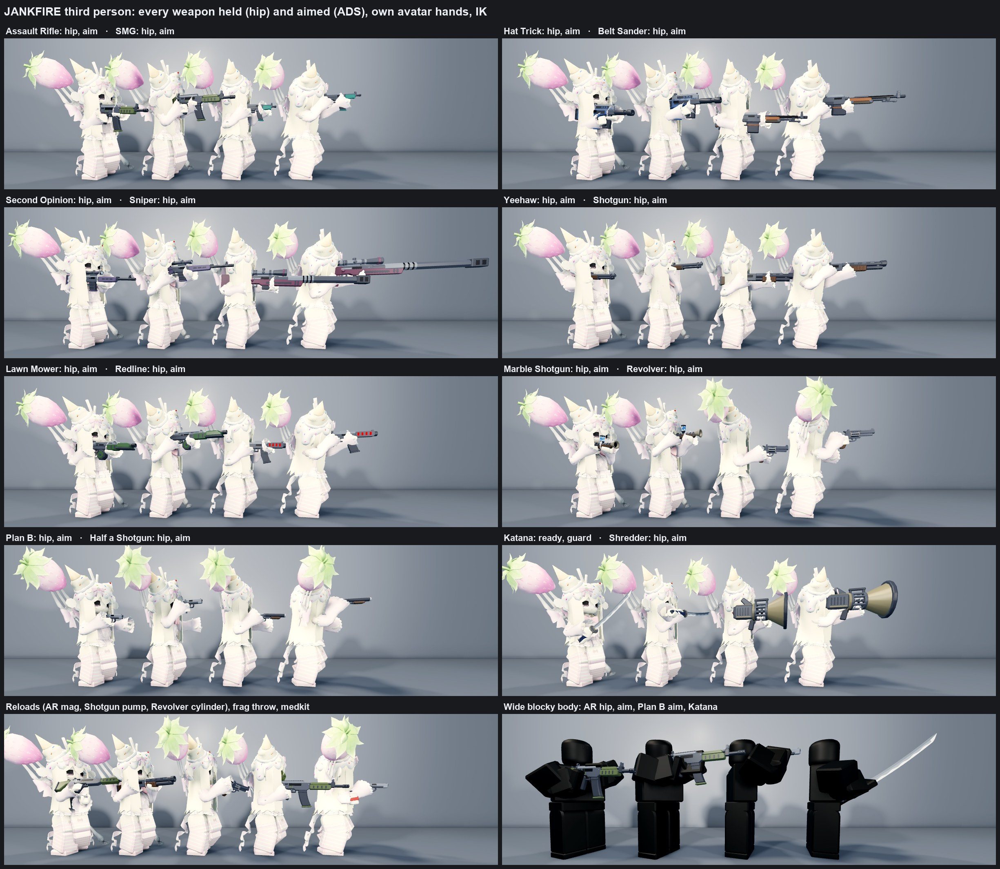

# Third person: every body handles its weapon

Asked for on 16 Nov 2026 ("can the character aim down gun outside of scopes in like in 3rd person animations for
weapons"). In third person (V), and for everyone watching you, your Roblox character now holds its weapon in both of
its own hands, aims it where you look, goes down the sights for every gun (scoped or not), kicks when it fires,
reloads with the off hand, swings and guards the katana, and throws or uses items with the left hand.

Code: `roblox/src/client/ThirdPerson.luau` (all of the pose, on every client), `roblox/src/server/ThirdPersonRelay.server.luau`
(the network), `roblox/src/client/ShoulderCam.client.luau` (your camera in third person, see "The shoulder camera"),
small hooks in `client/Arsenal.client.luau`, `client/Move.client.luau`, `client/Utility.client.luau` and
`client_root/CrouchPoses.client.luau`.

## How it works

Every frame, for every character holding a weapon (players, the training dummies, test rigs):

1. **The gun.** Each client builds its own copy of the held gun (`WeaponModels.build` with the same skin, wrap and
   hat as the server's `HeldWeapon`, which is hidden on that client) and welds it to the chest (`UpperTorso`) where the
   stance puts it. The copy is **sized to the avatar's arms**: `k = TP.T.scale x u` studs per metre of the gun's file,
   where `u` is that avatar's shoulder-to-wrist length (clamped 1.7 to 4.5). The server's `HeldWeapon` is built at 4.5
   studs a metre, which made a rifle longer than the owner's slim avatar is tall; no arm could reach its handguard.
   On a standard blocky body the copy is about 2.9 studs a metre, on the owner's slim one about 2.0.
2. **The chest.** The waist turns the chest into the stance (bladed for rifles, gun arm forward for pistols) and takes
   part of the look pitch (`waist`, 0.35 to 0.45); the walk animation's sway is taken out of the upper body so the gun
   stays steady. The neck takes the rest of the pitch, so the head looks where the gun points; while aiming the head
   tilts down onto the stock (`cheek`).
3. **Hip and aim (ADS).** At the hip the gun sits low and right of the face, pointing where you look. Aiming blends
   (same speed as first person) to the gun up at the right eye: its rear sight (`Sight` spot) a little in front of the
   eye, on the line of sight. Every gun has this, scoped or not.
4. **The hands.** The avatar's own hands (never a custom model) go on the hold table's grip spots
   (`tools/roblox/holds.json` -> `Holds.luau`, the same spots first person uses) through a two-bone IK solved from the
   avatar's own rig attachments: shoulder, elbow, wrist and the hand's `GripAttachment`. Each hand is turned about the
   handle until the wrist faces its elbow (the first-person rule), the elbows bend toward per-stance pole points. If a
   handguard is beyond an arm's reach, the hand slides back along the gun (at most 0.18 m of the file) until it is
   reachable. One-handed guns (Pistol, Revolver, Sawed-Off) leave the left arm to the walk animation.
5. **Fire.** A kick per shot from the gun's own first-person recoil row (`recoilVM`, x `TP.T.kick`), on springs, about
   the grip; the slide, cylinder and hammer move (`GunParts.shot`); the pump, bolt and lever cycle after a shot.
6. **Reload.** The gun goes through its first-person reload clip (`Reloads.luau`), its moving pieces move (`GunParts`),
   and the off hand takes the magazine, the cylinder or the barrels out and back for the clip's window, or rides the
   pump. One-handed guns bring the left hand in for the reload only.
7. **Sprint.** Fast on the ground, not aiming, not just fired: the gun comes down across the body (`TP.T.low`).
8. **Katana.** Its own stance (both hands on the hilt, blade forward and up at the right hip), two alternating
   slashes (right to left, left to right), the guard (blade across in front of the face), the draw and the stagger
   when a swing is parried. Keys in `KAT` at the top of the module.
9. **Items.** The left hand throws (frag, smoke, duck, the calculator) on an arc with the item in the hand until the
   release, or holds the item up for a moment (medkit at the chest, goggles to the face, camera at the eye, radar
   forward, and so on). Driven by the server's `ItemFx` events, so everyone sees it.
10. **You in third person.** With a weapon out your body turns to face where you aim (first person already did), and
    the gun points at what the crosshair is on, not along the camera (`TP.crosshair`, below). The camera is the
    shoulder camera (next section).

The pose runs after the walk animation and after the crouch and slide bends: `CrouchPoses` calls `TP.step(dt)` at the
end of its own pass (and the module runs its own pass if that call stops coming). Everything is written in the
chest's own space, so the hands land exactly whatever the chest does.

Roblox's `IKControl` was the first idea. It solves during the animation step, before the crouch poses and this pass
bend the spine, so its hands slid off the gun whenever the chest moved; this solve runs after, in chest space.

## The shoulder camera

Added 16 Nov 2026 after the pose work ("can the character aim down gun outside of scopes ... in 3rd person"), in
`client/ShoulderCam.client.luau`. Before it, third person was Roblox's Classic camera: straight behind you with your
body in the middle of the screen, the mouse free, and the right mouse button both turning the camera and aiming.

- **V** turns third person on and off as before. `Move.client` sets the player's attribute `ThirdPerson`; the
  shoulder camera drives the camera (Scriptable) while it is true and the device has a mouse. First person is still
  Roblox's own camera, untouched.
- **Over the right shoulder:** the camera turns about a point 1.5 studs over your root (Roblox's own camera's point,
  with the crouch and slide drop) and sits 2.5 studs right, 0.6 up and 8 back. The crosshair in the middle of the
  screen sees past you.
- **The mouse is locked to the middle** of the screen: moving it turns the camera, no button to hold, at Roblox's own
  camera rate (0.5 degrees a pixel, 0.77 of that up and down), so it turns as it does in first person; the P menu's
  sensitivity scales both.
- **Aiming (RMB with a gun)** brings the camera in to 2.3 right, 0.55 up and 5.4 back (wide enough that the owner's
  big hat stays off the crosshair), at the speed the gun comes up to your eye (`TP.aiming`, Arsenal's ADS blend,
  eased); the gun's ADS zoom still narrows the view.
- **Walls:** a ball the camera's size (0.4 studs) is swept from your head out to where the camera wants to be; a wall
  in the way pulls it straight in, and it eases back out (rate 6 a second) once the way is clear. Bodies, see-through
  parts (glass, invisible hit boxes), trusses and anything you can walk through don't stop it. If it ends up closer
  than 2.6 studs to your head (a wall right behind you), your body fades out of the way, fully gone at 1 stud, as
  Roblox's own camera does; the gun keeps its own look. Looking up, the camera stops going down behind you at 25
  degrees, so it never swings under you into the floor.
- **Your hats never cover the aim:** while you aim (the camera in close), each of your own hats and hair pieces whose
  box on screen reaches into the middle of the screen (`C.mid`: the band from 38 to 62 % across and 22 to 78 % down,
  round the crosshair) fades to 0.8 (`C.aimFade`), smoothly in and out (rate 10 a second), scaled by how far you're
  aimed in. Your body, your head and the gun stay; at the hip nothing fades.
- **In and out:** turning third person on, the camera starts 0.6 of the way out and eases back; turning it off, it
  glides into your head in 0.14 s and hands over to first person.
- **Menus:** while `LoadoutOpen` is set (loadout, shop, profile, loot opening) the menu has the camera and the mouse;
  under the settings panel (`SettingsOpen`) the mouse is free and the camera holds still.
- **Camera kicks and shakes** (Arsenal's recoil, the items) are changes from last frame's look, so the camera reads its
  look back every frame, as Roblox's own camera does: recoil climbs the same way in both views.
- **Hits land on the crosshair, also up close.** With the camera off to the side, a line from your eye to whatever
  the crosshair shows on the far wall can pass beside a player standing close under the crosshair. So
  `TP.crosshair(eye)` casts the camera's ray (from level with your head, so nothing behind you counts) against the
  map and everyone's hit boxes (the boxes the shots use), and Arsenal fires from your eye to that point: the server
  checks shots from the eye, the tracer is drawn from the muzzle to the hit. Your character's gun points at the same
  point.
- **Telling first person from third:** Arsenal, ThirdPerson and Utility used "the camera is more than 4.5 studs from
  your root"; in a tight corner the shoulder camera can come closer than that, so they now also count the
  `ThirdPerson` attribute.
- Tune live in a Play test through the script's `Tune` attribute (JSON merged into `C`, e.g. `{"hip":{"back":9}}`),
  then write the numbers back into the file.



*Before (Roblox's Classic camera) and after, on the owner's avatar in the training range; a tight corner (a wall 2
studs behind the back and one on the right); a wide body (width x1.6, depth x1.4).*

Tested in Play on 16 Nov 2026 (in place version 430), real V, mouse and P keys:

- V: the camera went Scriptable, the mouse locked to the middle, 2.5 right / 0.6 up / 8 back; your body and gun
  showing. RMB: 2.3 / 0.55 / 5.4 with the rifle's zoom (FOV 80 to 53). V again: first person as before (Roblox's
  camera, mouse locked, the first-person gun showing, the third-person copy hidden).
- Close range: crosshair on the left half of a dummy 6 studs away. The old aim (map only) passed 2.23 studs from
  the box centre (half-width 1.56: a miss); the new aim hits, and a real click took the dummy from 100 to 45.
- Tight corner: the camera stopped 1.2 studs from the head, never inside a wall; the body faded to 0.86; the gun and
  crosshair stayed clear; no first-person gun popped in.
- Wide body (a respawn mid-test): the camera carried on over the new body, hip and aim.
- P: the mouse is free under the settings panel and locks again when it closes. No errors in the output.
- With the owner's big hat, aiming at 1.7 right put the hat next to the crosshair; 2.3 keeps it clear. On a body
  scaled up 1.6 wide the scaled-up hat fills the left half while aiming (the crosshair stays clear).

**Hats fade while aiming (place version 442).** The owner's hat and leaves still covered about half the screen
while aiming, so your own hats and hair over the middle of the screen now fade (above). Tested on the owner's
avatar (9 accessories): aiming, the 6 that reach the middle (the strawberry hat, the hair, the glasses) went to
0.80 and the bow tie and the 2 others lower down stayed at 0; the body, the head and the gun stayed solid. After
letting go of RMB they were back to 0 within 0.4 s, smoothly. On a plain avatar (accessories and clothes removed)
nothing faded.



## The slide

Reported 16 Nov 2026: "when you slide, its not an actual slide ... your feet still move like they kick like theyre
trying to run". The slide pose (`client_root/CrouchPoses.client.luau`) used to be layered on top of whatever animation
was playing, so Roblox's run cycle kept kicking the legs underneath. Now (place version 466):

- **The slide takes the body outright:** the Root, both hips, knees and ankles, the waist, the neck and both arms are
  set to the slide pose (lerped from the animation by the slide's weight), whatever the run is doing. Leaning back 28
  degrees (the torso ends up about 32 back), the right leg out in front nearly straight, the left folded under, the
  left arm out for balance. The third-person weapon pose still runs after it, so a held gun stays held (the arms only
  take the slide pose when they're free).
- **Hips at the right height for any body:** the hips' height is worked out from the body's own leg and foot lengths
  so the folded shin lies on the floor and the front heel just clears it, after Move.client's 0.9-stud slide sink
  (`T.lift` = 0.3 measured in Play: without it the shin sat 0.35 into the floor).
- **Ease:** in and out at rate 18 a second (about 90 % in 0.12 s), so a slide into a run or a jump doesn't pop.
  A crouch is unchanged.
- Footsteps were already silent in a slide (`Steps.client` skips them).
- Tune live through the script's `Tune` attribute (JSON, angles in degrees: `lean`, `frontHip`, `backKnee`, `lift`
  and so on), then write the numbers back. Test bodies tagged `TPRig` are posed too: attribute `Pose` = `"slide"` and
  `PoseW` = a number holds the slide at that weight.

Tested in Play: a real slide on the owner's character (sprint, then C): while running the feet moved 1.6 and 1.9
studs relative to the body; during the 0.78 s slide (after the ease) 0.11 and 0.05 studs. Six test bodies (the
owner's avatar holding the rifle, a plain body) at the start, middle and end of a slide, with the run animation playing
underneath every one: the feet don't move (0.000), the folded shin rests on the floor (0.01 studs up), the front heel
0.22 up.



*(In this first strip the outer two bodies were frozen at 35 % and 55 % of the ease, inside its first and last
0.12 s, so they read as a kneel. A real slide is at 88 % by 0.1 s and holds the full pose to the end: below.)*

**One pose from start to end (place version 470).** Leaned back more (`lean` 24 to 28, the neck to -30 so the head
stays level) and the front leg a little lower (`frontHip` 38 to 32): at full weight the torso leans back 32 degrees,
the folded shin is 0.05 studs off the floor and the front heel 0.20. Frozen at the weights a real slide has 0.1 s in
(0.88), in the middle and 0.1 s before the end (1, 1), with the run animation playing underneath, the pose is the same
(the last two measure the same to the hundredth of a stud).



## The network

Your client sends `TPState(pitch, yaw, flags)`: where you look (degrees; yaw is the offset from your body's facing)
and two flags (1 = aiming, 2 = reloading, 4 = an empty reload). It sends when something changes, at most about 12
times a second (flags at once). `ThirdPersonRelay` checks the numbers (finite, clamped, at most 30 a second per
player) and puts them on your character as the attribute `TP` (Vector3: pitch, yaw, flags). Every other client
smooths it and poses your body. Shots (`Shot`), swings and guards (`Fx`) and items (`ItemFx`) already reached every
client and drive the kicks, slashes and throws.

## Tuning

All numbers are in `TP.T` at the top of `ThirdPerson.luau`. Distances are in the avatar's arm lengths (`u`), angles in
radians. Per stance (`rifle`, `heavy` = LMG, `pistol`, `shredder`, `katana`): `twist` / `twistAds`, `waist`,
`ads` (rear sight from the right eye while aiming), `hip` and `hipRot` (the gun's move from there at the hip), `cheek`,
`poleR` / `poleL` (where the elbows point).

In a Play test, change any of it live through the module's `Tune` attribute (JSON merged into `TP.T`):

```lua
game.Players.LocalPlayer.PlayerScripts.Jankfire.ThirdPerson:SetAttribute("Tune", '{"rifle":{"hip":[0.14,-0.4,0.1]}}')
```

Then write the numbers back into the file.

## Testing (Studio)

Any model tagged `TPRig` with a `TPWeapon` attribute is posed like a player. Its state comes from the same `TP`
attribute a player's does, so it tests the other-player path. Extra test attributes:

- `TPFire`, `TPSwing`, `TPGuard`, `TPStagger`: change the number to fire / swing / guard / stagger once.
- `TPItem` = `"frag:throw"` or `"medkit:use"`: once.
- Frozen poses for photos: `TPKatPose` = `"swing:0.15"`, `TPClipPose` = `"reload_ar:0.6"`,
  `TPItemPose` = `"frag:throw:0.12"`.
- `TPDebug` = true: the gun carries `HandR` / `HandL` (where each hand was sent, chest space) to check the IK.
- `TPKat`: the katana's kill count on a rig.

`ReplicatedStorage.TPWide` (made by the test on the server from a default blocky HumanoidDescription) is the wide body.

## Results (16 Nov 2026, place version 389)



*Every weapon at the hip and aimed, on the owner's slim avatar (test bodies posed through the other-player path), then
three reloads, a frag throw and the medkit, then a wide blocky body.*

Measured in Play tests:

- **Hands land exactly.** Each hand's part ends within 0.000 to 0.010 studs and 0.0° of where it was sent, on all 16
  weapons, both bodies, hip and aim. A few targets are out of reach on purpose and the arm stops short (straight):
  the off hand chasing a dropped magazine on the slim avatar (AR 1.25 studs short at the bottom of the drop, SMG
  0.64), the Revolver's cylinder (0.09), the katana's left hand on the wide body (0.20).
- **Your own character, real keys and mouse (training room):** V gives third person; the local gun is built, the
  server's copy is hidden, your body turns to the camera. RMB: the `TP` attribute on the server read `(0, -1, 1)`
  (aiming). 11 shots fired (30 to 19) and R: `TP` read `(5, -2, 2)` (reloading) and the magazine left the gun.
  No errors in the output.
- **First person is unchanged:** the viewmodel, the hands and the HUD are as before; your own third-person copy is
  hidden while you are in first person.
- The dummies (Plinker, Stand, Dummy) hold their guns the same way, at a level look.

**"The gun is held backwards in third person" (reported 16 Nov, against place v360):** that came from Arsenal's old
arm pose (`poseStep`: it turned the shoulder joint, and on the owner's avatar the shoulders are AnimationConstraints,
so the server's gun swung round behind). This work removed that code (v389). Checked again on the owner's own avatar
in third person (place v397): the Assault Rifle points along the body (0.98 of straight ahead), muzzle 2.9 studs in
front, both hands exactly on; Pistol 0.85 (the rest is the aim's yaw toward the camera), muzzle in front; the
server's copy of the gun shows 0 visible parts.

**Later tweaks (place v397):** the Wood Chipper Shredder skin gets both hands through a fallback frame (handle to
muzzle) when it has no hub and chute; no goggles model in the hand (the items client already draws them on the head);
the calculator and the laptop are held facing the holder, as in first person; a real throw starts from the top of
the wind-up when the server's launch arrives, with no item in the hand (the thrown one is already flying); your own
Marble Shotgun shows your real marble count.

Known limits and ideas for later:

- The Redline's jerry can and the marble bag (first-person reload props) are not shown in third person; the off hand
  stays on the gun for those two reloads. (Until place version 466 they showed in the wrong place instead: they're
  models of their own, placed at the first-person gun, which is hidden at the camera in third person, so they hung
  behind your character during the reload. Viewmodel now drops them while the first-person gun is hidden; checked in
  Play: none in third person, the jerry can there as before in first person.)
- The sprint lowering and the throw's item model in the hand are in the code but were not photographed.
- The shoulder camera needs a mouse: on a device without one, V's third person stays Roblox's Classic camera. There
  is no key to swap shoulders, and the shoulder offset doesn't grow with a very wide body.
- The `TPState` remote is made by `ThirdPersonRelay` when the server starts (it is not in `default.project.json`).
