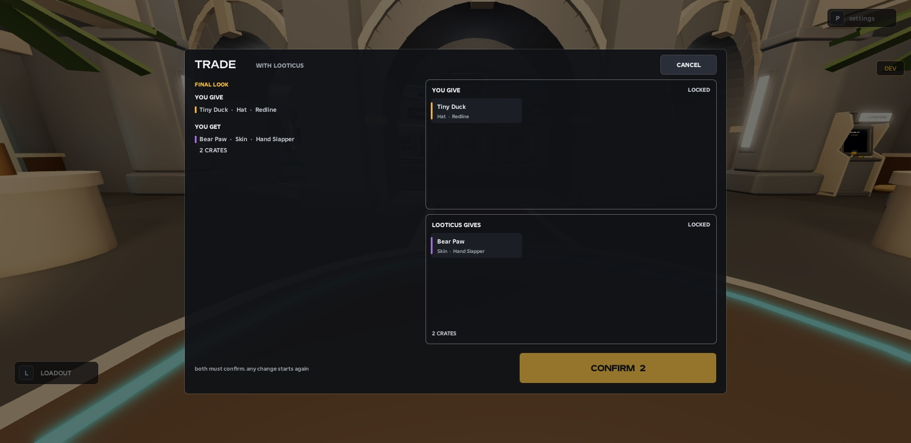
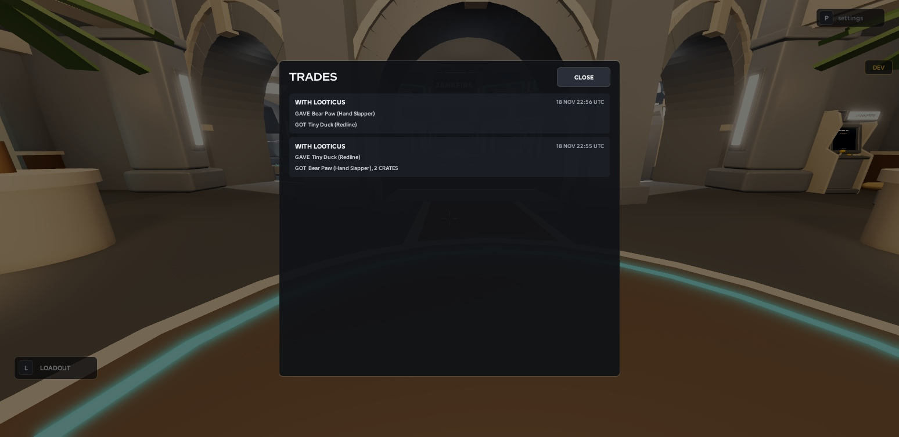

# Trading (Roblox)

The owner, 18 Nov 2026: "we need trading". Built by the play-party-ranked session.

**Switch:** `PlayConfig.TRADING_ON` (ReplicatedStorage.Jankfire.PlayConfig), **false** until the owner's content
questionnaire is changed to say the game has trading. The main session flips it. Nothing about trading shows while it
is off: the PARTY panel's TRADE stays a greyed slot, and cards have no TRADE or TRADES button.

## Files

| File | What |
|---|---|
| `src/shared/TradeRules.luau` | What may be traded, the numbers (level, account age, limits, timings), item rows for screens |
| `src/server/Trading.luau` | Requests, the trade window's state, the swap, the ledger, the owner's lookup, the Studio test hook |
| `src/server/Loot.luau` (block "trading") | `Loot.tradeHandle(p)`, `Loot.testHandle(id, how)`, `Loot.loaded` |
| `src/client/TradeUI.luau` | The trade window, the request pop-up, TRADES (history) |
| `src/client/TradeClient.client.luau` | Pushes into TradeUI, PadNav registration, the `TradeTest` attribute |
| Hooks | PartyUI (TRADE per player), ProfileUI (TRADE on others' cards, TRADES on yours), MapRoomHud (closes it), PadNav (the pop-up on VIEW), PlayServer (`Trading.init()`) |

## Who can trade

Everyone in the same server, with all of these true for **both** sides:

- **Hub only.** Not in a match, a map room or training. MenuGate blocks the window there, and the server closes a
  trade the moment a side leaves the hub.
- **Level 5+** (Stats' `Level`) and a Roblox account **7+ days old** (fewer alt scams).
- **Roblox's policy:** `PolicyService:GetPolicyInfoForPlayerAsync(p).IsPaidItemTradingAllowed`. We don't track whether
  an item was bought or earned, so a no blocks trading outright ("NOT AVAILABLE WHERE YOU ARE"). It's blocked until the
  policy answers ("ONE MOMENT").
- The loot save is loaded and reachable, no trade of theirs is still finishing, and the trade log is reachable.

One trade at a time each. A request every 5 s at most; a request lasts 20 s; the other side may decline. Asking someone
who has already asked you opens the trade.

Refusals are short labels: `LEVEL 5 TO TRADE`, `ACCOUNT UNDER 7 DAYS OLD`, `NOT AVAILABLE WHERE YOU ARE`, `HUB ONLY`,
`THEY CAN'T TRADE RIGHT NOW` (a request to someone who can't; their reason isn't shown to you).

## What can be traded

`TradeRules.why(type, key)` decides, and the server asks it again for every item at the moment of the swap.

- **Yes:** owned wraps (one gun's), hats (one gun's), weapon skins, kill effects, emotes, card borders, banners (the
  card backgrounds) and titles, of the container rarities (common, rare, epic, legendary). And unopened containers:
  Crates, Duffel Bags, Spray Cans (up to 99 of each).
- **No**, marked `NOT TRADEABLE` in the picker with the reason:
  - `FREE`: free and default things.
  - `VIP`: VIP-only things, and skins of a VIP set.
  - `VIP DAILY`: the VIP daily reward's exclusives.
  - `CODE`: code rewards (a skin set with `code = true`: Ducky Classic).
  - `FOUND`: found things (the lore titles, OG).
  - `OWNER`: the OWNER title.
  - `MASTERY`: weapon mastery camos.
  - `COMING SOON`: anything on a weapon that isn't live.
  - `BUNDLE`: a shop bundle's wrap, owned on every gun at once (`data.every.wrap`).
  - Grapples (lore gifts) and any other type: not offered at all.
- Coins (Brass) and Crate Tickets aren't in the loot save, so they can't be offered.

## The window

- **YOUR THINGS:** everything you own, with filters (ALL, WRAPS, HATS, SKINS, FLAIR, CARD, BOXES). Click to put an
  item in or take it out; BOXES has − / + for containers. At most 16 items a side.
- **YOU GIVE** and **NAME GIVES:** each side's offer, marked ADDING, LOCKED or CONFIRMED.
- **LOCK:** both sides lock. Any change after a lock (an item in or out, a container count, UNLOCK) unlocks both.
- **FINAL LOOK:** with both locked, the picker gives way to two plain lists, YOU GIVE and YOU GET, exactly what moves.
  CONFIRM counts down 3 s (the server refuses one sooner). Both must confirm; any change starts again.
- **CANCEL** at any time before the swap. A trade with nothing happening for 5 minutes closes.
- On a phone the window has two tabs: TRADE (or FINAL LOOK) and YOUR THINGS.
- On a controller PadNav moves through it (`Pad.MENUS.trade`). B goes back from YOUR THINGS on a phone, else cancels.
  A request pop-up is on VIEW.
- **TRADES:** your last 50 trades (from your save): who with, when, what you gave and got. It opens from TRADES on your
  own card.

## The swap

The server does it; the client only asks. Every item is checked again: still in that side's save, still tradeable,
enough containers. Then:

1. **Prepare.** The whole trade goes into both loot saves as `data.tradePend`, and both are written. If either write
   fails, it's taken out again: nothing moved ("couldn't save: nothing changed. try again").
2. **Decide.** The ledger key `t:<trade id>` is written once, with UpdateAsync that only writes when it's empty: commit
   (with the whole trade) or abort, whoever writes first. A save that loads with a trade pending asks the ledger, and
   writes abort if nobody decided yet. So a crash at any point can't leave one save traded and the other not.
3. **Apply.** Each save gives its side and takes the other's, once: `data.tradeDone` holds the trade id as a receipt. It
   also keeps the trade in `data.trades` (the last 50), clears `tradePend`, and is written. A write that fails here is
   already right in memory: the autosave or the leave save writes it. If the server dies first, the save still has its
   pending copy, and the next load finishes it from the ledger's commit (`Loot.loaded` → `resolve`).
4. **The owner's log:** `p:<userId>` in the ledger gets the trade id (newest first, 200 kept).

If the ledger doesn't answer at all, nothing moves. Both saves keep the pending copy, neither player can start another
trade, and the server asks the ledger again every 15 s until it gets an answer.

Received items are NEW in the loadout. Anything worn that went (a wrap, hat, skin, kill effect, emote or card look)
comes off by itself: Loot fires `changed`, and the loadout, flair and the card each check what you own.

**Stores** (all `_studio` in Studio): the loot save `JankfireLoot_v1` (session-locked, Profiles.luau) and the ledger
`JankfireTrades_v1`.

**The owner's lookup:** `Trading.lookup(userId, n)` returns the last n trades that user was in, straight from the ledger
(both ids and names, the items, the time), here or not. It's for the REPORT / CONFIRM CHEATER tools; they don't call it
yet.

## Studio tests

Hook: `ServerStorage.JankTradeTest` (BindableFunction). It works with `TRADING_ON` false.

- `on` / `off`: switch Studio's trading on or off.
- `stand id name { level, age, policy }`: a stand-in trader (negative id) with its own loot save. `unstand id` removes
  it.
- `give id type key` and `setstock id kind n`: put things in a save.
- `inv id`: a save's contents.
- `gate id { level, age, policy }`: treat a player as if they had that level, account age or policy.
- What a stand-in does: `ask` / `answer` / `add` / `remove` / `stock` / `lock` / `unlock` / `confirm` / `cancel`.
- `fail "prepare"|"final"|"ledger" id on`: make that step's write fail.
- `crash id`: a stand-in's save is dropped unwritten. `reload id`: loads it again and finishes whatever is pending.
- `snap id` / `restore id`: a copy of a save's things, and back.
- `state` / `trade` / `inbox` / `lookup`: read-outs.

On the client, the LocalPlayer attribute `TradeTest` takes `open`, `history`, `close`, `request:<id>`, `fake:844x390`
and `real`.

## Tested (18 Nov 2026, about 22:55 UTC, place version 1035, solo Play)

The test ran with trading switched on in Studio only (`TRADING_ON` stays false), my own Studio loot save, and two
stand-in traders with their own saves.

- **The gate:** my real Studio level is 1, so I was refused with "LEVEL 5 TO TRADE". Gated as level 3: "LEVEL 5 TO
  TRADE". Gated as a 2-day account: "ACCOUNT UNDER 7 DAYS OLD". Gated as a policy no: "NOT AVAILABLE WHERE YOU ARE". The
  rest of the test ran gated as level 10.
- **A policy-blocked player:** the stand-in Dune (policy no) asking me was refused "NOT AVAILABLE WHERE YOU ARE". My
  request to Dune was refused "THEY CAN'T TRADE RIGHT NOW".
- **The picker:** 42 things in my save, 40 of them marked not tradeable (VIP, code and free items, mostly).
- **An untradeable item refused:** the stand-in adding the VIP Ducky wrap was refused "NOT TRADEABLE: VIP".
- **A normal trade:** the stand-in Looticus asked; the pop-up read "LOOTICUS WANTS TO TRADE"; I accepted.
  - I put in a Tiny Duck hat (Redline); it put in a Bear Paw skin (Hand Slapper) and 2 crates.
  - Both locked: the final look. A confirm 0 s after both locked was refused "LOOK IT OVER FIRST".
  - **A change after lock:** the stand-in changed its crates, and both sides went back to unlocked (phase edit).
  - Both locked again; CONFIRM counted 3, 2, 1; both confirmed.
  - The hat was the stand-in's, the skin and 2 crates mine, the stand-in at 0 crates. Nothing on both sides, and one
    history entry each.
- **A save failure at prepare:** the second trade (the skin back for the hat), with the stand-in's prepare write made to
  fail. "couldn't save: nothing changed. try again": nothing moved, no pending copy, back to adding.
- **A failure after the commit, then a crash:**
  - The same trade again, with the stand-in's final write made to fail. My side moved and saved; the stand-in's moved
    in memory only.
  - Its save was then dropped unwritten (a server dying) and loaded again from the store. It found its pending copy,
    read the ledger's commit, and finished: it had the skin and not the hat; I had the hat and not the skin.
  - Nothing duplicated, nothing lost. The ledger lookup showed both trades as commits, with both ids and items.
- **TRADES:** both trades listed, newest first, with what went each way.
- **Restored afterwards:** my save's things are as before (the hat back, no skin, no crates). The test's restore missed
  the trade history, so my Studio save still lists the two test trades. It's fixed, and `clearlog` clears it.

Not tested: two real players, a phone-sized layout, a controller, a worn item coming off (it runs through `Loot.changed`
like any change of what you own), and the live PolicyService answer for a real account.

