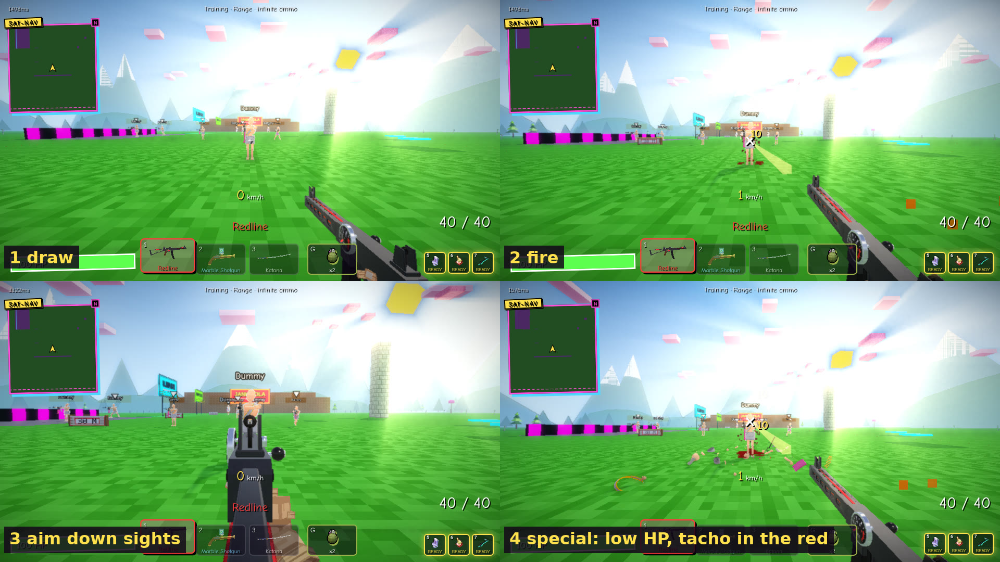
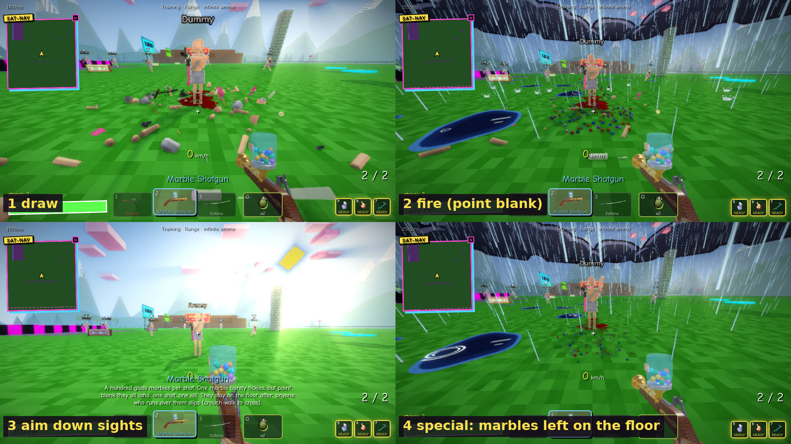
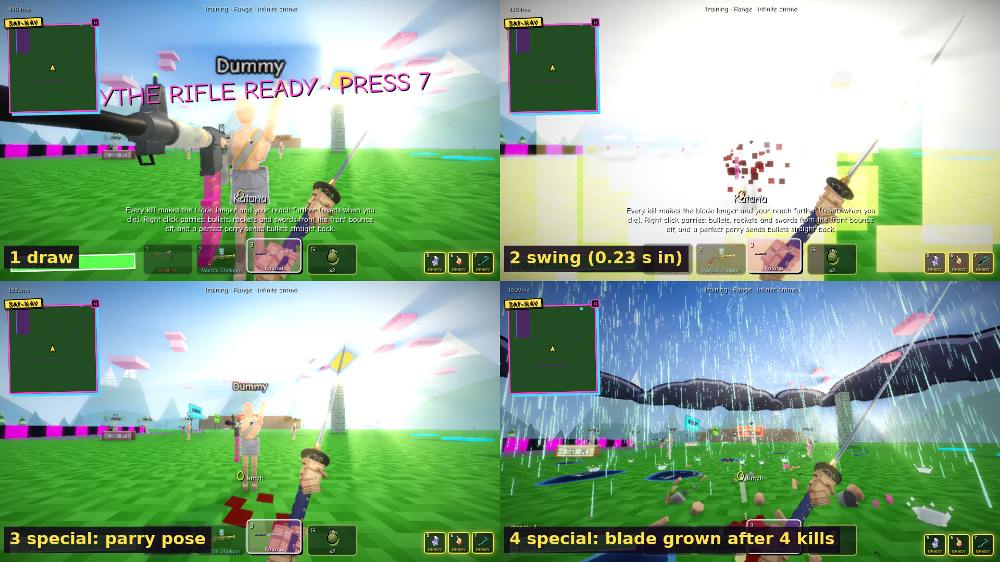

# JANKFIRE weapons: the Roblox porting spec

Every weapon, item and killstreak in JANKFIRE, written so that any session can code it in Roblox from this file alone.
Traced from the web game's code (main at patch 11.48), not from memory: every rule has a `file:line` to re-read, and
anything the code doesn't settle says **unclear**.

**How to read it.** The table below is the plain-words version. Then **Core systems** (read once: how firing, hits,
damage, knockback, the kill feed, animation and effects work for everything), then one section per weapon:
stats (web metres → Roblox studs), the gimmick step by step, what the server decides vs what the client only shows,
the juice (sounds in `public/js/audio.js`, callouts, kill-feed line), **Animations**, **Effects**, the model and its
attachment spots, and **Roblox notes**. Items and killstreaks come after, marked **phase 2**. At the end: the list of
**Blender effects to make for Roblox**, and **where the web server trusts the client** (things to fix in the port).

**Modes:** how every game mode works is in the sister doc, [MODES.md](MODES.md).

**Units:** 1 m = 3 studs (a 1.8 m player = 5.4 studs, see `roblox/README.md`). Distances, sizes, speeds,
accelerations and knockback ×3. Damage, HP, times, rates, counts, angles and multipliers stay the same.

**Effects tags:** every effect says whether it is already a **Blender asset** (which `.glb` / baked sprite) or
**code-only**. Owner rule (2026-11-13): new visual effects are Blender-made, so every code-only effect needs a Blender
version for Roblox (batched at the end).

## Owner notes

- **"the bits spitting out are pretty clunky, its not very smooth"** (owner, 2026-11-13): read as the stuff weapons throw out (shell casings, debris chunks, the marble spray, gibs) moves in visible steps
  and looks blocky. For Roblox, the "Shells & ejected bits" Blender batch must fix that: real casing / chunk meshes,
  a smooth arc with spin and one or two bounces, a fade instead of a pop, motion that runs every frame on the client
  (never server-stepped or networked: the server only says "a shot happened"). The web game's own version is a
  separate fix, flagged to the coordinator. (Part of the steppiness in these stills is the cloud's software
  renderer, which runs at a few frames a second.)

## Everything at a glance

| weapon | slot | colour | what it does |
| --- | --- | --- | --- |
| **Assault Rifle** `ar` | primary | `#9fd36b` | full auto, steady, a laser when you aim. the honest gun. somebody has to be. |
| **SMG** `smg` | primary | `#6bd3c8` | sprays fast, weighs nothing, and you run faster holding it. aiming is optional. |
| **Redline** `redline` | primary | `#ff3b3b` | the lower your HP, the faster it fires. full health it plods, 10 HP it screams. watch the needle. |
| **Shotgun** `shotgun` | primary | `#e0a060` | ten pellets of close-range bad news. shoot the floor and it throws you into the sky. |
| **Minigun** `minigun` | primary | `#c8c8c8` | spins up, then never stops. the bullets shove people and the recoil is strong enough to fly on. |
| **Sniper** `sniper` | primary | `#ff4fd8` | a headshot always kills, a body shot sends them flying off the map. hipfire is a gamble. |
| **Chicken Rocket** `chicken` | primary | `#ffe14d` | rubber chickens that explode. shoot your own feet to rocket jump. no chickens were consulted. |
| **Bowling Ball Launcher** `bowling` | primary | `#6b7bff` | rolls along the floor and bowls over everyone in the lane. three in one go is a STRIKE. |
| **Bow** `bow` | primary | `#c88a4a` | hold to draw, let go to loose. every arrow gets a random tip: power, fire, boom, gas, or a 4 second nap. |
| **Peel Shooter** `banana` | primary | `#ffe135` | hard bananas that bonk and make them slip. misses stay on the floor as peels for 30 s. |
| **Shredder** `shredder` | primary | `#ffb31a` | an industrial vacuum: suck them in, shred them, spit them out the chute. overheats after 4 s. |
| **Big Laser Pointer** `laser` | primary | `#39ff14` | an office laser pointer the size of a leg. hold to charge, let go for a beam through everyone in a line. |
| **Hat Trick** `burst` | primary | `#4f8bff` | a bullpup that fires three at a time. land all three on one person for a BURST!. very french. |
| **Belt Sander** `lmg` | primary | `#ff5a1f` | a hundred rounds on a belt you can watch run out. the barrel glows hotter the longer you hold it. |
| **Second Opinion** `dmr` | primary | `#b07dff` | two to the body or one to the head. quick-scope it for a little extra and a little shove. |
| **Yeehaw** `lever` | primary | `#ff6b8b` | crank it after every shot. keep hitting the same person and it stings up to x1.45. yeehaw. |
| **Lawn Mower** `autoshot` | primary | `#4ad66b` | an automatic shotgun with a box mag. less per shot than the pump, but it never stops. mows people. |
| **Nail Gun** `nailgun` | primary | `#ff6f3c` | fires nails, fast. six in a row and they're nailed to the wall behind them like a poster. |
| **Tennis Ball Launcher** `tennis` | primary | `#d4ff3a` | fuzzy balls that bounce up to 5 times and hit harder every bounce. bank it round a corner. |
| **Shopping Cart Cannon** `cart` | primary | `#9b5cff` | fires a shopping cart that runs people over. it parks as cover, or hop in and ride it. no brakes. |
| **Revolver** `revolver` | secondary | `#e0c070` | six shots, a cowboy twirl after each one. hold the trigger and it fans the rest out like a western. |
| **Plan B** `pistol` | secondary | `#a0b4ff` | a plain pistol for when plan A runs dry. 12 shots, and the slide locks back to say you're empty. |
| **Lefty & Righty** `akimbo` | secondary | `#00e5a0` | two machine pistols, one per mouse button. hold both to hose. they reload one hand at a time. |
| **Half a Shotgun** `sawnoff` | secondary | `#e05a3a` | half a shotgun, two shells. point blank they go flying. shoot the floor for a little hop. |
| **Marble Shotgun** `marbles` | secondary | `#7fd0ff` | a hundred marbles a shot. point blank it's a one-shot, and they stay on the floor to slip on. |
| **Cigarette** `cig` | secondary | `#ff7a1a` | hold to smoke, let go to breathe fire for as long as you inhaled. smoke too long and you cough. |
| **Blood Cross** `bloodcross` | secondary | `#ff1f3d` | shoot blood from your fingertip for 12 HP a shot. it sticks, a cross bursts out of them, they pop. |
| **Leaf Blower** `blower` | secondary | `#ff9a3a` | pushes people off the map. point it at the floor and you hover. |
| **Card Deck** `cards` | secondary | `#ffffff` | a hand of 5. spades throw a fan, hearts heal, clubs blast, diamonds dash, aces teleport, jokers do whatever. |
| **Snowball** `snowball` | secondary | `#dff4ff` | barely hurts. 4 hits freeze them solid, one more shatters them. |
| **Water Pistol** `water` | secondary | `#3fb8ff` | a big squirt gun. soaked people slip, slow down, stop burning and conduct tasers. |
| **Taser** `taser` | secondary | `#e8ff3a` | two darts on wires: a second of stun. wet people chain it to each other. don't fire it wet. |
| **TV Remote** `remote` | secondary | `#ff5a8a` | left click pauses them, right click rewinds them 2 seconds. batteries not included. |
| **Lasso** `lasso` | secondary | `#e0b070` | spin, throw, catch someone, swing them round on the rope and let go. walls hurt. |
| **Bread** `bread` | melee | `#d9a35b` | a huge loaf. home runs people off the map, and smacking the floor pogos you into the sky. |
| **Slipper** `slipper` | melee | `#ff9ad5` | a boomerang slipper. curves into the nearest enemy, then smacks them again on the way home. |
| **Katana** `katana` | melee | `#e8e8f0` | grows longer with every kill. right click parries; a perfect parry sends the bullets home. |
| **Knife** `knife` | melee | `#c8d0dc` | fast slashes, a heavy stab on right click, triple damage in the back. sometimes it's a spoon. |
| **Hand Slapper** `slapper` | melee | `#ff7ab8` | a giant toy hand on a stick. barely hurts. launches them and puts them on their bum. |
| **Scales of Justice** `scales` | melee | `#ffc83a` | hits as hard as they deserve: leaders, streakers and your killer take up to x3. HUNG JURY is x1. |

**Items (G slot, phase 2)**

| item (G) | what it does |
| --- | --- |
| **Frag Grenade** `frag` | throw it, it bounces, it goes off. everyone in 7.5 m goes flying, you too. |
| **Medkit** `medkit` | 45 HP over a couple of seconds. carry two. |
| **Shield Bubble** `bubble` | a dome for 7 s. nothing from outside can hurt anyone inside. |
| **Rubber Duck** `duck` | homes in, sticks, and a black hole opens ON them. their friends get dragged in. then it pops. |
| **Smoke Bomb** `smoke` | a thick cloud for 10 s. bots can't see through it either. |
| **Party Popper** `popper` | yank the string: everyone in front gets shoved hard, you fly backwards. zero damage, all void kills. |
| **Reverse Card** `reverse` | flash it and for 3 s everything aimed at you goes back to whoever sent it. |
| **Bubble Wand** `wand` | blow soap bubbles. hit an enemy and they float off in a giant bubble. over the void, that's yours. |
| **Instant Camera** `camera` | snap a photo, print it as a door. walk in, come out where you took it. telefrag whoever's standing there. |
| **Pop Quiz** `quiz` | throw a calculator. maths question, 6 seconds. wrong: dead. right: gold star and a shield. |
| **Night Vision Goggles** `nvg` | the dark goes green and people glow. middle click flashes everyone looking at you. |
| **Speed Trap** `radar` | hold G to clock their speed. over 100 km/h: slow down or jail. over 200: jail. |
| **Laptop** `laptop` | open it at someone. their screen fills with pop-up ads for 7 s. |

**Killstreaks (phase 2)**

| killstreak | kills | what it does |
| --- | --- | --- |
| **Moon Boots** `moonboots` | 3 | low gravity and huge jumps for 25 s. the moon is a state of mind. |
| **Chicken Strike** `chickenstrike` | 4 | 14 exploding rubber chickens rain down where you aim. |
| **Scythe Rifle** `scythe` | 5 | a reaping scythe in slot 4. X folds it into a sniper, hold V to glitch through people. |
| **Overdrive Rig** `overdrive` | 8 | a scrap juggernaut with 1200 armour: rocket punch, block, sky-high leaps, thrusters, missiles, hacks. |
| **Spinbot** `spinbot` | 6 | aimbot and spinbot for 10 s. you are now a cheater. |
| **Wrecking Ball** `wreckingball` | 6 | become a 900 HP steel ball. ram people (faster = harder), swing on the chain, slam the floor. |
| **Spy Satellite** `satellite` | 7 | see every enemy through walls for 20 s. |
| **Mech Drop** `mechdrop` | 9 | call a giant mech onto your crosshair and climb in. paper plane flies, night shift swings a sword. |
| **Giant Duck** `giantduck` | 10 | a giant black hole where you aim. pulls everyone but you and eats their momentum. |

## Suggested porting order

**Step 2 (the first three):** each one proves a different part of the engine, with a gimmick players know.

1. **Redline** (`redline`, primary): the hitscan pipeline every gun uses (client fires, server checks the hit and owns
   HP, kill feed), plus a simple gimmick on top (fire rate from your HP).
2. **Marble Shotgun** (`marbles`, secondary): pellets, point-blank damage, and **state left on the map**: the
   marbles stay on the floor and make people slip (server-owned list, synced to clients, slip on the victim's client).
3. **Katana** (`katana`, melee): the melee swing check, growth per kill (server-owned, resets on death) and the
   parry (timing window, bouncing bullets back).

**Then in batches** (each batch reuses what the one before built):

| batch | weapons | builds |
| --- | --- | --- |
| 3. plain guns | ar, smg, pistol, revolver, shotgun, sawnoff, sniper, dmr, burst, lmg, autoshot, lever | ADS, bloom, recoil-as-self-shove (shotgun jumps), sniper knockback, the rifle reloads |
| 4. projectiles | chicken, banana, bowling, tennis, nailgun, bow, snowball | the server projectile stepper, splash, bounces, peels on the floor, freeze |
| 5. melee & thrown | bread, knife, slapper, slipper, scales | pogo, backstab, slip, boomerang, verdict damage + summons |
| 6. cones, beams & status | minigun, laser, cig, blower, water, taser, remote, bloodcross, shredder | hold-to-fire weapons, charge, fuel, soaked / stunned / paused, self-damage, suction |
| 7. the odd ones | akimbo, cards, lasso, cart | two hands, the card hand, ropes, a rideable cart |
| phase 2 | items, then killstreaks | charges and cooldowns; streak earning; the rig, the wrecking ball and the mechs last |

## Key poses (web game, Too HD)

Draw, fire, aim and the gimmick for the first three, from the Training range. Reloads couldn't be captured there
(Training's infinite ammo never lets the reload play out on screen); their step-by-step timings are in each section.

| | |
| --- | --- |
|  |  |
| **Redline**: draw, fire, aim, low HP (tacho in the red) | **Marble Shotgun**: draw, point-blank shot, aim, marbles left on the floor |
|  | |
| **Katana**: draw, swing, parry pose, blade grown after 4 kills | |

---

## Core systems (every gun builds on these)

Read this once. Everything below is traced from the code on `claude/roblox-weapons-spec` (= latest main). Units: web is
metres; the Roblox port is 1 m = 3 studs. Times, rates, damage, HP, angles, spread and multipliers do not scale.

### C1. Weapon kinds and what they send

`shared/weapons.js:1-6`: `kind` is `hitscan | proj | cone | melee | beam | bow | cards | blood | ...`. Hitscan guns
use `rate` (shots/s), `mag`, `reload` (s). Everything else uses `cd` (cooldown, s).

| kind | who finds the hit | client → server | server → everyone |
|---|---|---|---|
| hitscan (ar, smg, redline, shotgun, minigun, sniper) | **the shooter's client** raycasts, then claims it | `hit` per victim + one `fire` per shot (tracer relay) | `fx {k:'shot'}` relay, then `dmg`, `kb` (victim only), `kill` |
| proj (chicken) | **the server** simulates the projectile | one `fire {w,o,d}` per shot | `ps` spawn, `pd` despawn/explode, then `dmg`, `kb`, `kill` |

Server tick: 60 Hz (`server.js:202-203`), snapshots 20 Hz (`server.js:204`). Remote players are drawn
`INTERP_MS = 110` ms in the past (`public/js/main.js:138`, `:2157`).

### C2. The hitscan pipeline, step by step

**Client (public/js/weapons.js)**
1. Trigger: `fireDown()` (`:1199`). Semi-auto hitscan (no `auto`, no `spinup`: shotgun, sniper) fires once per press
   if `W.ammo > 0`, else `sfx.empty()` + `reload()`. Full-auto guns (ar, smg, redline, minigun) fire from
   `updateWeapons()` (`:1451`, loop at `:1480-1485`) while held: up to 4 shots per frame while the cooldown is ready;
   minigun only once `W.spin >= 1`. Ammo 0 → `reload()`.
2. Cooldown: `interval(id)` = `1 / fireRate(w, ME.hp)` (`:725`, `shared/weapons.js:333`); `setCd` (`:729`) keeps the
   rate steady at low fps (`cd = max(cd, now - min(40ms, iv/2)) + iv`).
3. `fireHitscan(id, now)` (`:798`):
   - `W.ammo[id]--` (not in Training: infinite ammo).
   - Ray origin = the eye (`eye()` = feet + eyeH, standing 1.6 m, crouch 1.05 m, slide 0.95 m: `player.js:30-41`),
     direction = `look()` (yaw/pitch) jittered by `spreadDir(look, currentSpread(w))` (`:765`): a uniform random point
     in a disc of radius `s` in the plane perpendicular to the aim (`m = sqrt(rand) * s`), then normalised. So `s` is
     roughly the cone half-angle in radians.
   - Per pellet: raycast the map (`raycast(from, d, range, BOXES)`), then players (`rayPlayers`, `:738`), then
     cars and empty mechs. Nearest wins. Teammates are skipped (bullets pass through them) unless they are in a soap
     bubble.
   - Hits are grouped per victim: `{ n: pellets that hit, h: of those, how many on the head box, d: last direction }`.
   - Tracers are drawn **from the muzzle** (`muzzleWorld()`) to the end point, but the ray is cast **from the eye**.
4. Messages (`:864-871`):
   - per victim: `{ t:'hit', to:<id>, w:<id>, d:[x,y,z] (2 dp), n, h, ns?, qs? }`
   - always: `{ t:'fire', w, o:eye, s:[up to 12 segments [x0,y0,z0,x1,y1,z1]] }` (everyone else's tracers)
5. Local feel right after (`:873-893`): self-push `applyKb(-look * recoil)`, camera kick, bloom, viewmodel kick,
   muzzle flash, shell eject, cycle anim, screen shake, `sfx.gun(id)`, auto-reload on empty. Details in C5.

**Server (server/room.js)**
1. Message budget per connection: 400 tokens, +0.3 per ms (300/s), 1 per message, over budget = dropped
   (`server.js:129-138`). JSON only, objects only, `tooDeep` guard.
2. `handle()` (`:2897`) gates: no attacks while in a pop quiz / soap bubble / board-game bench / holding a lasso,
   and mode handlers (battle island, royale, Plant & Defuse) may eat the message first.
3. `fire` → `onFire(p, m)` (`:2022`): weapon must exist, you must be alive, not a wrecking ball / rig / mech, the
   weapon's slot must be primary/secondary/melee (or the earned scythe, or the mode's weapon). For hitscan it only
   **relays** the tracer segments (`segs()` `:4161`: max 12, 6 finite numbers each) as
   `fx {k:'shot', w, id, s}` to everyone but you, rate-limited to one relay per `250 / rate` ms per player (4× the
   gun's real rate, Redline's current HP rate included) (`:2038-2044`). It does **not** count ammo.
4. `hit` → `onHit(p, m)` (`:1727`). Checks, in order:
   - not in a rig / mech, not a wrecking ball, not staggered by a katana parry (`p.staggerUntil`);
   - `WEAPONS[m.w]` exists (`has()`), target `t = players.get(m.to)` exists, alive, not you; `d = norm(vec3(m.d))`
     (`vec3` `:135`: array of 3 finite numbers, |x| ≤ 1e6; `norm` rejects zero length);
   - mode gating: `allowed()` (gun game rung / zombie claw), zombies shop, chaos kits;
   - `n = clampInt(m.n, 1, min(pellets, maxPellets(w, p, t)))`, `h = clampInt(m.h, 0, n)`;
   - **rate check per (shooter, target, weapon)**: `pairOk(p, t, 'hs'+w, (1000 / rate) * 0.6)` (`:1663`, `:1755`):
     at most one accepted hit message on the same victim per 60 % of the fire interval. The rate is
     `rateOf(w, p.hp)` = `fireRate` from the server's HP (Redline) or the Plant & Defuse table.
   - **range check**: `rangeOk(p, t, w.range)` (`:1669`): feet-to-feet distance ≤ `range + 6 + 0.3·speed(p) +
     0.3·speed(t)` m, where `speedOf` (`:1639`) is the claimed speed capped by what the server's position trail saw.
   - **pellet cap** `maxPellets(w, p, t)` (`:1675`): at distance D, `R = spread·D·0.7`,
     `ds = 1 + clamp((D-25)/60, 0, 1)·0.8`, `frac = min(1, 2.4·ds² / (π R²))`,
     `max = clamp(ceil(pellets·frac·1.35 + 2), 1, pellets)`. Stops "all 10 pellets hit" from across the map.
5. `applyHitscan(p, t, wid, n, h, d, mul)` (`:1705`):
   - wrecking ball / rig: no head (`h = 0`); mech: cockpit multiplier; katana parry may block or reflect (`parryShot`);
   - `rifleShot` (server/rifles.js:22) returns `{mul:1, add:0, kb:0}` for every gun in this file;
   - **damage** `dmg = (w.dmg·(n−h) + w.dmg·w.head·h) · mul`;
   - **knockback** `k = w.kb · n`; vector `[d.x·k, d.y·k + kbUp·(n/pellets), d.z·k]` (m/s, added to the victim's velocity);
   - `hurt(t, p, wid, dmg, kbVec, { hs: h > 0, lethal: wid==='sniper' && h>0 && !p.isBot })`.
6. What the server does **not** check (port as an improvement, flagged, not in the web game):
   - **no line-of-sight / wall re-trace**: the server trusts the client's raycast (only an enemy vending machine's
     OUT OF ORDER wall is checked, `vmBlockShot`);
   - **no ammo / mag / reload authority** for these guns (the client counts bullets; Training never decrements). Only the
     revolver (`revolverHit` `:1690`) and mode-specific economies (royale `brHandle`, zombies `zmArm`, Plant & Defuse
     `econHandle`) count rounds;
   - no spread check (except Plant & Defuse), no lag rewind (no history of positions; the range slack covers it);
   - the weapon id in `hit` is not checked against your loadout or held weapon (`p.w`) in normal modes;
   - the knockback direction is the client's `d` (normalised, so no extra size, but the direction is the shooter's word);
   - minigun spin-up is never checked on the server.

### C3. Projectile pipeline (chicken; same engine as banana, bowling ...)

- Client `fireProj(id, now)` (`weapons.js:1082`): sets cooldown, sends `{ t:'fire', w, o:eye, d:look }` (no spread
  for players), plays the shooter's own sound + kick at once. **No client-side prediction of the projectile**: your own
  chicken appears when the server's `ps` arrives.
- Server `onFire` → `spawnProj(p, wid, o, d)` (`room.js:2119`): `o` is replaced by the server eye if it is more than
  4 m away (`:2033`); cooldown check `now - lastFire[wid] >= cd · 750 ms` (75 % of cd: lag slack); short wall check
  0.8 m ahead so it spawns in front of you or just short of a wall (`off = wallHit ? max(0, t - r - 0.05) : 0.8`);
  velocity `d·speed + 0.35·shooterVel`; broadcasts `{ t:'ps', id, k, p, v, o }`.
- Server `tickProjectiles(dt)` (`:2364`, 60 Hz): `stepProjectile` (`shared/physics.js:210`): `v.y -= grav·dt`, then
  sub-steps of at most `r` metres, moving one axis at a time against the map AABBs; first wall hit returns (no
  bounce unless `bounce`). Players: `sweep(prev, cur, r, skip)` (`:2320`) = segment vs each player's hitboxes grown by
  `r`. Skips: the owner for the first 0.25 s, anyone hit by it in the last 700 ms, and teammates (it flies through
  them). Also checked: cars, empty mechs, katana parries (`parryProj`, can bat it back), vending-machine walls.
  Lifetime `w.life || 6` s, or below the map's `killY` → removed with **no** effect.
- Clients run the same `stepProjectile` on the `ps` data for visuals (`main.js:2200-2215`) and remove it on `pd`.

### C4. The damage model (HP, heads, no limbs, no falloff)

- **HP 100.** Overheal fades 2 HP/s down to 100 (`room.js:1422`).
- **Hitboxes** (`shared/physics.js:237`, position = feet): body AABB `x/z ±0.52, y 0 → 1.62`; head AABB
  `x/z ±0.38, y 1.62 → 2.30`. Roblox: body 3.12 × 4.86 × 3.12 studs, head 2.28 wide, y 4.86 → 6.90 studs above
  the feet. A body hit = `dmg`, a head hit = `dmg · head`.
- **The shooter's client scales other players' hitboxes with distance** (`remote.js:228`, `:507`):
  `distScale = 1 + clamp((dist − 25)/60, 0, 1) · 0.8` (×1 up to 25 m, ×1.8 at 85 m+, scaled about the feet), and the
  remote model is drawn at `1.2 · distScale`. Far people are bigger targets. The server does not know or check this.
- **No limb multipliers and no damage falloff in normal modes.** `shared/bodyhp.js` is NOT body parts: it is the HP
  pool of the Wrecking Ball / Overdrive Rig killstreaks (900 / 1200, max 120 per hit, no headshots on them).
  Legs and range falloff exist only in **Plant & Defuse** (`shared/sdgun.js` SDG table, applied by
  `server/sdtune.js`): per-bullet head / body / legs damage, falloff steps, own fire rates. The rows for these guns
  are under each weapon.
- **`damage(t, amt, attacker, w, hs)`** (`room.js:1367`) is the single place HP drops. `hitBlocked` (`:1359`):
  target dead, round over, **spawn protection 1.2 s for humans**, pop-quiz invulnerability, teammates, shield bubble.
  Then mode adjustments: bots' damage to humans ×0.6 outside the Bots mode (coop), wrecking ball / rig / mech soak
  it, Plant & Defuse armour, royale tiers. Then `t.hp -= amt`, headshot stat, `tag()` (last attacker), and the
  broadcast `{ t:'dmg', to, from, a: round(min(amt, 999)), w, hs, ko: 1 if it kills }`. At ≤ 0 HP → `kill()`.
- **`hurt()`** (`:1446`) wraps every hit: soap bubble pops instead of hurting, teammates ignored, shield bubble
  blocks (`fx bubhit`), `lethal` raises damage to at least the victim's HP, a **reverse card** swaps attacker and
  victim and mirrors the knockback horizontally, then **knockback is applied before `damage()` runs**, so a
  spawn-protected player still gets shoved.
- **Bots**: a bot's hitscan damage ×0.7 (`botDmg` `:958`), bots' sniper headshots are not lethal. Bots fire from the
  server with the same spread maths (`botFire` `:963`): `spread · max(0.3, hipMul) + D.err` (err 0.09 / 0.045 / 0.018 rad
  for easy / normal / hard, `BOT_DIFF`), raycast map then player boxes, then `applyHitscan`. Bots do not spin up the
  minigun and do not get self-recoil.

### C5. Spread, bloom, ADS, recoil, kick

All client-side (`public/js/weapons.js`), nothing here is checked by the server outside Plant & Defuse.

- **Spread** `currentSpread(w)` (`:779`):
  `base = spread · statMul + W.bloom`; `hip = HIPFIRE[cfg.hip].mul` (lobby setting, `shared/weapons.js:382`:
  laser 0, tight 0.5, **normal 1** (default), sloppy 2, stormtrooper 4);
  `hipS = base · hip`; `adsS = base · ads.spread · min(1, hip)`; result `hipS + (adsS − hipS) · W.aim (+ lasso sway)`.
  `statMul` is 1 in multiplayer (only Overdue story loot changes it). The spinbot streak sets spread 0.
- **Bloom**: each shot `W.bloom = min(maxBloom, bloom + w.bloom)`; decays `0.06` per second (`:1460`). Guns
  without `bloom` never bloom (shotgun, minigun, sniper).
- **ADS** (right mouse): `W.aim` rises `7·adsSpeed` per second (≈0.14 s to full), falls 8/s; can't aim while
  reloading (`:1462-1469`). `W.zoom = 1 + (ads.zoom − 1)·aim`; camera FOV = `fov / zoom` (vertical FOV, default 95°)
  (`main.js:2291`); mouse sensitivity × `adsSens / zoom` while aim > 0.5. Walk speed × `(1 − 0.25·aim)` on top of
  the gun's `speedMul`. Aimed viewmodel pose (`adsPose`, `:260-281`): a gun with a `sight` spot puts it exactly on
  the screen centre, `[0, −sight.y·s, −0.17 − sight.z·s]` (s = viewmodel scale, 0.17 m = eye relief); a gun without
  one (minigun, chicken) uses `ads.p` (camera space, m), clamped to sit right of and below the crosshair.
  `ads.scope`: at aim > 0.92 the scope overlay replaces the crosshair (`hud.scope`, `hud.js:125`); `W.scopedAt` is
  stamped for quick-scope detection.
- **Recoil (`recoil`) is a self-shove**, not camera: `applyKb(-look · recoil)` m/s added to your own velocity each
  shot (`:873`, `player.js:88`). This is how the shotgun jump and the minigun flight work.
- **Kick (`kick`) is camera climb**: pitch `+= kick · (0.6..1.4 random) · (1 − 0.5·aim)` rad, yaw `+= (rand−0.5)·kick·0.5`
  (`:876-877`). It is not recovered automatically (the player pulls down).
- **Viewmodel juice** (`:880-883`, springs `:64-108`): `W.kick += 1` (or 0.25 for guns with rate > 8), decays 6/s;
  `kickVM(id)` pushes a spring with the per-gun `RECOIL` row (`back, up, roll, side, punch`; ×0.6 while aiming) and a
  camera view-punch (visual only). Muzzle flash `W.flashT` 0.035 s (rate > 8) or 0.05 s.

### C6. Knockback: how it reaches the victim

`hurt()` → `knock(t, v, w)` (`room.js:1330`):
- rig / mech shrug part of it; battle-island downed players pay their crawl;
- `|v| ≥ 1` stamps `t.knockT` (anti-farm for EPIC);
- **bots**: added straight to `t.vel` on the server (lifted 0.02 m off the floor if `v.y > 0.5`);
- **players**: `send(t, { t:'kb', v: v rounded 2 dp, w })` to the victim only. The victim's client
  (`main.js:1723` → `applyKb`, `player.js:88`) adds `v` to `ME.vel` and, if `v.y > 0.5` and grounded, sets
  airborne and nudges up 0.02 m. Their own movement physics (friction 6, air control, gravity 26) does the rest.
- Roblox: exactly this. Server `KnockbackRemote:FireClient(victim, v * 3)` (studs/s); the victim's client adds it to
  its LinearVelocity-driven movement state. Bots/NPCs owned by the server get it on the server.

### C7. Slip / FLAGS (as they touch weapons)

`FLAGS` (`shared/weapons.js:413`) is a bitfield the client puts in its 20 Hz snapshot (`s` message, field `f`) so
others can draw state. Relevant here: `SPIN 8` (minigun barrels turning, `remote.js:541` spins the third-person
barrels at 40 rad/s), `FIRE 2`, `AIM 1<<10` (spectators see ADS), `SLIP 16`. None of the 7 guns here slip anyone;
slips come from `hurt(..., {slip:true})` → `slip(t)` (`room.js:1344`) → `{t:'slip'}` → client `slip()`
(`player.js`: 1.7 s, forward shove 6 m/s + up 6.5 m/s, rope released, "WHOOPS!" / "MARBLES!").

### C8. Kill credit, kill feed, death lines

- `kill(t, attacker, w)` (`room.js:1465`): marks dead, respawn timer (2.5 s; Plant & Defuse longer; killcam can
  hold up to 9 s), **credit**: the attacker; for `void`, `cough`, `reset`, cars without a driver: whoever `tag()`ged
  you in the last **10 s** gets it, `via` = the weapon they last hit you with (so a sniper knock off the map is a
  Sniper kill "into the void"); ducks / lava: 6 s. Killer `kills++`, `streak++` → killstreak pockets at 3 picked
  thresholds (`STREAKS`), stats (`chicken_kills` for chicken kills: Poultry in Motion), EPIC check (`shared/epic.js`:
  long / headshot / no-scope / airborne / fast / low-HP kills; per-weapon distance weights `EPIC_W`; `EPIC_LOCK` =
  sniper, dmr, revolver make the victim's killcam unskippable).
- Broadcast `{ t:'kill', k, v, w, via, vel, pos, yaw, fx: killer's kill-effect cosmetic, ep, rs }`.
- Client (`main.js:1770`): victim breaks apart into gibs using `vel` (or the killer's kill effect replaces it).
  **Kill feed** (`hud.feed`, `hud.js:209`, max 6 lines, 7 s): `<killer>  [<Weapon name>]  <victim>`, the bracket
  tag in the weapon's colour (`wname`/`wcolor`, `main.js:139-140`), plus `  into the void` / `  into the sea` /
  `  EPIC 63m` suffixes. There is no picture icon per gun (only special ones: no-scope, cars). Dummies never show.
- **Death screen** (`hud.dead`): `killed by <name>  (<Weapon>)`; a void kill: `<name> knocked you into the void
  (<Weapon>)`; alone: `you fell into the void`, `you smoked too much`, ... plus the killer's player card
  (`deathCard`).
- Killer: `sfx.kill()` + centre callout `killed <name>`; victim: `sfx.death()`.

### C9. Generic hit feedback (sounds, markers, hit-stop)

Driven by the server's `dmg` broadcast (`main.js:1726`), so you only get a marker for a hit the server accepted.
- **Shooter**: hit marker `hud.hit(hs)` (`hud.js:224`): white `x`, or red `✖` on a headshot, 0.18 s. Sound:
  `sfx.headshot(ko)` = the **DINK** (steel ping with inharmonic partials; `ko` = the headshot killed: heavier double
  ping + thump; rapid headshots within 60 ms are halved) or `sfx.hit()` (short 1900 Hz square tick)
  (`audio.js:112-137`). Floating damage number `hud.dmgNum` (yellow, red with `!!` for headshots, 0.9 s).
- **Victim**: `sfx.headshotTaken(ko)` = the **TONK** (dull helmet clang + crunch; ko adds a bone crack and ringing
  ears; small version if headshot again within 80 ms) or `sfx.hurt()`; red screen vignette `hud.hurt(a)`.
  (So in code: DINK = you landed a headshot, TONK = you took one. The kill sound is `sfx.kill()`, a short brass
  fanfare, `audio.js:163`.)
- **Everyone else**: pixel blood `fx.blood` at the head or chest, pointing away from the shooter.
- **Hit-stop**: none for guns. `W.hitStop` exists only for melee swings, katana parries, the rig and mechs. Guns get no
  red impact frames either (`hud.impact` is used by Blood Cross, mechs, wrecking ball).
- Others' shots: `fx {k:'shot'}` → tracers from that player's third-person muzzle (`main.js:1971-1989`), colour
  `tracerColor(skin, w.tracer || 0xfff0a0)`, width `w.thick` or 0.03 (rate > 8) / 0.045, life 0.07 s / 0.2 s, and
  `sfx.gun(id, pos)` positional.

### C10. Generic animation (first person and third person)

Everything in this section is **code-only** (procedural springs and keyframes in `public/js/anim.js`,
`weapons.js`, `vmbob.js`, `reloads.js`). The `.glb` gun models only supply named moving nodes (`mag`, `charge`,
`pump`, `bolt`, `needle`, `barrels`, `vents`); no animation clips are baked in Blender. Per-weapon parts below only
list what differs.

**Viewmodel pose stack** (`weapons.js:1621-1749`, recomputed every frame, all offsets in camera space, m / rad):
1. Base pose `VM[id] = { p, r, s }` (`weapons.js:471+`), e.g. AR `p [0.2, −0.2, −0.38]`, scale 0.7.
2. **Footstep bob** `vmBob` (`vmbob.js:12-25`): one dip per foot strike, stride `min(4.3, 1.2 + 0.29·speed)` m (×0.7
   crouched, ×0.65 walking); amplitude `0.011 + 0.008·run + 0.01·sprint` (smoothsteps at 6-10 and 11.5-14 m/s),
   ×0.4 when screen shake is off; x = sin·amp·1.1, y = dip·amp·1.6, pitch dip·amp·2.5, roll sin·amp·3.5. Slipping on
   marbles throws the gun up and wobbles it.
3. **Idle breathing**: x `sin(t·1.3)·0.0025`, y `sin(t·2.1)·0.0018`, roll `sin(t·1.1)·0.008` (t in s).
4. **Look lag / sway**: the gun trails mouse movement: `swayX/Y` ← `clamp(Δyaw/Δpitch · 0.6, ±0.07)`, eased at 9/s;
   applied as x +0.2·swayX, y −0.12·swayY, pitch −0.8·swayY, yaw +1.3·swayX, roll +0.6·swayX.
5. **Run tilt** while sprinting on the ground, not aiming: `runK` eased 8/s → y −0.03, pitch −0.25, yaw +0.35,
   roll +0.2. Sliding: roll +0.3. Landing: a spring thump scaled by fall speed (`|vy|/14`, max 1.3); jump: a small lift.
6. **ADS**: blend to `adsPose` with smoothstep of `W.aim` (in 7/s ≈ 0.14 s, out 8/s ≈ 0.125 s); rotation goes to 0.
   Scoped guns hide the viewmodel completely once `W.scoped` (aim > 0.92).
7. **Equip / draw**: `W.swap = 0.2` (gun drops `0.3·swap` m, decays 5/s) + the draw clip (`anim.js:154-156`):
   `draw_gun` 0.34 s (starts at p [0.03, −0.26, 0.06] r [−0.9, 0.35, 0.45], snaps to a small overshoot at 0.2 s,
   `click` at 0.19 s) or `draw_heavy` 0.48 s (from p [0.06, −0.36, 0.12] r [−0.7, 0.25, 0.65], overshoot at 0.3 s,
   `clunk` = `sfx.thunk()` at 0.28 s) for minigun, chicken (and blower, bowling). `sfx.click()` on every swap.
   A skin with its own `draw_<skin>` clip would override it; none of the skins in this file has one.
8. **Shot kick** (springs, `weapons.js:64-108`): each shot `kickVM(id)` adds the gun's `RECOIL` row (back, up, roll,
   side; ×0.6 when aim > 0.5) to a position spring (stiffness 220, damping 20) and rotation spring (200, 18), plus a
   camera view-punch spring (160, 18; visual only). They snap back with a small overshoot in ~0.2-0.3 s. On top:
   `W.kick` (+1 per shot, +0.25 for rate > 8, decays 6/s) pushes the gun back `0.04·kick` m and up `0.12·kick` rad.
   Kick is ×(1 − 0.6·aim) while aiming so the sights stay usable.
9. **Cycle clips** after a shot (`anim.js:168-176`, started by `W.cycle` after a delay, `weapons.js:887-888`, `:1555`):
   `pump_shotgun`, `bolt_sniper` (details per weapon). Blender guns move their real `pump` / `bolt` nodes on the same
   timings (`glbkit.js:374-392`).
10. **Reload driver** (`weapons.js:694-712`, `reloads.js:1-17`, `:286+`): a reload is a clip `reload_<id>` that runs
    **on the reload's own clock** (it ends on the exact frame the ammo returns, any fps, `weapons.js:1685`). Channels
    move the gun's nodes (`mag`, `charge`, `pump`, `bolt`, `needle`), bring in a code-built **off hand**
    (`makeHand`, `hands.js`, wearing your sleeve) and hand-held **props** (shell, clip, can, minigun lid / arm / belt,
    built from boxes in `reloads.js:36-104`). Events call `sfx.reloadFx(name)`. A gun with no clip falls back to a
    generic dip: `py −= 0.12·k, pitch −= 0.6·k, roll += 0.4·k`, k = sin(progress·π), + `sfx.reload()`. Reload is
    cancelled by swapping weapons; fire is refused while reloading; ADS is blocked.
11. **Inspect** (the use key when nothing else is there, `main.js:1257`, `weapons.js:464`): not while reloading, aiming
    or mid-animation. `inspectFor(id)` picks `inspect_<skin>` > `inspect_<id>` (shotgun, minigun, sniper, chicken) >
    `inspect_gun` (2.4 s: tilt to show the right side (to 0.35 s), hold, roll over to the left side (1.5 s), back).
12. **Hit-stop**: none for these guns (C9).

**Third person** (what other players see, `remote.js`): the character's right arm holds the weapon model (same
`buildWeapon` as the viewmodel, skin included) in the hand slot at ×1.5 scale (`remote.js:194-203`); the arm pitches
to the player's aim (`ch.arm.rotation.x = pitch`, `:446`), corrected for body lean (`:500-501`). **No third-person
shot recoil, cycle, reload or inspect animation exists**: shots show only as the tracer from their muzzle + muzzle
smoke + sound. Body rig: mannequin with built-in jank (random tilt, twitches, `remote.js:466-478`), loco leans.
Death: the body bursts into its own mesh pieces (`breakApart`, `remote.js:396`).

### C11. Generic effects (Blender asset or code-only)

| effect | what it looks like | asset |
|---|---|---|
| muzzle flash (first person only) | additive star texture (16-point, white → yellow → orange, 32 px canvas) on a 0.24 m face plane + two 0.4 × 0.14 m side spikes along the barrel, random roll and 0.8-1.4 scale each frame, ×1.6 size "big" for shotgun / sniper; visible 0.035 s (rate > 8) or 0.05 s (`weapons.js:114-145`, `:553`, `:1748-1751`) | **code-only** |
| muzzle smoke | a small grey puff off every tracer start (not within 1.3 m of the camera, so you see it on others' guns), max one per 60 ms per spot, 0.22 → 0.85 m over 0.55-0.8 s (`flipbook.js:173-182`) | **Blender asset**: `public/sprites/puffsoft.png` flipbook (Mantaflow bake, `tools/sprites/smoke_sim.py`); off on Potato |
| tracer | a straight additive beam (`makeBeam`) muzzle → hit point, colour `tracerColor(skin, w.tracer || 0xfff0a0)`, width `w.thick` or 0.03 / 0.045 m, fades over 0.07 / 0.2 s (`fx.js:260-267`) | **code-only** |
| shell ejection | small brass squares (0.018 m; 0.03 m "big") thrown up-right out of the port (`userData.port`, else 35 % down the barrel), 0.55 s, gravity 4.5, viewmodel only (`weapons.js:146-155`) | **code-only** |
| bullet impact | 10 grey-brown squares sprayed off the surface normal, 0.5 s (`fx.js:268-271`); cars / mechs: hot sparks + a white pop (`fx.js:274-288`). No bullet-hole decals in normal play (only the Training spray range) | **code-only** |
| blood | red / dark-red squares from the head (hs) or chest, away from the shooter, `min(60, 6 + 0.8·dmg)` of them, + up to 5 dark floor splat decals (max 80 kept) (`fx.js:136-150`, `main.js:1737-1745`; Settings blood toggle) | **code-only** |
| death gibs | the victim's own body meshes fly with `0.6·vel + random`, spin, bounce on the floor, 4-5 s (`remote.js:396-415`); or the killer's kill-effect cosmetic (`killfx.js`) | **code-only** (behaviour; meshes are the character) |
| hit marker | centre `x` (white) or `✖` (red, headshot), 34 px, 0.18 s (`hud.js:224-230`, `style.css:21`) | **code-only (UI)** |
| damage numbers | floating number above the victim, yellow, red with `!!` on a headshot, 0.9 s (`hud.js:232-240`) | **code-only (UI)** |
| hurt vignette | red screen edge, opacity += dmg/40 (`hud.js:231`, `:325`) | **code-only (UI)** |
| screen shake | `G.shake` (0..), decays 2.2/s (`main.js:2284`); off in Settings | **code-only (camera)** |
| red impact frames | not used by guns (`hud.impact`, `hud.js:114-124`) | — |
| kill callout | centre text `killed <name>` (or `dummy down`) 1.4 s, `brag` style (`main.js:1851-1854`) | **code-only (UI)** |
| kill-feed line | `<killer>  [<Weapon>]  <victim>` (+ suffixes), weapon colour, top-right, 6 lines, 7 s (`hud.js:209-216`) | **code-only (UI)** |
| DINK / TONK / hit / kill / death sounds | C9 | **code-only (synth)**: render `sfx.headshot`, `sfx.headshotTaken`, `sfx.hit`, `sfx.hurt`, `sfx.kill`, `sfx.death` to .ogg |

Owner rule for Roblox: every code-only *visual* above needs a Blender version (flash star, tracer, brass, impact
dust, sparks, blood squirts / decal, the explosion core). UI, camera shake and synth sounds stay code (UI is the
port's ScreenGui, sounds get rendered). The visuals and UI pieces are listed in `A.fx.json` (camera shake and sounds are not).

### C12. Roblox shape for the core (suggested)

- Remotes in `ReplicatedStorage.JankfireRemotes`: `Fire` (C→S: `{w, o, segs}` for hitscan, `{w, o, d}` for
  projectiles), `Hit` (C→S: `{to, w, d, n, h, ns, qs}`), `Shot` (S→others: tracer relay), `Dmg` (S→all), `Kill` (S→all),
  `Knockback` (S→victim), `Proj` (S→all: spawn `{id,k,p,v,o}` / despawn `{id,p,x}`).
- Client hitscan: `workspace:Raycast(eyePos, dir * range*3, params)` against solid map (CanQuery parts), then a manual
  ray-vs-AABB test against each remote player's two boxes (same sizes ×3, scaled by distScale, built from the
  interpolated position you draw). Don't raycast R15 limbs: the web hitboxes are two fixed boxes and animation
  should not change who you hit.
- Server: keep the per-(shooter, victim, weapon) 0.6-interval gate, the range-plus-slack test, the pellet cap,
  `hitBlocked`, and add a cheap LOS check (`workspace:Raycast` eye → target chest, map only) and a "weapon is in your
  loadout" check, since the web server has neither.
- Projectiles: simulate on the server in `RunService.Heartbeat` with the same maths (not physics Parts, not
  `Touched`); `workspace:Spherecast` (radius r·3) against the map, plus segment-vs-box against players. Clients
  draw their own copy from `Proj` spawn data.

---

---

## Primaries

### Assault Rifle (`ar`) · primary · `#9fd36b`
Full auto, steady, and a laser when you aim. the honest gun. somebody has to be.

**Stats** (`shared/weapons.js:8-14`)
| stat | web | Roblox |
|---|---|---|
| kind / auto | hitscan, full auto | same |
| dmg (body) | 11 | same |
| head (multiplier) | ×2 → 22 | same |
| rate | 10 shots/s (0.1 s) | same |
| DPS body / head | 110 / 220 | same |
| mag / reload | 30 / 1.7 s | same |
| spread (hip, rad) | 0.01 | same |
| bloom per shot / maxBloom | 0.004 / 0.04 (decay 0.06/s) | same |
| ADS | zoom 1.5, spread ×0.2, viewmodel p [0, −0.11, −0.3] m | zoom/spread same, p [0, −0.33, −0.9] studs |
| recoil (self-push per shot) | 0.4 m/s | 1.2 studs/s |
| kick (camera climb) | 0.008 rad | same |
| range | 300 m | 900 studs |
| kb / kbUp | 0 / 0 | 0 / 0 |
| viewmodel spring (RECOIL) | back 0.9, up 3, roll 1.5, side 0.15, punch 0.012 | same |
| Plant & Defuse (SDG) | head 156, body 39, legs 33, no falloff, first-shot spread 0.003 hip / 0.0015 ADS, bloom 0.0008/shot cap 0.004 | same |

**How it works**
1. Hold fire: a shot every 0.1 s, each one `spread + bloom` (×hipfire setting), bloom climbing 0.004 a shot to 0.04.
2. Aim: spread ×0.2 at full aim, zoom 1.5, camera kick halved.
3. 10 body hits (11) or 5 headshots (22) kill from 100 HP. No knockback, no gimmick: it's the baseline.
4. Empty: auto-reload, 1.7 s (mag out, mag in, charging handle).

**Server decides & checks**: the generic hitscan path (C2): `pairOk` per victim every ≥ 60 ms, `rangeOk(300)`,
damage `11·(n−h) + 22·h` (`room.js:1705-1716`). No ammo authority.
**Client only shows**: spread, bloom, ammo, reload, tracer, recoil/kick, shell ejection.
**Juice**: `sfx.gun('ar')` (lowpass noise + 160 Hz square thump, `audio.js:194`); reload sounds via
`sfx.reloadFx('magOut' | 'magIn' | 'chargeBack' | 'chargeHome')` (reload keys `reloads.js:110-116`); muzzle flash,
shell eject, default tracer `0xfff0a0` 0.03 wide / 0.07 s (fast gun); hit DINK/tick (C9). Feed tag `[Assault Rifle]`.
**Model**: `w_ar.glb`, 9894 tris. muzzle (0, 0.015, −0.72) m → (0, 0.045, −2.16) studs; sight y 0.114 z 0.234 m →
y 0.341 z 0.702 studs. Other nodes: `mag`, `charge` (reload anim), `hatAt`. Skins: `w_ar_toy` (Toy Blaster),
`w_ar_bullpup` (Bullpup), `w_ar_keytar` (Keytar).
**Animations** (all code-only keyframes/springs on the Blender model's nodes; generic parts in C10)
- Draw: `draw_gun` 0.34 s. Idle / bob / sway / ADS: generic; ADS lines the `sight` up on screen centre (≈0.14 s).
- Fire: `kickVM` row back 0.9, up 3, roll 1.5, side 0.15, punch 0.012; `W.kick` +0.25 a shot (fast gun).
- Reload `reload_ar`, 1.7 s (`reloads.js:110-116`): 0-0.2 s tilt the gun (p [−0.09, 0.08, −0.08], r [0.18, 0.46,
  0.55]); off hand comes in at 0.1 s; `mag` drops from 0.22 s (out by 0.46 s, −0.36 m), `magOut` 0.24 s; new mag
  rises 0.66-1.08 s, slapped home with a snap at 1.08 s (`magIn`); 1.2-1.36 s hand moves to the charging handle,
  `charge` pulled back 0.09 m at 1.45 s (`chargeBack`), released at 1.56 s (`chargeHome`); hand away by 1.68 s.
- Inspect: `inspect_gun` 2.4 s (C10).
- Third person: generic (arm aims, no recoil / reload animation).

**Effects**
- Muzzle flash: small star, 0.035 s. **code-only**. Muzzle smoke: `puffsoft.png` **Blender asset** (others' guns).
- Tracer: default `0xfff0a0`, 0.03 m wide, 0.07 s (rate 10 > 8 counts as fast). **code-only**. (Its kill-feed colour is
  `#9fd36b`; the tracer is NOT the weapon colour, it is the default unless a skin's `tracerColor` changes it.)
- Brass: one shell per shot (`SHELL_ON_FIRE`). **code-only**.
- Impacts, blood, gibs, hit marker, DINK / TONK, kill callout, feed `[Assault Rifle]` in `#9fd36b`: generic (C11).
- No screen shake per shot, no hit-stop, no impact frames.

**Roblox notes**: client raycast + `Hit` remote; `Fire` remote for the tracer relay at ≤ 40/s. Bots: in `BOT_GUNS`
twice (most common bot gun); they prefer to stand at a normal mid range (`room.js:718`).

### SMG (`smg`) · primary · `#6bd3c8`
Sprays fast, weighs nothing, and you run faster holding it. aiming is optional, enthusiasm isn't.

**Stats** (`shared/weapons.js:15-21`)
| stat | web | Roblox |
|---|---|---|
| kind / auto | hitscan, full auto | same |
| dmg / head | 7 / ×1.5 → 10.5 | same |
| rate | 16/s (0.0625 s) | same |
| DPS body / head | 112 / 168 | same |
| mag / reload | 45 / 1.5 s | same |
| spread | 0.03 | same |
| bloom / maxBloom | 0.002 / 0.05 | same |
| ADS | zoom 1.3, spread ×0.4, p [0, −0.1, −0.28] m | p [0, −0.3, −0.84] studs |
| recoil | 0.2 m/s | 0.6 studs/s |
| kick | 0.005 rad | same |
| range | 200 m | 600 studs |
| kb | 0 | 0 |
| speedMul | ×1.2 move speed while held (×0.75 more at full ADS) | same |
| RECOIL spring | back 0.6, up 2.2, roll 1.4, side 0.2, punch 0.008 | same |
| Plant & Defuse | 13 shots/s; head 62, body 24, legs 20; falloff ×0.85 past 20 m, ×0.7 past 40 m; spread 0.006 / 0.004 ADS | distances 60 / 120 studs |

**How it works**: full auto at 16/s, sloppy hip spread 0.03 that the sights cut to 0.012. 15 body hits to kill. The
gimmick is mobility: `ME.speedMul = 1.2 · (1 − 0.25·aim)` (`weapons.js:1470`), so hip-firing while running is the
intended play.
**Server decides & checks**: generic (C2) with a 37.5 ms pair gate. **Movement speed is client-owned**: the server
does not apply `speedMul` (it only catches teleports / the speed trap).
**Client only shows**: everything except the hit.
**Juice**: `sfx.gun('smg')` (brighter, shorter crack), reload `chargeBack`, `magOut`, `magIn`, `hkSlap`
(`reloads.js:118-125`). Fast-gun visuals: thin tracer 0.03, life 0.07 s, flash 0.035 s, viewmodel kick +0.25.
**Model**: `w_smg.glb`, 6404 tris. muzzle (0, 0.01, −0.37) m → (0, 0.03, −1.11) studs; sight y 0.054 z 0.102 m →
y 0.162 z 0.306 studs. Nodes `mag`, `charge`, `hatAt`. Skins: `w_smg_uzi` (Pocket Uzi), `w_smg_label` (Label Maker).
**Animations** (code-only; generic parts in C10)
- Draw `draw_gun` 0.34 s; ADS on the `sight` spot.
- Fire: `kickVM` back 0.6, up 2.2, roll 1.4, side 0.2, punch 0.008; `W.kick` +0.25 a shot.
- Reload `reload_smg`, 1.5 s, "the HK way" (`reloads.js:118-125`): 0.12-0.22 s off hand yanks the `charge`
  (cocking lever) back 0.07 m and locks it (`chargeBack` 0.2 s); 0.36 s gun tilts, `mag` drops from 0.36 s
  (`magOut` 0.38 s); new mag in, snap at 1.0 s (`magIn`); 1.1-1.22 s hand slaps the lever down (`hkSlap` 1.22 s,
  charge back to 0); hand away by 1.42 s.
- Inspect `inspect_gun` 2.4 s. Third person: generic.

**Effects**: flash 0.035 s (**code-only**), default tracer `0xfff0a0` thin / 0.07 s (**code-only**), brass every shot
(**code-only**), muzzle smoke (**Blender**: `puffsoft.png`). Everything else generic (C11). Feed `[SMG]` `#6bd3c8`.

**Roblox notes**: apply `speedMul` in the client movement module (the web does). If the port's server checks speed,
allow ×1.2 while the held weapon (snapshot `w`) is the SMG.

### Redline (`redline`) · primary · `#ff3b3b`
The lower your HP, the faster it fires. on full health it plods; on 10 HP it screams. watch the needle.

**Stats** (`shared/weapons.js:22-28`)
| stat | web | Roblox |
|---|---|---|
| kind / auto | hitscan, full auto | same |
| dmg / head | 10 / ×1.8 → 18 | same |
| rate → rateMax | 6/s at 100 HP → 22/s at 0 HP | same |
| rate formula | `rate + (rateMax − rate) · clamp(1 − hp/100, 0, 1)` (`shared/weapons.js:333`) | same |
| examples | 100 HP: 6/s (60 DPS) · 50 HP: 14/s (140) · 10 HP: 20.4/s (204) | same |
| mag / reload | 40 / 1.8 s | same |
| spread | 0.018 | same |
| bloom / maxBloom | 0.0025 / 0.06 | same |
| ADS | zoom 1.4, spread ×0.35, p [0, −0.1, −0.3] m | p [0, −0.3, −0.9] studs |
| recoil | 0.3 m/s | 0.9 studs/s |
| kick | 0.006 rad | same |
| range | 250 m | 750 studs |
| kb | 0 | 0 |
| RECOIL spring | back 0.7, up 2.4, roll 1.6, side 0.2, punch 0.008 | same |
| Plant & Defuse | keeps the HP ramp (no `rof`); head 66, body 26, legs 22; falloff ×0.85 > 20 m, ×0.7 > 40 m; spread 0.006 / 0.004 | 60 / 120 studs |

**How it works**
1. Every shot's cooldown is recomputed from your HP right now: client uses `ME.hp` (`weapons.js:725`), server uses
   `p.hp` for its gate (`room.js:1755`, `:2040`). Overheal (> 100) = base rate 6.
2. Getting hurt mid-spray speeds the gun up instantly; a medkit slows it back down.
3. Tachometer: `k = (rate − 6)/16` (0 full HP → 1 at 0 HP, `weapons.js:727`). The viewmodel `needle` rotates
   `x = −2.3 + 4.6·k` rad (eased ×12/s); above k 0.85 while firing it bangs off the limiter
   (`± sin(t·0.08)·0.12`); the `vents` material glows `RGB(0.25+0.75k, 0.04+0.3k², 0.02 + 0.15k while firing)`
   (`weapons.js:1695-1700`).
4. Reload 1.8 s: a jerry can, three glugs, a rev (`reloads.js:165-172`).

**Server decides & checks**: the rate gate follows the **server's** HP for the shooter, so a client claiming low HP
can't fire faster than its real HP allows (`pairOk` interval `0.6/rateOf(hp)`). Everything else generic.
**Client only shows**: needle, vents, pitch, ammo.
**Juice**: `sfx.gun('redline', pos, k)` gets brighter, higher and shorter as k rises (`audio.js:193`); others hear it
at k = 0 (`remoteK` only tracks the Belt Sander's heat). Reload `sfx.reloadFx('glug' ×3, 'revUp', 'click')`.
**Model**: `w_redline.glb`, 9316 tris. muzzle (0, 0.01, −0.47) m → (0, 0.03, −1.41) studs; sight y 0.074 z 0.106 m →
y 0.221 z 0.318 studs. Nodes `needle`, `vents` (material name → one unlit material per gun, `glbkit.js:267-272`),
`hatAt`. Skin: `w_redline_hotrod` (Hot Rod).
**Animations** (code-only; generic parts in C10)
- Draw `draw_gun` 0.34 s; ADS on the `sight` spot.
- Fire: `kickVM` back 0.7, up 2.4, roll 1.6, side 0.2, punch 0.008. `fast = w.rate > 8` reads the base `rate` 6,
  so the Redline always uses the slow-gun values (`W.kick` +1, 0.05 s flash, 0.045 m / 0.2 s tracer) even at 22/s
  (`weapons.js:867`, `:880-883`).
- **Tachometer needle** (Blender node `needle`, driven in code): `rotation.x = −2.3 + 4.6·k`, eased ×12/s; bangs on
  the limiter (`± 0.12·sin(t_ms·0.08)`) when k > 0.85 and you fired in the last 200 ms (`weapons.js:1695-1700`).
- Reload `reload_redline`, 1.8 s "pit stop" (`reloads.js:165-172`): 0-0.2 s gun tilts (r [0.22, 0.3, 0.5]); off
  hand brings a code-built red **jerry can** (`p_can`) and tips it (hand roll to −1.6 rad) 0.36-1.0 s with three
  `glug`s at 0.5 / 0.72 / 0.94 s; hand away by 1.26 s; 1.28-1.52 s a wrist twist "revs" it (snap at 1.36 s,
  `revUp` 1.3 s) while the `needle` channel forces the needle into the red (1.3 → 1.42 s full, wobbles 1.46-1.56 s,
  back by 1.76 s); `click` 1.6 s.
- Inspect `inspect_gun` 2.4 s. Third person: generic (others don't see the needle move).

**Effects**
- **Vent glow** (Blender nodes whose material is named in the model's `vents` meta, recoloured in code each frame):
  `RGB(0.25 + 0.75k, 0.04 + 0.3k², 0.02 + 0.15k while firing)`, dull brown-red → hot orange-red. **code-only colour
  animation** on a Blender part.
- Flash 0.05 s (**code-only**), tracer default `0xfff0a0` 0.045 m / 0.2 s (**code-only**), brass every shot
  (**code-only**), muzzle smoke (**Blender** `puffsoft.png`). Generic hit / kill effects. Feed `[Redline]` `#ff3b3b`.

**Roblox notes**: drive the needle's `Motor6D`/`CFrame` and the vents' `Color` from the same k on the client; send no
HP from the client: the server reads its own Humanoid/HP value for the gate.
**Unclear**: other players hear the Redline at its full-HP pitch (k is never sent); looks deliberate (cheap), not
confirmed.

### Shotgun (`shotgun`) · primary · `#e0a060`
Ten pellets of close-range bad news. shoot the floor and it throws you into the sky.

**Stats** (`shared/weapons.js:29-35`)
| stat | web | Roblox |
|---|---|---|
| kind | hitscan, semi-auto (one per click) | same |
| pellets | 10 | same |
| dmg per pellet / head | 8 / ×1.5 → 12 | same |
| max per shot | 80 all body, 120 all head | same |
| rate | 1/0.75 = 1.33/s (0.75 s between) | same |
| mag / reload | 6 / 2.0 s | same |
| spread | 0.075 (no bloom) | same |
| ADS | zoom 1.2, spread ×0.65 (→ 0.049), p [0, −0.1, −0.3] m | p [0, −0.3, −0.9] studs |
| recoil (self-push) | 17 m/s opposite the aim | 51 studs/s |
| kick | 0.08 rad | same |
| range | 80 m | 240 studs |
| kb / kbUp | 0 / 0 (no shove on victims) | 0 / 0 |
| server pellet cap | `maxPellets` (C2): all 10 to ~25 m, ~7 at 30 m, fewer beyond | same maths, distances ×3 |
| RECOIL spring | back 2.4, up 9, roll 3, side 0.3, punch 0.05 | same |
| Plant & Defuse | per pellet: head 24, body 15, legs 12; ×0.6 past 8 m, ×0.25 past 14 m; spread 0.075 | 24 / 42 studs |

**How it works**
1. Click: 10 independent rays, each with its own `spreadDir(look, 0.075)`. Pellets on the same person are summed into
   one `hit` (`n` pellets, `h` heads).
2. **The gimmick is the recoil**: every shot adds `−look · 17` m/s to your own velocity (`weapons.js:873`). Aim at
   the floor = +17 m/s up (gravity 26 m/s²: ≈ 5.5 m of height from standing, stacking with a jump); aim forward
   = a 17 m/s backward dash. Works mid-air, so chained shots keep you flying for 6 shells.
3. Pump: `W.cycle = pump_shotgun` for 0.22 s after each shot (visual), screen shake 0.6.
4. Reload 2.0 s, shown shell by shell (6 `shellIn` events then pump back/home, `reloads.js:138-155`). The ammo refills
   all at once at the end; you can't fire mid-reload, swapping cancels it.

**Server decides & checks**: pair gate 450 ms per victim, `rangeOk(80)`, pellet cap, damage `8·(n−h) + 12·h`.
Recoil is never seen by the server (client movement).
**Client only shows**: pellets, tracers (10 per shot, all from the muzzle), recoil launch, pump.
**Juice**: `sfx.gun('shotgun')` (big lowpass boom + 90 Hz sub + a delayed pump clack, `audio.js:196`); reload
`sfx.reloadFx('shellIn', 'pumpBack', 'pumpHome')`; muzzle flash; shake 0.6.
**Model**: `w_shotgun.glb`, 7660 tris. muzzle (0, 0.025, −0.74) m → (0, 0.075, −2.22) studs; sight y 0.071 z −0.039 m →
y 0.214 z −0.116 studs. Node `pump` (forend), `hatAt`. Skins: `w_shotgun_double` (Double Barrel),
`w_shotgun_umbrella` (Brolly).
**Animations** (code-only; generic parts in C10)
- Draw `draw_gun` 0.34 s; ADS on the `sight` spot (z −0.039: the sight sits near the receiver).
- Fire: `kickVM` back 2.4, up 9, roll 3, side 0.3, punch 0.05 (big), `W.kick` +1, camera kick 0.08 rad.
- **Pump** (`pump_shotgun`, `anim.js:168-170`), starts 0.22 s after the shot (`W.cycle`), 0.32 s long: 0-0.1 s gun
  rolls and comes back (p [0.01, −0.035, 0.07], r [0.16, 0, −0.28]); 0.17 s snaps forward (z −0.01); settles by 0.32 s.
  Events: `click` 0.09 s, **red shell ejected** 0.13 s (`shellRed`), `click` 0.17 s. The Blender `pump` node slides
  back its `travel` (default 0.09 model units) over 0.1 s and snaps home by 0.17 s (`glbkit.js:378-381`). Skipped if
  a reload starts first.
- Reload `reload_shotgun`, 2.0 s, shell by shell (`reloads.js:138-155`): 0-0.2 s roll the gun onto its side (roll
  −1.45 rad) to show the loading port; six cycles starting at 0.3 + 0.2·i s: the off hand brings a code-built red
  **shell** (`p_shell`), thumbs it in at +0.12 s (gun bumps, `shellIn` at 0.42 + 0.2·i), new shell appears at +0.18 s;
  1.5-1.6 s hand moves to the forend; pump back 1.62-1.7 s (`pumpBack` 1.68 s), home 1.8 s (`pumpHome`); gun rights
  itself by 2.0 s. (Ammo refills all 6 at the end, the clip is just a show.)
- Inspect `inspect_shotgun` 1.9 s (`anim.js:321-326`): turn it (r [0.2, 0.4, 0.3]), rack the pump twice (gun jolts
  0.07 m back at 0.4 / 0.7 s, home at 0.52 / 0.82 s, four `click`s), roll the other way at 1.4 s, back.
- Third person: generic.
- The shooter's own launch (17 m/s) is a movement effect, not an animation.

**Effects**
- Muzzle flash **big** (×1.6: 0.38 m star, 0.64 m spikes), 0.05 s. **code-only**.
- Ten tracers per shot, default `0xfff0a0` 0.045 m / 0.2 s, from the muzzle; ten impact puffs (one per pellet that
  hits a wall). **code-only**. Muzzle smoke **Blender** `puffsoft.png` (one per 60 ms per spot, so one per shot).
- Red shell (0xc02020, 0.03 m "big" brass square) from the pump, not on fire. **code-only**.
- Screen shake 0.6 per shot (`weapons.js:892`). Generic hit / kill effects; a full close-range blast usually reads as
  one `dmg` with up to 10 pellets (one hit marker, one number). Feed `[Shotgun]` `#e0a060`.

**Roblox notes**: the self-launch must be applied by the shooter's client to its LinearVelocity state the moment it
fires (×3 → 51 studs/s). Group pellets per victim before firing `Hit` (one remote per victim, not per pellet).

### Minigun (`minigun`) · primary · `#c8c8c8`
Spins up, then never stops. its bullets shove people, and the recoil is strong enough to fly on.

**Stats** (`shared/weapons.js:36-42`)
| stat | web | Roblox |
|---|---|---|
| kind / auto | hitscan, full auto after spin-up | same |
| spinup | 0.6 s to full; spins down in 0.9 s (rate 1/(0.6·1.5)) | same |
| dmg / head | 6 / ×1.5 → 9 | same |
| rate | 25/s (0.04 s) | same |
| DPS body / head | 150 / 225 | same |
| mag / reload | 250 (10 s of fire) / 3.5 s | same |
| spread | 0.045 (no bloom) | same |
| ADS | zoom 1.15, spread ×0.6, p [0.08, −0.2, −0.36] m (stays at the hip) | p [0.24, −0.6, −1.08] studs |
| kb (shove per bullet) | 1.7 m/s along the bullet (no kbUp) | 5.1 studs/s |
| sustained shove | 25 × 1.7 = 42.5 m/s² while held on target | 127.5 studs/s² |
| recoil (self-push per shot) | 1.25 m/s → 31.25 m/s² sustained | 3.75 studs/s → 93.75 studs/s² (gravity 78) |
| kick | 0.004 rad | same |
| range | 200 m | 600 studs |
| RECOIL spring | back 0.35, up 0.9, roll 1.2, side 0.25, punch 0.004 | same |
| Plant & Defuse | not sold (no SDG row) | — |

**How it works**
1. Hold fire: `W.spin` climbs `dt/0.6` while held and not reloading (`weapons.js:1476-1478`); HUD meter
   `SPINNING UP` (`:1608`). Only at `spin ≥ 1` does it fire, 25/s. Let go: spins down at 1/0.9 per s (a quick
   re-press fires again sooner).
2. **Shove**: each bullet that lands pushes the victim 1.7 m/s along the shot direction (`k = kb·n` in
   `applyHitscan`); hold it on someone and they get shoved away (~42 m/s² of push while every bullet lands).
3. **Flight**: each shot pushes YOU 1.25 m/s backward → 31 m/s² while firing, more than gravity (26 m/s²). Point
   straight down and you rise; point behind you and you jet forward. 250 rounds = 10 s of flying.
4. Reload 3.5 s: a tiny arm climbs out of the ammo box and shoves the belt in (`reloads.js:174-186`).

**Server decides & checks**: generic, pair gate 24 ms per victim, `rangeOk(200)`, damage `6·(n−h) + 9·h`, kb vector
`d · 1.7`. **Spin-up is client-only** (the server never checks it; bots fire without it).
**Client only shows**: spin, barrels, flight (own recoil), ammo.
**Juice**: per shot `sfx.gun('minigun')` (a tiny 50 ms noise tick, `audio.js:197`); spin loop
`loopSfx('spin', spinning && held)` (bandpass 1200 Hz noise + 110 Hz saw, `audio.js:428`, `weapons.js:1581`);
`FLAGS.SPIN` in your snapshot → others see the barrels whirl (`remote.js:541`); viewmodel `barrels`
`rotation.z += spin·dt·40` and a ±4 mm shake at full spin (`weapons.js:1721`, `:1731`). Reload
`sfx.reloadFx('boxPop', 'tinyHi', 'tinyGrunt', 'belt', 'tinyYes', 'coverSlam', 'spin')`.
**Model**: `w_minigun.glb`, 7268 tris. muzzle (0, 0, −0.75) m → (0, 0, −2.25) studs; no sight (hip only). Nodes
`barrels` (spins on z), `hatAt`. Skin: `w_minigun_gatling` (Old Gatling).
**Animations** (code-only; generic parts in C10)
- Draw `draw_heavy` 0.48 s (`clunk` at 0.28 s). ADS: no sight, so it stays at the hip-ish `ads.p` [0.08, −0.2, −0.36].
- **Spin-up**: Blender node `barrels` turns `rotation.z += W.spin·dt·40` (40 rad/s ≈ 6.4 rev/s at full); spin rises
  over 0.6 s while held, falls over 0.9 s (`weapons.js:1476-1478`, `:1721`). At full spin while held, the viewmodel
  rattles ±0.004 m in x / y every frame (`:1731`). HUD meter `SPINNING UP` (grey) while 0 < spin < 1.
- Fire: `kickVM` back 0.35, up 0.9, roll 1.2, side 0.25, punch 0.004 (light, but 25 a second); `W.kick` +0.25.
- Reload `reload_minigun`, 3.5 s (`reloads.js:174-186`): 0-0.35 s gun turns to show the ammo box (r [0.25, 0.62,
  −0.25]); code-built **box lid** (`p_mlid`) pops open 0.42-0.5 s (`boxPop` 0.45 s); a **tiny mannequin arm**
  (`p_arm`, `armFore` elbow) climbs out 0.5-0.8 s, **waves** 0.95-1.32 s (`tinyHi` 0.7 / 1.0 s), grabs a new **belt**
  of 8 rounds (`p_belt`, appears 1.42 s) and shoves it in 1.5-2.2 s (`tinyGrunt` 1.7 / 2.0 s, `belt` 2.18 s), gives a
  **thumbs up** 2.45-2.8 s (`tinyYes` 2.55 s), ducks back by 2.9 s; lid slams 3.0 s (`coverSlam`), gun dips 3.12 s,
  `spin` 3.15 s; back by 3.5 s.
- Inspect `inspect_minigun` 2.5 s: lift and turn it (r [0.25, 0.4, 0]), at 0.4 s `spin` sets `W.inspectSpin = 1.5`
  (barrels whirl at `30·inspectSpin` rad/s, fading 0.8/s) + `sfx.reload()`, turn back at 2.0 s.
- Third person: `FLAGS.SPIN` → their `barrels` node turns 40 rad/s while spinning (`remote.js:541`). Nothing else.
- The shooter's flight (recoil) is movement, not animation.

**Effects**
- Flash small star 0.035 s every shot (**code-only**); tracer default `0xfff0a0`, 0.03 m / 0.07 s (**code-only**);
  brass every shot (**code-only**, 25/s = a stream); muzzle smoke (**Blender** `puffsoft.png`, max one per 60 ms).
- No shake per shot. Spin sound loop (synth). Generic hit / kill effects; rapid headshots use the halved DINK and the
  small TONK. Feed `[Minigun]` `#c8c8c8`.

**Roblox notes**: server should gate spin-up too (accept hits only after the player has had the minigun out and
firing for ≥ 0.6 s minus slack; `Fire` relays tell you when firing started). Knockback per hit message: one
`Knockback` FireClient per accepted hit (25/s); consider summing per victim per Heartbeat to cut remote traffic.
Self-recoil: shooter's client adds `−look · 3.75` studs/s per shot.

### Sniper (`sniper`) · primary · `#ff4fd8`
Right click to scope. a headshot always kills, a body shot sends them flying off the map. hipfire is a gamble.

**Stats** (`shared/weapons.js:43-49`)
| stat | web | Roblox |
|---|---|---|
| kind | hitscan, semi-auto (bolt) | same |
| dmg body | 55 (two body shots kill) | same |
| head | ×2 = 110, and **lethal**: a player's sniper headshot always does at least the victim's HP | same |
| rate | 1/1.1 = 0.91/s (1.1 s between) | same |
| mag / reload | 5 / 2.2 s | same |
| spread hip | 0.05 (a gamble) | same |
| ADS | zoom 4, **spread ×0 (perfect at full aim)**, scope overlay at aim > 0.92, p [0, −0.1, −0.25] m | p [0, −0.3, −0.75] studs |
| kb (victim launch) | 75 m/s along the bullet | 225 studs/s |
| kbUp | +14 m/s up | +42 studs/s |
| recoil (self-push) | 12 m/s | 36 studs/s |
| kick | 0.06 rad | same |
| range | 500 m | 1500 studs |
| tracer | `0xff4fd8`, thick 0.09 m, life 0.2 s | 0.27 studs thick |
| RECOIL spring | back 3, up 11, roll 2, side 0.2, punch 0.075 | same |
| Plant & Defuse | 0.75 shots/s; head 250, body 150, legs 115; spread 0.09 hip / 0 ADS | same |

**How it works**
1. Right click: `W.aim` → 1 in ~0.14 s; at 0.92 the scope overlay comes up (`W.scopedAt` stamped). Spread lerps from
   0.05 to 0 with aim, so a half-raised scope is half accurate.
2. Click: one ray, 500 m. Body hit = 55 damage + **knockback `d·75 + (0, 14, 0)` m/s**: the victim's client gets
   flung ~75 m/s, usually off the map; the server credits the void death to the shooter for 10 s (C8), feed reads
   `[Sniper] ... into the void`.
3. Headshot from a player = dead, no matter the HP (`lethal`, `room.js:1716`; also survives a katana parry
   reflection, `:1961`, and Plant & Defuse armour, `econ.js:648`). Bots' headshots are only 110 × 0.7.
4. After the shot: bolt cycle anim 0.32 s, screen shake 0.6, self-push 12 m/s back, kick 0.06 rad.
5. **No-scope** (`ns: 1` when fired with `!W.scoped`, `weapons.js:861`): cosmetic only. Server `noScope()`
   (`room.js:1790`) checks the shot really hurt, rate 1 per 700 ms, measures distance with server positions and
   broadcasts `{ t:'ns', k, v, d, hs, kill, p }`. Clients (`public/js/noscope.js`): shooter gets a `NO SCOPE 42m`
   badge + `sfx.noscope()`; feed gets a no-scope icon; victim of a 25 m+ no-scope kill gets the full MLG overlay
   (stickers WOW / REKT / 360 / OHHHH ..., `sfx.airhorn`) and their killcam waits 2.2 s for it; a no-scope headshot
   launches **fireworks spelling the shooter's name** for everyone. Also an EPIC style point (`ns` 20 m).
6. **Quick-scope** (`qs: 1` if fired within `ROYAL.quick` = 350 ms of the scope coming up) and long shots (50 m+)
   tick Sniper Royalty feats (`royalKill` `:1809`) → unlocks the Golden Sniper skin. Progress only, never damage.
7. EPIC: sniper is in `EPIC_LOCK`: an epic sniper kill's killcam can't be skipped by the victim.
8. Reload 2.2 s: bolt up/back, stripper clip of 5, bolt home (`reloads.js:156-163`).

**Server decides & checks**: pair gate 660 ms per victim, `rangeOk(500)`, damage / lethal / knockback, the
no-scope event (distance and "it landed" are server facts; `ns` itself is the shooter's word so it buys only
cosmetics), Royalty only for humans, not in Training, victim moved in the last 5 s.
**Client only shows**: scope overlay, zoom 4, spread, bolt, no-scope badge / MLG overlay / fireworks.
**Juice**: `sfx.sniper(pos)` (`audio.js:105`: long bright noise + falling saw + a high crack); reload
`sfx.reloadFx('boltUp', 'boltBack', 'shell', 'shellIn' ×5, 'clipFlick', 'boltHome', 'boltDown')`; pink thick tracer;
shake 0.6; DINK on headshot (ko version on the kill). `sfx.noscope()`, `sfx.airhorn()` for the no-scope set.
**Model**: `w_sniper.glb`, 12266 tris. muzzle (0, 0.02, −1.48) m → (0, 0.06, −4.44) studs; sight y 0.124 z 0.103 m →
y 0.371 z 0.309 studs. Node `bolt` (bolt_sniper anim), `hatAt`. Skins: `w_sniper_musket` (Musket),
`w_sniper_cue` (Pool Cue), `w_sniper_golden` (Golden Sniper, Sniper Royalty reward).
**Animations** (code-only; generic parts in C10)
- Draw `draw_gun` 0.34 s. ADS: the `sight` (scope) comes to the screen centre over ≈0.14 s; at aim > 0.92 the
  **viewmodel is hidden** and the scope overlay shows (so the bolt, flash and kick aren't seen while scoped).
- Fire: `kickVM` back 3, up 11, roll 2, side 0.2, punch 0.075 (the biggest of these seven), `W.kick` +1.
- **Bolt** (`bolt_sniper`, `anim.js:172-175`), starts 0.32 s after the shot, 0.48 s long: by 0.12 s the gun rolls
  right (r [0.12, 0.22, −0.55]); 0.22 s snaps back (z +0.09); 0.3 s snaps forward; settles by 0.48 s. Events `click`
  0.1 s, **brass ejected** 0.2 s (`shell`), `click` 0.29 s. The Blender `bolt` node lifts (rotation.z up to `lift`,
  default 1 rad) by 0.12 s, runs back `travel` (default 0.1) by 0.22 s, home by 0.3 s, down by 0.42 s
  (`glbkit.js:384-391`).
- Reload `reload_sniper`, 2.2 s (`reloads.js:156-163`): gun rolls right (r [0.12, −0.1, 0.9]) by 0.18 s; off hand on the
  bolt: up 0.2-0.28 s (`boltUp`), back by 0.4 s (`boltBack`, an empty flies 0.42 s); hand fetches a code-built
  **stripper clip of 5** (`p_clip`) at 0.5 s and thumbs the rounds down 0.92-1.3 s (five `shellIn`), clip flicked
  away 1.42-1.52 s (`clipFlick` 1.44 s, it spins off); bolt home 1.62-1.72 s (`boltHome`), down by 1.8 s (`boltDown`);
  gun settles by 2.2 s.
- Inspect `inspect_sniper` 2.2 s: swing it round to look down its side (yaw 1.2 rad), at 0.8 s **blow the dust off**
  (`blow`: `sfx.blow()` + 6 white dust squares), back.
- Third person: generic.

**Effects**
- Muzzle flash **big** (×1.6), 0.05 s, only when not scoped (it's on the viewmodel). **code-only**.
- Tracer **pink `0xff4fd8`** (the weapon colour), **thick 0.09 m**, 0.2 s. **code-only**. Muzzle smoke **Blender**
  `puffsoft.png`.
- Brass from the bolt (not on fire). **code-only**.
- **Scope overlay** (`style.css:192-197`): black everywhere outside a centred circle of radius 34 % of screen height,
  2 px black cross-hairs; crosshair hidden. **code-only (UI)**.
- Screen shake 0.6 per shot. The victim flies (knockback), then gibs on death (C11).
- No-scope set (`noscope.js`): shooter badge `NO SCOPE` + metres by the crosshair (**code-only UI**); kill-feed
  no-scope icon (**code-only UI**); victim of a 25 m+ no-scope: full-screen MLG overlay `NO-SCOPED` / `by <name> · Nm`,
  spinning and shaking, random stickers (WOW, REKT, 360, OHHHH, EZ, +100, GG, SKILL, WHAT, #1, NO SCOPE), a flash,
  shake 1.3 (kill) / 0.5, 2.5 s or the killcam hold (**code-only UI**); no-scope headshot: **fireworks** rockets from
  the victim's spot burst ~27 m up and their sparks (max 420) spell the shooter's name + distance for 3 s, then fall
  (`fireworks.js:1-12`) (**code-only**, 3D particles).
- EPIC kill: the victim's killcam is locked (`EPIC_LOCK`), feed suffix `EPIC Nm` (yellow). Feed `[Sniper]` `#ff4fd8`.

**Roblox notes**: the scope = a ScreenGui overlay + `Camera.FieldOfView = fov/4`. The launch is the whole joke:
`Knockback` (225, +42 studs/s) to the victim's client, and keep the 10 s last-attacker tag so void deaths credit
the sniper. Bots: prefer 25-60 m, they never scope (every bot sniper kill counts as a no-scope in bot chat).
Autofire (touch): only fires the sniper when scoped (`autofire.js:54`).

### Chicken Rocket (`chicken`) · primary · `#ffe14d`
Rubber chickens that explode. shoot your own feet to rocket jump. no chickens were consulted.

**Stats** (`shared/weapons.js:50-54`, explosion `room.js:2190-2212`)
| stat | web | Roblox |
|---|---|---|
| kind | proj (server-simulated), one per click | same |
| cd | 0.85 s client; server accepts ≥ 0.6375 s (cd × 0.75) | same |
| speed | 36 m/s + 0.35 × shooter velocity | 108 studs/s |
| grav | 6 m/s² (floaty arc) | 18 studs/s² |
| r (collision radius) | 0.35 m | 1.05 studs |
| spawn | 0.8 m in front of the eye (less if a wall is closer) | 2.4 studs |
| life | 6 s (no `life` field → default), then vanishes without exploding | same |
| owner immunity | 0.25 s after launch | same |
| radius (splash) | 7.5 m | 22.5 studs |
| dmg | 55 at the centre → 16.5 at the edge: `55 · (0.3 + 0.7f)`, f = 1 − dist/radius | same |
| kb | `34 · (0.4 + 0.6f)` m/s away from the blast + `6f` up | 102 · (…) studs/s, + 18f up |
| selfKb | ×1.0 (full knockback on yourself, **0 self damage**) | same |
| head | none (splash only) | — |
| ADS | zoom 1.25, p [0.06, −0.15, −0.38] m | p [0.18, −0.45, −1.14] studs |
| RECOIL spring | back 2.8, up 6, roll 1.5, side 0.3, punch 0.045 | same |

**How it works**
1. Click: client sends `{t:'fire', w:'chicken', o:eye, d:look}` (no spread), plays `sfx.squawk()`, kick 0.8.
2. Server spawns it (C3) and steps it at 60 Hz with gravity 6. It explodes on the **first** thing it touches: a wall /
   floor (`room.js:2471`) or a player box grown by 0.35 m (`:2430`, explosion at the contact point). Teammates are
   skipped (it flies through them). After 0.25 s it can hit its owner.
3. `explode(pr)` (`:2190`): broadcast `{t:'pd', id, p, x:1}`, hits cars and empty mechs, then every alive player
   whose nearest point is within 7.5 m: damage `55·(0.3+0.7f)`, knockback `dir·34·(0.4+0.6f) + (0, 6f, 0)` where
   dir = blast → victim (straight up if closer than 0.1 m). **No wall check**: it hurts through walls (only an enemy
   vending-machine wall blocks it).
4. Rocket jump: on yourself the damage is 0 and knockback is full. Feet shot from standing (~1 m away): f ≈ 0.87 →
   ≈ 31 m/s away from the blast + 5.2 m/s up. Chain it with the 0.35 inherited velocity for long flights.
5. Missed and flying: after 6 s (or below the map's killY) it is deleted quietly.
6. Kills count toward `chicken_kills` (Poultry in Motion). Chicken Strike (the streak) drops the same chickens
   (`makeProj` with `st`), covered with the streaks.

**Server decides & checks**: cooldown (`lastFire.chicken`), origin within 4 m of the server eye, all collision,
explosion damage and knockback; teammates immune (`friendly` in `hurt`), spawn protection, bubbles.
**Client only shows**: the flying bird (same `stepProjectile` maths on `ps` data, faces its velocity, rolls
`now·0.02`, feathers `fx.feathers` ~8/s), explosion `fx.explosion(p, 7.5)`, `sfx.boom(p)`, screen shake
`max(0, 1 − d/30)` on `pd` with `x` (`main.js:1886-1899`).
**Juice**: launch `sfx.squawk()` (two square sweeps 700→1500→500 Hz, `audio.js:107`; others hear it on `ps` at the
spawn point); `sfx.boom(pos)` (`audio.js:106`); muzzle flash; viewmodel kick 0.8 (`W.kick`); no cooldown meter
(cd < 1 s). Feed tag `[Chicken Rocket]` in yellow.
**Model**: `w_chicken.glb`, 6936 tris. muzzle (0, 0, −0.62) m → (0, 0, −1.86) studs; no sight. Node `hatAt`. Skin:
`w_chicken_turkey` (Turkey Launcher). Projectile: `pj_chicken.glb` / `pj_chicken_turkey.glb` (fitted to 0.7 m
long, `models.js:1821-1830`), code fallback a yellow box-and-ball chicken (`models.js:1832`).
**Animations** (code-only; generic parts in C10)
- Draw `draw_heavy` 0.48 s (`clunk` 0.28 s). ADS: no sight, `ads.p` [0.06, −0.15, −0.38] (launcher held low-right).
- Fire: `kickVM` back 2.8, up 6, roll 1.5, side 0.3, punch 0.045; `W.kick = 0.8` (set, not added) (`weapons.js:1101`).
  No cycle clip, no reload (no mag: just the 0.85 s cooldown).
- Inspect `inspect_chicken` 1.3 s (`anim.js:379-383`): hold it up and turn it (r [0.1, 0.5, 0.2]), two quick squeezes
  (roll snaps to 0.45 rad at 0.45 s and 0.75 s, back at 0.6 s) with a `squawk` at 0.45 s.
- **The flying chicken** (`main.js:2212-2215`): `pj_chicken.glb` model (**Blender asset**) points along its velocity
  and barrel-rolls `now_ms·0.02` rad (≈20 rad/s).
- Third person: generic (they hold the launcher; you see their chicken fly).

**Effects**
- Muzzle flash small star 0.05 s (**code-only**). No tracer, no brass.
- **Feather trail**: about 8 white feather squares a second off the flying chicken (`fx.feathers(p, 1)`, white /
  pale-yellow, 1.2-2.4 s, drift down) (`fx.js:258-260`). **code-only**.
- **Explosion** on `pd` with `x` (`fx.explosion(p, 7.5)`, `fx.js:240-257`):
  - fireball: `boom.png` flipbook (8×8 frames), one big sprite (size `max(3.6, 2.7·r)` = 20 m, drawn 0.9 → 1.25 of that) in the middle plus 3
    smaller ones off-centre, 1.25-1.5 s, then 5 dark smoke puffs a beat later that rise and spread. **Blender asset**
    (`public/sprites/boom.png`, baked by `tools/sprites/blender/explosion_flipbook.py`; smoke = `puffsoft.png`).
  - a white flash sphere, radius 0.5·r, 0.08 s; 22 hot spark squares; **25 feathers** (every explosion in the game
    throws feathers). **code-only**.
  - Potato / sprites off: the old yellow ball (radius r, 0.28 s), 70 fire squares, 25 smoke squares. **code-only**.
  - Screen shake `max(0, 1 − dist/30)` for everyone nearby (`main.js:1900`).
- Generic hit / kill effects (blood, gibs flung by the blast's knockback). Feed `[Chicken Rocket]` `#ffe14d`.

**Roblox notes**: simulate on the server (Heartbeat, same maths ×3); do not use a physics Part or `Touched`.
Collision: `workspace:Spherecast(pos, 1.05, vel*dt, mapParams)` for walls, segment-vs-AABB (boxes grown by 1.05) for
players. Explosion: loop players, distance to the nearest point of their box ≤ 22.5 studs. Send `Knockback` to each
victim's client (yourself included for rocket jumps). Clients render the chicken from the `Proj` spawn data and
remove it on despawn; a mesh per live chicken (≤ a handful per player) is fine.
**Unclear**: `pj_chicken.glb` is not in models.json (no tris / spots extracted for the projectile).

---

### More primaries (part B)

Generic behaviour (the `fire` / `hit` messages, spread and bloom, recoil-as-self-velocity, ADS, the `hurt` → `damage` →
`kill` pipeline, reverse cards, bubbles, parries, spawn protection, `pairOk` / `rangeOk` / `maxPellets`, the 60 Hz
server tick, the generic projectile stepper `stepProjectile` and `sweep`, kill feed) is in **Core systems**. This part
only covers what each weapon does on top of that.
Each weapon also has **Animations** and **Effects** (the owner's addendum). Generic viewmodel bob / sway, the ADS
blend, the recoil-spring driver (`kickVM`, `weapons.js:98-108`), the reload driver, muzzle flash (`makeFlash`), tracers
(`fx.tracer`), shells (`ejectShell`), hitmarkers and DINK / TONK are in Core systems; below is only what differs.
Unless stated, keyframes are code-only (`ANIMS` in `public/js/anim.js`, `rifles.js`, `reloads.js`) and move the
Blender model's named nodes.

Conventions used below:
- "server cd floor": the server accepts a projectile shot once `cd × 0.75` s have passed since the last one
  (`room.js:2122`, `primaries.js:100`, bow `room.js:2053`), so the client's cd is the real rate and the server has 25 % slack.
- "generic projectile": spawned by `spawnProj` (`server/room.js:2119`): starts 0.8 m (2.4 studs) in front of the eye
  (less if a wall is closer), velocity = `d × speed + shooterVel × 0.35`, stepped by `stepProjectile`
  (`shared/physics.js:210`) at 60 Hz in `tickProjectiles` (`server/room.js:2364`); clients get `ps` (spawn), `pu`
  (correction), `pd` (removed) and predict with the same stepper (`public/js/main.js:2199`).
- kb vectors are `[x, y, z]` velocity added to the victim (m/s; ×3 for studs/s). On a human it goes out as `{t:'kb', v}`
  and the victim's client adds it (`room.js:1340`), so in Roblox it must be a RemoteEvent to that player's client.
- Viewmodel / ADS offsets `ads.p` are metres in camera space; ×3 if the Roblox viewmodel is in studs.

---

### Bowling Ball Launcher (`bowling`) · primary · `#6b7bff`
Rolls along the floor and bowls over everyone in the lane. STRIKE.

**Stats**
| stat | web | Roblox |
|---|---|---|
| kind | `proj` (generic projectile, semi) | same |
| cd (time between shots) | 1.3 s (server floor 0.975 s) | same |
| speed | 30 m/s | 90 studs/s |
| grav (its own gravity) | 30 m/s² | 90 studs/s² |
| r (ball radius, collision) | 0.45 m | 1.35 studs |
| bounce (restitution on every box hit) | 0.25 | same |
| dmg (per victim per pass, no head bonus) | 45 | same |
| kb (horizontal shove along the ball's travel) | 40 m/s | 120 studs/s |
| kbUp | 10 m/s | 30 studs/s |
| life | 6 s | same |
| owner immune after launch | 0.5 s | same |
| same-victim re-hit cooldown | 700 ms | same |
| speed kept after hitting people | ×0.85 | same |
| horizontal scrub per floor contact tick | ×0.995 | same |
| inherited shooter velocity | 0.35 | same |
| vs cars / empty mechs | dmg ×2 | same |
| ADS | zoom 1.25, p [0.06, -0.18, -0.38] | p [0.18, -0.54, -1.14] |

**How it works**
1. Click: client sends `{t:'fire', w:'bowling', o, d}` (`public/js/weapons.js:1082`). Server `spawnProj`
   (`room.js:2119`) makes a generic projectile.
2. Each tick `stepProjectile` moves it with gravity 30 and `bounce 0.25` on every axis, so it hops a little and then
   effectively rolls: resting on a floor it keeps bouncing by tiny amounts. When the step's first contact is a floor top
   (`hit.axis === 1 && hit.sign === 1`), horizontal speed ×0.995 (`room.js:2477`) — almost no friction, it rolls far.
   Walls reflect it at 25 % speed.
3. People: a swept sphere (`sweep`, radius 0.45) against every player box between last and this position. It skips the
   owner for 0.5 s (`room.js:2425`), anyone it hit less than 700 ms ago, and teammates (unless in a soap bubble). It
   hits **every** victim in the sweep, does not stop: each gets 45 dmg and kb `[dx·40, 10, dz·40]` where `d` is the
   ball's horizontal travel direction (`room.js:2456-2460`).
4. After any hit: broadcast `{t:'fx', k:'strike', p, n: pr.hit.size}` (n = everyone this ball has hit so far, cumulative),
   ball velocity ×0.85 and a `pu` correction (`room.js:2461-2465`).
5. Gone after 6 s or below the map's `killY` (`room.js:2479`). Hits cars (`traffic.js:504`, ×2 dmg) and empty mechs
   (`mech.js:382`, ×2 dmg) through the generic hooks; can be parried back.

**Server decides & checks**: cooldown (`room.js:2122`), every move, every hit, damage, knockback, lifetime. Client
only sends origin (clamped to within 4 m of the server's eye, `room.js:2034`) and direction (normalised).
**Client only shows**: predicted roll with the same stepper, the mesh spins at `horizontalSpeed / 0.45` rad/s about its
travel axis (`main.js:2216-2219`).
**Juice**: fire `sfx.thunk` (`audio.js:238`; others hear it via `main.js:1877`); muzzle flash (in `FLASH_IDS`,
`weapons.js:130`); viewmodel kick 0.8 + recoil spring `{back 3.2, up 5, roll 2}` (`weapons.js:81`); hits:
`sfx.strike` (`audio.js:239`) and HUD `SPARE` (n = 2) / `STRIKE` (n ≥ 3) with style `brag` (`main.js:2042-2044`;
note: every client that gets the fx shows it, not only the shooter). HUD COOLDOWN meter (cd ≥ 1 s,
`weapons.js:1611`). Kill feed: `[Bowling Ball Launcher]` tag in `#6b7bff`.
**Model**: `w_bowling.glb`, 4898 tris, muzzle [0, 0, -0.6] m → [0, 0, -1.8] studs, no sight; grip: not in models.json.
Skins: `w_bowling_cannon` ("Hand Cannon"). Ball: `pj_bowling.glb` (code fallback `bowlingBall(g, 0.45)`,
`models.js:1857`).
**Roblox notes**: simulate on the server (Heartbeat) with your own stepper, not a physics Part: per axis move +
`WorldRoot:Spherecast`/box overlap against the solid map, reflect ×0.25. Victim test = sphere (1.35 studs) swept against
server-side player boxes. Client draws a visual-only ball (CanCollide/CanQuery off) predicted with the same code and
eased to `pu`. One RemoteEvent `Fire {w, o, d}`; validate type, finite, |d|≈1, o within 12 studs of the server eye,
cooldown. Knockback to humans via a `Knock` RemoteEvent to the victim. Max live balls ≈ players × 6 s / 1.3 s.

**Animations** (generic bob / sway / ADS blend / recoil springs: see Core systems)
- draw: `draw_heavy` (`anim.js:156`), 0.48 s: up from [0.06, -0.36, 0.12] m, rot [-0.7, 0.25, 0.65] rad, snaps in by
  0.3 s, `clunk` (sfx.thunk) at 0.28 s. code-only keyframes.
- ADS: zoom 1.25, gun to [0.06, -0.18, -0.38] (aim blends in at 7/s ≈ 0.14 s, out at 8/s, `weapons.js:1464`).
- fire: recoil spring `RECOIL.bowling` {back 3.2, up 5, roll 2, side 0.3, punch 0.05} (`weapons.js:81`) + `W.kick` 0.8
  (`weapons.js:1101`); springs k 220 / 200, damping 20 / 18 (`weapons.js:103-108`): back at rest in ≈ 0.3 s.
- reload: none (cooldown weapon); HUD COOLDOWN bar fills over 1.3 s (`weapons.js:1611`).
- inspect: `inspect_gun` (`anim.js:308`), 2.4 s: turns to show its side 0.35–1.1 s, flips to the other side 1.5–2.0 s,
  back at 2.4 s.
- the ball: rolls about its travel axis at horizontalSpeed / 0.45 rad/s (`main.js:2216-2219`), code-driven.
- third person: generic gun in the hand slot at ×1.5 (`remote.js:197-204`); everyone sees the ball (`ps`/`pu`).

**Effects**
- muzzle flash 0.05 s: `makeFlash` additive quads (`weapons.js:131`, `553`, `1105`): **code-only**.
- no tracer, no shell. Ball: **Blender asset** `public/models/pj_bowling.glb` (code fallback `bowlingBall`).
- no impact particles on hits or walls (only `sfx.strike` + the HUD word).
- screen: HUD `SPARE` / `STRIKE` 1.2 s, style `brag` (`main.js:2042-2044`): UI text. Kill feed `[Bowling Ball Launcher]`
  in `#6b7bff`: UI text.

---

### Bow (`bow`) · primary · `#c88a4a`
Hold to draw, let go to loose. Every arrow has a random tip, and you only find out which one you got after the last.

**Stats**
| stat | web | Roblox |
|---|---|---|
| kind | `bow` (own path, not `spawnProj`) | same |
| cd (min gap between arrows) | 0.35 s (server floor 0.2625 s) | same |
| draw (time to full draw) | 0.7 s | same |
| min draw to fire | 0.15 | same |
| speed at no draw → full | 45 → 115 m/s | 135 → 345 studs/s |
| grav | 8 m/s² | 24 studs/s² |
| r (arrow radius) | 0.24 m | 0.72 studs |
| dmg no draw → full | 30 → 70 (lerp by draw c) | same |
| headshot | ×1.5 if hit point > feet + 1.55 m | feet + 4.65 studs |
| life | 6 s (no `life` field: default) | same |
| owner immune | 0.25 s | same |
| arrow spawn | eye + d × 0.7 m | 2.1 studs |
| ADS | zoom 1.6, p [0, -0.1, -0.3] | p [0, -0.3, -0.9] |

Tips (`ARROW_TIPS`, `shared/weapons.js:405`; colour shows on the arrowhead):
| tip | colour | on a player | on a wall | Roblox numbers |
|---|---|---|---|---|
| regular | `#dddddd` | dmg 30..70, kb `[d.x·6, 2, d.z·6]` | sticks | kb 18 / up 6 |
| power | `#ffe14d` | dmg ×1.8 (54..126), flies ×1.3 faster | sticks | speed ×1.3 |
| knockback | `#4fd8ff` | dmg 15 flat, kb `[d.x·60, 15, d.z·60]` | sticks | kb 180 / up 45 |
| flame | `#ff6a1a` | dmg 15 + burning 3 s: 5 dmg every 0.5 s (credited `bow`) | no stick | same |
| explosion | `#ff3030` | explodes where it lands: R 5.5 m, dmg 50×(0.3+0.7f), kb 30×(0.4+0.6f) + up 6f, f = 1 − dist/R; owner takes 0 dmg but full shove | explodes | R 16.5, kb 90, up 18f |
| gas | `#7dff4f` | dmg 10 + gas cloud | cloud | cloud r 16.5 |
| sleep | `#b07dff` | dmg 10 + knocked flat 4 s (Plant & Defuse: 1.5 s, `shared/tactical.js:19`) | sticks | same |

Gas cloud: lasts 4.5 s, every 0.4 s does 4 dmg to every non-friendly, non-owner whose body centre is within 5.5 m
(16.5 studs) of it; it becomes harmless fog if the owner leaves (`room.js:1403`, `1429-1439`).

**How it works**
1. Client: holding fire grows `W.draw` by `dt / 0.7` up to 1 (click at full, `weapons.js:1526`); HUD meter shows
   `<TIP> ARROW` (· `FULL DRAW`) in the tip colour. Release with draw ≥ 0.15 sends
   `{t:'fire', w:'bow', o, d, c: draw}` (`weapons.js:1268-1274`).
2. Server (`room.js:2052-2063`): rejects within 0.2625 s of the last arrow. The draw is the client's word but capped:
   `c = max(0.15, min(1, c, timeSinceLastArrow / 0.595 s))` (so a full draw needs ≥ 0.595 s since the last arrow).
   Speed = lerp(45, 115, c) × (1.3 if power). Spawns via `makeProj` with the current `p.tip`, then rolls a new random tip
   and sends `{t:'tip', tip}` to the shooter only (tips are also rolled at spawn, `room.js:493`, and sent on join,
   `room.js:529`). Test knob `JF_ARROW_TIP=<tip>` forces one tip (`room.js:255`).
3. Flight: generic stepper, gravity 8, no bounce (stops at the first wall). Sweep hits the first player (owner skipped
   for 0.25 s) → `arrowHit` (`room.js:2149-2173`); a wall → `arrowHit` with no target.
4. `arrowHit`: broadcasts `pd` with `st:1` if it sticks (regular / power / knockback / sleep into a wall), the tip and
   the direction. Explosion → `explodeAt(…, 'bow', 5.5, 50, 30)` (`room.js:2175`) and nothing else. Gas → cloud (also on
   a wall). Then on a player: damage per the table, ×1.5 head, `hurt(…, 'bow', dmg, kb, {hs})`. A soap-bubbled target
   just has the bubble popped (0 dmg). A shield bubble blocks the fire and sleep as well as the damage.
5. Sleep (`room.js:1395`): sets `t.sleepUntil`, sends `{t:'sleep', dur}`; the rig / mechs ignore it. The sleeper's client
   drops the camera to the floor and rolls it on its side, ignores move / look / fire / grapple input, shows `zzz...`,
   lets go of the rope (`main.js:1925-1931`, `2262-2270`, `1248`, `1312`), and sets `FLAGS.SLEEP` in its own snapshots
   while it lasts. A second sleep arrow extends it.
6. Burn (`room.js:1394`, ticks in `tickStatus` `room.js:1426`): 5 dmg / 0.5 s for 3 s, `fx burn` broadcast each tick.
   Kills by burn / gas ticks never count as EPIC (`room.js:1593`).
7. Bots always loose a full draw at `speedMax` with a random tip (`room.js:1017-1020`; no power ×1.3 speed for bots).

**Server decides & checks**: arrow rate, draw cap, the tip (client never chooses it), flight, hits, all tip effects,
burn and gas ticks. **Client only shows**: draw animation (arrow + string pull back 0.16 m), tip colour, predicted
flight, a tracer streak in the tip colour, stuck arrows (kept 8 s, `main.js:1906-1913`), gas cloud smoke particles
(`main.js:2236`).
**Juice**: `sfx.bowShot` on loose (`audio.js:267`; others hear it in `spawnProj` `main.js:1417`), `sfx.click` at full
draw, `sfx.thwack` when it sticks, `sfx.boom` + shake for explosion tips (`boom` msg), `sfx.snore` + `zzz...` when slept,
burn particles. Kill feed `[Bow]` in `#c88a4a`. EPIC distance multiplier 1.3 (`shared/epic.js`).
**Model**: `w_bow.glb`, 8146 tris, muzzle [0, 0, -0.6] → [0, 0, -1.8] studs; no sight; grip: not in models.json. The
viewmodel is canted (`weapons.js:276`). `other: bow` = the arrow/string nodes it pulls back (`glbkit.js:316`). Skins:
`w_bow_compound` ("Compound Bow"). Arrow: `pj_bow.glb` (its `tip` node gets the tip colour).
**Roblox notes**: server-simulated projectile (fast: 345 studs/s, so step with a raycast/spherecast per tick, not
Touched). Remote `Fire {w:'bow', o, d, c}`: validate `c` finite 0..1, apply the time-since-last-arrow cap on the server.
Separate server→client remotes: `Tip {tip}`, `Sleep {dur}`, knockback. Sleep must be enforced by the victim's client
(movement is client-owned); the server can additionally ignore a sleeper's fire. Gas cloud = one server record + a
Blender flipbook visual. Stuck arrows are client-only decoration (cap the count).

**Animations**
- draw: `draw_bow` (`anim.js:166`), 0.4 s: swings in from [-0.12, -0.26, 0] rolled 0.9 rad, overshoots (`back` ease)
  to rest at 0.3 s, `thwack` at 0.2 s. code-only keyframes.
- the draw (hold): the arrow and string nodes slide back `0.16 m × draw` (linear, full at 0.7 s), `sfx.click` at full
  (`weapons.js:1526-1531`); the arrowhead material takes the tip colour (`weapons.js:1532`).
- ADS: zoom 1.6, canted pose: the bow tilted 0.42 rad with the riser left of the arrow (`weapons.js:276`).
- release: spring `RECOIL.bow` {back −1.4 (the bow jumps forward), up 2.5, roll 1} × (0.5 + draw), `W.kick` 0.5
  (`weapons.js:1273`, `92`).
- reload: none. inspect: `inspect_gun` 2.4 s.
- arrows fly nose-first along their velocity, no tumble (`main.js:2210`); stuck arrows stay 8 s (`main.js:1906-1913`).
- third person: generic hold (no draw pose for others). Slept players: topple like a plank in 0.45 s, a 0.26 s bounce,
  lie breathing with three floating Z sprites, get up in 0.38 s (`updateNap`, `remote.js:308-330`). Burning players:
  flames on them (`remote.js:548-549`).
- your own sleep: camera falls to 0.32 m above your feet in 0.45 s, rolls 1.38 rad on its side, slow breathing bob, a
  dark `#sleepFx` overlay, gets up in the last 0.4 s (`main.js:2262-2270`).

**Effects**
- arrow: **Blender asset** `public/models/pj_bow.glb` (tip node tinted in code); stuck arrows reuse it.
- arrow streak: `fx.tracer` in the tip colour, 0.02 m thick, 0.1 s, each time it moved > 0.25 m (`main.js:2230-2233`):
  **code-only**.
- explosion tip: `fx.explosion` (`fx.js:240`): white pop 0.08 s + 22 fire sparks + feathers, plus the drawn fireball
  sprite sheet `public/sprites/boom.png` via `boomSprite` (`flipbook.js:163`; a drawn sprite sheet, not a Blender asset);
  shake by distance (`main.js:1932-1937`): **code-only** (+ sprite sheet).
- gas cloud: 3 smoke puffs per frame scattered within 5 m for 4.5 s (`main.js:2236-2239`): **code-only**.
- flame: `fx.burn` particles + an instanced flame on the burning player (`flames.js:163`): **code-only**.
- sleep Zs: canvas-texture sprites (`remote.js:62-70`): **code-only**. `#sleepFx` overlay: UI.
- HUD meter `<TIP> ARROW · FULL DRAW` in the tip colour; `zzz...` for the sleeper: UI text. No muzzle flash.

---

### Peel Shooter (`banana`) · primary · `#ffe135`
Hard bananas that bonk and make them slip. Misses stay on the floor as peels.

**Stats**
| stat | web | Roblox |
|---|---|---|
| kind | `proj`, auto (hold) | same |
| cd | 0.3 s (server floor 0.225 s) | same |
| speed | 42 m/s | 126 studs/s |
| grav | 18 m/s² | 54 studs/s² |
| r | 0.25 m | 0.75 studs |
| bounce (off walls) | 0.35 | same |
| dmg (no head bonus) | 14 | same |
| kb | `[d.x·9, 3, d.z·9]` (the 3 is hard-coded, no kbUp field) | 27 / 9 studs/s |
| life | 6 s (default) | same |
| owner immune | 0.25 s | same |
| peels on the map | max 40 (oldest goes), each 30 s | same |
| peel arms after | 0.6 s | same |
| peel trigger box | \|dx\| < 0.85, \|dz\| < 0.85, feet within −0.4..+0.5 m of the peel | 2.55 / −1.2..+1.5 studs |
| slip (`SLIP_TIME`) | 1.7 s | same |
| ADS | zoom 1.25, p [0, -0.12, -0.32] | p [0, -0.36, -0.96] |

**How it works**
1. Holding fire auto-fires through `fireProj` whenever the cd is ready (`weapons.js:1486`). Server: generic
   `spawnProj`.
2. Hits a player (sweep): removed (`pd` with `b:1`), victim gets 14 dmg + kb + **slip**. Its own shooter (after 0.25 s):
   0 dmg, slip only (`room.js:2447-2454`).
3. Hits a floor top (`hit.axis === 1 && hit.sign === 1`): removed and a **peel** placed on that box's top at the ball's
   x/z (`room.js:2472-2475`, `makePeel` `room.js:2309`). Walls: bounces off at 35 % (generic stepper), keeps flying.
   Hitting an enemy vending-mech wall drops a peel at its foot (`mech_vending.js:225`).
4. Peels (`tickPeels`, `room.js:2625-2640`, 60 Hz): ignored for 0.6 s after landing, then the first live player whose
   feet are in the trigger box (anyone, teammates and the owner included) removes it (`pr` with `s:1`) and slips;
   credited to the owner via a 0-dmg `hurt` (so a slip into the void is the owner's kill). Expire after 30 s.
5. Slip (`room.js:1343`): rigs / mechs are immune. Humans get `{t:'slip'}`; their client (`player.js:93-100`) adds
   look × 6 m/s horizontally, sets vy ≥ 6.5, leaves the ground, drops the grapple, and for 1.7 s uses friction 0.02,
   no walk acceleration, no air control, no jump, no slide (`player.js:229-276`); the camera rolls and bobs
   (`main.js:2257`). Snapshots carry `FLAGS.SLIP`. Bots: `slipUntil` 1.7 s, vy ≥ 6.5.

**Server decides & checks**: rate, flight, hits, slip, every peel (place, arm, trigger, expire, cap). Client never
places peels. **Client only shows**: predicted bananas, peel meshes (`main.js:1420`, `1941-1950`).
**Juice**: fire `sfx.pew`, muzzle flash; hit `fx.splat` + `sfx.bonk` (`main.js:1901-1904`); peel lands `sfx.splat`;
stepping on a peel `fx.splat` + `sfx.whoops`; the slipper hears `sfx.whoops` again in `slip()`. Viewmodel recoil spring
`{back 1.2, up 3.5}`. Kill feed `[Peel Shooter]`.
**Model**: `w_banana.glb`, 6188 tris, muzzle [0, 0, -0.36] → [0, 0, -1.08] studs, sight y 0.0682 z 0.0778 →
y 0.205 z 0.233 studs; grip: not in models.json. Skins: `w_banana_bunch` ("Bunch Blaster"). Projectile `pj_banana.glb`,
peel `pj_peel.glb` (code fallback `buildPeel`, `models.js:1952`).
**Roblox notes**: server-simulated projectile. Peels: up to 40 anchored, non-colliding, CanQuery=false Parts (or a
pool); detect stepping with the server's own box check every Heartbeat (positions it already has), **not** Touched.
`Slip` RemoteEvent to the victim; their client runs the slip movement. Banana-on-floor detection needs the hit normal:
a downward-moving ball hitting an up-facing surface → peel at that surface's Y.

**Animations**
- draw: `draw_gun` (`anim.js:155`), 0.34 s: up from [0.03, -0.26, 0.06] rot [-0.9, 0.35, 0.45], snaps in by 0.2 s,
  `click` at 0.19 s. code-only.
- ADS: zoom 1.25, gun to [0, -0.12, -0.32].
- fire (every 0.3 s while held): spring `RECOIL.banana` {back 1.2, up 3.5, roll 2, punch 0.015}, `W.kick` 0.35.
- reload: none. inspect: `inspect_gun` 2.4 s.
- bananas tumble in flight (spin += 18 rad/s on x and 0.7× on y, `main.js:2224-2226`). Peels get a random yaw.
- slip (victim, 1.7 s): camera rolls `sin(k·4π)·0.5·(1−k)` and dips `1.1·sin(kπ)` (`main.js:2257-2260`), viewmodel
  stumble (`vmbob.js:26`). Third person: the slip fall from `FLAGS.SLIP`: feet up by 0.26 s, flat on the back by 0.52 s,
  lie until 1.4 s, back up at 2.05 s (`SLIP` keys, `loco.js:133-146`).

**Effects**
- muzzle flash: **code-only** (`makeFlash`). No tracer, no shell.
- banana: **Blender asset** `public/models/pj_banana.glb`; peel: **Blender asset** `public/models/pj_peel.glb`.
- hit: `fx.splat` (`fx.js:298`) + `sfx.bonk`: **code-only**. Peel stepped on: `fx.splat` + `sfx.whoops`: **code-only**.
- kill feed `[Peel Shooter]`: UI.

---

### Shredder (`shredder`) · primary · `#ffb31a`
An industrial vacuum-shredder: hold to suck people in; whoever reaches the intake gets shredded and spat out the chute.

**Stats**
| stat | web | Roblox |
|---|---|---|
| kind | `cone` (hold; reports targets with `push`) | same |
| range | 14 m | 42 studs |
| cone (client half-angle) | 0.61 rad; server allows cone + 0.45 = 1.06 rad, and anyone within 3 m of the eye | 9 studs |
| tick (client report interval) | 0.09 s | same |
| mouth (intake point) | eye + look × 1.3 m, then −0.25 m down | 3.9 / −0.75 studs |
| grabR (held in the intake) | 3.5 m | 10.5 studs |
| shredR (teeth: takes damage) | 2 m | 6 studs |
| dps | 150 (× time since last tick on that victim, max one tick after a pause) | same |
| pull (per tick at the range edge) | 4 m/s | 12 studs/s |
| pullMax (per tick at the mouth) | 22 m/s | 66 studs/s |
| vmax (pull speed cap, + 0.3 × distance) | 10 m/s | 30 studs/s (the 0.3 × distance term scales by itself) |
| lift | 1.4 m/s × (0.4 + 0.6k) per tick | 4.2 studs/s |
| fuel (overheats after) | 4 s of sucking | same |
| regen (cooling) | 1 s per s | same |
| coolTo (usable again at) | 0.35 × fuel = 1.4 s of heat | same |
| speedMul | 0.92 | same |
| server pair limit | one pull per victim per 70 ms | same |

**How it works**
1. Client (`weapons.js:1341-1366`): while held and not overheated, heat += real dt; at 4 s → `OVERHEATED`
   (`sfx.overheat`), unusable until heat ≤ 1.4 (cools 1/s while not sucking). Every 0.09 s it sends
   `{t:'push', to: id, w:'shredder'}` for each live enemy within 14 m and the 0.61 rad cone (`conePlayers`,
   `weapons.js:750`). It also sets `FLAGS.SUCK` in its snapshots so others see/hear it (`weapons.js:1584`).
2. Server `onPush` → `shredPull(p, t)` (`room.js:1836`, `1842-1874`):
   - needs `p.w === 'shredder'` (from snapshots), `pairOk` 70 ms per victim, `rangeOk` 14 m + slack, a passing server
     heat check (`shredHeat`, `room.js:1887-1901`: the same heat sum as the client, +0.75 s jitter slack; overheated
     pushes only cool it), the victim in front (cos(1.06 rad) unless within 3 m) and line of sight from the eye.
   - `el` = seconds since the last tick on this victim (if < 0.3 s), else one tick (0.09 s).
   - d = distance from the mouth to the nearest bit of the victim (their y clamped 0.2..1.7 m above their feet).
   - d > 3.5 m (outside grabR): pull. k = 1 − d/14; dv = min((4 + 18k²) × el/0.09, 10 + 0.3d − closingSpeed), never
     negative; kb = dir × dv + up `1.4 × (0.4 + 0.6k)`; sent as a 0-dmg `hurt` with kb. No pull on someone in spawn
     protection.
   - d ≤ 3.5 m: unless they're a teammate / bubbled / reverse-carded / spawn-protected, **hold** them at mouth +
     look × 0.75 + right × 0.3, 1.0 m down (`shredHold`, `room.js:1877`): humans get `{t:'grab', p}` and their client
     steers to that point for 260 ms (velocity = (p − pos) × 12, clamped ±30 m/s, `shredder.js:60-75`); bots get
     `t.held`. And d ≤ 2 m: `hurt(t, p, 'shredder', 150 × el)` (≈ 13.5 per 0.09 s tick).
3. Bots (`botShred`, `room.js:1903`) run the same pull on everyone each 0.09 s with their own heat, and set `FLAGS.SUCK`.
4. A kill credited `shredder`: every client runs `shredKill` (`shredder.js:170`, called from `main.js:1777`): the victim's
   gun, then their body parts fly into the killer's intake and come out the chute as chunks + blood + confetti; the
   normal gibs / kill effect are skipped (`m.fx = 'none'`). Purely visual: the server does nothing special on a
   shredder kill.

**Server decides & checks**: who is pulled, how hard, who is held, all damage, the heat (a hacked client can't keep it
on). **Client only shows**: viewmodel (teeth spin, lamps, heat needle, red-hot teeth, droop + steam when overheated,
air/leaves spiralling into the throat, blood out the chute while chewing, `shredderVM` `weapons.js:1411`), vacuum
particles, other people's machines (`remoteShredder` `shredder.js:38`), the shred-kill sequence. Note: the server does
not check a human's `FLAGS.SUCK` (cosmetic; only bots' is set server-side, `room.js:1087`).
**Juice**: `sfx.startup` on draw, looping `shredMotor(spin)` (`audio.js:500`), `sfx.suck` for others' machines,
`sfx.shred` crunch while chewing (`shredder.js:124`, `250`), `sfx.spit` from the chute, `sfx.overheat`, `sfx.whoops` on
the kill; HUD `IN THE SHREDDER` (victim, style `slip`), `OVERHEATED` / HEAT meter (`weapons.js:1614`). Kill feed
`[Shredder]` in `#ffb31a`. (The Warehouse's shredder *pit* is a map hazard, not this weapon.)
**Model**: `w_shredder.glb`, 7328 tris, muzzle [0, 0.055, -0.44] → [0, 0.165, -1.32] studs (the intake), no sight;
`other: shred` = teeth / lamps / needle / chute nodes; grip: not in models.json. Skins: `w_shredder_chipper`
("Wood Chipper").
**Roblox notes**: no projectile. Remote `Push {to, w}` from the client at ~11 Hz per target; server repeats every check
above using its own positions and the player's server-known look direction. Pull = `Knock` RemoteEvent to the victim
(client adds the velocity); hold = `Grab {p}` RemoteEvent (client steers there for 260 ms; resend every tick). Keep
the heat on the server. Show suction to others with a replicated attribute (e.g. `Sucking`) instead of a snapshot flag.

**Animations**
- draw: `draw_shredder` (`anim.js:394`), 0.92 s: hauled up heavy from [0.07, -0.4, 0.14], snap by 0.3 s (`clunk` 0.28),
  the motor catches at 0.5 s (`startup`: teeth jump, a 0.3 s smoke puff out of the chute, `sfx.startup`,
  `weapons.js:1433`), shudders at 0.52 / 0.62 / 0.71 s, settles 0.92 s. code-only keyframes.
- running (`shredderVM`, `weapons.js:1411-1431`): teeth spin up over 0.35 s, wind down over 0.9 s
  (`weapons.js:1354`), turning `dt·spin·40` rad (max 0.3 per frame, `spinTeeth` `models.js:262`); random jitter
  0.011 × spin; lamps red (dark when off); heat needle `2.3 − 4.6 × heat` rad; teeth glow dull red → orange above 45 %
  heat (`heatTeeth`, `models.js:251`).
- chewing someone: kick 0.3 + 0.22 s of blood down the throat and out the chute (`shredKick`, `weapons.js:1435`).
- kill: chute spit kick 0.6 (`shredSpitVM`, `weapons.js:1437`).
- overheated: the gun droops (y −0.035, pitch −0.24, roll +0.14, eased 5/s), lamps blink every 300 ms, steam off the
  chute.
- ADS: none (no `ads`). reload: none.
- inspect: `inspect_shredder` (`anim.js:389`), 1.85 s: intake swung round to face you by 0.45 s, motor blip at 0.64 s
  (teeth spin in your face, small jolt at 0.73 s), back by 1.62 s.
- third person (`remoteShredder`, `shredder.js:38-58`): teeth spin and lamps from `FLAGS.SUCK`, a heat-glow guess, a
  160 ms jolt per bite. Victim held in an intake: thrashes (root shakes, arms / legs / head flail) for 280 ms after each
  chew (`thrash`, `shredder.js:139-158`); their gun is eaten first.

**Effects**
- suction stream toward the intake: `fx.vacuum` (`fx.js:196`): **code-only**.
- first person: air (20 % leaves) spiralling down the throat (`throat`, `weapons.js:1384`); blood / confetti / smoke out
  of the chute (`chuteVM`, `weapons.js:1396`); steam when overheated: **code-only**.
- the shred kill (`shredKill`, `shredder.js:170-221`): copies of the victim's body parts fly into the killer's intake
  (nearest first, 0.06–0.47 s), blood streams to it (`fx.bloodTo`), cube chunks + blood + confetti spit out of the chute
  in bursts: **code-only** (uses the character model's own parts).
- victim held: camera shake 0.45 (`shredder.js:73`); HUD `IN THE SHREDDER`, `OVERHEATED`, HEAT meter: UI.
- no muzzle flash, tracer or shell. Kill feed `[Shredder]`: UI.

---

### Big Laser Pointer (`laser`) · primary · `#39ff14`
An office laser pointer the size of a leg: hold to charge, let go for a fat beam through everyone in a line.

**Stats** (`[a, b]` = tap → full charge, lerped by k)
| stat | web | Roblox |
|---|---|---|
| kind | `beam` | same |
| charge (hold time for k = 1) | 1.2 s | same |
| tap (held ≤ this = k 0) | 0.3 s; k = clamp((held − 0.3) / 0.9) | same |
| cd (after the beam ends) | 0.45 s | same |
| range | 120 m (stops at walls, not at people) | 360 studs |
| tick (damage interval) | 0.1 s | same |
| dur (beam length in time) | 0.16 → 0.62 s | same |
| r (beam radius) | 0.22 → 0.7 m | 0.66 → 2.1 studs |
| dmg (per tick, no head bonus) | 5 → 21 | same |
| kb (per tick, along the beam) | 1.5 → 7 m/s | 4.5 → 21 studs/s |
| kbUp (per tick) | 1.5 m/s | 4.5 studs/s |
| slow (walk speed while charging) | ×0.72 | same |
| speedMul | 0.97 | same |
| self push on a k > 0.5 shot (client) | look × −5k m/s | −15k studs/s |
| tracer colour | `0x39ff14` | same |

Totals: a tap = 2 ticks × 5 = 10 dmg; a full charge = 7 ticks × 21 = up to 147 dmg on anyone who stays in the beam.

**How it works**
1. Press: client sends `{t:'fire', w:'laser', ch:1}` (`weapons.js:1227`); server `laserFire` (`server/gear.js:46`)
   stores `p.laserT = now` if no beam is running and the cd is over. Switching weapon / dying sends `ch:0` (cancels).
2. Client while held: walk speed ×0.72, charge whine, HUD meter (`TAP = LITTLE ZAP` → `CHARGING` →
   `FULLY CHARGED · LET GO`), `FLAGS.CHARGE` in snapshots (`weapons.js:1248-1251`, `1585`, `1615-1618`). The server
   strips `FLAGS.CHARGE` from a human's snapshot unless it has a charge running (`gear.js:310`).
3. Release: `{t:'fire', w:'laser', o, d}`. The server times the charge itself: held = now − laserT, counted only if your
   snapshots say the laser is in your hands (bots always). k from held; dur = lerp(0.16, 0.62, k);
   `p.beam = {k, until, next:0}`; next charge allowed at now + (dur + 0.45) s; broadcasts `{t:'fx', k:'beam', id, c:k, dur}`
   to everyone but the shooter (`gear.js:46-58`).
4. Every server tick `tickBeams` (`gear.js:60-75`): beam ends if dead, past `until`, bubbled or in a pop quiz. Every
   0.1 s: ray from the server's eye along the server's look (`lookOf(p)`, follows your aim) to the first wall (max 120 m);
   every non-friendly player whose box the swept capsule (radius r) touches takes dmg and kb `[d·kb, d.y·kb + 1.5]`.
5. Bots: charge, release 0.9–1.4 s later (`gear.js:77-82`); one that loses its target fires anyway after 2.6 s
   (`gear.js:301`).

**Server decides & checks**: the charge time (client never sends k), cooldown, the beam's direction (server look), every
tick and hit. **Client only shows**: the beam (`public/js/beam.js`: additive tube with rings + white core, muzzle and
wall flares, sparks; `beamStart` `beam.js:68`, `updateBeams` `beam.js:83`), the charge orb / LEDs / lens on everyone's
pointer (`chargeLook` `beam.js:120`, others via `FLAGS.CHARGE` `beam.js:111`), the self push.
**Juice**: `sfx.click` on press, looping `laserWhine(k)` (`audio.js:635`, a wobble at full), `sfx.laserFire(k)`
(`audio.js:660`, BWAAAM + bass at k > 0.6), camera punch + shake 0.12 + 0.25k while it runs, viewmodel shakes harder the
longer you hold. Kill feed `[Big Laser Pointer]` in `#39ff14`.
**Model**: `w_laser.glb`, 10794 tris, muzzle [0, 0, -0.42] → [0, 0, -1.26] studs (the lens), no sight; `other: laser`
= orb / LEDs / emitter / button / charm nodes (`laserglb.js`); grip: not in models.json. Skins: `w_laser_cattoy`
("Cat Laser").
**Roblox notes**: no projectile. Remote `Fire {w:'laser', ch:1}` on press, `{ch:0}` cancel, `{}` release; time the
charge with the server clock. Beam hits: every 0.1 s a server `Spherecast` (radius r) from the eye along the
server-known aim, collecting **all** characters up to the first map hit (Spherecast stops at the first hit, so either
loop with the filter growing, or raycast the wall then test each character's box against the capsule yourself, as the
web game does). Aim must reach the server continuously (the web game takes it from movement snapshots). Charging state
for others: an attribute set by the server.

**Animations**
- draw: `draw_gun` 0.34 s. No ADS (no `ads`), no reload.
- charging (`laserVM`, `weapons.js:1253-1261`): pulled in to the shoulder over 250 ms (y −0.01, z +0.03, roll 0.04),
  random shake `0.0015 + k²·0.006` (grows with charge), the dangling charm swings (sin, 0.004 / 0.0031 rad/ms); the
  button presses 5 mm, the 5 LEDs light one per 20 % of charge (the 5th blinks white every 200 ms), the emitter tints, a
  green orb swells at the lens `0.012 + 0.05k` with a pulse (`chargeLook`, `beam.js:120-127`).
- release: spring `RECOIL.laser` {back 1.8, up 5} × (0.25 + 0.55k), `W.kick` 0.2 + 0.3k, camera punch −0.02 − 0.05k
  (`weapons.js:1242-1244`), extra kick decays 3/s; shakes 0.004 × k while the beam runs.
- inspect: `inspect_gun` 2.4 s.
- third person: the orb / LEDs fill over 1.2 s from `FLAGS.CHARGE` and the lens spits sparks (`remoteCharge`,
  `beam.js:111-118`); their beam comes out of their muzzle and follows their look.

**Effects**
- the beam (`beam.js:16-108`): an additive tube (outer + white core 0.3×), starts lens-thin and fans out over 2.6 m,
  bright rings racing down it, fizzing edge; radius `lerp(r, k) × envelope` (0.05 s swell, fades over the last 30 %);
  green muzzle flare and a wall-hit flare (canvas radial gradient sprites); wall sparks every 0.05 s (3 + 5k):
  **code-only** (custom shader).
- the charge orb (`laserglb.js:30`): a code sphere, **code-only** (LEDs / emitter / button / charm are nodes of the
  Blender model `public/models/w_laser.glb`, recoloured in code).
- screen: own shake 0.12 + 0.25k while it runs; HUD charge meter: UI. No muzzle flash (the flare replaces it), no shell.

---

### Hat Trick (`burst`) · primary · `#4f8bff`
A bullpup that fires three at a time. Land all three on one person for a BURST!. Very accurate, very French.

**Stats**
| stat | web | Roblox |
|---|---|---|
| kind | hitscan, auto (holding keeps bursting) | same |
| rate (inside a burst) | 14 shots/s | same |
| burst | 3 shots | same |
| burstGap (pause after each burst) | 0.28 s | same |
| mag / reload | 30 / 2.0 s | same |
| dmg / head | 15 / ×2 (30) | same |
| spread / bloom / maxBloom | 0.006 / 0.002 / 0.018 rad | same |
| ADS | zoom 1.6, spread ×0.15, p [0, -0.11, -0.3] | p [0, -0.33, -0.9] |
| kb / kbUp | 0 / 0 | 0 |
| recoil (self push) / kick (pitch) | 0.35 m/s / 0.006 rad | 1.05 studs/s / same |
| range | 320 m | 960 studs |
| tracer | `0x4f8bff` | same |

**How it works**
1. A press starts a burst; it always finishes all 3 even on a tap (`bursting`, `weapons.js:1213`,
   `rifles.js:119-129`). After the 3rd shot the client adds 0.28 s to the cooldown. Holding fires burst after burst.
2. Every hit report goes through `rifleShot` (`server/rifles.js:22-34`) before damage:
   - cap: any window of ((3 − 1)/14 + 0.28 × 0.8) = 0.367 s may hold at most 3 hits from this shooter; extra hits are
     dropped (`return null`).
   - BURST!: hits within (2/14) s + 220 ms of the burst's first hit; if all 3 land on the same person the server sends
     `{t:'rfx', k:'burst', v, hs}` to the shooter (hs = the third hit was a headshot). Hits split between people → no
     BURST!. **No damage bonus**: BURST! is only a callout.
3. Bots fire 3 then wait `burstGap / diffRate` (`rifles.js:51-55`).

**Server decides & checks**: generic hitscan checks + the 3-per-window cap; BURST! judged from server hit times.
**Client only shows**: everything else (ejected shells, charging-handle rack, mag swap anims `rifles.js:43-47`, draw /
inspect).
**Juice**: `sfx.gun('burst')` (`audio.js:202`), callout `BURST!` (style `burst`) + `sfx.rifle('burst', hs)` ding-ding
(+ a high ding on a headshot, `audio.js:735`), shake 0.25; reload noises `sfx.rifle('magOut'|'magIn'|'chargeBack'|…)`.
Kill feed `[Hat Trick]`. EPIC multiplier 0.95. Viewmodel `RIFLE_VM.burst`, recoil spring `{back 0.7, up 2.2}`.
**Model**: `w_burst.glb`, 7628 tris, muzzle [0, 0.012, -0.67] → [0, 0.036, -2.01] studs, sight y 0.1448 z 0.1204 →
y 0.434 z 0.361 studs; moving parts `mag`, `charge`; grip: not in models.json (bullpup: hand offset
`RIFLE_VM.burst.hand [0.004, -0.05, -0.05]`). Skins: `w_burst_ticket` ("Take A Number").
**Roblox notes**: plain server-validated hitscan (Core systems). Keep a per-shooter list of hit timestamps on the
server for the cap and the BURST! check; send `RifleFx {k:'burst'}` to the shooter only.

**Animations** (`public/js/rifles.js`)
- draw: `draw_burst` 0.45 s: snap in by 0.2 s (`click` 0.19), charging handle racked 0.24–0.42 s (`chargeBack` 0.3,
  `chargeHome` 0.42) (`rifles.js:79-80`).
- ADS: zoom 1.6, [0, -0.11, -0.3]. Fire: spring `RIFLE_RECOIL.burst` {back 0.7, up 2.2, roll 1.1, punch 0.01}
  (`rifles.js:24`) per shot, 3 shots 71 ms apart then a 0.28 s pause.
- reload: `reload_burst` 2.0 s (`rifles.js:43-47`): tilt + roll the gun to show the mag behind the grip (0–0.24 s); mag
  out at 0.36 s, gone below by 0.6 s; a fresh one comes up and is slapped home at 1.32 s (`magIn`); handle racked
  1.62–1.8 s (`chargeBack` 1.68, `chargeHome` 1.8); back at rest 2.0 s. code-only keyframes moving the model's `mag` /
  `charge` nodes.
- inspect: `inspect_burst` 2.5 s: look down the side 0.4–1.0 s, flip to check the carry handle 1.4–1.85 s, smack the
  mag at 2.0 s (`rifles.js:91-94`).
- third person: generic hold + their tracers.

**Effects**
- muzzle flash (small): **code-only**. Shell ejected every shot (`ejectShell`, `weapons.js:146`): **code-only**.
- tracer `0x4f8bff` (its own `tracer` field), 0.03 m thick, 0.07 s (rate > 8): **code-only** line + the drawn muzzle puff
  sprite `public/sprites/puffsoft.png` (`muzzlePuff`, `flipbook.js:174`).
- BURST!: HUD `BURST!` 0.9 s (style `burst`), shake 0.25 (`rifles.js:224`): UI + code shake.

---

### Belt Sander (`lmg`) · primary · `#ff5a1f`
A hundred rounds on a belt you can watch run out; the barrel glows hotter the longer you hold it.

**Stats**
| stat | web | Roblox |
|---|---|---|
| kind | hitscan, auto | same |
| rate | 12 shots/s | same |
| mag / reload | 100 / 4.2 s | same |
| dmg / head | 10 / ×1.6 (16) | same |
| spread / bloom / maxBloom | 0.034 / 0.0012 / 0.03 rad | same |
| ADS | zoom 1.35, spread ×0.4, p [0, -0.11, -0.3] | p [0, -0.33, -0.9] |
| adsSpeed (how fast the sights come up) | ×0.42 (aim rises 7 × 0.42 per s) | same |
| kb (per bullet) / kbUp | 0.25 m/s / 0 | 0.75 studs/s |
| recoil / kick | 0.45 m/s / 0.006 rad | 1.35 studs/s / same |
| range | 260 m | 780 studs |
| speedMul (walk speed holding it) | 0.86 | same |
| heatUp / heatDown (looks + sound only) | +0.24/s of firing (0.02 per shot) / −0.4/s | same |

**How it works**: a plain auto hitscan (Core systems) with a small shove per bullet. The gimmick is all feel:
- Heat (`rifles.js:121`, `206-212`): each shot adds heatUp/rate = 0.02 (full after ~50 shots ≈ 4.2 s); after 250 ms
  without shooting it cools 0.4/s. The barrel material goes dark → red → orange → white-hot; above 0.55 it smokes.
  The gun sound gets louder and lower with heat (`sfx.gun('lmg', null, heat)`, `audio.js:203`); other people's guns
  estimate the heat from the shots they hear (`remoteK`, `rifles.js:136`).
- Belt: the visible links = rounds left in the mag (`rifles.js:213-217`); the reload flips the cover, swaps the box,
  lays a new belt (`reload_lmg`, `rifles.js:48-54`).
- Slow sights (`adsSpeed`, `weapons.js:1464`) and a slow walk.

**Server decides & checks**: generic hitscan only; heat is not on the server at all. **Client only shows**: heat,
belt, smoke, cover.
**Juice**: heat-scaled `sfx.gun('lmg')`; reload noises `coverUp`, `belt`, `coverSlam`; shells eject. Kill feed
`[Belt Sander]`. EPIC multiplier 1.
**Model**: `w_lmg.glb`, 8006 tris, muzzle [0, 0.02, -0.87] → [0, 0.06, -2.61] studs, sight y 0.1038 z 0.08 →
y 0.311 z 0.24 studs; moving / special parts `mag`, `cover`, `belt` (link list), `heat` (barrel material); grip: not in
models.json. Skins: `w_lmg_leaf` ("Leaf Shredder").
**Roblox notes**: plain hitscan. Heat glow: lerp a barrel part's Color / a SurfaceAppearance tint locally (or a Blender
flipbook texture per the owner rule); belt = toggle link parts' Transparency by ammo.

**Animations**
- draw: `draw_lmg` 0.6 s, heavy: up from [0.07, -0.42, 0.14], snap by 0.34 s (`clunk` 0.32, `belt` 0.36)
  (`rifles.js:85-86`).
- ADS: zoom 1.35, slow (aim rises at 7 × 0.42/s ≈ 0.34 s, `weapons.js:1464`). Fire: spring `RIFLE_RECOIL.lmg`
  {back 0.55, up 1.6, roll 1.3, side 0.3}.
- reload: `reload_lmg` 4.2 s (`rifles.js:48-54`): tilt up 0–0.35 s; feed cover flips open 0.45–0.62 s (`coverUp`
  0.55); the box mag comes off at 1.12 s (`magOut`), the belt links vanish 0.8–0.95 s; a fresh box seated at 2.08 s
  (`magIn`); the belt is laid back 2.6–2.95 s (`belt` 2.7); cover slammed 3.28–3.42 s (`coverSlam` 3.4); charge at
  3.8 s; rest 4.2 s.
- inspect: `inspect_lmg` 2.6 s: pop the cover 0.5–0.68 s, look at the belt, pat it at 1.1 s, slam at 1.74 s
  (`rifles.js:96-99`).
- belt: one visible link per round left (`rifles.js:180-184`).
- third person: generic hold + tracers; the shot sound gets hotter (`remoteK`).

**Effects**
- muzzle flash, shell every shot: **code-only**.
- tracer: no `tracer` field → default pale yellow `0xfff0a0` (not the weapon colour), 0.03 m, 0.07 s: **code-only**.
- barrel heat glow: the `heat` node's colour dark → red (0.45) → orange (0.8) → white-hot, a flicker while firing; grey
  smoke puffs off the barrel above 55 % heat (`heatColor` / `heatPuff`, `rifles.js:147-170`, `176-184`): **code-only**.

---

### Second Opinion (`dmr`) · primary · `#b07dff`
A semi-auto marksman rifle with a little scope: two to the body or one to the head; quick-scope it for a bit extra.

**Stats**
| stat | web | Roblox |
|---|---|---|
| kind | hitscan, semi | same |
| rate | 1/0.55 ≈ 1.82 shots/s | same |
| mag / reload | 10 / 2.1 s | same |
| dmg / head | 52 / ×2 (104) | same |
| spread (hip) | 0.045 rad; scoped 0 | same |
| ADS | zoom 2.6, scope overlay, p [0, -0.1, -0.26] | p [0, -0.3, -0.78] |
| kb / kbUp | 0 / 0 | 0 |
| recoil / kick | 3 m/s / 0.035 rad | 9 studs/s / same |
| range | 400 m | 1200 studs |
| quick (quick-scope window after the scope is fully up) | 0.3 s | same |
| qsDmg / qsKb | +10 dmg / +9 m/s along the shot | +27 studs/s |
| quick-scope cap (server) | once per 1.2 s | same |
| speedMul | 0.96 | same |
| tracer / thick | `0xb07dff` / 0.06 m | 0.18 studs |

**How it works**
1. The client marks a shot `qs:1` when it is fired while scoped and within 0.3 s of the scope coming fully up
   (`W.scopedAt`, `weapons.js:1468`; `quickScoped` `rifles.js:131`; sent with the hit `weapons.js:862`, `867`).
2. Server `onHit` sets `p.qsHit` (`room.js:1758`); `rifleShot` (`rifles.js:43-47`) grants +10 dmg and +9 kb (added as
   `d × 9` to the hit's knockback) at most once every 1.2 s, and sends `{t:'rfx', k:'qs', v}` to the shooter. The flag is
   the client's word, which is why it buys so little.
3. Kills lock the victim's killcam when EPIC (`EPIC_LOCK` includes `dmr`, `shared/epic.js:17`).

**Server decides & checks**: generic hitscan + the 1.2 s quick-scope cap. **Client only shows**: scope, quick-scope
timing.
**Juice**: `sfx.gun('dmr')` (`audio.js:204`), big muzzle flash, shake 0.6, HUD `QUICK SCOPE` (style `qscope`) +
`sfx.rifle('qs')`; inspect breathes on the scope lens. Kill feed `[Second Opinion]`.
**Model**: `w_dmr.glb`, 8690 tris, muzzle [0, 0.02, -0.89] → [0, 0.06, -2.67] studs, sight y 0.12 z 0.1204 →
y 0.36 z 0.361 studs; parts `mag`, `charge`; grip: not in models.json. Skins: `w_dmr_pen` ("Fountain Pen").
**Roblox notes**: plain hitscan with an optional `qs` boolean in the hit remote; server applies the bonus only if its
own per-shooter 1.2 s timer allows.

**Animations**
- draw: `draw_dmr` 0.5 s: snap by 0.24 s (`click` 0.22), racked 0.28–0.46 s (`rifles.js:81-82`).
- ADS: zoom 2.6 with the scope overlay once aim > 0.92 (`weapons.js:1467`); the quick-scope clock starts then
  (`weapons.js:1468`). Fire: spring `RIFLE_RECOIL.dmr` {back 2.2, up 8, roll 1.8, punch 0.05}, camera shake 0.6
  (`weapons.js:892`).
- reload: `reload_dmr` 2.1 s (`rifles.js:56-60`): mag out 0.4 s, in 1.35 s, handle back 1.76 s, home 1.88 s.
- inspect: `inspect_dmr` 2.3 s: scope turned to your face, breathe on the lens (`blow` 0.9 s), wipe, back.
- third person: generic.

**Effects**
- big muzzle flash (×1.6) and a shell every shot: **code-only**.
- tracer `0xb07dff`, 0.06 m thick, 0.2 s: **code-only**.
- HUD `QUICK SCOPE` 0.9 s (style `qscope`): UI.

---

### Yeehaw (`lever`) · primary · `#ff6b8b`
A lever-action you crank after every shot; keep hitting the same person and every hit stings a bit more.

**Stats**
| stat | web | Roblox |
|---|---|---|
| kind | hitscan, semi | same |
| rate | 1/0.42 ≈ 2.38 shots/s | same |
| mag / reload | 8 / 2.6 s (spin-cock) | same |
| dmg / head | 30 / ×2 (60) | same |
| spread | 0.012 rad (ADS ×0.2) | same |
| ADS | zoom 1.45, p [0, -0.09, -0.29] | p [0, -0.27, -0.87] |
| kb / kbUp | 2 / 0.5 m/s | 6 / 1.5 studs/s |
| recoil / kick | 2 m/s / 0.04 rad | 6 studs/s / same |
| range | 280 m | 840 studs |
| ramp (extra per chained hit) | +0.15 | same |
| rampMax | 3 (so ×1, ×1.15, ×1.3, ×1.45) | same |
| chain (max gap between hits on the same person) | 0.8 s | same |
| tracer | `0xffc0cc` | same |

**How it works** (`server/rifles.js:36-41`): the server keeps `p.lev = {to, k, t}`. A hit on the same person within
0.8 s of your last hit raises k by 1 (max 3); anyone else, or too slow, resets k to 0. Damage × (1 + 0.15k). On k > 0
the shooter gets `{t:'rfx', k:'lever', n:k, v}` → HUD `YEEHAW x1.15 / x1.30 / x1.45` (style `lever`). Fire interval is
0.42 s, so one miss between hits (0.84 s) breaks the chain.
Every shot plays `lever_cycle` (lever thrown, case flies out the top, `rifles.js:75-76`); reload thumbs 5 rounds in then
spin-cocks round the lever loop (`rifles.js:62-67`).

**Server decides & checks**: the ramp, from server hit times. **Client only shows**: lever / hammer / spin-cock
animation, callout.
**Juice**: `sfx.gun('lever')` (`audio.js:205`), `sfx.rifle('ramp', n)` rising pitch, `leverOpen` / `leverClack` /
`shellIn` / `yeehaw` (inspect). Kill feed `[Yeehaw]`. EPIC multiplier 1.1.
**Model**: `w_lever.glb`, 6754 tris, muzzle [0, 0.02, -0.71] → [0, 0.06, -2.13] studs, sight y 0.06 z -0.2 →
y 0.18 z -0.6 studs; parts `lever`, `lhammer`; grip: not in models.json (fist sits in the lever loop,
`RIFLE_VM.lever.hand`). Skins: `w_lever_capgun` ("Cap Gun").
**Roblox notes**: plain hitscan; per-shooter `{target, k, time}` on the server; `RifleFx {k:'lever', n}` to the shooter.

**Animations**
- draw: `draw_lever` 0.66 s, one-handed spin-cock: the whole gun turns −2π round the lever loop 0.14–0.5 s, lever
  thrown 0.14–0.52 s (`whoosh` 0.16, `leverClack` 0.51) (`rifles.js:87-88`; the twirl pivots on the fist,
  `rifles.js:194-199`).
- ADS: zoom 1.45. Fire: spring `RIFLE_RECOIL.lever` {back 1.8, up 9, roll 1.6, punch 0.045}.
- after every shot: `lever_cycle` 0.34 s, queued 0.04 s after the shot (`rifles.js:75-76`, `128`): lever thrown at
  0.1 s (a brass case flies out the top: `shellUp`), back at 0.19 s (`leverClack`), hammer cocked; the gun dips and comes
  back on target.
- reload: `reload_lever` 2.6 s (`rifles.js:62-67`): rolled over by 0.25 s; 5 rounds thumbed through the loading gate at
  0.42 / 0.69 / 0.96 / 1.23 / 1.5 s (each a small snap, `shellIn`); spin-cock: twirl −2π 1.9–2.42 s with the lever out
  and home (`whoosh` 1.92, `leverClack` 2.43); rest 2.6 s.
- inspect: `inspect_lever` 2.4 s: two spin-cocks 0.2–1.25 s, a lever flick, a `yeehaw` at 1.6 s.
- third person: generic.

**Effects**
- muzzle flash: **code-only**; the case comes from `lever_cycle` (`ejectShell(g, 0xd9a53a, false, true)`,
  `rifles.js:212`): **code-only**.
- tracer `0xffc0cc` (pale pink, not the weapon colour `#ff6b8b`), 0.2 s: **code-only**.
- HUD `YEEHAW x1.15 / x1.30 / x1.45` 0.8 s (style `lever`): UI.

---

### Lawn Mower (`autoshot`) · primary · `#4ad66b`
An automatic shotgun with a box mag: less per shot than the pump, but it never stops. Mows lawns. And people.

**Stats**
| stat | web | Roblox |
|---|---|---|
| kind | hitscan, auto, pellets | same |
| rate | 3 shots/s | same |
| mag / reload | 10 / 2.4 s | same |
| pellets × dmg / head | 8 × 5 (40 per shot) / ×1.5 | same |
| spread | 0.07 rad (ADS ×0.7) | same |
| ADS | zoom 1.2, p [0, -0.1, -0.3] | p [0, -0.3, -0.9] |
| kb / kbUp | 0 / 0 | 0 |
| recoil (self push per shot) / kick | 5.5 m/s / 0.045 rad | 16.5 studs/s / same |
| range | 60 m | 180 studs |

**How it works**: a plain pellet hitscan (Core systems), auto. Server caps the claimed pellets by distance
(`maxPellets`, `room.js:1675`). The 5.5 m/s recoil × 3 shots/s is a real self-shove (back-pedal / small boosts).
No server gimmick.
**Server decides & checks**: generic. **Client only shows**: box-mag reload, inspect yanks a mower pull cord.
**Juice**: `sfx.gun('autoshot')` (`audio.js:206`), big muzzle flash, shells, `sfx.rifle('mower')` on inspect. Kill feed
`[Lawn Mower]`. EPIC multiplier 2.2.
**Model**: `w_autoshot.glb`, 9676 tris, muzzle [0, 0.02, -0.76] → [0, 0.06, -2.28] studs, sight y 0.078 z 0.110 →
y 0.234 z 0.331 studs; parts `mag`, `charge`; grip: not in models.json. Skins: `w_autoshot_trimmer` ("Weed Whacker").
**Roblox notes**: plain pellet hitscan; same distance-based pellet cap on the server.

**Animations**
- draw: `draw_autoshot` 0.52 s (`clunk` 0.25, racked 0.3–0.48 s) (`rifles.js:83-84`).
- ADS: zoom 1.2. Fire: spring `RIFLE_RECOIL.autoshot` {back 1.9, up 6.5, roll 2.4, side 0.35, punch 0.04}.
- reload: `reload_autoshot` 2.4 s (`rifles.js:68-72`): box mag out 0.45 s, in 1.42 s, handle back 1.94 s, home 2.06 s.
- inspect: `inspect_autoshot` 2.3 s: yanks a lawn-mower pull cord at 0.5 s (`mower`), racks twice (1.22–1.68 s).
- third person: generic; all 8 pellet tracers start at their muzzle.

**Effects**
- big muzzle flash (×1.6), shell every shot: **code-only**.
- 8 tracers, default pale yellow `0xfff0a0` (no `tracer` field), 0.045 m, 0.2 s: **code-only**.

---

### Nail Gun (`nailgun`) · primary · `#ff6f3c`
Fires nails, fast. Land enough in a row and they get nailed to the wall behind them like a poster.

**Stats**
| stat | web | Roblox |
|---|---|---|
| kind | hitscan, auto | same |
| rate | 11 shots/s | same |
| mag / reload | 36 / 1.9 s | same |
| dmg / head | 9 / ×1.6 | same |
| spread / bloom / maxBloom | 0.022 / 0.003 / 0.045 rad | same |
| ADS | zoom 1.35, spread ×0.35, p [0, -0.1, -0.3] | p [0, -0.3, -0.9] |
| kb / kbUp | 0.5 / 0 m/s | 1.5 studs/s |
| recoil / kick | 0.25 m/s / 0.006 rad | 0.75 studs/s / same |
| range | 120 m | 360 studs |
| tracer / thick | `0xd8dde4` / 0.018 m | 0.054 studs |
| nails.n (nails from one shooter to pin) | 6 | same |
| nails.win (counting window) | 1.2 s | same |
| nails.dur (pinned for) | 1.1 s | same |
| nails.safe (no re-pin after a pin ends) | 2.5 s | same |
| nails.reach (wall search behind them) | 7 m | 21 studs |
| nails.lift (raised on the wall) | 0.35 m | 1.05 studs |
| wall stand-off | 0.42 m | 1.26 studs |
| nails.stick (decor nail in a wall) | 10 s, max 160 | same |

**How it works**
1. Plain hitscan hits (Core systems); after each landed hit `applyHitscan` calls `nailHit` (`room.js:1717`,
   `server/primaries.js:37-49`).
2. `nailHit`: no pin if the victim's reverse card is up. Adds one `{at, by}` per nail to the victim's list, keeps only
   the last 1.2 s (and ≤ 24). No pin while pinned or within 2.5 s after a pin ends, or on a rig / wrecking ball / soap
   bubble, or if `hitBlocked` (spawn protection, teammate, shield bubble). When **this shooter** has ≥ 6 nails in the
   window: clear the list, `pinTo`.
3. `pinTo` (`primaries.js:51-67`): horizontal shot direction; ray from 1.1 m above their feet along it, 7 m. If it hits a
   vertical wall: spot = wall point + normal × 0.42 at feet + 0.35 m (else at feet height if that overlaps the map); no
   wall → pinned where they stand (to the floor). `pinUntil = now + 1.1 s`; broadcast
   `{t:'pin', id, by, p, n: wallNormal, d, dur}`; bots get `t.held` (hang there), humans' clients obey.
4. Victim's client (`public/js/primaries.js:88-125`): `ME.pin`; each frame velocity = (spot − pos) × 14 (±30 m/s),
   no ground, no grapple, no jump; hops out of a cart; still free to aim and shoot. HUD `NAILED TO THE WALL` /
   `NAILED TO THE FLOOR`; shooter HUD `PINNED!`. Others see a poster pose: back to the wall, arms up in a Y, legs
   splayed, a small struggle (`posterPose`).
5. Pinned people can't hop into a shopping cart, and a ridden cart lets go of them (`primaries.js:156`, `238`).

**Server decides & checks**: the nail count per shooter per victim, the pin, where the pin lands (server raycast and
overlap test). Not checked: a human's client actually staying put (movement is client-owned; the server trusts it to
obey `pin`). **Client only shows**: nails in walls where each shot ended on map geometry (`nailSegs`,
`primaries.js:62`, client raycast of the shot segments; also for others' shots via `fx shot`), the big comedy pin
nails (4 through the floor, 5 through the sleeves/legs/hood on a wall) that last the pin + 0.4 s.
**Juice**: own gun sound `sfx.nail` (hiss + THUNK + feed tick, replaces `sfx.gun` for `nailgun`, `primaries.js:28-41`),
`sfx.nailWall` (30 % of wall nails), `sfx.pinned` (rattle of 4 hits + groan), impact + spray in the gun colours,
victim shake 0.6. Reload anim in `public/js/reloads.js:187`. Kill feed `[Nail Gun]`.
**Model**: `w_nailgun.glb`, 7334 tris, muzzle [0, 0.04, -0.358] → [0, 0.12, -1.074] studs, sight y 0.1744 z 0.1324
→ y 0.523 z 0.397 studs; grip: not in models.json. Skins: `w_nailgun_staple` ("Office Stapler"). Nail decor mesh is
code-built (`nailMesh`, `public/js/primmodels.js`).
**Roblox notes**: hitscan as Core systems; per-victim nail list on the server. `Pin {id, by, p, n, d, dur}` to all
clients; the victim's client holds itself at `p` (optionally the server can also reject that player's position updates
that stray > ~1 stud from `p` during the pin). Wall nails: client-only decor Parts, pooled, capped at 160, 10 s.

**Animations**
- draw: `draw_gun` 0.34 s. ADS: zoom 1.35. Viewmodel turned 0.3 rad so you see the nails in the magazine
  (`weapons.js:490`).
- fire: spring `RECOIL.nailgun` {back 0.8, up 2.6, roll 1.8, punch 0.01} (a pneumatic tap).
- reload: `reload_nailgun` 1.9 s (`reloads.js:186-198`): gun tilted by 0.2 s; the off hand slides a fresh strip up into
  the mag 0.2–0.92 s (`click` 0.3); strip in at 0.93 s (`nailIn`), it vanishes; a tiny pink claw hammer appears in the
  hand at 1.0 s and bonks the strip home at 1.15, 1.35 and 1.55 s (`bonk`, `bonk`, `bonkBig`; the gun jumps each time);
  hand away by 1.8 s; rest 1.9 s.
- inspect: `inspect_gun` 2.4 s.
- third person: generic; pinned players: poster pose (back to the wall, arms up in a Y, legs splayed, head tilted, a
  0.05 rad struggle, `posterPose`, `primaries.js:103-113`).
- pinned (you): held on the spot, HUD + shake 0.6.

**Effects**
- no muzzle flash, no shell. Tracer `0xd8dde4`, 0.018 m thick (thin), 0.07 s: **code-only**.
- nails left in walls where shots ended (10 s, max 160, randomly tilted): `nailMesh` (`primmodels.js:56`): **code-only**.
- the pin: 4 (floor) or 5 (wall: sleeves, trousers, hood) fat nails ×3.4 through the victim, held for the pin + 0.4 s,
  `fx.impact` + `fx.spray` of 14 grey / orange bits (`pinFx`, `primaries.js:74-86`): **code-only**.
- reload props: the nail strip and the claw hammer (`reloads.js:68`, `74`): **code-only** meshes.
- HUD `NAILED TO THE WALL` / `NAILED TO THE FLOOR` (victim), `PINNED!` (shooter): UI.

---

### Tennis Ball Launcher (`tennis`) · primary · `#d4ff3a`
Fuzzy balls that bounce off everything up to 5 times, hitting harder every bounce. Bank it round a corner.

**Stats**
| stat | web | Roblox |
|---|---|---|
| kind | `proj` (own stepper `stepBall`) | same |
| cd | 0.5 s (server floor 0.375 s) | same |
| speed | 40 m/s | 120 studs/s |
| grav | 14 m/s² | 42 studs/s² |
| r | 0.1 m | 0.3 studs |
| bounce (restitution on the hit axis) | 0.8 | same |
| scrub on the other axes per contact | ×0.94 | same |
| minBounce (a contact counts as a bounce above this speed) | 3 m/s | 9 studs/s |
| floor rest (vy zeroed below) | 1.2 m/s | 3.6 studs/s |
| bounces (counted max; the 6th kills the ball) | 5 | same |
| dmg | 20 × (1 + 0.3 × bounces) = 20, 26, 32, 38, 44, 50 | same |
| headshot | ×1.5 if hit point > feet + 1.62 m (max 75) | feet + 4.86 studs |
| kb | `[d.x·7·(1+0.15b), 2.5, d.z·7·(1+0.15b)]` | 21 / 7.5 studs/s |
| life | 4.5 s; also removed when slower than 0.5 m/s after 1 s | 1.5 studs/s |
| owner immune | until its first bounce and 0.25 s | same |
| ADS | zoom 1.3, p [0.04, -0.13, -0.34] | p [0.12, -0.39, -1.02] |

**How it works**
1. Fired like any projectile (`spawnProj`), but `tickProjectiles` hands it to `tennisStep`
   (`room.js:2374`, `server/primaries.js:71-95`).
2. `stepBall` (`shared/primaries.js:12-39`): sub-stepped axis by axis; on a box contact the ball is pushed out, that
   axis' velocity is reversed ×0.8 and the other two ×0.94; a contact faster than 3 m/s counts as a bounce (rolling
   doesn't). After counted bounces the server broadcasts `pu` with `b` (bounces so far).
3. Players: swept sphere. Your own ball can hit you only after its first bounce and 0.25 s: just the knockback, no damage.
   Anyone else: `ballDmg(b)` × 1.5 on the head, kb scaled 1 + 0.15b. Removed with `pd {tb: b, h:1}`.
4. b > 5 → dead ball (`pd {tb}`).
5. Unlike other projectiles it skips the car, empty-mech and vending-wall checks (it returns before them), so tennis
   balls pass through traffic and empty mechs. Katana parries still bat it back (`parryProj`).

**Server decides & checks**: everything (bounces, damage, removal). **Client only shows**: predicted bounces with the
same `stepBall` (`public/js/primaries.js:127-143`), corrected by each `pu`.
**Juice**: `sfx.tennisFire` (`primaries.js:36`), a `sfx.thwock(pos, k)` per bounce that rises in pitch with the
bounce count, fuzz spray, the ball grows 7 % per bounce and its trail goes green → yellow → orange → red → magenta
(`BOUNCE_COLS`); on a hit `thwock` k + 2, and the shooter gets `BANK SHOT xN` (1–2 bounces) or `TRICK SHOT xN`
(≥ 3) (`tennisEnd`, `primaries.js:145-149`). Kill feed `[Tennis Ball Launcher]`.
**Model**: `w_tennis.glb`, 7088 tris, muzzle [0, 0.03, -0.545] → [0, 0.09, -1.635] studs, sight y 0.1444 z 0.018 →
y 0.433 z 0.054 studs; grip: not in models.json. Skins: `w_tennis_machine` ("Ball Machine"). Ball: code-built
`tennisBall(0.1)` (`models.js:1863`), no `pj_tennis.glb`.
**Roblox notes**: server-simulated (Roblox physics restitution would not count bounces the same way). Port `stepBall`
verbatim; use the hit normal of a `Spherecast` per sub-step or box overlap like the web code. Client predicts with the
same function and snaps on `pu {b}`. Watch for jitter on a resting ball: keep the 1.2 m/s (3.6 studs/s) rest rule.

**Animations**
- draw: `draw_gun` 0.34 s. ADS: zoom 1.3, [0.04, -0.13, -0.34].
- fire: spring `RECOIL.tennis` {back 1.6, up 4.5, roll 1.4, punch 0.025}, `W.kick` 0.35.
- reload: none (cd 0.5 s). inspect: `inspect_gun` 2.4 s.
- the ball spins at `speed × 9` rad/s and grows 7 % per bounce (`primaries.js:136-140`), code-driven.
- third person: generic.

**Effects**
- no muzzle flash. Ball: code-built `tennisBall` (`primmodels.js:70`): **code-only** mesh (no `pj_tennis.glb`).
- trail: `fx.tracer` while faster than 6 m/s, colour by bounce count lime `0xd4ff3a` → yellow → orange → `0xff7a1a` →
  red → magenta `0xff00dc`, 0.03 + 0.006 × bounces m thick, 0.12 s (`primaries.js:139-141`): **code-only**.
- fuzz: 6 lime / white bits per bounce, 10 at the end (`fx.spray`): **code-only**.
- HUD `BANK SHOT xN` / `TRICK SHOT xN` 1.1 s: UI.

---

### Shopping Cart Cannon (`cart`) · primary · `#9b5cff`
Fires a shopping cart that runs people over. It stays as cover, or hop in (F) and ride it.

**Stats** (gun: `WEAPONS.cart`; cart: `CART`, `shared/primaries.js:45-53`)
| stat | web | Roblox |
|---|---|---|
| kind | `proj` in the table, but carts are their own objects (`spawnProj` hands off to `fireCart`) | same |
| cd | 1.6 s (server floor 1.2 s) | same |
| speed | 22 m/s along aim | 66 studs/s |
| up (extra launch lift) | 3.5 m/s | 10.5 studs/s |
| inherited shooter velocity | 0.3 (vertical: only upward) | same |
| grav | 26 m/s² (hard-coded in `stepCart`; the table's `grav` and `r` are unused) | 78 studs/s² |
| life | 25 s | same |
| speedMul | 0.93 | same |
| self shove on firing (client) | look × −6 m/s | −18 studs/s |
| cart size L × W × H | 0.95 × 0.6 × 1.0 m (AABB of the turned footprint) | 2.85 × 1.8 × 3 studs |
| top (rider stands at) | 1.0 m above the cart's bottom | 3 studs |
| max carts per room / per shooter | 6 / 3 (oldest removed) | same |
| ground friction | 6 m/s² | 18 studs/s² |
| wallBounce | 0.35 | same |
| drop boost (landing from a fall faster than 6 m/s) | horizontal speed += fallSpeed × 0.35 | 18 studs/s threshold |
| parks when | horizontal speed < 0.5 m/s for 0.25 s | 1.5 studs/s |
| plough: min speed | 4 m/s | 12 studs/s |
| plough dmg | min(80, 3 × speed) | min(80, 1 × speed in studs/s) |
| plough kb | speed × 1.3 horizontal, up 7 | same factor / up 21 studs/s |
| plough re-hit per victim | 700 ms | same |
| speed kept after ploughing (not ridden) | ×0.75 | same |
| owner safe | 0.4 s (+0.4 while flying) | same |
| ride.acc / top / fric | 7 m/s² / 11 m/s / 1.4 m/s² | 21 / 33 / 4.2 |
| ride.turn | 2.6 rad/s | same |
| ride.reach / upTol (hop-in) | 1.1 / 0.7 m (server +0.6 slack each) | 3.3 / 2.1 studs |
| ride.autoSp (slide-in) | 6 m/s (hop in at > 11) | 18 (33) studs/s |
| ride.maxSp (server clamp) | 26 m/s | 78 studs/s |
| ride.jump (jump out) | 9 m/s | 27 studs/s |
| hop-in refused if cart faster than | 14 m/s | 42 studs/s |
| rider "left it" distance | 3.5 m | 10.5 studs |
| ADS | zoom 1.2, p [0.06, -0.17, -0.38] | p [0.18, -0.51, -1.14] |

**How it works** (all in `server/primaries.js`)
1. `fireCart` (`:98-117`): cooldown; bots aim it flat along the floor (−0.1 down) so it rolls. Removes the shooter's
   oldest if they have 3, and the room's oldest if there are 6 (`cart x why:'old'`). Spawns 1.0 m ahead of the eye
   (or 0.7 m short of a wall within 1.3 m), 0.75 m lower; if that overlaps the map it drops at the shooter's feet.
   State `fly`; broadcast `{t:'cart', k:'s', id, p, v, y, st, o, r, s}`.
2. `tickCarts` (`:147-193`, 60 Hz):
   - older than 25 s or below killY → removed (`cart x why:'gone'`).
   - `fly` / `roll`: `stepCart` (`shared/primaries.js:65-83`) = gravity 26 + the **player** box mover `movePlayer`
     (collides and steps up curbs/stairs like a player), wall bounce 0.35, drop boost, ground friction 6. First ground
     contact → `roll`. Ploughs (below). Slower than 0.5 m/s for 0.25 s → `rest`.
   - `rest`: once nobody stands inside its box, it becomes **solid**: its AABB is added to the room's collision boxes
     (`cartSolid` `:131`, the `boxes` getter override `:22-29`), so bullets, projectiles and players stop on it; a box
     material `metal`. If the floor under it vanishes it rolls again.
   - `ride`: the cart follows the rider (cart bottom = rider feet − 1.0 m); its velocity = the rider's claimed velocity,
     clamped ±26 m/s and then cut to what the server actually saw it move (× 1.4 + 1.5; a teleport-size jump → 0). Let go
     when the rider dies, leaves it (> 3.5 m), turns into a rig/ball, gets bubbled or pinned.
   - sends `cart u` on every state change and every 0.1 s while moving; the whole list (`carts`) every 2 s.
3. `plough` (`:204-226`): speed = hypot(vx, 0.5 vy, vz); ≥ 4 m/s → every live player touching its box (+0.12 m pad)
   takes min(80, 3 × speed) and kb `[dir·1.3·speed, 7, …]`, once per 700 ms per victim. Skips the rider and the owner
   for the first 0.4 s (0.8 s while flying). Your own cart, or one whose owner left, only shoves (not on someone in their
   first 1.2 s alive). Broadcast `{t:'fx', k:'plough', p, n, s}`; a non-ridden cart then loses 25 % horizontal speed.
4. Riding: client F (`cartKey`, `public/js/primaries.js:254`) or landing on a cart moving > 4 m/s, or sliding into one
   faster than 11 m/s (`updatePrims` `:307-312`) → `startRide`: `{t:'cart', k:'ride', id}`. Server `onCart`
   (`:228-249`): max one hop-in per 150 ms, must not be riding / rig / ball / bubbled / pinned, the cart must exist, be
   empty, not flying and ≤ 14 m/s, and you must be within reach of its top. The client drives (`rideStep`
   `:263-305`): the cart turns toward where you look at 2.6 rad/s, W pushes like a scooter up to 11 m/s, S brakes then
   rolls back to −3, friction 1.4, sideways slip damped, gravity, the player box mover, wall bounce 0.35 (crash sound if
   > 6 m/s), drop boost (`CLEAN UP ON AISLE 5` off a fall faster than 12 m/s). Space = jump out (vy 9, the cart keeps
   rolling: aim it at people), F = hop out. `{t:'cart', k:'off', v}` is never rate-limited; the server lets the cart roll
   on at your speed capped to the cart's own speed + 2 m/s. If the server never confirms the ride in 800 ms the client
   lets go.
5. Round reset / clear: all carts removed (`clearCarts`). Late joiners get `carts` (`room.js:534`).

**Server decides & checks**: cooldown, caps, every cart's motion while free, solidity, all plough damage, ride
permission, ridden-cart speed sanity. The rider's own position is client-authoritative (like walking).
**Client only shows**: cart meshes interpolated (≤ 0.15 s of extrapolation, eased), parked carts added to the
client's collision boxes too (`solid`, `primaries.js:160`), wobble/lean "one bad wheel", wheel spin.
**Juice**: `sfx.cartFire` (air blast + rattle), `sfx.cartRattle` while rolling, `sfx.cartCrash` on plough and wall hits,
smoke puff on spawn, `pop` + smoke when removed, shake 0.5 on firing, plough spray in silver/red/purple + shake within
12 m; HUD `CART SURFING`, `CLEAN UP ON AISLE 5`; COOLDOWN meter. Kill feed `[Shopping Cart Cannon]`.
**Model**: gun `w_cart.glb`, 7518 tris, muzzle [0, 0.02, -0.71] → [0, 0.06, -2.13] studs, no sight; grip: not in
models.json. Skins: `w_cart_basket` ("Basket Case"). The cart itself: `p_cart.glb` (feet at y 0, nose −z; code fallback
`cartModel`, `models.js:1879`); not in models.json (tris unknown).
**Roblox notes**: do **not** use unanchored physics carts (ownership flips, jitter, exploiters). Keep the server
simulation: an anchored cart model moved by CFrame each Heartbeat with a port of `stepCart` (a box mover against the
map), parked = the same anchored model with CanCollide + CanQuery on (so raycasts and characters stop on it), flying /
rolling = CanCollide off. Max 6 per server room. Remotes: `Fire`, `Cart {k:'ride', id}` / `{k:'off', v}` from the client
(validate id integer, v finite, the hop-in rules), `Cart` updates server → all. While riding, the rider's client drives
its own character + a client-side visual cart; the server snaps the real cart to the rider and applies the same speed
sanity. Plough knockback → `Knock` to each victim's client.

**Animations**
- draw: `draw_gun` 0.34 s (not in the heavy set). ADS: zoom 1.2.
- fire: spring `RECOIL.cart` {back 4.2, up 7, roll 2.4, side 0.4, punch 0.07} (`weapons.js:88`), `W.kick` 0.8, camera
  shake 0.5 (`weapons.js:1098`).
- reload: none; COOLDOWN bar over 1.6 s. inspect: `inspect_gun` 2.4 s.
- the cart (`updatePrims`, `primaries.js:315-336`): nose tilted −0.15 rad while flying; while moving it shimmies like it
  has one bad wheel (lean `sin(w·3.1)·0.025 + sin(w·7.3)·0.012`, w advancing at 2 + speed per s); wheels spin at
  `speed / 0.05` rad/s (nodes named `wheel`); other people's carts are eased toward the server's (rate 18/s, ≤ 0.15 s of
  guessing).
- riding (you): you stand on it at 1 m, the cart turns toward your look at 2.6 rad/s; HUD `CART SURFING`,
  `CLEAN UP ON AISLE 5`; crash shake `min(0.8, hit/20)` (`primaries.js:288`).
- third person: generic hold; a rider stands on top of the cart (the cart follows them).

**Effects**
- muzzle flash: **code-only**. Cart: **Blender asset** `public/models/p_cart.glb` (code fallback `cartModel`,
  `primmodels.js:115`).
- smoke puff when it comes out (4 puffs) and when it is removed (6 puffs + pop) (`primaries.js:180-187`, `189-195`):
  **code-only**.
- plough: `fx.spray` 16 silver / red / purple bits + `fx.impact`, shake 0.5 within 12 m (`primFx`,
  `primaries.js:211-219`): **code-only**.
- landing off a drop while riding: `fx.dust` 8 (`primaries.js:293`): **code-only**.
- HUD: UI text only.

#### Shopping Cart (`cartp`) · hidden (slot null) · `#9b5cff`
Not a weapon: the table entry (`shared/weapons.js:163`) gives parked and rolling carts a name and colour in replays. The
play of the round and killcams record carts as projectile rows `['c'+id, 'cartp', x, y, z, yaw]` (server
`cartRec`, `server/primaries.js:252`; client `G.cartRec`, `public/js/primaries.js:207`), and `buildProjectile('cartp')`
draws `p_cart.glb` (`models.js:1811`). Roblox: a replay system needs the same row type (position + yaw only).

**Animations / Effects**: replays draw it with `buildProjectile('cartp')` → `p_cart.glb` (**Blender asset**) at the
recorded position + yaw; no wheel / wobble animation in replays (unclear: not traced further).

---

**Unclear / not found**
- Grip spots: `models.json` has no `grip` for any of these weapons; by the glb convention (`public/js/glbkit.js:1-3`)
  models are authored in the game's own gun space, but the exact hand anchor was not extracted. Rifles have explicit
  fist offsets in `RIFLE_VM.*.hand` (`public/js/rifles.js:16-22`).
- Projectile meshes (`pj_bowling`, `pj_bow`, `pj_banana`, `pj_peel`, `p_cart`) are not in `models.json`: tris unknown.
- Bowling's `STRIKE`/`SPARE` callout shows on every client that receives the fx, not only the shooter's
  (`main.js:2042-2044`): unclear if intended.
- Banana: the floor/peel test uses only the first box contact of each server tick; a banana that touches a wall and the
  floor in the same tick bounces instead of leaving a peel (as coded).

---

## Secondaries

Read this with **Core systems** (fire pipeline, `hit` validation with `pairOk` / `rangeOk` / `maxPellets`, the
`hurt` -> `knock` -> `damage` chain, reverse cards, bubbles, spawn protection, kill feed). Below is only what each
secondary does differently, plus its own server path.

Conventions used in this section:
- `R` = `server/room.js`, `SW` = `shared/weapons.js`, `CW` = `public/js/weapons.js` (client).
- Model spots are in three.js weapon space (x right, y up, -z forward). Roblox uses the same handedness and -Z is
  `LookVector`, so only multiply by 3. `models.json` has no grip point: the hand is built around the code model's grip
  area near the origin (`public/js/models.js` `WB`); "unclear" exactly where, use the origin.
- `recoil` = a shove on the shooter, m/s, opposite the aim (`CW:873`, `applyKb`). `kick` = radians the camera pitch
  climbs per shot (x 0.6..1.4 random, halved when aiming), plus up to +-kick/4 of yaw. `bloom` = spread added per shot,
  capped at `maxBloom`, decays 0.06 rad/s (`CW:1460`). `ads.zoom` = the FOV is divided by it, `ads.spread` = spread
  multiplier when aimed, `ads.p` = viewmodel position (m) when aimed. Aiming also slows you to x0.75 (`CW:1468`).
- `speedMul` = run speed multiplier while it is out.
- Ammo for the hitscan sidearms lives on the client (only the revolver's cylinder is also counted on the server).
- Bots carry `revolver, marbles, water, taser, remote, pistol, akimbo, sawnoff` (`R:93-97` `BOT_GUNS`), the lasso in
  bot rooms (20%, `server/lasso.js:440`); the gun game ladder can also hand them `bloodcross, cards, snowball, taser`
  (`shared/modes.js:33-34`). Bots never use the cigarette or the leaf blower (no bot code for kind `cone`).

---

### Revolver (`revolver`) · secondary · `#e0c070`
six shots, a cowboy twirl after every one, and if you hold the trigger it fans the rest out like a western.

**Stats** (`SW:166`)
| stat | web | Roblox |
|---|---|---|
| kind | hitscan, semi-auto (one tap = one shot) | same |
| damage (tap) | 40, head x2.4 = 96 | same |
| fan the hammer damage | 28 a shot (head 67.2) | same |
| rate (tap) | 2.5/s (one every 0.4 s) | same |
| fan rate | 6/s, starts after holding 0.2 s | same |
| mag / reload | 6 / 2.0 s | same |
| spread (tap / fan) | 0.003 rad / 0.065 rad (x the hipfire setting) | same |
| ADS | zoom 1.4, spread x0.2, `p` [0, -0.085, -0.28] m | p [0, -0.255, -0.84] studs |
| recoil (shove) | 3 m/s (fan: x0.3) | 9 studs/s |
| kick | 0.07 rad (fan: x0.3) | same |
| range | 250 m | 750 studs |
| ricochet | 2 bounces | same |
| knockback | 0 | 0 |
| tracer | 0xffd060 | same |

**How it works**
1. Tap: one accurate shot, then the viewmodel twirls round the trigger finger (`public/js/twirl.js` `twirlShot`: 0.24 s,
   pivot = trigger guard at [0, -0.02, 0.02] m in gun space). No twirl while aiming down sights.
2. Hold fire > 0.2 s (not aiming, not reloading): "fan the hammer", the rest of the cylinder goes at 6/s with fan spread
   and fan damage; the gun keeps spinning one full turn per shot (`CW:911` `fanTheHammer`). Aim kick and recoil shove
   are scaled by `fanHammer.kick` 0.3. A tap after fanning waits one normal tap interval. Aiming, letting go, running
   dry or dying stops the fan; anything but letting go needs a fresh click.
3. Ricochet (client only): each bullet that hits the map reflects off the face normal (`d - 2(d.n)n`), up to 2 times,
   with the remaining range, and can hit a player after a bounce (`CW:845-852`). `sfx.ricochet` per bounce.
4. Empty: auto reload.

**Server decides & checks**
- `R:1753` routes every revolver `hit` to `revolverHit` (`R:1690`): its own cylinder per shooter (a hit = a shot,
  one player per bullet). Two schedules: nothing counts faster than the fan rate (40% early slack for lag); full
  damage only for an unflagged hit on the tap schedule, anything faster (or flagged `fan: 1`) is paid at fan damage
  (mul = 28/40). 6 hits, then nothing until a reload-length pause (no hit for 2.0 x 0.75 = 1.5 s resets it).
  Training = infinite. Range check `rangeOk(250)`. Returns the damage multiplier into `applyHitscan` (`R:1705`).
- The fx limiter in `onFire` uses the fan rate when `fan: 1` (`R:2040`).
- The ricochet path is not re-checked: the server only checks straight-line range (unclear if intended; it matches
  how every hitscan works, see Core).

**Client only shows** twirl, fan spin, hammer slap, cylinder turn (`partsShot`), ricochet path and sparks. Others see
the twirl / fan spin from the `fx shot` event's `fan` flag (`public/js/main.js` `r.revShot`).

**Juice** `sfx.gun('revolver')` (`audio.js:198`), `sfx.twirl` (tap), `sfx.hammer` (between fanned shots, `audio.js:231`),
`sfx.ricochet` per bounce, `sfx.empty` when dry. Tracer colour 0xffd060. Kill feed: generic tag "Revolver" in its colour.

**Animations** (all code-only keyframes / procedural; CW = `public/js/weapons.js`)
- draw: generic `draw_gun` 0.34 s, click at 0.19 (`anim.js:155`). ADS pose = `ads.p` (generic blend, Core).
- fire: recoil spring `RECOIL.revolver` back 1.6, up 13, roll 2.5, side 0.2, camera punch 0.045 (`CW:78`); hammer
  drops 0.55 rad in 0.05 s and back in 0.05 s, cylinder turns 60 degrees per shot, eased at 24/s (`glbkit.js:371-383`).
- **tap twirl** (`twirl.js:27-29`, `CW:905`): after every unaimed tap the gun spins forward round the trigger guard
  (pivot [0, -0.02, 0.02] m in gun space) to the next whole turn at least 1.5 pi away in 0.24 s, arriving at -7 rad/s,
  then a stiff catch spring (k 900, damping 36) rocks it into the palm. While it turns the arm reaches out and the
  wrist turns so the barrel never crosses your face: offsets x k: px -0.025, py -0.02, pz -0.1, ry +0.4, rz -0.15
  (`CW:1718`). Aiming finishes a running twirl in 0.12 s (`CW:943`). The flash stays where the shot left.
- **fan the hammer**: one whole forward turn per fanned shot, timed to land on the next one (1/6 s per turn, arriving
  at -2 pi x 6 rad/s), coasting 0.12 s after the last shot, then `settle` (0.3 s) (`twirl.js:26-29`); the hammer is
  slapped back 0.55 x the shot interval after each shot (`CW:932`).
- reload `reload_revolver` 2.0 s (`reloads.js:127`): 0.14-0.26 crane swings the cylinder out; 0.32 muzzle up, 0.34
  six empties drop out; 0.66 muzzle down; off hand brings a speedloader (six rounds on a knurled disc) 0.5-0.95, in at
  0.95, twist 1.1; 1.38 flick shut; 1.5-1.92 cylinder spun two extra turns.
- inspect `inspect_revolver` 1.9 s (`anim.js:315`): two full spins round the trigger finger by 1.0 s (click), a
  show-off tilt, back.
- third person: the same twirl / fan spin on their gun from `fx shot` (`remote.js:179-182`, stepped at `remote.js:553`).

**Effects**
- muzzle flash (generic, Core) **code-only**; tracer 0xffd060 **code-only** (generic).
- ricochet: impact puff at each bounce (`fx.impact`) + `sfx.ricochet`, the tracer bends at the wall **code-only**.
- six falling brass casings on reload (`reloads.js:347`), speedloader + chamber rims props (`reloads.js` PROPS)
  **code-only**.
- screen: generic hitmarker / DINK (Core). No weapon-specific screen effect.

**Model** `w_revolver.glb`, 6762 tris. muzzle [0, 0.03, -0.29] m = [0, 0.09, -0.87] studs; sight y 0.083 z 0.168 m =
y 0.25 z 0.504 studs; moving nodes `cylinder` (turns per shot), `hammer`; `hatAt`. Skins: `w_revolver_drill`,
`w_revolver_flint`.

**Roblox notes** Client raycast per bullet (with the 2 reflections), then the generic `Hit` remote `{to, w, d, n:1,
h, fan?}`. Port `revolverHit` exactly (per-player cylinder table on the server). The twirl is a viewmodel animation
around the trigger-guard pivot; replicate the fan flag so other clients spin the third-person gun.

---

### Plan B (`pistol`) · secondary · `#a0b4ff`
a plain pistol for when plan A runs dry. 12 shots, the slide locks back so you know you're empty.

**Stats** (`SW:178`)
| stat | web | Roblox |
|---|---|---|
| kind | hitscan, semi-auto (one shot per click) | same |
| damage | 20, head x2.2 = 44 | same |
| rate | 5/s max (the server holds it) | same |
| mag / reload | 12 / 1.35 s | same |
| spread / bloom / maxBloom | 0.006 / +0.007 a shot / 0.03 rad | same |
| ADS | zoom 1.35, spread x0.25, `p` [0, -0.085, -0.28] m | p [0, -0.255, -0.84] studs |
| recoil | 0.6 m/s | 1.8 studs/s |
| kick | 0.035 rad | same |
| range | 220 m | 660 studs |
| knockback | 0 | 0 |
| speedMul | 1.05 | same |
| tracer | 0xb8c8ff | same |

**How it works** One shot per press (`fireDown`, not `auto`). Bloom stacks per shot and decays. The slide kicks
back every shot and locks back on the last round; an empty reload ends with the thumb dropping the slide
(`public/js/sidearms.js`, anims `draw_pistol` 0.27 s, `reload_pistol`). No gimmick beyond that.

**Server decides & checks** Generic hitscan branch `R:1754-1760`: `pairOk(p, t, 'hspistol', 0.6 x 200 ms = 120 ms)`
per target, `rangeOk(220)`, then `applyHitscan`.

**Client only shows** slide / hammer / mag parts (`sideShot`, `public/js/sidearms.js`), muzzle flash, tracer.

**Juice** `sfx.gun('pistol')` (`audio.js:208`), `sfx.empty` on a dry click. Kill-feed tag "Plan B".

**Animations** (`public/js/sidearms.js`, code-only keyframes)
- draw `draw_pistol` 0.27 s, click 0.12 (`sidearms.js:25`): the fast one.
- fire: recoil spring back 1.1, up 7, roll 1.6, side 0.15, punch 0.022 (`CW:89`); the slide snaps back 0.038 (gun
  units) in 0.022 s and home by 0.075 s; the hammer drops in 0.02 s and is recocked by 0.06 s (`sideStep`
  `sidearms.js:124`). Empty: the slide stays locked back.
- reload `reload_pistol` 1.35 s (`sidearms.js:31`): 0.16 tip the gun, 0.18 mag drops out along the 18-degree grip
  rake (hidden past 0.18), off hand comes in 0.3-0.6 with a fresh mag, slaps it home at 0.84, hand leaves by 1.05.
  Empty variant `reload_pistol_empty` (`:37`): same, mag in at 0.82, then the thumb drops the slide at 1.04-1.08.
- inspect `inspect_pistol` 2.2 s (`:27`): press check (slide cracked 0.55-0.85), turn it over to the other side.
- third person: generic gun arm (Core).

**Effects** muzzle flash (generic) **code-only**; a brass shell flies out every shot (`SHELL_ON_FIRE` `CW:155`,
`ejectShell`) **code-only**; tracer 0xb8c8ff **code-only** (generic).

**Model** `w_pistol.glb`, 7690 tris. muzzle [0, 0.03, -0.25] m = [0, 0.09, -0.75] studs; sight y 0.059 z 0.049 m =
y 0.176 z 0.146 studs; nodes `slide`, `mag` (slides out along the 18 degree grip rake), `hammers`. Skin:
`w_pistol_calc` (calculator).

**Roblox notes** Plain client raycast + `Hit` remote; server per-target 120 ms gate + range. The slide lock is a
viewmodel state (ammo == 0).

---

### Lefty & Righty (`akimbo`) · secondary · `#00e5a0`
two machine pistols, one per hand. left click fires lefty, right click fires righty, hold both to hose.

**Stats** (`SW:188`)
| stat | web | Roblox |
|---|---|---|
| kind | hitscan, full auto, `hands: 2` | same |
| damage | 6, head x1.6 = 9.6 | same |
| rate | 9/s per hand (18/s both) | same |
| mag / reload | 40 total = 20 per hand / 1.5 s per hand | same |
| spread / bloom / maxBloom | 0.045 / +0.003 / 0.05 rad | same |
| ADS | none (right click is the right gun) | same |
| recoil | 0.25 m/s per shot | 0.75 studs/s |
| kick | 0.012 rad | same |
| range | 140 m | 420 studs |
| knockback | 0 | 0 |
| speedMul | 1.05 | same |
| tracer | 0x7dffd0 | same |

**How it works** (`CW:957-1080`)
- Left trigger = left gun (`W.held`), right trigger = right gun (`W.aimHeld`). Each hand has its own 20-round half,
  own cooldown (1/9 s), own recoil spring (`RECOIL.akimbo` `CW:90`: back 0.7, up 2.6, roll 1.8, side 0.3, camera
  punch 0.006 leaning toward the gun that fired) and its own reload.
- A hand that runs dry reloads on its own while the other keeps firing. R reloads both. In Plant & Defuse the hands
  reload one at a time.
- Each shot's `hit` carries `hd: 1` for the left gun.

**Server decides & checks** `R:1754-1755`: the per-target gate key is `'hsakimbo'` or `'hsakimboL'`, each at
0.6 x 1000/9 = 67 ms, so claiming the other hand buys at most the pair's real rate. The fx limiter in `onFire`
allows rate x hands = 18/s (`R:2040`). Bots fire alternating hands at the doubled rate (`R:972`, `R:1003`).

**Client only shows** both viewmodels (the left is the right one mirrored, `akimboVM`), the cocking knob snapping per
shot, mags dropping, L / R stickers. HUD: `hud.ammo2(left, right)` and "LEFTY RELOADING" / "RIGHTY RELOADING".
Others see the left gun fire from the `hd: 1` flag on `fx shot`.

**Juice** `sfx.gun('akimbo')` (`audio.js:209`, pitch jittered), per-hand camera punch. Kill-feed tag "Lefty & Righty".

**Animations**
- draw `draw_akimbo` 0.34 s, click 0.19 (`sidearms.js:46`): both come up crossed and snap apart (the left gun plays
  every key mirrored, `akimboVM` `CW:1051`).
- **alternation**: each hand is independent: its own recoil spring per shot (back 0.7, up 2.6, roll 1.8 x random
  sign mirrored per side, side 0.3, spring k 220 / damping 20 for position, 200 / 18 for rotation) and a camera punch
  0.006 that leans toward the gun that fired (`akKick` `CW:983`, `akSprings` `:989`). The cocking knob snaps back
  0.03 per shot (`sideStep`). Muzzle flash per hand for 0.04 s (`CW:1743`).
- reload per hand `reload_akimbo` 1.5 s (`sidearms.js:53`): 0.13 flick the mag out, 0.62-0.92 the gun dips off
  screen, 1.12 back up with a fresh mag, 1.31 rack the knob. The other hand keeps firing meanwhile.
- inspect `inspect_akimbo` 1.95 s (`:48`): gangster tilt (both flat), rack both knobs at 1.48.
- third person: a second gun in their left hand, left arm swung out front 0.6 rad (`remote.js:448`); the left gun's
  muzzle is used for its tracers (`hd`).

**Effects** muzzle flash per hand **code-only**; a shell per shot from the firing gun **code-only**; L / R stickers
(`tagL` / `tagR` nodes in `w_akimbo.glb`) **Blender asset**; tracer 0x7dffd0 **code-only**.

**Model** `w_akimbo.glb`, 8006 tris (one gun; the game puts it in both hands, left mirrored). muzzle [0, 0.03, -0.2] m
= [0, 0.09, -0.6] studs; no sight; nodes `cocker`, `mag`, `tags` (`tagL` / `tagR`, one shows per hand). Skin:
`w_akimbo_walkie` (walkie-talkies).

**Roblox notes** Two independent client fire loops; `Hit` payload adds `hd` (1 = left). Server keeps two per-target
gates. Third-person rig needs a gun in each hand.

---

### Half a Shotgun (`sawnoff`) · secondary · `#e05a3a`
somebody sawed a shotgun in half. two shells, point blank they go flying, shoot the floor for a little hop.

**Stats** (`SW:196`)
| stat | web | Roblox |
|---|---|---|
| kind | hitscan, semi-auto, 12 pellets | same |
| damage | 9 a pellet (108 all), head x1.3 | same |
| rate | 3.33/s (one barrel every 0.3 s) | same |
| mag / reload | 2 / 2.3 s | same |
| spread | 0.11 rad | same |
| ADS | zoom 1.12, spread x0.7, `p` [0, -0.1, -0.3] m | p [0, -0.3, -0.9] studs |
| knockback on the victim | `kb` 3.4 m/s per pellet that hit, `kbUp` 9 m/s x (pellets hit / 12) | 10.2 per pellet, 27 x fraction |
| recoil (on you) | 10 m/s | 30 studs/s |
| kick | 0.09 rad | same |
| range | 32 m | 96 studs |
| tracer | 0xffa060 | same |

**How it works**
- Victim knockback (`applyHitscan` `R:1714-1716`): horizontal = aim dir x 3.4 x pellets hit (all 12 = 40.8 m/s), up =
  9 x fraction of pellets hit. Point blank they fly.
- Self hop: the recoil shove is 10 m/s straight back along your aim (`CW:873`), so aiming at your feet throws you
  up ~10 m/s (any upward part > 0.5 m/s lifts you off the ground, `public/js/player.js:88`).

**Server decides & checks** Generic hitscan branch: `maxPellets` caps how many pellets can land at that distance
(`R:1675`: spread disc 0.11 x dist x 0.7 vs a 2.4 m² hitbox; e.g. 12 at 5 m, ~8 at 20 m), `pairOk('hssawnoff',
0.6 x 300 = 180 ms)`, `rangeOk(32)`.

**Client only shows** hammers falling one per barrel, the break-open reload with the shells popping out
(`public/js/sidearms.js`, `hinge`, `shells`).

**Juice** `sfx.gun('sawnoff')` (`audio.js:210`, a fat low boom). Kill-feed tag "Half a Shotgun".

**Animations**
- draw `draw_sawnoff` 0.52 s (`sidearms.js:61`): comes up broken open, flicks shut at 0.31 ("close").
- fire: recoil spring back 3.4, up 16, roll 3.5, side 0.35, punch 0.085 (`CW:91`, the biggest sidearm kick); the
  hammer of the barrel that fired falls 0.75 rad and stays down until the reload cocks it.
- reload `reload_sawnoff` 2.3 s (`sidearms.js:70`): 0.1-0.24 break open (hinge 0.7 rad), 0.48 muzzle up and both
  shells pop out (red hulls, brass heads, a wisp of smoke), 0.68 held out breech-first, the off-hand thumb pushes
  shell 1 in by 0.98 and shell 2 by 1.32, 1.74 flick shut, 1.94 and 2.0 cock each hammer.
- inspect `inspect_sawnoff` 2.0 s (`:64`): break it, look down the chambers (shells peek out 0.012), flick shut at 1.42.
- third person: generic gun arm; the self-hop shows as their movement.

**Effects** muzzle flash (bigger shotgun-class, generic) **code-only**; 12 pellet tracers 0xffa060 **code-only**;
ejected shells + smoke wisp on reload (`sideEvent` `sidearms.js:174`) **code-only**. No shell per shot (break-action).

**Model** `w_sawnoff.glb`, 8908 tris. muzzle [0, 0.02, -0.31] m = [0, 0.06, -0.93] studs; sight y 0.037 z 0.075 m =
y 0.111 z 0.225 studs; nodes `hinge` (barrels break round a pin at (0, -0.002, -0.05) m), `shells`, `hammers`.
Skin: `w_sawnoff_pepper`.

**Roblox notes** 12 client rays, one `Hit` per victim with `n` / `h`. Server sends the knockback to the victim's
client (`Knockback` remote, x3 studs). The hop is the shooter's own client applying recoil; nothing server-side.

---

### Marble Shotgun (`marbles`) · secondary · `#7fd0ff`
a hundred glass marbles a shot. point blank it's a one-shot, and the marbles stay on the floor to slip on.

**Stats** (`SW:203`, floor marbles `shared/marbles.js:3` `MSLIP`)
| stat | web | Roblox |
|---|---|---|
| kind | hitscan, semi-auto, 100 pellets | same |
| damage | 1.15 a marble (115 all), head x1.3 | same |
| rate | 1.11/s (0.9 s) | same |
| mag / reload | 2 / 1.9 s | same |
| spread | 0.27 rad | same |
| ADS | zoom 1.15, spread x0.8, `p` [0, -0.1, -0.3] m | p [0, -0.3, -0.9] studs |
| knockback | 0 | 0 |
| recoil / kick | 4 m/s / 0.07 rad | 12 studs/s / same |
| range | 30 m | 90 studs |
| patch life | 9 s | same |
| patch counts after | 0.35 s (marbles still flying) | same |
| patch marbles / radius | 90 / 1.1-2.5 m | 90 / 3.3-7.5 studs |
| caps | 10 patches a room, 3 per shooter (oldest goes) | same |
| patch cooldown | 0.8 s per shooter | same |
| safe speed | slip above 5.5 m/s (crouch walk 4.5 + 1 is safe; capped at slide speed 7) | 16.5 / 13.5 / 21 studs/s |
| feet height on patch | -0.3..+0.35 m | -0.9..+1.05 studs |
| slip immunity | 2 s after a slip | same |
| thinning per slip | marbles x0.55, radius x0.85 (min 0.8 m), gone under 10 | min 2.4 studs |
| slip itself | `SLIP_TIME` 1.7 s, +6 m/s along your look, up 6.5 m/s (`public/js/player.js:93`) | 18 / 19.5 studs/s |

**How it works**
1. Damage is plain hitscan: 100 rays, hits grouped per victim. Point blank all land = 115 = a kill.
2. Floor marbles: the client sends the first 12 pellet segments in `fire.s`. The server (`marblePatch` `R:2647`)
   recasts each from your eye, finds where it would drop (wall hit point or the end of its range, then straight down
   40 m onto a floor with normal y = 1), keeps the biggest bunch that landed together (within 0.5 m height and 2.5 m
   across), needs at least max(3, 30% of the segments), centres the patch on it, radius = clamp(0.9 + rms spread x
   1.3, 1.1, 2.5) m. Marble count scales with how many landed together and with the radius.
3. Every tick after 0.35 s (`tickMarbles` `R:2697`), anyone on a patch (`onPatch`) going faster than the safe speed
   slips (`slipsOn` `R:2713`): not teammates of the shooter, not spawn-protected, not frozen, not in a soap bubble /
   wrecking ball / rig / mech, not already slipping or airborne (|vertical speed| > 2), not behind a wall from the
   patch centre. The shooter slips on their own marbles too. Speed = max(claimed, what the snapshots moved over the
   last 0.3 s x 0.8) (`marbleSpeed` `R:2725`), so a client can't claim to stand still. Safe speed:
   `min(7, max(5.5, 4.5 x speedMul + 1))` (`R:2739`).
4. A slip (`marbleSlip` `R:2740`): `slip` message to that player ("MARBLES!"), the shooter is tagged as last attacker
   (slip off a ledge = their kill), the patch thins. Bots get +4 m/s along their motion.

**Server decides & checks** `onFire` only builds a patch if `p.w === 'marbles'` (`R:2045`) and at most once per 0.8 s.
`maxPellets` (`R:1675`) caps landed marbles by distance (100 at 5 m, ~31 at 10 m). Generic `pairOk('hsmarbles',
540 ms)`, `rangeOk(30)`. Patches are server state (`this.mpatches`), sent as `mpatch` `{id, c, r, n, o, left}`,
thinned with `mslip` `{id, by, n, r, p}`, removed with `mpx` `{id}`; late joiners and killcams get them too.

**Client only shows** `public/js/marbles.js`: up to 1400 visible marbles flying along the pellet paths, bouncing,
then rolling; `public/js/mslip.js`: the resting marbles per patch, kicked about by anyone running through (looks only),
thinned on a slip. Palette from the skin (glass / gumball).

**Juice** `sfx.gun('marbles')` (`audio.js:192`, boom + glassy clinks), `sfx.clatter` on a slip, `sfx.marble` clacks
when kicked, `sfx.whoops`; HUD "MARBLES!" for whoever slips. Kill-feed tag "Marble Shotgun".

**Animations**
- draw: generic `draw_gun` 0.34 s. fire: recoil spring back 2.0, up 8, roll 2.6, side 0.35, punch 0.04 (`CW:74`).
- reload `reload_marbles` 1.9 s (`reloads.js:199`): jar lid flips open 0.26-0.34 (click), the off hand holds a net
  bag of marbles over the jar and pours at 0.66 / 0.78 / 0.9 / 1.02 / 1.18 (marbles rattle in), one bounces out at
  1.12 ("boing"), lid shut 1.4-1.5, a thwack 1.5, click 1.53.
- inspect: generic `inspect_gun` 2.4 s (`anim.js:307`).
- **slip stumble** (whoever slips, first person): the gun is flung up for 0.1 s then wobbles for ~2 s (rx +0.85,
  rz +0.5 at the peak, 9 / 14 Hz wobble) (`vmbob.js` slip block).
- third person: generic; a slipping player does the generic slip fall (Core / banana).

**Effects**
- the 100 marbles: real little spheres (radius 0.026 m) fly out along the pellet paths at 70 m/s, bounce off what
  they hit (gravity 22), then rattle and roll for a few seconds; up to 1400 live, one instanced mesh, glass or gumball
  palette (`marbles.js:9-13`) **code-only**.
- floor patches: the resting marbles per patch, kicked about when someone runs through, scattered on a slip
  (`mslip.js`, `marbles.js` `addPatch` / `thinPatch` / `kick`) **code-only**.
- muzzle flash **code-only**; no tracers (the marbles are the tracers).
- reload props (net bag, marbles pouring) **code-only** (`reloads.js:35`, `:351`).
- callout "MARBLES!" + clatter for the one who slips.

**Model** `w_marbles.glb`, 7220 tris. muzzle [0, 0.012, -0.37] m = [0, 0.036, -1.11] studs; no sight node. Skin:
`w_marbles_gumball` (switches marble colours).

**Roblox notes** 100 client rays per shot is fine; send at most 12 segments for the patch. Do the patch maths and the
slip check on the server per Heartbeat from replicated positions (no `Touched`: unreliable at speed). Draw floor
marbles client-side from the `mpatch` event (one instanced mesh / a few parts per patch, CanCollide = false,
CanQuery = false) so 10 patches x 90 marbles never become server parts. The slip is applied by the victim's client.

---

### Cigarette (`cig`) · secondary · `#ff7a1a`
hold to smoke, let go to breathe fire for as long as you inhaled. smoke too long and you cough your lungs out.

**Stats** (`SW:210`)
| stat | web | Roblox |
|---|---|---|
| kind | cone (no ammo) | same |
| fire damage | 5 a tick, per target | same |
| tick | 0.09 s (client); server takes one per target per 75 ms | same |
| range / cone | 13 m / 0.42 rad half-angle | 39 studs / same |
| max charge | 3 s inhaled | same |
| exhale time | min(charge, 3) x 1.2 s (max 3.6 s) | same |
| auto cough | holding past 4.5 s | same |
| jet (push on you while exhaling) | 6 m/s² opposite your aim | 18 studs/s² |
| victim knockback per tick | [aim x 1.5, 0.6 up, aim z x 1.5] m/s | x4.5 / 1.8 up |
| cough | 12 damage to yourself, at most once per 0.8 s | same |

**How it works** (`CW:1488-1506`, `CW:1277-1284`, `CW:1189`)
1. Hold fire: `W.charge` grows by real time (INHALE meter, smoke puffs at the tip, `FLAGS.SMOKE` so others see it).
2. Release: under 0.12 s does nothing; over 3 s ("TOO MUCH" zone, red meter) you cough instead; otherwise you exhale
   for min(charge, 3) x 1.2 s: a fire cone from your face, every 0.09 s a `hit {to, w:'cig', d}` for each enemy in
   the cone (`conePlayers`: within 13 m, inside 0.42 rad or within 1.5 m, line of sight), and a 6 m/s² push backwards.
   `FLAGS.FIRE` while exhaling.
3. Still holding at 4.5 s: you cough on your own. A cough sends `{t:'cough'}`, locks the cigarette until you let go.

**Server decides & checks**
- Fire: `onHit` branch `R:1782-1784`: `pairOk(p, t, 'cig', 75 ms)`, `rangeOk(13)`, then 5 damage + the small shove.
  The server does not check the cone, line of sight or whether you really inhaled (the client's word).
- Cough: `handle` case `'cough'` `R:2940`: alive, 800 ms apart, 12 damage to yourself via `damage(p, 12, null,
  'cough')` and an `fx cough` to everyone else. Dying to it: kill feed "smoked too much" (or credited to your last
  attacker as "(coughed)", `public/js/main.js:1805`).

**Client only shows** smoke puffs, `fx.fireCone`, the cough cloud (`coughCloud` `CW:1182`), the ember swelling at the
tip (`tip` node).

**Juice** loops `inhale` and `fire` (`audio.js` `LOOPDEF:424-425`, `loopSfx`), `sfx.cough` (`audio.js:111`); HUD meter
INHALE / TOO MUCH / EXHALING; "*cough cough*" message, shake 0.5. Death line "you smoked too much".

**Animations**
- draw `draw_melee` 0.42 s: tossed up one forward flip and caught (`anim.js:158`).
- **smoking**: while you inhale the cigarette moves to your mouth (blend to px 0.02, py -0.13, pz -0.2, ry 1.45 at
  10/s), the ember (`tip` node) swells to 1 + charge x 0.6 with a flicker (`CW:1666-1675`); while exhaling the hand
  drops 0.15 out of view.
- inspect `inspect_cig` 2.1 s (`anim.js:337`): a long drag 0.4-1.3, smoke at 1.35, flick the ash at 1.68 (sparks).
- **third person**: smoke puffs from their head while `FLAGS.SMOKE`, a fire cone from their head while `FLAGS.FIRE`
  (`remote.js:537-538`); a cough = three hacking head jerks over 1 s (`remote.js:474`).

**Effects**
- inhale smoke puffs at the tip (`fx.smoke`, `CW:1492`) **code-only**.
- fire breath: `fx.fireCone` 7 fire particles a frame (speed 19-25 m/s, yellow/orange to red, life 0.4-0.65 s) and
  occasional dark smoke 6 m out (`fx.js:165`) **code-only**.
- cough cloud: 15 smoke bursts thickening out to 3.3 m + a grey spray (`coughCloud` `CW:1182`) **code-only**.
- inspect smoke + ash sparks (`CW:1327-1328`) **code-only**.
- screen: "*cough cough*" + shake 0.5; meter INHALE / TOO MUCH (red) / EXHALING.

**Model** `w_cig.glb`, 732 tris. muzzle [0, 0, -0.11] m = [0, 0, -0.33] studs; `tip` (the ember). Skin: `w_cig_cigar`.

**Roblox notes** Client timer for inhale / exhale; during exhale send `Hit` per target per 0.09 s. Server: per-target
75 ms gate + range; add a server cone + line-of-sight check (the web one trusts the client). `Cough` remote with an
0.8 s server gate. The fire cone and smoke are flipbook effects.

---

### Blood Cross (`bloodcross`) · secondary · `#ff1f3d`
no gun: you shoot blood out of your fingertip and pay 12 HP a shot. it sticks, a cross bursts out of them, they pop.

**Stats** (`SW:216`)
| stat | web | Roblox |
|---|---|---|
| kind | blood (server projectile) | same |
| cost | 12 of your own HP a shot | same |
| cooldown | 0.7 s (thin: 1.1 s) | same |
| bolt speed / gravity / radius / life | 75 m/s / 0 / 0.15 m / 2 s | 225 studs/s / 0 / 0.45 studs / same |
| fuse (stuck until the cross erupts) | 0.6 s | same |
| burst (erupt until the pop) | 0.25 s | same |
| pop damage on the stuck target | 75 (thin: 34) | same |
| pop knockback on them | [bolt dir x 6, 4 up, bolt dir z x 6] m/s | x18 / 12 up |
| blast (not thin) | radius 3 m, 35 x falloff, kb dir x 9 x falloff, up 3 + 3 x falloff | 9 studs, kb x27, up 9 + 9 x falloff |
| kill refund | the 12 HP back (thin: 12) | same |

**How it works**
1. Fire (`fireBlood` `R:2214`): refused between rounds (no blood charged). If `hp - 12 < 1` it is a **thin** shot:
   free, 1.1 s cooldown, weak, no blast (`send {t:'bcross', k:'dry'}`, HUD "THIN BLOOD"). Otherwise `p.hp -= 12`
   directly (never through `damage`, so it can't kill you). A refused shot still uses up the cooldown. Training gives
   the blood back 2 s after your last shot (`tickCrosses` `R:2267`).
2. The bolt spawns 0.8 m ahead (or just short of a wall), flies straight (no gravity, no inherited speed) for 2 s
   (`tickBloodBolt` `R:2233`). A katana parry bats it back (the parrier pays nothing).
3. Hits a wall / floor: a red X that fizzles, no damage (`bcross k:'wall'`).
4. Hits an enemy (sweep, skips you and teammates): it **sticks** (`stickCross` `R:2254`): the mark is stored in the
   target's body frame (side it hit, height clamped 0.9-2.15 m above the feet) so it moves and turns with them.
5. After 0.6 s it **erupts** (two spikes burst out), 0.25 s later it **pops** (`blowCross` `R:2285`): 75 to the
   stuck target, then (not thin) a 3 m blast on everyone else nearby except you. If the target died / respawned
   meanwhile, it pops where they were (blast only). If the shooter left, it pops for show with no damage.
6. Any kill from the pop refunds the shot's cost (never past full, `k:'refund'`). Never a headshot.

**Server decides & checks** everything above: the HP price, thin rule, cooldown (`cd x 750 ms`), the bolt, the
stick, both timers, the damage. Events `bcross` k = `stick | erupt | boom | wall | refund | dry | refill` go to
everyone and into the killcam recording (`crossCast`). Bots fire it the same way (`R:1015`).

**Client only shows** `public/js/bloodcross.js`: the bolt with trail, the X mark on the body, the two spikes, the pop
(blood, wall splats, red glow), the wall X. Your own shot draws a thin blood tracer from the fingertip until the real
bolt shows. Skin `bloodcross_shadow` bleeds purple (`PAL`).

**Juice** `sfx.bcBeat` (lub-dub, you paid), `sfx.bcStick`, `sfx.bcWhine` (swells over the fuse), `sfx.bcErupt`,
`sfx.bcBoom`, `sfx.bcFizzle` (wall), `sfx.bcRefund` (`audio.js:449-460`); victim HUD "BLOOD CROSSED" + red anime
impact frames (`hud.impact`), screen shake by distance; "+12 HP" float text on refund. Kill-feed tag "Blood Cross".

**Animations** (the hand rig: `index`, `thumb`, `curl` channels on the finger-gun, `CW:1702-1709`)
- draw `draw_bloodcross` 0.45 s (`anim.js:61`): an open hand comes up and snaps shut into the finger gun, thumb
  cocked with a click at 0.3.
- fire `bang_bloodcross` 0.3 s (`anim.js:59`): the thumb drops like a hammer (to -0.95 rad by 0.025 s, held to 0.09,
  back by 0.3), the index flicks 0.22 rad, the fist squeezes, the wrist kicks up 0.32 rad at 0.035 s.
- idle: the fingertip beats like a heart every 1.1 s (lub at 10%, dub at 32%: scale +0.45 / +0.27) and swells with
  the shot kick (`CW:1705-1706`).
- inspect `inspect_bloodcross` 1.95 s (`anim.js:64`): fingertip to your mouth 0.32, blow the blood off it at 0.5,
  spin the hand round the finger like a pistol 1.12-1.72, click 1.69.
- third person: generic arm; the mark, spikes and pop are on the victim's body (below).

**Effects** (`public/js/bloodcross.js`, all **code-only**)
- fire: a fingertip flare for 0.07 s, 18 hot sparks + 10 drops of blood (`CW:1124-1125`), a thin blood tracer 7 m
  out (`crossFired` `:174`).
- bolt: white-hot core in a red glow (`BLOOD_BOLTS`, `models.js:1383`) with one red streak trail per frame (`:204`).
- stick: a red X on the body where it hit, follows them (`stick` `:271`, `makeX` `:92`); a pulsing whine.
- erupt (0.6 s later): two spikes burst out through them (`erupt` `:283`, `makeSpikes` `:106`).
- pop: blood burst, a red glow, blast ring on the floor, up to 70 blood splat decals on nearby walls / floor for 12 s
  (pixel splat canvas texture) (`burst` `:355`, `splatter` `:378`, `decal` `:386`).
- wall hit: a red X on the wall that fizzles (`wallX` `:404`).
- victim screen: a growing red X overlay that throbs faster through the fuse, flashes full screen on the erupt and
  the pop, red tint fade 0.4 s (`ov` `:458`); red anime impact frames (`hud.impact`), shake.
- "+N HP" float text on refund / training refill (`:439`). Skin `bloodcross_shadow` turns every colour purple.

**Model** `w_bloodcross.glb`, 5980 tris (the finger-gun hand). muzzle (fingertip) [-0.004, 0.026, -0.123] m =
[-0.011, 0.077, -0.37] studs; node `blood`. Skin: `w_bloodcross_shadow`. The bolt is code-built (`BLOOD_BOLTS`,
`public/js/models.js:1383`).

**Roblox notes** Server-simulated projectile (a table, stepped per Heartbeat with a sphere sweep: `workspace:Spherecast`
or segment vs character boxes), not a physics Part. `Fire` remote `{w:'bloodcross', o, d}`. Server owns HP cost,
timers, damage. Clients weld the visual cross to the victim's HumanoidRootPart from the `stick` offset. Remember the
HP price is not "damage" (no kill credit, no hit markers).

---

### Leaf Blower (`blower`) · secondary · `#ff9a3a`
pushes people off the map. point it at the floor to hover.

**Stats** (`SW:222`)
| stat | web | Roblox |
|---|---|---|
| kind | cone (fuel, no ammo) | same |
| range / cone | 16 m / 0.42 rad | 48 studs / same |
| tick | 0.09 s (client); server one per target per 75 ms | same |
| push per tick | 5.5 m/s away from you (server direction) + 1.2 up | 16.5 + 3.6 up |
| damage | 1 with a 30% chance per push, else 0 | same |
| self thrust | 34 m/s² opposite your aim | 102 studs/s² |
| fuel | 4 s of blowing | same |
| regen | 0.8 s of fuel per s while not blowing (5 s from empty) | same |

**How it works** (`CW:1507-1521`) Hold fire while you have fuel: every frame you are pushed back along your aim at
34 m/s²; aiming down (aim y < -0.3) on the ground lifts you off it, so pointing at the floor hovers. Every 0.09 s a
`push {to, w:'blower'}` goes out for each enemy in the cone (same `conePlayers` test as the cigarette). `FLAGS.BLOW`
so others see leaves. Fuel refills when you let go or switch away, and on respawn (`CW:591`).

**Server decides & checks** `onPush` `R:1827-1830`: `pairOk(p, t, 'blow', 75 ms)`, `rangeOk(16)`, the push direction
from server positions (shooter to target), then `hurt` with 0 or 1 damage (a 0 still shoves and tags you as the last
attacker, so a void fall is your kill). Zombies: only if bought (`zmArm`). Fuel, cone and line of sight are client-only.

**Client only shows** `fx.leaves` from the nozzle, the FUEL meter.

**Juice** loop `blower` (`audio.js:426`, a sawtooth drone), HUD meter "FUEL". Kill-feed tag "Leaf Blower" (mostly
via the void).

**Animations**
- draw `draw_heavy` 0.48 s, clunk at 0.28 (`anim.js:156`).
- blowing: the viewmodel jitters +-0.004 every frame (`CW:1731`). No reload.
- inspect `inspect_blower` 1.4 s (`anim.js:384`): a tilt and a rev at 0.45.
- third person: leaves stream from their muzzle while `FLAGS.BLOW` (`remote.js:539`).

**Effects** leaves: 4 coloured leaf particles + a white air puff a frame, 14-20 m/s along the aim (`fx.leaves`
`fx.js:174`) **code-only**. Meter "FUEL".

**Model** `w_blower.glb`, 7352 tris. muzzle [0, -0.03, -0.87] m = [0, -0.09, -2.61] studs. Skin: `w_blower_dryer`.

**Roblox notes** Self thrust is the holder's own client movement code. `Push` remote per target per tick; the server
sends the knockback to the victim's client. Add a server cone + line of sight and a fuel count (the web trusts the
client for both).

---

### Card Deck (`cards`) · secondary · `#ffffff`
hold 5 cards. pick one, play it: spades throw a fan, hearts heal, clubs blast, diamonds dash, aces teleport, jokers are random.

**Stats** (`SW:227`, thrown card `SW:235`)
| stat | web | Roblox |
|---|---|---|
| kind | cards | same |
| play cooldown | 0.35 s (server 262 ms) | same |
| hand / deck | 5 cards from a shuffled 54 (52 + 2 jokers) | same |
| redraw (R) | a fresh 5, at most every 2.5 s | same |
| empty hand | dealt again after 1.5 s | same |
| thrown card (`card`) speed / gravity / radius | 85 m/s / 2 m/s² / 0.26 m | 255 studs/s / 6 / 0.78 studs |
| card damage | 11 + 0.6 x rank (rank clamped 2..13): 12.2 .. 18.8 | same |
| card knockback | [dir x 4, 1 up, dir z x 4] m/s | x12 / 3 up |
| card life | `card` has no `life`: the 6 s default, minus the 0.3 s `makeProj` head start = 5.7 s | same |
| spade fan | 6 cards over 0.16 rad (face card / joker: 24 over 0.9 rad) | same |
| flick | every non-spade, non-ace card also throws 2 straight ahead (0.05 rad apart) | same |
| ace teleport | up to 16 m along your aim, stops 1 m short of a wall, never downward | 48 / 3 studs |
| hearts | heal 3 x rank (cap 100); face/joker: heal 150, cap 150 | same |
| clubs | radius 9 m in front (dot >= 0.6); face/joker 12 m all round | 27 / 36 studs |
| clubs damage / kb | 12 + 2 x rank, kb 10 + 4 x rank, up 6 (face: 30, kb 55, up 14) | kb x3 |
| diamonds dash | you get rank x 3.5 m/s along your aim, +2 up (face: 55, +6 up) | x3 |

**How it works**
- Right click (`cycleCard`) moves the selection, left click plays the selected card (`fire {w:'cards', i, o, d}`),
  R redraws (`reload()` -> `{t:'redraw'}`). Hand comes as `hand {hand:['h7','s12','j0',...], left}`: suit letter +
  rank 1..13, `j0` = joker. Dealt on join and every respawn.
- `playCard` (`R:2068`): takes card `i` out of the hand. Joker = random suit at rank 13 (always an ultimate). Rank
  >= 11 = ultimate. Then: rank 1 (any suit) = **teleport**: server raycasts 16 m from your eye and sends you a `tp`
  to the spot (your client moves you). Hearts = **heal**. Spades = **fan** of thrown cards (`throwCards` `R:2111`).
  Clubs = **shockwave**: every live player in range (and in front for non-ultimates) gets `hurt` with the damage and
  a push away from you plus up. Diamonds = **dash**: a `knock` on yourself. Every card except spades and aces also
  flicks 2 cards at your aim.
- Thrown cards are server projectiles (`makeProj` `R:2138`) spawned 0.8 m out, stepped with gravity 2; they never hit
  their thrower; on a player: removed, `hurt('cards', dmg, [d x 4, 1, d x 4])` (`arrowHit` `R:2151`); on a wall:
  removed (the client sticks a card in the wall for a few seconds). One target per card, no headshots.

**Server decides & checks** the deck, the hand, which card is played (index 0..4, must exist), the cooldown, every
effect, every card's flight and hit. Redraw gate 2.5 s (`R:3071`). Clubs has **no line-of-sight check** (it goes
through walls; unclear if intended). Bots have no hand: they just throw single `card`s at the base damage (`R:1021`).
Test knob `JF_CARD_HAND=s7,s2,...` deals a fixed hand (`R:281`).

**Client only shows** the fanned hand on the viewmodel (`fan` nodes `card0..4`, selected one raised), the HUD hand
(`hud.cards`), cards flying off the fan (`CW:207`; note: the viewmodel animation throws rank-many spades, up to 6 /
8 for ultimates, while the server always throws 6 / 24: cosmetic only), thrown cards as banked, spinning 3D cards with
suit-coloured trails (`public/js/cardfx.js`, pooled by `cardpool.js`), stuck in walls, bursting on people.

**Juice** `sfx.cardThrow`, `sfx.cardThk` (sticks in a wall), `sfx.cardBurst` (hits someone), `sfx.cardWhoosh` (past
your ear), `sfx.cardFlop` (lands) (`audio.js:866-872`); per suit: `sfx.heal` (hearts), confetti + `sfx.popper`
(clubs), `sfx.pad` (diamonds), joker = `sfx.laugh` + chat line "X played a joker"; your ultimate: HUD "ULTIMATE" /
"JOKER!"; ace: `fx.glitch` + `sfx.reverse` where you land. Kill-feed tag "Card Deck".

**Animations**
- draw `draw_cards` 0.34 s, a riffle (4 clicks 35 ms apart) at 0.08 (`anim.js:165`, `CW:1301`).
- the hand: up to 5 cards fanned on the `fan` nodes, each at angle (i - (n-1)/2) x 0.22 rad on a 0.09 radius, the
  selected one raised 0.035 (`CW:1536-1552`); a played card hides for 1.2 s.
- play a spade / club / diamond `throw_card` 0.42 s (`anim.js:138`): wrist cocks back by 0.08, FLICK at 0.12-0.14.
- face card / joker `throw_card_ult` 0.6 s (`anim.js:143`): big spinning wind-up, sparkles at 0.06, flick at 0.22.
- heart / ace `raise_card` 0.58 s (`anim.js:148`): held up, it bursts at 0.31.
- flicked cards on screen: little planes leave the fan 35 ms apart, fly 0.42 s spinning 28-38 rad/s, fan 1.2 rad wide
  (ult 2.4) (`throwCards` `CW:207`, `updateFlying` `:227`). Count is cosmetic (see above).
- third person: an arm swing for 0.38 s on every played card (`r.swingT`, `remote.js:481`).

**Effects**
- thrown cards (`public/js/cardfx.js`): real 3D cards, nose-up 0.6 rad, banked and spinning, with a soft glow and a
  suit-coloured trail; into a wall they stick at an angle for 5 s (Potato 2.5 s) then pop away; into a player a puff
  of suit symbols; nothing near: they flutter down and land (`cardStep` `:75`, `stick` `:206`, `burst` `:238`,
  `fallFrom` `:255`); caps 72 flying / 36 stuck / 48 puffs (`cardpool.js:10`) **code-only** (the live card mesh is
  code-built `cardmesh.js`; `pj_card.glb` **Blender asset** is used in replays).
- ultimate wind-up sparkles yellow/pink (`CW:1303`), heart / ace burst 26 sparkles (pink / magenta / white)
  (`CW:1304`) **code-only**.
- clubs: confetti from the player (`fx.confetti`) **code-only**; ace: a pixel glitch where you land (`fx.glitch`)
  **code-only**.
- HUD: the hand of cards (`hud.cards`), "ULTIMATE" / "JOKER!".

**Model** `w_cards.glb`, 380 tris (the fanned hand). muzzle [0, 0.05, -0.1] m = [0, 0.15, -0.3] studs; `fan` = 5 card
nodes the hand is dealt onto. Skin: `w_cards_business`. Thrown card: live = code-built 3D card (`cardmesh.js`);
replays use `pj_card.glb` (76 tris).

#### Card (`card`) · hidden helper (slot null) · `#ffffff`
The thrown card itself (stats above). `slot: null`, so `onFire` refuses it: it only exists via `playCard` and bots.

**Roblox notes** Hand and deck live in a server table per player; `Hand` remote to the owner. `PlayCard` (or `Fire`
with `i`) and `Redraw` remotes with server gates. Cards are server-simulated (up to 24 at once from an ultimate:
never physics Parts); broadcast spawn `{id, p, v}` and end `{id, p}` so clients draw them. The ace teleport and the
diamond dash go to the player's own client (`Teleport` / `Knockback` remotes); whitelist the teleport in the
server's teleport catcher.

---

### Snowball (`snowball`) · secondary · `#dff4ff`
barely hurts, but 4 hits freeze them solid, and one more shatters them.

**Stats** (`SW:256`)
| stat | web | Roblox |
|---|---|---|
| kind | proj (server projectile), one per click | same |
| cooldown | 0.3 s (server 225 ms) | same |
| speed / gravity / radius / life | 46 m/s / 10 m/s² / 0.13 m / 3 s | 138 studs/s / 30 / 0.39 studs / same |
| inherits thrower velocity | x0.35 | same |
| damage | 9 | same |
| knockback | dir x 3 horizontal, 1.5 up | 9 / 4.5 up |
| frost to freeze | 4 hits | same |
| freeze time | 2.4 s | same |
| frost decay | -1 frost per full 3 s since the last hit | same |

**How it works**
1. Click: `fire {w:'snowball', o, d}`; `spawnProj` (`R:2119`) spawns it 0.8 m out (or short of a wall) with 0.35 of
   your velocity. It ignores you for its first 0.25 s, never hits teammates (except one in a soap bubble).
2. On a player (`R:2431-2445`): it breaks (`pd` with `b:1`). In a soap bubble: it just pops the bubble. If they are
   **frozen**: a hit that could land (no reverse card, not blocked) **shatters** them: an instant kill (`kill`, not
   `hurt`), `fx shatter`. Otherwise 9 damage + small shove, and if it landed, `frost` (`R:1186`): frost count +1
   (after decay); at 4: frozen for 2.4 s (horizontal velocity zeroed, grapple cut, frost reset), broadcast `freeze
   {id, dur}`; else `frost {id, n}`.
3. Frozen: the frozen player's client zeroes its horizontal speed and takes no input (`public/js/main.js:2102`),
   can't grapple or dash; marbles don't slip them, a lasso can't catch them, a held lasso rope drops. Bots stand
   still (`R:1035`).
4. On a wall: it breaks, nothing else.

**Server decides & checks** cooldown, the projectile, every hit, frost, freeze, the shatter kill. Not checked: a
frozen human's own shots and movement are only stopped by their client (the server doesn't refuse `fire` / `hit`
while frozen). In Roblox, refuse them on the server too.

**Client only shows** throw animation `throw_snowball`, ice block on frozen remotes (`public/js/remote.js:454`), frost
overlay `#freezeFx` (0.15 per frost, full when frozen), white puffs on frost hits, the shatter spray.

**Juice** throw `sfx.swing`; frost: HUD "❄❄ FROSTY" (one per frost) for the victim; freeze: `sfx.ting`, HUD
"FROZEN SOLID"; shatter: `sfx.crunch` + `sfx.ting`, white/ice spray. Kill-feed tag "Snowball".

**Animations**
- draw: generic `draw_gun` 0.34 s (no own draw). throw `throw_snowball` 0.34 s (`anim.js:48`): wind up by 0.07, snap
  forward 0.13, follow-through; whoosh at 0.1, swing trail 0.07-0.16. No reload; inspect = generic `inspect_gun`.
- thrown ball spins in flight (generic projectile spin, `main.js:2219-2225`).
- frozen (third person): a see-through ice box 1.0 x 2.3 x 1.0 m round them, pose held (`remote.js:456`, `loco.js:210`).

**Effects**
- thrown ball: `pj_snowball.glb` **Blender asset** (skin `pj_snowball_ice.glb`); code ball fallback.
- hit / wall: 18-particle white puff (`main.js:1903`) **code-only**.
- frost: white puff on the target (`main.js:1681`) **code-only**; your screen gets a frost overlay (`#freezeFx`,
  0.15 per frost, full when frozen, `main.js:2187`) **code-only**.
- frozen: the ice block **code-only**; shatter: 70-particle white/ice spray (`main.js:1990-1993`) **code-only**.
- callouts "❄ FROSTY" (one flake per frost), "FROZEN SOLID".

**Model** held `w_snowball.glb`, 1828 tris, muzzle [0, 0.02, -0.16] m = [0, 0.06, -0.48] studs, node `glint`; skin
`w_snowball_ice`. Thrown: `pj_snowball.glb` 1828 tris (skin `pj_snowball_ice.glb` 1266 tris).

**Roblox notes** Server-simulated projectile (sphere sweep per step). Frost / frozen as server state on the player,
replicated with an attribute; the frozen player's client stops itself, and the server rejects movement and weapon
remotes while frozen. Shatter = a server kill with weapon `snowball`.

---

### Water Pistol (`water`) · secondary · `#3fb8ff`
a big plastic squirt gun. soaks them: they slip, slow down, their fire goes out, and tasers get way worse.

**Stats** (`SW:500`)
| stat | web | Roblox |
|---|---|---|
| kind | hitscan, full auto | same |
| damage | 1, head x1.5 | same |
| rate | 9/s | same |
| mag (the tank) / reload | 40 / 1.6 s | same |
| spread | 0.03 rad | same |
| ADS | zoom 1.2, spread x0.5, `p` [0, -0.1, -0.3] m | p [0, -0.3, -0.9] studs |
| knockback | 0.6 m/s a squirt | 1.8 studs/s |
| recoil / kick | 0 / 0.002 rad | same |
| range | 26 m | 78 studs |
| soak | 4 s: speed x0.72, ground friction x0.3 | same |

**How it works**
- Every squirt that lands **soaks** the target for 4 s (refreshed by each squirt): `soak {id, by, dur, x?}`.
  Soaked: their client runs at x0.72 speed and x0.3 ground friction (slidey, `public/js/player.js:267` via
  `ME.wetGrip`); bots move at x0.72 (`modeSpeed`). A soak puts out burning and lava burn (`x:1` = "FIRE PUT OUT").
  `FLAGS.SOAK` in snapshots.
- A soaked target takes a taser stun x1.5 and conducts the taser chain (see Taser).

**Server decides & checks** generic hitscan path (`pairOk('hswater', 67 ms)`, `rangeOk(26)`), then the wrapped
`applyHitscan` (`server/secondaries.js:41`) soaks if `soakable` (`:73`: alive, not you, not in a soap bubble, not
blocked by spawn protection / bubble / team, and **not** while they hold a reverse card: then nobody gets soaked).
`soak` (`:125`) owns the timer; the broadcast is throttled to one per 450 ms unless it put a fire out.

**Client only shows** a sagging water stream instead of a tracer (`waterArc`, `public/js/secondaries.js:193`), drips +
a puddle under soaked people, the wet screen overlay `#secWet`, the tank (`water` node) draining with ammo.

**Juice** `sfx.squirt` (via `sfx.gun('water')`), `sfx.splash` on a soak, `sfx.sizzle` + smoke when it puts a fire out;
HUD "SOAKED" / "FIRE PUT OUT". Kill-feed tag "Water Pistol".

**Animations**
- draw / inspect: generic `draw_gun` 0.34 s / `inspect_gun` 2.4 s. fire: generic recoil (no `RECOIL` entry: back 0.8,
  up 2.5, roll 1, side 0.2, punch 0.01, `CW:96`).
- the tank (`water` node) drains with ammo, eased at 10/s (`secondaries.js:672-673`).
- reload `reload_water` 1.6 s (`reloads.js:207`): the off hand brings a pink juice box, straw in the filler, slurp
  0.44, squeezes it 0.42-0.92 (the tank fills, pink drops squish out at 0.66 / 0.86), tosses it at 1.04, two pumps
  1.14-1.46 (squeaks 1.22 / 1.38).
- third person: soaked people drip and stand in a puddle (below).

**Effects** (all **code-only**)
- the stream: 6 sagging beam segments nozzle to hit (sag up to 0.9 m), alternating blues, drops falling off it, a splash
  at the end, life 0.13 s (`waterArc` `secondaries.js:193`).
- soaked: falling drips round them + a 0.75 m puddle under their feet (`overlay` `secondaries.js:290`); spray +
  splash on each soak; smoke puffs when it puts a fire out (`onSoak` `:558`).
- your screen when soaked: blue wet vignette `#secWet` fading over the last 0.8 s (`secondaries.js:37`, `:685`).
- juice box reload prop (`reloads.js` PROPS `juice`) **code-only**.

**Model** `w_water.glb`, 5870 tris. muzzle [0, 0.01, -0.29] m = [0, 0.03, -0.87] studs; sight y 0.136 z 0.09 m =
y 0.408 z 0.269 studs; node `water` (origin on the tank floor: scale y = how full), `pump`. Skins: `w_water_flower`,
`w_water_hose`.

**Roblox notes** Hitscan as usual. Soak = server timer + a replicated attribute (`SoakUntil`); the soaked player's
own movement code applies x0.72 speed and x0.3 friction. Stream visual = a Beam / flipbook between nozzle and hit.

---

### Taser (`taser`) · secondary · `#e8ff3a`
two darts on wires: stunned for a second. wet people conduct, so it jumps through everyone soaked. don't fire it wet.

**Stats** (`SW:510`)
| stat | web | Roblox |
|---|---|---|
| kind | zap (server picks the target) | same |
| cooldown | 1.25 s (server allows 1.125 s) | same |
| range / aim slack | 9 m / 0.1 rad (+ body slack) | 27 studs / same |
| stun | 1.0 s (soaked target x1.5 = 1.5 s) | same |
| damage | 18, knockback 2.5 m/s up | 7.5 studs/s up |
| chain | to soaked people within 9 m of a zapped one (line of sight), up to 8 more, 1.0 s stun + 12 damage each | 27 studs |
| self stun when fired wet | 0.4 s | same |
| speedMul | 1.05 | same |

**How it works** (`server/secondaries.js:136-214`)
1. Click: the client picks who is under the crosshair (`pick`) and sends `fire {w:'taser', o, d, to}`.
2. Server `secTarget` (`:76`): the named target if it agrees (within range + slack, inside cone + atan(body /
   distance) + 0.04, line of sight from the eye to their chest, not through smoke), else its own best pick. Skips
   teammates and soap bubbles.
3. Miss: darts land on the wall / at range (`fx zap` with `e`); if you are soaked you stun yourself 0.4 s.
4. Hit: reverse card sends it back down the wire. `zapOne` (`:193`): 18 damage, 2.5 up, stun 1 s (1.5 if soaked). A
   rig in the Overdrive killstreak is insulated: dry it only takes the damage ("grounded"), soaked it gets a 0.6 s
   stun and fried thrusters for 2 s.
5. Chain: breadth-first from the target to every soaked, alive, non-teammate within 9 m chest to chest with line of
   sight, up to 8 in total, each 1 s + 12 damage. Firing while soaked also stuns you 0.4 s.
6. Stunned (`stun` `:207`): grapple cut, laser charge dropped; the server ignores your `fire, hit, push, item,
   deploy, tbag, use, parry, spray, radar, slam` until it ends (80 ms slack, `secStopped` `:70`); your client stops
   your movement and input (`secFrozen`), jitters your aim, banner "ZZZZT!". Bots stop thinking.

**Server decides & checks** target choice, cooldown, line of sight, chain, stun timers (`FLAGS.STUN`), damage. Note:
`secFire` is reached before `onFire`'s checks, so it does **not** check that you have the taser out, the gun-game rung
or zombies purchases (`server/secondaries.js:30-33`). In Roblox, check the equipped weapon.

**Client only shows** two slack wires to the target (`darts`), jagged lightning bolts (yellow first link, cyan chain
links 70 ms apart), sparks, arcs crawling on stunned people, the static overlay `#secStatic`.

**Juice** `sfx.taser` (darts pop), `sfx.buzz` (TZZZT, longer with more links), `sfx.arc` per chain link
(`audio.js:689-700`); HUD "N WAY CHAIN!" when more than 2 links; victim banner "ZZZZT!" ("you tased yourself. it was
wet."), shake 0.6. Kill-feed tag "Taser".

**Animations**
- draw / inspect: generic `draw_gun` / `inspect_gun`. fire: viewmodel kick x0.8 (generic recoil numbers) and W.kick
  0.4 (`secondaries.js:442`). No reload.
- stunned (third person): their whole body shakes (root roll +-0.04, x jitter) while arcs crawl on them
  (`secondaries.js:308-321`).

**Effects** (all **code-only**, `public/js/secondaries.js`)
- darts: two dark wires from the muzzle that fly out in 0.07 s and droop in the middle, yellow dart tips, life 0.75 s
  (`darts` `:187`, stepped `:220`).
- lightning: 7 jagged additive beam segments, re-jagged every 40 ms, tight at your end and wild at theirs; the first
  link yellow 0xe8ff3a for 0.45 s, chain links cyan 0x9ff6ff 0.5 s, each 70 ms after the last (`bolt` `:169`,
  `fxOf` `:500`); sparks at each end; a self-zap = 4 short bolts round you.
- stunned people: arcs crawling over the body (beams redrawn every 45 ms) + a glow (`overlay` `:308`).
- your screen: yellow scanline static `#secStatic` flickering 0.6-1.0 while stunned (`:41`, `:686`), aim jitter,
  shake 0.6, banner "ZZZZT!".
- callout "N WAY CHAIN!".

**Model** `w_taser.glb`, 4296 tris. muzzle [0, 0.012, -0.172] m = [0, 0.036, -0.516] studs; sight y 0.066 z 0.093 m =
y 0.198 z 0.279 studs. Skin: `w_taser_zapper` (bug zapper, `led` node).

**Roblox notes** `Fire` remote `{w:'taser', o, d, to}`; the server re-picks the target from replicated positions
(port `secTarget` with lengths x3). Stun = server timer + attribute; the server drops action remotes while stunned;
the client freezes itself. Wires and bolts are client visuals (Beams / flipbooks).

---

### TV Remote (`remote`) · secondary · `#ff5a8a`
point and click. left click PAUSES them, right click REWINDS them 2 seconds. batteries not included.

**Stats** (`SW:517`)
| stat | web | Roblox |
|---|---|---|
| kind | remote (server picks the target) | same |
| range / aim slack | 45 m / 0.09 rad | 135 studs / same |
| pause | 1.2 s frozen in place (an Overdrive rig: 0.5 s), cooldown 3.5 s | same |
| rewind | back to where the server saw them 2 s ago, cooldown 6 s | same |
| any click | at least 0.25 s apart | same |
| damage / knockback | 0 / 0 | same |
| speedMul | 1.05 | same |

**How it works** (`server/secondaries.js:146-255`)
- Left click = pause (`m:0`), right click = rewind (`m:1`); separate cooldowns (server allows 120 ms early).
  `fire {w:'remote', m, o, d, to}`. Target via `secTarget` like the taser. Miss / blocked: `fx rmiss`.
- Reverse card: it happens to you instead.
- **Pause** (`pauseP` `:230`): saves their position and velocity, cuts their grapple, for 1.2 s. The server pins a
  player's snapshots within 0.4 m of that spot (`secSnap` `:357`) and ignores their actions (`secStopped`); their
  client holds itself there. When it ends their momentum comes back (client restores the saved velocity; bots get it
  back on the server).
- **Rewind** (`rewindP` `:238`): the server keeps every player's position at 10 Hz for 3 s (`tickSec` `:322`), takes
  the newest sample at least 2 s old, puts them there with zero velocity, cancels a pause (a cage moves with them).
  Their client is told (`fx rewind {a, b, tr}`); for 2.5 s the server snaps them back with `rwdfix` if their snapshots
  stray more than 4 m + 0.03 m/ms of age from it after 350 ms (at most 3 times).
- Both tag you as their last attacker (a rewind off a ledge, a pause in front of a car: your kill).

**Server decides & checks** target, cooldowns, history, the pinned spot, the rewind spot. Same gap as the taser: no
check that the remote is the equipped weapon or allowed by the mode.

**Client only shows** the IR beam (blue for pause 0x2e7bff, pink for rewind 0xff5a8a) and the IR LED flashing;
"❚❚ PAUSED" label over paused people; VHS afterimages along a rewind path; for the victim the VHS overlay (blinking
"❚❚ PAUSE", grey screen) or "◀◀ REWIND" with a hue shift; the cooldowns line under the crosshair.

**Juice** `sfx.remoteClick`, `sfx.pause` (bip-boop), `sfx.unpause`, `sfx.rewind` (tape squeal + ka-chunk)
(`audio.js:701-708`), `sfx.empty` while on cooldown; HUD "PAUSED <name>" / "REWOUND <name>". Kill-feed tag "TV Remote".

**Animations**
- draw / inspect: generic. click: viewmodel kick x0.35, W.kick 0.15; the IR LED (`ir` node) turns blue (pause) or
  pink (rewind) for 0.16 s, then back to red (`secondaries.js:462-464`, `:669`). No reload.
- third person: generic arm.

**Effects** (all **code-only**)
- IR beam: a thin tracer muzzle to target, blue 0x2e7bff / pink 0xff5a8a, 0.12 s (`remoteClick` `:466`); misses
  draw the same to the wall.
- pause: a ring at their feet (2.2 m, 0.3 s), a blinking "❚❚ PAUSED" label over them (blinks off 1 frame in 8 at
  250 ms) (`overlay` `:325-331`); the victim's screen: VHS scanlines + vignette `#secVhs`, blinking "❚❚ PAUSE" text,
  the canvas filtered grayscale 0.7 (`drawHud` `:682-690`).
- rewind: VHS afterimages along the path back (up to 10 boxes 0.55 x 1.75 x 0.32 m, alternating pink / cyan,
  playing back newest first over 0.9 s) (`rewindTrail` `:247`), a pink ring where they land; the victim's screen
  "◀◀ REWIND" for 0.9 s with a hue shift (`:538`).
- HUD line under the crosshair with both cooldowns.

**Model** `w_remote.glb`, 3220 tris. muzzle (IR LED) [0, 0, -0.18] m = [0, 0, -0.54] studs; `ir` node. Skin:
`w_remote_pad` (game pad, `ir_wzN` = frayed cable end).

**Roblox notes** The server needs its own 10 Hz, 3 s position history per character (from replicated
HumanoidRootPart positions). Pause and rewind are sent to the victim's client (`Pause {dur}` / `Rewind {to}`) which
moves itself; the server teleport catcher must accept the rewind jump and enforce the pause pin (snap back if > 1.2
studs off).

---

### Lasso (`lasso`) · secondary · `#e0b070`
hold to spin, let go to throw. catch someone and swing them about on your rope, then let go and they fly.

**Stats** (`SW:539` is just the entry; every number is `LASSO` in `shared/lasso.js:9`)
| stat | web | Roblox |
|---|---|---|
| spin to full | 1.1 s (`spinT`) | same |
| throw range (s = spin 0..1) | 12 .. 28 m | 36 .. 84 studs |
| throw speed | 24 .. 38 m/s, +1.2 up, + 0.3 x your velocity (capped 25 m/s) | 72 .. 114, +3.6 up, cap 75 |
| loop gravity / radius | 6 m/s² / 0.55 m | 18 studs/s² / 1.65 studs |
| loop flight limit | its range, a wall, 2.5 s or the kill plane | same |
| miss: drop / reel back | drops 0.35 s, then flies back at max(34, your speed + 12) m/s (cap 90) | 102 / +36 / cap 270 studs/s |
| cooldown | 1.2 s after a miss or a cut; 0.35 s after a throw | same |
| rope length | 2 .. 16 m (starts at the catch distance) | 6 .. 48 studs |
| reel | wheel 1.5 m a notch; keys 9 m/s; rope eases at 14 m/s | 4.5 / 27 / 42 studs |
| cinch height | 1.1 m above their feet | 3.3 studs |
| spring | k 100 1/s², damping ratio 0.12, force cap 95 m/s² | k same, zeta same, cap 285 studs/s² |
| rope max | 1.1 x L + 1 m (pull only) | 1.1 x L + 3 studs |
| floor drag / give | 8 m/s² / 6 m/s | 24 / 18 studs |
| hold time | 5 s, then it slips | same |
| fling | their velocity x1.2 + yours (capped 40 m/s) x1, capped 120 m/s | cap 120 / 360 studs/s |
| teammate fling cap | 45 m/s, one wriggle press frees them | 135 studs/s |
| wriggle free | 18 presses at least 60 ms apart; progress decays 0.15/s after 0.3 s idle | same |
| splat | from 22 m/s impact: (speed - 22) x 2.4 damage, max 140 | from 66 studs/s: (speed - 66) x 0.8, max 140 |
| YEET | a launch of 45 m/s+ | 135 studs/s |
| held person's hipfire | +0.22 spread | same |
| stream | 30 Hz | same |

**How it works**
1. **Spin and throw** (client `public/js/lasso.js:369-418`): hold fire to spin (meter "LASSO · N m", `FLAGS.LASSO` in
   snapshots), release to send `lasso {k:'throw', o, d, s}`. The server (`lassoThrow` `server/lasso.js:131`) refuses
   if you aren't holding the lasso, already hold / are held, are in a bubble / ball / rig, asleep / frozen / quizzed,
   staggered, between rounds, in Jank Royale or Zombies, or within the cooldown. It caps `s` to (time since your
   snapshots first showed `FLAGS.LASSO`) / 1.1 + 0.25, so a tap throws a short one. Plant & Defuse: needs a bought
   lasso, each throw spends one.
2. **The loop** is a server projectile `loop` (`stepLoop` `:172`): phase 0 flies open with gravity 6 and sweeps for
   players; phase 1 (miss) drops for 0.35 s; phase 2 is reeled back to your hand.
3. **Touch** (`lassoTouch` `:207`): not through walls. A katana parry cuts it (`k:'cut'`). A wrecking ball or rig:
   it slides off. A shield bubble: blocked. Can't catch: spawn-protected (1.2 s), frozen, in a pop quiz, already on
   a rope. A reverse card flips it: they hold you. Teammates **can** be caught (a ride: no damage, no credit).
4. **Hold** (`lassoStart` `:246`): the holder's client runs `holdStep` (`shared/lasso.js:48`) on the victim's body at
   120 Hz: a stiff, bouncy spring pulls their waist toward a point L metres down your aim, force capped; the rope only
   pulls (never longer than 1.1L + 1), so a fast turn swings them round you; dragged along the floor they slow by
   8 m/s². Turning fast on a long rope, shaking side to side in time with the spring and walking backwards all pump
   the speed up. The client streams `lh {p, v, L}` at 30 Hz. While holding you can't switch weapons; wheel / R / F
   reel.
5. **Let go** (fire or aim): `lasso {k:'rel', p, v}`; the server launches them with `flingVel` (`shared/lasso.js:37`)
   and tags them (a void fall is yours). Other ends (5 s, wriggle, death, stream quiet 1.5 s, either side becomes a
   ball / rig / quiz, holder asleep / frozen / in a bubble) just drop them with their current speed (cap 120).
6. **Splats** (`lassoImpact` / `lassoSplat` `:342-355`): whenever a body on the rope or in flight loses at least 60%
   of a 6+ m/s axis against a surface it is touching, the lost speed (all axes) >= 22 m/s does damage (at most one
   splat per 0.3 s). Teammates: no damage; a soap bubble pops instead.
7. **Flight** (`lassoFlight` `:394`): for the first 0.35 s the server simulates the fling itself and clamps the
   victim's snapshots to it (no shrugging it off); landing (or 6 s) sends `k:'land'` with the distance if it was a
   fling over 8 m/s and they flew 3 m+ or died.

**Server decides & checks** every `lh` sample (`lassoAccept` `:102`): token bucket (8, refilled at 48/s), speed may
only grow by `GROW` = (95 + 26) x 1.35 + 30 = 193 m/s² (x3 = 580 studs/s²), within rope max + 2.5 m + 0.1 x holder
speed of the holder's eye, no jump bigger than the max speed allows, not through a wall (> 0.5 m of a box) and not
inside the map; 15 bad samples in a row end the hold ("lag"). Accepted samples set the victim's server position and
are relayed to the victim (`lh`). The held victim's own snapshots are overridden (`lassoSnap` `:417`). Bot holders
are simulated on the server (`lassoSim` `:383`); bots wriggle, and bots with the lasso throw with lead, pick a fling
direction toward a drop or a wall, shake, walk backwards and flick (`lassoBotHold` `:497`). Messages `lasso` k =
`loop | lu | cut | slide | hold | rel | splat | land | wr` go to everyone and into killcams.

**Client only shows** (`public/js/lasso.js`, `lasso_model.js`) the coil on the viewmodel, the loop spinning overhead,
the loop opening in flight, the rope (sagging when slack), the cinched waist, the victim flailing, tumbling after a
fling (their client gives no control for 0.35 s and rolls the camera), YEET trails, splat dust, camera sway and aim
drift for whoever is held.

**Juice** local synth sounds in `lasso.js` `snd` (`whup` per turn, `throw`, `zip`, `catch`, `creak`, `crack` on a
fling, `splat`, `ratchet` while reeling, `miss`, `slide`), plus `sfx.yeet`, `sfx.thunk`, `sfx.crunch`, `sfx.ting` (cut).
HUD: "GOT <NAME>" / "LASSOED by X", meter "<name> · N m rope · N m/s", "YEET\nN m/s" (45+), "N m/s", "SPLAT · N",
"THEY FLEW N m" / "INTO THE VOID · N m", "CUT" / "CUT THE ROPE", "TOO HEAVY", "WRIGGLED FREE", "the rope slipped",
"COILING". Kill-feed tag "Lasso" (splats and void falls).

**Animations** (`public/js/lasso.js`; the lasso draws its own two-handed viewmodel, `vmFrame` `:486`)
- idle: the right hand holds the loop at your side, the left the coil; walk bob from `W.bob`; draw = the generic swap
  dip (`W.swap` 0.2, decays 5/s, `CW:661`, `:1626`).
- **spin**: the right wrist goes up and circles: radius 0.03 + 0.02 x spin, at 1.1 + 2.4 x spin turns a second; one
  "whup" of air per turn (`:503-510`); the pose blends in at 9/s.
- **throw**: the arm thrusts out for 0.45 s (sin curve) (`:497`).
- **hold / haul**: both hands on the rope (blend 12/s), the rope tugs your hands toward them and jitters when taut;
  let go = a 0.5 s jerk back.
- **held** (you are on the end): camera sways, aim drifts with the swing (`lassoFrame` `:392-401`); **flung**: the
  camera rolls for up to 1.6 s (`:402-405`), no control for 0.35 s.
- **third person** (`G.lassoRemote` `:698`): spinning = right arm straight up circling (1.75 rad +- 0.15) with the
  loop going round overhead 0.5 m radius at 2.6 turns/s and a rope from the hand; holding = both arms point down the
  rope at the victim; held = arms and legs flailing (`flail` `:759`), body leaning toward the rope; flung = tumbling
  head over heels round the waist until they land (max 4 s).

**Effects** (all **code-only**; the rope and loop are code geometry in `lasso_model.js`: `Rope`, `sagRope`,
`ringPoints`, `honda`)
- the loop in flight opening up, the spoke rope back to the hand (`loopFrame` `:194`); the rope sagging when slack,
  a cinch ring round the victim's waist (`cinchRing` `:587`).
- YEET trail behind a flung body over 22 m/s: a tracer from orange to pale yellow, thicker the faster, plus sparkle
  spray (`:747-753`).
- splat: dust (10-36), an impact puff, a ground ring over 30% strength (`onSplat` `:132`), shake for the victim.
- cut: 26 hot sparks + ting (`onCut` `:149`); slide off a ball / rig: 12 sparks.
- HUD: meters "LASSO · N m", "COILING", the hold meter, YEET / SPLAT / THEY FLEW callouts.

**Model** `w_lasso.glb`, 8164 tris (the coil). muzzle (hand) [0.03, -0.03, -0.04] m = [0.09, -0.09, -0.12] studs.
Skin: `w_lasso_hose`. The rope and the flying loop are code-built (`lasso_model.js` `Rope`, `ringPoints`, `honda`).

#### Loop (`loop`) · hidden helper · `#e0b070`
The thrown loop as a projectile kind (`SW:544`). `slot: 'hidden'`, so `onFire` refuses it; only `lassoThrow` makes
one. Unclear: its own fields (speed 30, grav 6, r 0.55, life 4) are not what the server flies: `stepLoop` uses
`LASSO.speed` 24..38, `LASSO.grav` 6, `LASSO.r` 0.55 and a 2.5 s limit; nothing reads `WEAPONS.loop.speed / life`.

**Roblox notes** Do not use RopeConstraint / physics for the gameplay: the victim's character is owned by the
victim's client. Port `holdStep` (lengths x3: rope `[1.1, 3]`, waist 3.3, aMax 285, fric 24, give 18, gravity 78)
and run it on the holder's client at a fixed 120 Hz (substep Heartbeat), send `LassoHold {p, v, L}` at 30 Hz; the
server validates as `lassoAccept` and relays to the victim, whose client moves itself to it (like a Knockback that
repeats). The loop is a server-simulated projectile. The rope is a client Beam between hand and waist. Bot holders
run `holdStep` on the server. Whitelist lasso motion in the teleport catcher.

**Unclear (section-wide)**
- Hitscan sidearms: the server never re-traces bullets, so the revolver's ricochets, and every hit's line of sight,
  are the client's word (as for every hitscan gun; see Core).
- Cigarette and leaf blower: the server checks neither the cone, line of sight, inhale time nor fuel.
- Snowball freeze, taser stun: movement and shooting are only stopped by the victim's own client (pause and jail are
  pinned by the server; stun and frozen are not).
- Taser / TV Remote: no equipped-weapon or mode check on the server (`server/secondaries.js:30-33`).

---

## Melee

All file:line references are for branch `claude/roblox-weapons-spec` (= main at d7b267f7). "room.js" means `server/room.js`,
"client weapons.js" means `public/js/weapons.js`. Generic behaviour (the `hurt` → `damage` → `kill` pipeline, `knock`/`kb`
messages, spawn protection, reverse card, soap bubble, kill feed, killcam) is in **Core systems**; only what is melee-specific
is written here.

### Melee basics: how a swing works and how the server checks it

Melee (`kind: 'melee'`) is **client-detected, server-checked**, like hitscan, but with a cone instead of a ray and with every
target in the cone hit at once (melee always cleaves).

**Fields.** `cd` = seconds between swings. `range` = reach in metres. `cone` = half-angle of the hit cone in **radians**.
`dmg` = damage per hit (no head multiplier: melee never headshots). `kb` = knockback speed along the aim, `kbUp` = extra
upward speed. `delay` = fallback seconds from click to hit (only used when the weapon has no animation; every melee here has
one, and the animation's `hit` time wins). `speedMul` = your run speed while holding it. `radial` = knock them straight away
from you instead of along your aim. `slip` = the hit also makes them slip.

**Step by step (one swing).**
1. Click (`fireDown` → `swing`, client weapons.js:1131): sets the local cooldown, sends `{t:'fire', w, o: eye, d: look}`
   (cosmetic only: the server just relays a `fx swing` to everyone else, room.js:2047), plays `swing_<model>` (or
   `swing_<model>2` if you click again within 0.75 s: the combo alternates backhand/forehand) and waits for the animation's
   `hit` time.
2. At the hit time (`resolveSwing`, client weapons.js:1148) the client runs `conePlayers(eye, look, range, cone)`
   (client weapons.js:750): every live enemy whose **feet + 1 m** point is within `range` of the eye, inside the cone (the
   cone test is skipped closer than 1.5 m, so a body hugging you always counts), with no map box between eye and that point.
3. For **each** target it sends `{t:'hit', to: id, w, d: look (unit), heavy: 1 | absent}`.
4. No player in the cone: the client tries an empty mech (`emptyMechSwing`, server side in `server/mech.js:322-334`, same
   reach) and a car (`carSwing`, `{t:'car'}` → `server/traffic.js`), then the Bread's pogo (see Bread).

**Server checks on `hit`** (`onHit`, room.js:1727-1781, melee branch room.js:1763-1779):
- not in the overdrive rig / a mech / the wrecking ball; chaos-kit and gun-game/infection weapon rules (`allowed`, room.js:3556);
  zombies mode only what you bought; both players alive; `t !== p`; `d` must normalise (`norm(vec3(m.d))`), else dropped.
- **stagger**: if your last swing got parried, hits are refused until `p.staggerUntil` (room.js:1736).
- **rate**: `pairOk(p, t, 'm'+w, cd*750)` (room.js:1663): one hit per *attacker + weapon + target* every 75% of the cooldown
  (25% slack for jitter). The knife's heavy stab has its own key `'mh'+w` with `heavy.cd*750`. Per target, so a cleave
  that hits 3 people is 3 legal hits.
- **reach**: `rangeOk(p, t, reach)` (room.js:1669): feet-to-feet distance `<= reach + 6 + 0.3*speedOf(p) + 0.3*speedOf(t)`.
  `speedOf` (room.js:1639) is the claimed velocity capped at 1.25× what the server's own position trail saw (0 for the first
  0.25 s). The 6 m slack covers lag (positions are client-authoritative and a snapshot old).
- katana parry (`parryMelee`, room.js:1966), then damage `hurt(t, p, w, dmg, kb, {slip, hs})` with
  `kb = [dir.x*kb, dir.y*kb + kbUp, dir.z*kb]`, `dir` = the client's `d` (aim, including its vertical part) or, for `radial`
  weapons, the server's own attacker→target direction.
- **Not checked by the web server** (observed, not a guess): the cone angle, line of sight, that `w` is the weapon you are
  holding (`p.w`) or in your loadout, and that a `fire` swing came before the `hit`. The reach + per-target rate are the only
  limits. Recommended for the port: also require `w == heldWeapon`, a swing within the last ~0.5 s, a loose cone check
  (`cone + 0.5` rad) and a LOS raycast.

**Other melee rules.**
- Swing fx relay rate limit: one `fx swing` per `cd*250` ms per player (room.js:2039-2045), purely cosmetic.
- Melee hits never count as headshots for EPIC; an EPIC melee kill's distance is capped at
  `max(range, heavy.range) + kat*grow + 2 + 0.3*speedOf` (room.js:1600), so a fake velocity can't fake a "WHAT A REACH".
- **Sworn Protector** stat `melee_kills`: killing blow from any `slot: 'melee'` weapon (bread, slipper, katana, knife,
  slapper, scales) or `parry` (room.js:92, :1541). Summons (`gavel`) kills don't count.
- **Gun game humiliation**: dying to any `kind: 'melee'` weapon knocks the victim back one rung (`ggKill`, room.js:3627-3640;
  client shows `HUMILIATED` + `sfx.sad()`, public/js/gungame.js:32). Slipper (`kind: 'proj'`), parry and summons kills don't
  humiliate. Melee rungs are rolled from `LADDER_POOL.melee = slapper, bread, scales, katana`, and the knife (in its spoon
  look) is always the last rung (shared/modes.js:28-36).
- **Bots** with a melee weapon close to 0 .. `range × 0.7` (1.2 m in chaos kits / Plant & Defuse, room.js:719) and swing
  when in reach and roughly facing (`dist < range` and angle < 0.6 rad, room.js:736); in chaos kits they also barely strafe
  (×0.3) and run at `speedMul || 1.1` (room.js:3840-3842). Their hit is resolved on the server directly
  (`botFire` melee branch, room.js:1007-1015): same parry, verdict and slip, **no backstab, no heavy stab**.
- Melee vs guns: no ammo, no reload, no spread/recoil; damage is flat (no falloff, no head/limb multipliers); several
  targets per swing; the viewmodel animation decides when the hit lands.

**Juice shared by every melee hit** (resolveSwing): impact flash `fx.blast` at the target's chest (0.6 radius, white/yellow;
1.1 for a heavy stab), `sfx.bonk()` (or `sfx.ting()` for the knife in its spoon look), `sfx.crunch()` on a heavy stab,
**hit-stop** 0.06 s (0.11 heavy), camera punch, shake 0.35 (0.6 heavy). Swinging: the animation's `whoosh` event plays
`sfx.swing()`; others hear `sfx.swing(pos)` from the relayed `fx swing`. Hit marker / damage number / `sfx.hit()` from the
generic `dmg` message (Core systems). Kill feed: `killer  [Weapon Name]  victim` in the weapon colour; death card
`killed by X (Weapon Name)` (public/js/main.js:1806-1840): no weapon-specific death lines for melee.

**Shared melee animation + effects machinery** (every melee section below builds on this)
- Keyframes live in `ANIMS` (public/js/anim.js): each key is a camera-space offset (metres / radians) added to the
  weapon's rest pose, with an ease (`smooth`, `snap` fast-out for strikes, `in` for wind-ups, `back` overshoot,
  `linear`; anim.js:8-15). `hit` = when `resolveSwing` runs, `trail` = [start, end] s the smear is on, `events` =
  [time, name] cues for sounds/particles (`animEvent`, client weapons.js:1289-1335). These are **code-only** keyframes:
  in Roblox they become viewmodel AnimationClips (or Blender actions under the owner rule).
- Combo: clicking again within 0.75 s of the last swing plays the `…2` variant, alternating (client weapons.js:1139-1142).
- Hit-stop: while `W.hitStop > 0` the viewmodel animation clock stops (`adt = 0`, client weapons.js:1679): 0.06 s on a
  normal hit, 0.11 s heavy, 0.03-0.13 s on a parry.
- Swing smear: **code-only**. A ribbon between the muzzle and 45% of the way to it, sampled every frame inside the
  `trail` window and faded after `TRAIL_LIFE` ms (default 120, knife 160, katana 180; public/js/bladefeel.js:102), in
  `TRAIL_COLOR` (client weapons.js:160-162: bread `#ffd9a0`, slapper `#ffb0d0`, slipper `#b0ffb0`, knife `#bfe8ff`,
  scales `#ffd86a`, claw `#7dff4f`; katana not listed = white). `updateTrail`, client weapons.js:178-200, called at :1752.
- Draw: `drawFor` (anim.js:437-446) picks `draw_<skin model>` first. Swinging cancels a draw animation (fireDown).
- Idle: the generic footstep bob (`vmBob`, public/js/vmbob.js) for everything; knife and katana add a slow figure-8
  sway (`bladeIdle`, bladefeel.js:95-101: about 0.004 m and 0.02-0.03 rad, katana ×1, knife ×0.7, gone while running).
- No ADS: melee entries have no `ads`, so `canAim` is false (client weapons.js:1463). Right click = knife stab, katana
  parry, scales summons; on bread, slipper and slapper it does nothing.
- Inspect key: `inspectFor` (anim.js:404-409): `inspect_<skin model>`, else `inspect_<id>`.
- Hit flash: `fx.blast(chest, 0.6 (1.1 heavy), 0xffffff, 0xffe14d)` (public/js/fx.js:320-331): a white sphere that
  grows to the radius and fades over 0.3 s plus 60 yellow-to-orange fire particles at 5-19 m/s living 0.5-0.9 s.
  **code-only**. Plus camera punch (`punchCam`) and shake (camera code), hitmarker + damage number (Core).
- **Third person** (public/js/remote.js:480-486): every relayed `fx swing` sets `r.swingT`; for 0.38 s the weapon arm
  yaws `±1.3 × sin(πt)` (one way for the first 35%, then back the other) and pitches up `0.5 × sin(πt)`. The same for
  every melee weapon; the heavy flag `h` is relayed but no remote code reads it, so a stab looks like a slash to
  others. Others see the same .glb as the viewmodel (`buildWeapon`). One-handed melee leaves the free arm swinging with
  the gait (public/js/loco.js:18 `FREE`). **code-only** (procedural on the mannequin rig).

**Roblox notes (all melee).**
- Remotes: `Swing` {w, heavy?} (relay to others for the third-person animation + whoosh) and `MeleeHit` {to: userId, w,
  d: unit Vector3, heavy?}, one per target. Server: types (`typeof`, finite components, `|d| ≈ 1`), alive, stagger, the
  per-target cooldown table keyed `attacker:weapon:target`, reach = `(range + bonus + 6 m slack + 0.3×speeds)` in studs
  (6 m = **18 studs**), plus the tightenings above.
- The client's cone point is feet + 1 m (= HumanoidRootPart-ish height: use `HRP.Position` with feet = HRP.Y − hip height,
  then +3 studs). LOS: `workspace:Raycast` with a whitelist of solid map parts (CanQuery map only, like the web `BOXES`).
- Knockback is applied by the **victim's client** (server fires a `Knock` RemoteEvent with the velocity in studs/s).

---

### Bread (`bread`) · melee · `#d9a35b`
a huge loaf. home run hits on people, and smack the floor to pogo yourself into the sky.

**Stats** (shared/weapons.js:270-274)
| stat | web | Roblox |
|---|---|---|
| dmg | 40 | same |
| cd (s between swings) | 0.55 | same |
| range (reach) | 4.2 m | 12.6 studs |
| cone (half-angle) | 0.8 rad | same |
| kb (along aim) | 38 m/s | 114 studs/s |
| kbUp | 10 m/s | 30 studs/s |
| pogo (self-launch) | 16 m/s | 48 studs/s |
| delay (fallback) | 0.07 s | same (real hit time: anim `swing_bread` 0.19 s) |
| server rate per target | 0.4125 s (cd×0.75) | same |

**How it works**
1. Normal melee swing (Melee basics). Hit lands 0.19 s after the click (`swing_bread`/`swing_bread2`, public/js/anim.js:19-30).
2. Each target hit: 40 dmg and a "home run": 38 m/s along your aim (aim down → into the floor, aim up → launched up) + 10 m/s
   up. Not radial: the aim direction, so you can bat people sideways off ledges.
3. **Pogo** (client only, client weapons.js:1171-1177): if the swing hit no player, no empty mech and no car, the client
   raycasts eye → look for `range` (4.2 m, no katana-style bonus) against the map; on a hit it adds `-look × 16 m/s` to its
   own velocity (`applyKb`), so smacking the floor under you launches you up, a wall pushes you off it. No cooldown beyond
   the swing's own 0.55 s, so you can chain pogos.

**Server decides & checks**: generic melee checks (room.js:1763-1779). The pogo is never sent: movement is client-authoritative.
**Client only shows**: cone detection, pogo, impact fx.
**Juice**: anim events `whoosh` → `sfx.swing()`; hit → `sfx.bonk()`, hit-stop 0.06; pogo → `fx.impact(point, normal)` +
`sfx.bonk()`; draw anim `thwack` → `sfx.thwack()`. Kill feed `[Bread]`.
**Animations**
- Draw `draw_bread` (anim.js:163): 0.46 s, heaved up from low right (start offset [0.12, -0.5, 0.12]) onto the shoulder,
  snapping in at 0.22, settle to 0.46; `thwack` at 0.2. (Not the generic toss-and-catch: the loaf is too long.)
- Swing `swing_bread` / combo `swing_bread2` (anim.js:19-30): 0.62 s. Wind-up to 0.13 (cocked right / backhand left),
  snap across to 0.24 (yaw ±1.9-2.1 rad: a huge sweep), follow-through held to 0.38, recover to 0.62. Hit 0.19,
  `whoosh` 0.15, trail 0.12-0.34.
- Pogo: no extra animation (it is the same swing that found no one).
- Inspect `inspect_bread` (anim.js:178-190): 3.2 s: tossed up with two full flips (0.55-1.15, `whoosh` 0.5, caught with
  `thwack` 1.15), two bites (0.17 s apart around 1.7-2.15: `crunch` + `crumbs` at 1.82/1.86 and 2.12/2.16), held up
  proudly at 2.5, back by 3.2.
- Third person: the shared arm swing.

**Effects**
- Hit flash `fx.blast` (shared): code-only. Smear `#ffd9a0`: code-only.
- Pogo: `fx.impact(point, normal)` (fx.js:275-277): 10 grey chunks thrown out along the surface normal (~4 m/s), 0.5 s.
  code-only.
- Inspect crumbs: 14 brown particles (client weapons.js:1313). code-only.
- Screen: hit-stop 0.06 s, shake 0.35, camera punch. No callout. Kill feed `[Bread]` (UI).
- Blender asset: the weapon only (`w_bread.glb`, `w_bread_croissant.glb`, `w_bread_sliced.glb`).

**Model**: `public/models/w_bread.glb`, 9612 tris, muzzle (blade tip) `[0, 0, -1.45]` m → `[0, 0, -4.35]` studs; bounds
0.22 × 0.17 × 1.79 m (0.67 × 0.50 × 5.38 studs). Extra marker `hatAt`. No grip/sight spots in the file. Skins:
`w_bread_croissant`, `w_bread_sliced`.
**Roblox notes**: the pogo is a pure client impulse: do it in the client movement module (same place the `Knock` velocity is
added), no remote. Use the same raycast params as the map LOS.

---

### Slipper (`slipper`) · melee (thrown) · `#ff9ad5`
a boomerang slipper. curves into the nearest enemy, smacks them, then flies home and smacks them again on the way back.

**Stats** (shared/weapons.js:275-282)
| stat | web | Roblox |
|---|---|---|
| dmg (per hit, out and back) | 30 | same |
| cd | 0.5 s | same (server: 0.375 s, cd×0.75) |
| speed (out) | 32 m/s | 96 studs/s |
| grav | 0 | 0 |
| r (hit radius) | 0.3 m | 0.9 studs |
| out (flight time out, no lock) | 0.45 s (≈14.4 m) | same (≈43 studs) |
| outLock (max time out while locked) | 1 s (≈32 m) | same (≈96 studs) |
| back (return speed, min) | 38 m/s | 114 studs/s |
| life (total) | 3 s | same |
| kb (horizontal, along flight) | 22 m/s | 66 studs/s |
| kbUp | 6 m/s | 18 studs/s |
| homeR (lock range) | 30 m | 90 studs |
| homeCone (half-angle of the lock cone, **degrees**) | 70° (bots 35°) | same |
| homeTurn (max steering) | 5 rad/s | same |
| catch distance | 1.3 m | 3.9 studs |
| spawn offset ahead of eye | 0.8 m (less if a wall is closer) | 2.4 studs |
| per-victim re-hit gap | 0.7 s | same |

**How it works** (server: room.js:2119-2137 spawn, :2341-2357 lock, :2380-2399 flight, :2424-2462 hits)
1. Click: the client plays `throw_slipper` and sends the throw at the animation's hit (0.16 s,
   client weapons.js:1082-1092): `{t:'fire', w:'slipper', o: eye, d: look}`. Only **one slipper out per player**: the client
   blocks while `W.slipperOut`; the server refuses a throw while any slipper of yours exists (room.js:2123).
2. Server spawns a projectile at `o + d*0.8` with `v = d*32`, **no inherited player velocity** (other projectiles inherit 35%).
3. **Out phase** (`phase 0`), each tick: while `age < outLock` it picks a target (`slipperTarget`): the nearest live enemy
   within 30 m whose centre is within 70° of the slipper's heading, in line of sight from the slipper, not a teammate, not
   behind a bubble, not spawn-protected (<1.2 s), not already hit by this slipper on this leg. The current lock gets a 20%
   distance bonus (no flip-flopping). It steers toward the target's centre at ≤ 5 rad/s (`steer`, shared/homing.js),
   keeping speed. Flight uses `stepProjectile` with no gravity.
4. It turns back when: `age >= out` (0.45 s) with no lock, or `age >= outLock` (1 s) while locked, or it touches a wall.
   Turning back clears its hit list (so the same person can be hit again on the way back).
5. **Back phase** (`phase 1`): flies straight at the thrower's eye − 0.3 m at `max(38, thrower speed + 10)` m/s, **through
   walls** (no collision). Within 1.3 m, or at 3 s total age, it is removed with `c: 1` (caught). Thrower dead/gone →
   removed at once.
6. **Hits** (both phases): sphere sweep (radius 0.3) along the tick's segment against players. The thrower is never hit
   (`ownerImmune = Infinity`), teammates neither. Each victim: 30 dmg, knockback = flight direction flattened to horizontal
   × 22 + 6 up (on the way back that drags them toward the thrower), at most once per 0.7 s per victim. It does not stop:
   it can hit several people. Broadcast `fx thwack`.
7. Ignores cars and empty mechs (room.js:2406-2407). Can be **parried** by a katana: it then flies out to the original
   thrower and homes back to the parrier (room.js:2005).

**Server decides & checks**: everything above (it is a server projectile). `fire` checks: alive, a loadout-slot weapon, the
cooldown `n - lastFire.slipper >= cd*750`, one slipper at a time, `o` within 4 m of the server eye.
**Client only shows**: the flying slipper, predicted between the server's 10 Hz `pu` updates with the same steer maths
(public/js/slipper.js: corrections ease out at 12/s, snap if > 4 m off). `pu` carries `tg` (locked target id) and `ph`
(phase). Catch: on `pd` of your own slipper → `onSlipperBack()` → `catch_slipper` animation (client weapons.js:1287); a
4 s client watchdog frees `slipperOut` if the `pd` is lost (client weapons.js:1461). The viewmodel is hidden while it's out.
**Juice**: throw anim `whoosh` → `sfx.swing()`; others hear `sfx.swing(pos)` on `ps`; hit → `sfx.thwack(pos)` (from
`fx thwack`); catch anim → `sfx.thwack()`. Kill feed `[Slipper]`.
**Animations**
- Draw `draw_melee` (anim.js:158-161): 0.42 s: one forward flip up and caught; `thwack` 0.29.
- Throw `throw_slipper` (anim.js:43-47): 0.3 s: cocked back by 0.12 (`in`), snapped forward by 0.2; the throw is sent
  at 0.16; `whoosh` 0.14; trail 0.12-0.24. The viewmodel is then hidden while it's out (client weapons.js:1734).
- Catch `catch_slipper` (anim.js:53): 0.3 s, pops back up from below with an overshoot; `thwack` 0.12.
- Inspect `inspect_slipper` (anim.js:191-196): 2.8 s: spun three turns on one finger (0.3-2.0), then slapped on your
  own hand (`thwack` 2.18). Not while it's out (client weapons.js:466).
- In flight: spins at 20 rad/s round its Y axis, tilted 0.3 rad (public/js/main.js:2202-2206), on the predicted path.
- Third person: no throw motion for others (a projectile `fire` only produces a `ps`, no `swingT`), and no code hides the
  slipper in the thrower's hand while it flies (observed).

**Effects**
- Flying mesh: **Blender asset** `public/models/pj_slipper.glb` (skins `pj_slipper_croc.glb`, `pj_slipper_flipflop.glb`;
  chosen at public/js/models.js:1821, code fallback `slipper(g, 1.6)` at models.js:430-434).
- No trail on the flying slipper (none in the code). The throw's viewmodel smear `#b0ffb0`: code-only.
- Hit: sound only (`fx thwack` → `sfx.thwack`), plus the generic blood and hitmarker (Core). No melee hit-stop.
- Kill feed `[Slipper]` (UI).

**Model**: `public/models/w_slipper.glb`, 3972 tris, muzzle `[0, 0, -0.15]` m → `[0, 0, -0.45]` studs; bounds 0.13 × 0.12 ×
0.29 m (0.38 × 0.37 × 0.86 studs). Marker `hatAt`. Skins `w_slipper_croc`, `w_slipper_flipflop`. The same mesh flies.
**Roblox notes**: simulate on the server (a table, not a physics Part: no network ownership fights, no Touched). Step in
`Heartbeat`, hit test with `workspace:Spherecast` (radius 0.9 studs) or a manual segment-vs-capsule test against character
hitboxes; out-phase wall test with the solid-map raycast params; back phase ignores walls. Fire `SlipperUpdate` to all
clients at 10 Hz {id, p, v, tg, ph}; clients run the shared `steer` ModuleScript (port shared/homing.js) for smooth curves.
Remote in: `Fire` {w:'slipper', o, d}. Max one per player, so part count is trivial.

---

### Katana (`katana`) · melee · `#e8e8f0`
every kill makes the blade longer. right click parries: bullets bounce off, perfect parries send them home.

**Stats** (shared/weapons.js:283-287)
| stat | web | Roblox |
|---|---|---|
| dmg | 48 | same |
| cd | 0.5 s | same (server per target: 0.375 s) |
| range (base reach) | 2.8 m | 8.4 studs |
| grow (reach per kill) | +0.5 m | +1.5 studs |
| growMax (kills counted) | 30 | same |
| max reach (30 kills) | 17.8 m | 53.4 studs |
| cone | 0.7 rad | same |
| kb | 6 m/s | 18 studs/s |
| kbUp | 2 m/s | 6 studs/s |
| delay (fallback) | 0.1 s | same (anim `swing_katana` hit 0.12 s, public/js/katanavm.js:77) |

**How it works**
1. Normal melee swing, reach = `2.8 + kat × 0.5` m on both client (client weapons.js:1153) and server (room.js:1765).
2. **Growth** (room.js:1490-1494): a kill whose killing blow is `w = 'katana'` or `'parry'` does `killer.kat = min(30, kat + 1)` and broadcasts `{t:'kat', id, n}` (knocking someone into the void does not count: that kill's `w` is `void`). Your death resets it to 0
   (broadcast `n: 0`). New joiners get everyone's `kat` in the welcome snapshot (room.js:522). Plant & Defuse stores the
   length on the weapon item, so a dropped/bought katana keeps it (server/econ.js:152, :276).
3. Visual: `setKatana(g, n)` (public/js/models.js:1973) stretches the blade node (`katBlade`) along −z by `1 + 0.55n` and
   moves the muzzle/tip with it (`katLen` = blade origin → tip). Note the visual scale (+55% of blade length per kill) is a
   look, the reach is the +0.5 m per kill.
4. Right click (or the bound `parry` key): **Katana Parry**, below.

#### Katana Parry (`parry`, hidden kill-credit weapon `#9fe8ff`) and `PARRY`
`WEAPONS.parry = { slot: null, kind: 'parry', name: 'Katana Parry' }` (shared/weapons.js:288) exists only so kills from
parried bullets and parry shoves have a name/colour in the kill feed. Constants `PARRY` (shared/weapons.js:432):

| field | meaning | web | Roblox |
|---|---|---|---|
| win | guard window | 0.35 s | same |
| perfect | perfect part at the start of the window | 0.15 s | same |
| cd | cooldown after the window | 0.8 s | same |
| slack | server lateness allowance | 0.05 s | same |
| arc | full front cone (degrees) | 140° (±70°) | same |
| shove | melee attacker pushed away | 14 m/s (×1.4 perfect = 19.6) | 42 (58.8) studs/s |
| shoveUp | and up | 5 m/s (not ×1.4) | 15 studs/s |
| stagger | attacker can't attack | 0.55 s (×1.4 perfect = 0.77 s) | same |

Step by step:
1. **Client** (`parry`, client weapons.js:403-420): only with the katana out; allowed when alive, off cooldown, not
   staggered, not mid-swing (`pendingSwing <= 0`), not in the first 0.12 s of the draw. A press up to 150 ms early is
   buffered (kept 250 ms). It sends `{t:'parry', y: yaw}`, blocks katana swings for the 0.35 s window, starts a
   `win + cd` = 1.15 s cooldown, plays `parry_katana`. A ring round the crosshair shows open / draining / ready
   (`hud.parryRing`).
2. **Server** `startParry` (room.js:1919-1928): alive, `p.w === 'katana'` (from snapshots), not a wrecking ball, not
   staggered, `now - parryT >= (win + cd) × 900` ms (10% jitter slack). Takes `m.y` as the freshest yaw if finite. Sets
   `p.parryT`, `parryN = 0`, a room-wide `parryUntil` (fast skip for projectiles), broadcasts `{t:'guard', id}`.
3. **Is a hit parried?** `parryAt(t, inc)` (room.js:1930-1938), `inc` = direction parrier → source, always from server-known
   positions (never the attacker's `d`): parrier alive, still holding the katana, `age <= win + slack` (0.4 s), not a ball,
   not in a soap bubble. Front test: horizontal angle between `inc` and the parrier's facing ≤ 70°; a hit from (nearly)
   straight above/below (horizontal part < 30% of length) always counts. Returns 2 (perfect) if `age <= perfect + slack`
   (0.2 s), else 1.
4. **Bullets** (`parryShot`, room.js:1949-1964, called from `applyHitscan` for players' and bots' shots): source = shooter's
   eye. Not for teammates or through bubbles. A parried shot does **no damage**. Perfect + shooter alive: the same bullets
   (same pellet count, headshots, multipliers, knockback reversed) hit the **shooter**, credited to the parrier as `parry`;
   a player's sniper headshot stays lethal. Broadcast `{t:'parry', id, by, pf, k:'shot', n, p, b?}` (`b` = where the bullet
   went back to).
5. **Melee** (`parryMelee`, room.js:1966-1979, players' and bots' swings, scythe dash too): no damage; the attacker gets
   `staggerUntil = now + 0.55 s (×1.4 perfect)` (their `hit`, `push`, `parry`, lasso are refused, bots' next swing delayed),
   is knocked `[away × 14 (×1.4), 5, away × 14 (×1.4)]`, and tagged so a fall into the void is the parrier's `parry` kill.
   Broadcast `k:'melee', st: stagger seconds`. The attacker's client calls `stagger(st)`: every slot on cooldown, half run
   speed, `staggered` animation, `PARRIED` callout.
6. **Projectiles** (`parryProj`, room.js:1981-2011; also tennis balls server/primaries.js:75, blood bolts room.js:2237,
   trolley cans server/mech_trolley.js:121, lasso loops server/lasso.js:217): any projectile moving ≥ 4 m/s whose swept path
   (radius `r + 0.3`) touches a parrier inside the window, from the front, not the parrier's own, not a teammate's, not hit
   in the last 0.7 s. It is re-aimed at the original thrower's centre at the **same speed**, aimed high by `0.5 g eta²` so
   gravity drops it on them; the parrier becomes its owner (can't hit the parrier on the way out). Slipper: flies to the
   thrower, then homes back to the parrier. Frag / smoke / duck: `pr.back` = thrower; when it reaches them it stops dead
   (horizontal speed ×0.08, `parryHome`, room.js:2013) and goes off at their feet. Explosions themselves are not parried
   (blast damage still hurts). Broadcast `k:'proj', pr: id` + a `pu` with the new path.
7. Several things can be parried in one window (`parryN` counts them); clients only make the first in 180 ms big.
8. Spawn / join resets `parryT` and `staggerUntil` (room.js:2841, :2861). **Bots never parry** (nothing calls
   `startParry` for them).

**Server decides & checks**: reach incl. growth, kill-count growth, every parry outcome, stagger, reflected damage.
**Client only shows**: the blade length, the guard pose, sparks, the ring, the stagger animation (the server separately
refuses a staggered player's hits).
**Juice**: swing `sfx.swing()` + `sfx.bonk()` on hit; growth → `KATANA GROWS · n kills` callout. Parry (public/js/parry.js):
first in a while → `sfx.parry(pos, perfect)` (a ringing struck blade, defined at public/js/audio.js:333), later ones
`sfx.tink(pos)`; `fx.sparks` off the blade (40 perfect / 26 / 8 small); a perfect bullet return draws a white + cyan tracer
and `sfx.ricochet`; parrier: hit-stop 0.13 perfect / 0.09 / 0.03, blade kick, `PERFECT PARRY!` or `PARRY!` with a screen
flash (0.8 / 0.5), shake; attacker: `PARRIED` (or `BLOCKED` for a non-perfect bullet parry). Remotes show the guard pose
(`guard` message). Kill feed `[Katana]` / `[Katana Parry]` in `#9fe8ff`.
**Animations** (public/js/katanavm.js, two-handed. Keys give the hilt position, blade direction and edge direction;
they are turned into offsets from the kamae rest pose `KAT_VM = { p: [0.1, -0.185, -0.44], r: [0.85, -0.7, 0.25],
s: 0.85 }` (katanavm.js:62-63) and slerped.)
- Rest: kamae, both fists on the tsuka (right at model z −0.083, left at +0.085), forearms running off screen to the
  shoulders (`katanaHands`, katanavm.js:19-31); idle figure-8 sway (shared).
- Draw `draw_katana` (katanavm.js:94-102): 0.72 s iai: drawn from the left hip edge up (0-0.12), a flat cut through the
  middle at 0.21, follow-through out right 0.29-0.4, the left hand joins 0.4-0.62 (channel `kl`), kamae by 0.66.
  `shing` 0.02, `whoosh` 0.14, trail 0.11-0.31.
- **Swing chain** `swing_katana` / `swing_katana2` (katanavm.js:77-93): 0.5 s each, alternating (combo window 0.75 s):
  cocked over the right (then left) shoulder by 0.055, a 0.025 s hang to 0.08, a linear WHIP through the middle at
  0.12 (= hit), out low to the other side at 0.16 (`snap`), the weight carries it on to 0.26, then it springs back
  (`back`) into kamae at 0.5. `whoosh` 0.07, trail 0.07-0.25 (smear lives 180 ms).
- **Growth**: the `katBlade` node is scaled along z by `1 + 0.55n` and the tip moved with it (models.js:1973-1979), at
  once on the `kat` message, with the callout `KATANA GROWS · n kills`. No grow animation.
- **Parry pose** `parry_katana` (katanavm.js:122-128): 0.56 s: blade snapped up across the face, edge out, tip high
  left by 0.05 (`snap`), held with a slight drift 0.1-0.34 (the 0.35 s window), back to kamae by 0.56. `whoosh` 0.01,
  trail 0-0.07. A landed parry adds hit-stop (0.13 perfect / 0.09 / 0.03 small) and a recoil kick on the blade
  (client weapons.js:422-436).
- Getting parried (with any weapon): `staggered` (anim.js:450-454): 0.62 s, the weapon knocked up and away by 0.07, held
  to 0.32, back by 0.62, plus a camera punch and shake 0.45.
- Inspect `inspect_katana` (katanavm.js:105-119): 2.4 s: the left hand lets go, the blade twirls round the right hand
  like a wheel (−4π over 0.4-0.98, three `whoosh`), caught flat to look down the hamon (1.25, `ting`), flipped to the
  other face (1.62), up (1.74) and a **chiburi** flick at 1.86 that throws the blood off, both hands back by 2.3.
- **Third person** (remote.js:487-502, katanavm.js:131-172): others see the blade raised in kamae (slot rotation
  [0.95, 0.22, 0]) with the left arm reaching round to the kashira by 2-bone IK (upper arm 0.3 m, forearm 0.32 m,
  drawn as code cylinders). Guard (`guard` message): ramps in over 0.05 s, holds to 0.35 s, out by 0.56 s; the arm
  pitches to 0.35 rad and yaws 0.75, the blade goes flat across above the head (slot [0.25, 1.45, 0.2]). A parried hit
  jolts the arm up 0.3 rad, fading over 0.14 s. Swings use the shared arm swing. Blade length follows `kat`
  (remote.js:177).

**Effects**
- Swing smear (white, 180 ms) and hit flash: code-only.
- Parry seen by others: `fx.sparks(p, dir, 40 perfect | 26 | 8)` (fx.js:281-296): hot white/pale-yellow sparks turning
  orange, sprayed sideways and up off the edge at 2.5-9.5 m/s, 0.1-0.3 s, plus a white pop sphere (0.15, 0.22 perfect)
  that fades in 0.1 s (0.16). code-only.
- Parry in your own view: 34 / 22 / 8 sparks along the blade (client weapons.js:430-435). code-only.
- Perfect bullet return: two tracers from the blade to the shooter (white 0.07 thick for 0.3 s, cyan `#9fe8ff` 0.025
  thick for 0.5 s; fx.js:261-268) + `sfx.ricochet`. code-only. Batted-back projectiles just change course.
- Chiburi: 16 red droplets flung off the last third of the blade (white/cyan when blood is off), katanavm.js:175-186.
  code-only.
- Screen: hit-stop; `PERFECT PARRY!` / `PARRY!` with a full-screen flash (`hud.flash(0.8 | 0.5, 0.3 | 0.2 s)`,
  hud.js:107); shake 0.45 / 0.25; the attacker sees `PARRIED` / `BLOCKED`; the parry ring round the crosshair (open /
  draining / a 0.25 s blink when ready, `hud.parryRing`, hud.js:93). UI.
- Blender asset: the weapon only (`w_katana*.glb`); the growth is a code scale of its `katBlade` node.

**Model**: `public/models/w_katana.glb`, 7738 tris, muzzle (tip) `[0, 0.0829, -0.8357]` m → `[0, 0.249, -2.507]` studs;
bounds 0.07 × 0.12 × 0.97 m (0.22 × 0.37 × 2.90 studs). Markers `katBlade` (the node to stretch), `katLen` (origin→tip
length), `hatAt`. Held two-handed (public/js/katanavm.js: grips at model z −0.083 and +0.085). Skins
`w_katana_baguette`, `w_katana_bokken`, `w_katana_neon`, `w_katana_shirasaya`.
**Roblox notes**: keep `kat` as a server attribute on the player (replicates for free; the blade is a Model scaled along its
length with `PivotTo`/mesh `Scale`, tip attachment moved). Remote `Parry` {yaw: number}: finite, rate per the 1.035 s
server cooldown. Every damage entry point (hitscan apply, melee hit, projectile step, lasso) must call a shared
`parryAt(target, incomingDir)` before damage; use the server's stored yaw for "front". Re-aimed projectiles are just a
velocity/owner change on the server-simulated projectile + an update to clients.

---

### Knife (`knife`) · melee · `#c8d0dc`
fast slashes, a heavy stab on right click, and from behind it's three times the stab. comes as a spoon too.

**Stats** (shared/weapons.js:289-295)
| stat | web | Roblox |
|---|---|---|
| dmg (slash) | 55 | same |
| cd (slash) | 0.42 s | same (server per target: 0.315 s) |
| range | 2.6 m | 7.8 studs |
| cone | 0.75 rad | same |
| kb / kbUp | 9 / 3 m/s | 27 / 9 studs/s |
| delay (fallback) | 0.08 s | same (anim `swing_knife` hit 0.1 s) |
| backstab (multiplier from behind) | ×3 (slash 165, stab 270) | same |
| speedMul (run speed held) | 1.1 | same |
| heavy.dmg | 90 | same |
| heavy.cd | 0.95 s | same (server per target: 0.7125 s) |
| heavy.range | 2.2 m | 6.6 studs |
| heavy.cone | 0.6 rad | same |
| heavy.kb / kbUp | 16 / 4 m/s | 48 / 12 studs/s |
| heavy hit time | anim `stab_knife` 0.29 s | same |

**How it works**
1. Left click: normal swing (the combo alternates two diagonal slashes, public/js/anim.js:73-84).
2. Right click: **heavy stab** (`heavyAttack`, client weapons.js:382-398): if ready, puts both the slash and the stab on the
   0.95 s heavy cooldown, sends `{t:'fire', w:'knife', o, d, heavy:1}` (others see the stab: `fx swing` with `h: 1`), plays
   `stab_<model>`, and at its hit time sends `hit` with `heavy: 1` using `heavy.range` / `heavy.cone`.
3. Server (room.js:1764-1775): `heavy === 1` (exactly; anything else is a slash) picks the heavy numbers and its own rate key.
   **Backstab** check for both: victim facing `f = (-sin yaw, -cos yaw)` (their look, horizontal), `toT` = attacker→victim
   horizontal unit; if `f · toT > 0.45` (victim facing away, within ≈63° of straight away from you) damage ×3 and the hit is
   flagged `hs` (so it plays headshot sounds and counts in the headshots stat, but not as an EPIC headshot).
4. **Spoon** (`WEAPON_ALIAS = { spoon: 'knife' }`, shared/weapons.js:549): the old Spoon weapon was merged into the knife.
   `wAlias` maps `spoon` → `knife` when building models (public/js/models.js:1485) and old replays are rewritten
   (public/js/replay.js:76); the skin `spoon_ladle` became `knife_ladle` (shared/cosmetics.js:354). In gun game (last rung)
   and **Spoons & Grapples** (FFA/bots only, `spoonLookOn`, shared/modes.js:100-102) every knife wears the `knife_spoon` look
   and hits go `ting`. In Spoons & Grapples (`kit.oneHit`) any knife hit kills: `dmg = max(dmg, t.hp)` (room.js:1451);
   that kit also gives ×1.6 run speed.

**Server decides & checks**: heavy vs slash numbers and rates, backstab (from the victim's server-known yaw and positions),
one-hit spoon rule. Generic melee checks.
**Client only shows**: which attack (it can't fake a bigger one: the server reads `heavy` and its own cooldown).
**Juice**: draw `shing` → `sfx.ting()`; slash hit `sfx.bonk()` (spoon look: `sfx.ting()`), stab adds `sfx.crunch()`,
hit-stop 0.11, bigger flash; backstab plays the headshot sounds (`sfx.headshot`/`sfx.headshotTaken`) via the `hs` flag.
Many skins have their own draw / inspect / swing animations (cleaver overhead chop, karambit, switchblade flips...,
public/js/anim.js:209-290). Kill feed `[Knife]`.
**Animations**
- Draw `draw_knife` (bladefeel.js:44-45, replaces anim.js:157): 0.4 s: it comes up spinning end over end in the fingers
  (toss channel −2π over 0-0.24; the hand opens 0-0.2 and closes by 0.26) and slaps into the grip; `whoosh` 0.1,
  `shing` 0.25. Skins with their own draw: bowie, butterfly (balisong.js), cleaver, karambit, kitchen, switch.
- **Slash** `swing_knife` / combo `swing_knife2` (bladefeel.js:18-27, replacing anim.js:75-84): 0.4 s each, alternating
  a right→left and a left→right diagonal: cocked by 0.05, a hang to 0.075, the whip snaps through by 0.12 (hit 0.1),
  overshoot held to 0.18, springs back (`back`) by 0.4. `whoosh` 0.07, trail 0.07-0.24 (smear 160 ms, `#bfe8ff`).
  Cleaver: `swing_knife_cleaver` overhead chop (hit 0.14, 0.46 s); karambit: `swing_knife_karambit(2)` hooking rake
  (hit 0.1, 0.4 s).
- **Heavy stab** `stab_knife` (anim.js:86-91): 0.85 s: pull back and raise 0-0.22 (`in`), thrust in at 0.29 (= hit,
  `snap`, side-on so you see it go in), held in 0.29-0.46, slow recovery to 0.85. `whooshBig` 0.25 (`sfx.swing` +
  `sfx.blow`), trail 0.23-0.34. The karambit has `stab_knife_karambit` (same timing).
- Inspect `inspect_knife` (bladefeel.js:47-54): 2.1 s, side-on: flipped up end over end and caught (0.33-0.8,
  `thwack`), rolled to the flipside (`ting` 1.15) and round again by 1.75. Each knife family has its own inspect.
- Moving parts on skins: balisong handles (balisong.js), the switchblade's blade, the karambit spinning round its ring
  (client weapons.js:1701-1717).
- Spoon look: the `knife_spoon` skin uses the default knife animations (there is no `swing_knife_spoon`; `swing_spoon`
  and `inspect_spoon` at anim.js:31-42 and :197-208 belong to the retired `spoon` id).
- Third person: the shared arm swing (the stab looks like a slash to others).

**Effects**
- Smear `#bfe8ff` and hit flash (radius 0.6, 1.1 for the stab): code-only.
- Stab: hit-stop 0.11, shake 0.6, a bigger camera punch, `sfx.crunch`. Backstab: no own visual; it plays the headshot
  hitmarker and sounds through the `hs` flag (Core).
- `ting` events also spray 6 small white-blue sparkles at the weapon (client weapons.js:1314). code-only.
- Blender asset: the weapon only (`w_knife*.glb`, 11 skins).

**Model**: `public/models/w_knife.glb`, 3790 tris, muzzle (tip) `[0, 0.0024, -0.2118]` m → `[0, 0.0072, -0.635]` studs;
bounds 0.024 × 0.064 × 0.30 m (0.07 × 0.19 × 0.91 studs). Marker `hatAt`. Skins (11): `w_knife_bowie`, `w_knife_butterfly`,
`w_knife_cleaver`, `w_knife_fish`, `w_knife_karambit`, `w_knife_keycard`, `w_knife_kitchen`, `w_knife_ladle`,
`w_knife_pizza`, `w_knife_spoon`, `w_knife_switch`.
**Roblox notes**: `MeleeHit` carries `heavy: true|nil`; validate it is a boolean. Backstab uses the victim's yaw the server
last received (their movement remote), never anything from the attacker. Keep two cooldown keys per target.

---

### Hand Slapper (`slapper`) · melee · `#ff7ab8`
a giant toy hand on a stick. point blank only, barely hurts, sends them flying and onto their bum.

**Stats** (shared/weapons.js:296-300)
| stat | web | Roblox |
|---|---|---|
| dmg | 15 | same |
| cd | 0.8 s | same (server per target: 0.6 s) |
| range | 1.9 m | 5.7 studs |
| cone | 0.8 rad | same |
| kb | 55 m/s | 165 studs/s |
| kbUp | 14 m/s | 42 studs/s |
| delay (fallback) | 0.1 s | same (anim `swing_slapper` hit 0.17 s) |
| slip | yes (1.7 s, `SLIP_TIME`) | same |
| radial | yes | same |

**How it works**
1. Normal swing, very short reach.
2. Server: `radial` → knockback direction is the server's own attacker→victim vector (including its vertical part), not the
   aim: `[toT.x×55, toT.y×55 + 14, toT.z×55]`. Then `slip` (room.js:1344): a player gets `{t:'slip'}`; a bot gets 1.7 s of
   slip and is popped up 6.5 m/s.
3. Victim's client `slip()` (public/js/player.js:93-103): 1.7 s of slipping (no jumping, no sliding), +6 m/s along their own
   look, at least 6.5 m/s up, lets go of the grapple, `WHOOPS!` callout.

**Server decides & checks**: generic melee + radial direction + slip.
**Client only shows**: the slip movement is the victim's client (movement is client-authoritative).
**Juice**: swing `whoosh` → `sfx.swing()`, hit `sfx.bonk()`; victim `sfx.whoops()` + `WHOOPS!`. Kill feed `[Hand Slapper]`.
**Animations**
- Draw `draw_melee` (anim.js:158-161): 0.42 s toss-flip-catch, `thwack` 0.29.
- Swing `swing_slapper` (anim.js:92-95): 0.52 s: raised back by 0.1 (`in`), the slap snaps into the middle of the screen
  by 0.18 (hit 0.17), held to 0.32, back by 0.52. `whoosh` 0.12, trail 0.1-0.26. There is no `swing_slapper2`, and the
  0.8 s cooldown is longer than the 0.75 s combo window, so every slap is this one.
- Inspect `inspect_slapper` (anim.js:293-299): 2.1 s: waves hello four times (0.3-1.1), then two claps on your other
  hand (`thwack` 1.3, 1.6).
- Third person: the shared arm swing. The victim plays the third-person slip pose for the slip (`slipPose`,
  public/js/loco.js:132-160).

**Effects**
- Smear `#ffb0d0` and hit flash: code-only. No slap-specific visual.
- Victim: `WHOOPS!` callout (UI) and `sfx.whoops`.
- Blender asset: the weapon only (`w_slapper*.glb`).

**Model**: `public/models/w_slapper.glb`, 7136 tris, muzzle `[0, 0, -0.7]` m → `[0, 0, -2.1]` studs; bounds 0.21 × 0.15 ×
0.84 m (0.64 × 0.46 × 2.51 studs). Markers `hand` (the hand node), `hatAt`. Skins `w_slapper_foam`, `w_slapper_paw`.
**Roblox notes**: send the victim `Knock` {v} then `Slip` {} (same RemoteEvents the banana/marbles use). Compute `toT` on the
server from HRP positions.

---

### Scales of Justice (`scales`) · melee · `#ffc83a`
hits as hard as they deserve. leaders, streakers and your killer take up to x3. right click calls a pillar of light down on them.

**Stats** (shared/weapons.js:301-307, shared/verdict.js:15)
| stat | web | Roblox |
|---|---|---|
| dmg (base) | 35 × verdict (14 .. 105) | same |
| cd | 0.6 s | same (server per target: 0.45 s) |
| range | 3.2 m | 9.6 studs |
| cone | 0.75 rad | same |
| kb / kbUp | 14 / 5 m/s | 42 / 15 studs/s |
| delay | 0.22 s | same (anim `swing_scales` 0.22 s, combo `swing_scales2` 0.19 s) |
| speedMul | 0.95 | same |
| verdict | `COURT = { guilt: 0.4, mercy: 0.25, min: 0.4, max: 3 }` | same |

**The verdict** (`verdict(me, them, ctx)`, shared/verdict.js:22-41; server inputs `verdictOf`, room.js:1721-1725).
Guilt `g` starts at 0, each charge adds:
- K/D this match (kills / max(1, deaths)): theirs better than yours by > 0.01: +1; worse: −1.
- Scoreboard (most kills, then fewest deaths): they're above you +1, and if they have > 0 kills and nobody on the board is
  above them (match leader) +1 more; they're below you −1.
- Team modes: your team's score behind theirs +1, ahead −1 (Plant & Defuse uses round wins).
- Their kill streak, counted as `min(streak, kills this match)`: ≥ 3 → +1, ≥ 5 → +2.
- Revenge: they're the last one who killed you: +2.
- NPCs (coop wave bots, training dummies): only streak and revenge count.

Multiplier: `g > 0` → `min(3, 1 + 0.4g)` (GUILTY); `g < 0` → `max(0.4, 1 − 0.25|g|)` (NOT GUILTY); `g = 0` → ×1
(**HUNG JURY**). Rounded to 0.01. So 35 → 105 at g ≥ 5 (a one-shot on 100 HP); 0.75 / 0.5 / 0.4 for g = −1 / −2 / ≤ −3.

**How it works**
1. Holding it: the client runs the same `verdict()` on the scoreboard it can see (public/js/scales.js:37-48) on whoever is
   "accused" (under the crosshair, else the one a swing would hit nearest to it) and shows `GUILTY x1.8` + the reasons
   (`+above you  +3 kill streak`) under the crosshair (`hud.verdict`); the scale in your hands tips toward the verdict and
   its pans swing on chains with your movement. Cosmetic only.
2. Swing: normal melee. Server (room.js:1773-1778) computes the verdict **at hit time** from its own data, `dmg = 35 × mult`,
   knockback along aim. If HP actually dropped it broadcasts `{t:'fx', k:'verdict', id: victim, by, m: mult, g,
   one: 1 if the hit killed and dmg ≥ 100, p}`.
3. Bots swinging the scales (gun game rung) get the same verdict (room.js:1011-1014).

#### Summons (`gavel`, right click, hidden kill-credit weapon `#ffc83a`) and `GAVEL`
`WEAPONS.gavel = { slot: null, kind: 'gavel', name: 'Summons' }` (shared/weapons.js:580) is the kill-feed tag. It belongs
to the scales. Constants `GAVEL` (shared/weapons.js:579), code in `server/gavel.js` (mixed into Room) and `public/js/gavel.js`:

| field | meaning | web | Roblox |
|---|---|---|---|
| range | max distance to the target / ground | 42 m | 126 studs |
| cone | half-angle around the aim to pick a target | 0.16 rad | same |
| delay | ring opens → pillar lands | 1.0 s | same |
| r | pillar radius (horizontal) | 2.3 m | 6.9 studs |
| h | how far above the ring floor a victim's feet can be | 3.2 m | 9.6 studs |
| (below) | how far below it | 1.5 m | 4.5 studs |
| dmg | 20 × verdict (8 .. 60) | same |
| kbUp | straight up | 7 m/s | 21 studs/s |
| cd | recharge | 10 s | same |

1. Right click with the scales out (`gavelAim`, public/js/gavel.js:65-73; main.js:1213): if the local guess says ready, sends
   `{t:'gavel', o: feet + 1.6 m, d: look}` and blocks itself 600 ms until the server answers.
2. Server `onGavel` (server/gavel.js:29-39): alive, holding the scales (`p.w`), `allowed`, not in a bubble / pop quiz, round
   not over, not rig / ball, not in Plant & Defuse or zombies. On cooldown → replies `{t:'gavel', cd: ms left}`. `o` used
   only if within 4 m of the server eye; `d` normalised or the server's look.
3. `castGavel` (server/gavel.js:40-64): target = the live non-friendly player within 42 m (to their feet + 1.1 m) with the
   **largest** dot to the aim that is still within the 0.16 rad cone, and visible (a wall hit closer than `dist − 0.6`
   blocks). No target → the map point where the aim ray hits within 42 m. Neither → `{t:'gavel', no:1}` (no cooldown spent,
   client says `NOWHERE TO HOLD COURT`). The ring is dropped onto the floor (ray down from +0.6 m, 12 m long). The ring is
   **static** at that spot (it does not follow the target). Starts the 10 s cooldown; stores
   `{id, owner, p, at: now + 1 s}`; broadcasts `{t:'fx', k:'gavel', gid, id: caster, to: target|0, p, r, d}`; tells the
   caster `{t:'gavel', cd: 10000, ok:1}`.
4. `tickGavels` (server/gavel.js:65-79), when due: if the caster is still in the room (alive or not) and the round isn't
   over, **every** non-friendly live player (not just the target, never the caster) whose feet are within 2.3 m
   horizontally of the ring centre and between 1.5 m below and 3.2 m above it gets `20 × verdictOf(caster, them)` damage
   and `[0, 7, 0]` knockback, credited as `gavel`, plus a `verdict` fx (`one: 0`). Broadcast
   `{t:'fx', k:'gavelx', gid, p, r, hit: [ids]}`.
5. Bots holding the scales (server/gavel.js:80-89): every ≥ 0.4 s, if off cooldown and their target is seen and 6 m–35.7 m
   away (0.85 × range), they cast at it.
6. Gun game: a summons kill counts as a kill with the scales' rung (wrapper on `ggKill`, server/gavel.js:18-23), and being a
   `kind: 'gavel'` kill it humiliates nobody. Not a Sworn Protector melee kill. HUD meter `SUMMONS RECHARGING` while the
   scales are out (client weapons.js:1610).

**Server decides & checks**: the verdict (the only number that decides damage), summons target, ring position, cooldown,
who is in the pillar.
**Client only shows**: the verdict readout and tipping scale (a guess from the visible scoreboard), the ring / pillar /
stamp / coins.
**Juice** (public/js/scales.js:136-232, public/js/gavel.js): on a verdict: a rubber **stamp** sprite slams over the victim
(`GUILTY!` dark red ink / `NOT GUILTY` blue / `HUNG JURY` brown, subtitle `x1.8`, or `THE COURT HAS SPOKEN` for a one-shot,
bigger), gold spray `fx.spray` (18 + 14×mult bits), `2 + 4×mult` gold coins that bounce and settle, `sfx.gavel(pos, n)`
(1 knock, 3 for a one-shot), then `sfx.guilty(pos, big)` (dun dun DUNNN) or `sfx.acquit(pos)`. Your own hit: your scale
slams to the verdict, one-shot → `THE COURT HAS SPOKEN` + shake 0.6; the victim sees `GUILTY! x1.8`. Others' stamps only
within 35 m. Summons: ring with tick marks and a scales glyph, a closing white circle as the 1 s clock and a faint 26 m
gold column, `sfx.gavelCall(pos)` (rising glassy chord); caster `COURT IS IN SESSION`; anyone standing in it
`YOU HAVE BEEN SUMMONED · MOVE` + `sfx.ting()`; strike: white core + gold halo pillar (0.55 s fade), floor flash, gold spray,
`sfx.gavelBang(pos)`, shake within 14 m (0.9 if inside), victims `JUDGED`. Swing anims fire `chains` → `sfx.chains()`.
Kill feed `[Scales of Justice]` / `[Summons]`.
**Animations**
- Rest: held upright by the handle, beam across the view (`{ p: [0.27, -0.335, -0.47], r: [0.06, 0.12, 0], s: 0.6 }`,
  client weapons.js:508). The beam is a damped spring toward the guessed verdict's tilt `sign(g) × min(0.42, 0.12|g|)`
  rad (stiffness 110, damping 11; the kangaroo skin's `wobble` is 70 / 4 and its body bobs), and each pan is a
  pendulum on its chain that your acceleration, turning and landings throw about (gravity 7 in the viewmodel, 9.8 in
  the world) (`stepScale`, scales.js:79-108; `tickScalesVM` :110-134). When your hit is ruled on, the beam slams to the
  server's verdict for 0.9 s (other players' scales for 1.2 s). code-only, procedural on the glb's `court` rig.
- Draw `draw_scales` (anim.js:127): 0.46 s, up from low with an overshoot (`back`), `chains` at 0.05 and 0.3.
- **Swings**: `swing_scales` (anim.js:116-121): 0.6 s overhead mace smash: heaved up 0-0.14 (`in`), SMASH across the
  middle at 0.23 (hit 0.22), sinks and stays down to 0.36, recovers by 0.6. Combo `swing_scales2` (anim.js:122-126):
  0.58 s flat side sweep, hit 0.19. Events `chains` 0.02, `whooshBig` 0.15 (0.12), `chains` 0.3 (0.28); trail 0.14-0.34
  (0.12-0.3). The pans fly about on every swing because of the pendulum sim.
- Inspect `inspect_scales` (anim.js:128-135): 2.5 s: held up and jiggled (snaps at 1.0 and 1.12) so the pans swing,
  `chains` 0.95 / 1.1, `ting` 1.6.
- **Summons**: there is no viewmodel animation for the right click (gavel.js has none).
- Third person: the shared arm swing; their pans swing as they move and their beam tips on their own rulings
  (`updateCourt`, scales.js:240-247).

**Effects**
- Smear `#ffd86a` (brass) and hit flash: code-only.
- **Verdict stamp** (scales.js:142-187): a sprite with a canvas-drawn rubber stamp (gold double border, the title in
  Comic Neue with coloured ink outline, specks knocked out). It slams in over 0.1 s from 2.8× size, wobbles, follows the
  victim (stays where they fell), fades from 1.3 s (one-shot: 1.35× bigger, fades from 1.95 s, gone by 2.4 s). Your own
  is drawn through walls and never smaller than about a fifth of the screen. code-only.
- Gold spray: `fx.spray` with 18 + 14×mult squares (yellow, cream, orange, white; 9 m/s; 0.9 s) (scales.js:212).
  code-only.
- Coins: 2 + 4×mult gold discs (r 0.075 m, 0.018 m thick) thrown up at 4-8 m/s, bouncing (×0.4) to rest on the
  floor, 2-3 s, shrinking out over the last 0.4 s (scales.js:188-203). code-only.
- Someone else's ruling more than 35 m away: sound only.
- Verdict readout under the crosshair (`hud.verdict`, hud.js:303): `GUILTY x1.8` + the reasons, coloured
  guilty / innocent. UI.
- **Summons ring** (gavel.js:20-47, :88-100): a floor plane 2.1 r wide with a canvas texture (gold rings, 24 ticks, a
  scales glyph), additive, spinning faster as it closes (1.2 → 6.2 rad/s) and flickering; a thin white ring shrinking
  from 2.6 r to r over the 1 s delay (the clock); a faint additive gold open cylinder r wide and 26 m tall that fades
  up to 0.38 opacity. code-only.
- **Pillar strike** (gavel.js:48-63, :101-108): a white core cylinder (0.55 r, 60 m tall) + a gold halo cylinder (r) +
  a floor flash disc (1.5 r); over 0.55 s the core thins to 10%, the halo widens ×1.5, the flash grows ×2.6 and fades;
  26 gold / yellow / white spray bits; shake 0.9 inside (0.4 within 14 m). code-only.
- Callouts (UI): `THE COURT HAS SPOKEN`, victim `GUILTY! x1.8` / `NOT GUILTY x0.5` / `HUNG JURY x1`,
  `COURT IS IN SESSION`, `YOU HAVE BEEN SUMMONED · MOVE`, `JUDGED`, `NOWHERE TO HOLD COURT`, meter `SUMMONS RECHARGING`.
- Blender asset: the weapon only (`w_scales.glb`, `w_scales_kangaroo.glb`).

**Model**: `public/models/w_scales.glb`, 9516 tris, muzzle `[0, 0.46, 0]` m → `[0, 1.38, 0]` studs (top of the post);
bounds 0.55 × 0.69 × 0.15 m (1.66 × 2.08 × 0.46 studs). Markers `court` (the beam + pans rig the code swings),
`faceOn`, `hatAt`. Skin `w_scales_kangaroo`.
**Roblox notes**: port shared/verdict.js as a shared ModuleScript (server for damage, client for the readout). The server
needs per-match kills/deaths/streak, `lastKiller`, team scores. Remote `Summons` {o: Vector3, d: Vector3}: finite, `|o − eye|
<= 4 m (12 studs)`, cooldown on the server. The pillar check is a server cylinder test at strike time (no Touched, no
region parts). Ring and pillar visuals are Blender meshes/flipbooks driven by `GavelOpen` {gid, p, r, d} / `GavelStrike`
{gid, p, r, hit} events.

---

### Mode-only and story helpers: `claw`, `blooddrive`
**Zombie Claw (`claw`, `#7dff4f`)** is the only weapon zombies get in **Infection** (FFA/bots game `inf`): `slot: 'mode'`,
handed out by `modeWeapon`/`modeLoadout` (room.js:3546-3575) with 200 HP (`INFECT.hp`), and nobody else may use it
(`allowed`). It is an ordinary melee weapon through the same pipeline: dmg 55 (two swipes on a 100 HP survivor), cd 0.45 s,
range 2.6 m (7.8 studs), cone 0.85 rad, kb 8 / kbUp 3 m/s (24 / 9 studs/s), delay 0.08 s (anims `swing_claw` /
`swing_claw2` hit 0.1 s), speedMul 1.3. A survivor killed by anyone turns (room.js:3608). Model `w_claw.glb`, 10094 tris,
muzzle `[0, -0.03, -0.33]` m → `[0, -0.09, -0.99]` studs, no skins. Animations: `swing_claw` / `swing_claw2` (anim.js:97-104), 0.42 s raking swipe and backhand, hit 0.1, `whoosh` 0.08, trail 0.06-0.22 in `#7dff4f`; no own draw or inspect (falls to `draw_gun` 0.34 s and `inspect_gun`, anim.js:437-446 / :404-409); third person: the shared arm swing on a zombie body. (The wave **Zombies** mode does not use it: its zombies
bite with `bite`, server/zombies.js:605-616.)
**Blood Drive (`blooddrive`)** is **not** melee: it is the Blood Cross as a motorised minigun for the OVERDUE story train
boss only (`slot: null`, only a story room accepts its `fire`, server/storytrain.js:321-362). It belongs with the Blood
Cross / story section, not here.

---

## Phase 2: ITEMS (the G slot) and KILLSTREAKS

Source of truth: the code on `claude/roblox-weapons-spec` (= main, patch 11.48). `file:line` refs are to that tree.
Units: web metres -> Roblox studs x3 (distances, radii, speeds, accelerations, knockback). Damage, HP, times, rates,
counts, angles (rad), cosines and multipliers are the same. **Formulas that take a speed (ram damage, km/h readings,
stomp heights) are written in metres: convert the Roblox speed to m/s first (÷3), run the formula, multiply any
distance or velocity that comes out by 3.**

Effect tags in the Animations / Effects parts: **[BA]** = Blender asset (a .glb in `public/models`), **[sprite asset]** =
a drawn flipbook sheet in `public/sprites` (not Blender, still an asset), **[CO]** = code-only (procedural; per the owner
rule each needs a Blender / flipbook version for Roblox; all listed in `E.fx.json`), **(UI)** = HUD text / DOM
(port as ScreenGui, not an effect asset).

Shared conventions used below:
- **kb** = a velocity (m/s) added to the victim. The server never moves a human: it sends `{t:'kb', v, w}` and the
  victim's client adds `v` to its own velocity (`public/js/player.js:88 applyKb`: if `v.y > 0.5` and on the ground it
  also lifts 2 cm off the floor). Bots get it added server-side. `server/room.js:1330 knock()`. In the port: a
  `Knock` RemoteEvent to that player's client with `v*3`.
- **hurt()** (`server/room.js:1446`) is the one path for every hit: soap-bubble pop, friendly check, shield-bubble
  block, reverse-card swap (the attacker becomes the victim, kb mirrored in x/z), knock, slip, tag, then `damage()`
  (`room.js:1367`: spawn protection 1.2 s, pop-quiz invulnerability, body-streak HP pools, then HP).
- **tag** = "last attacker" (kill credit for a void death within the usual window).
- Server tick is 60 Hz (`server.js:202 TICK`).

---------------------------------------------------------------------------------------------------------------------

## Items basics

One item per loadout, key **G** (`item`, rebindable). Pick it in the loadout (`ITEM_ORDER`, `shared/weapons.js:368`,
plus `radar`, `laptop` pushed later).

**Charges.** Every item has `charges` (max held) and `recharge` (s per charge). Using one starts the clock if it isn't
running; each time `now >= next` one charge comes back and `next += recharge` until full
(`server/room.js:1095 itemCharges`, the client mirrors it in `public/js/weapons.js:291 charges`). Charges refill on
respawn, EXCEPT the six "gadgets" marked `carry: true` (`shared/weapons.js:570`): radar, nvg, laptop, quiz, camera, wand.
Their count and timer survive death and item swaps (kept per item in `p.icSave`). Final values after that override:

| item | charges | recharge s | carry |
|---|---|---|---|
| frag | 2 | 18 | no |
| medkit | 2 | 20 | no |
| bubble | 1 | 28 | no |
| duck | 1 | 20 | no |
| smoke | 3 | 14 | no |
| popper | 2 | 9 | no |
| reverse | 1 | 22 | no |
| wand | 2 | 32 | yes |
| camera | 1 | 42 | yes |
| quiz | 2 | 40 | yes |
| nvg | 2 | 28 | yes (`keep`: goggles stay on with 0 charges) |
| radar | 2 | 32 | yes |
| laptop | 1 | 42 | yes |

(The original rows in `ITEMS` say e.g. quiz 1/22, camera 1/25: those are overwritten at `weapons.js:570`. Use the table.)

**Using one.** Client `useItem()` (`public/js/weapons.js:300`): no hands in the wrecking ball; in the Overdrive Rig G
fires missiles instead; 420 ms spam limit; `W.itemHook` lets the camera / goggles / radar take G first; out of charges
-> `sfx.empty()` + "<name>: recharging". Otherwise it predicts the charge, sends **`{t:'item', i, o:eye, d:look}`**,
plays `toss_item` (or pops the item model into the left hand for popper / reverse / laptop: `weapons.js:318 POP`) and a
sound (`sfx.heal` medkit, `sfx.reverse` bubble, else `sfx.swing`).

**Server checks** (`server/room.js:1120 useItem`), in order:
1. in the rig or a mech -> refuse (resend charges).
2. alive, `Object.hasOwn(ITEMS, m.i)`.
3. `gearItem` (camera snap is free; goggles flash refused unless they're on), `server/gear.js:86`.
4. `m.i === p.item`, charges > 0, 400 ms since the last use, no mode weapon (gun game / infected), no chaos kit with
   `noItem` -> else resend `{t:'ic', i, n, next}` so the HUD can't drift.
5. spend: `n--`, start the clock, send `ic`.
6. `o` must be within 4 m of the server's eye, else the eye is used; `d` normalised (fallback `[0,0,-1]`).
7. dispatch: wand / gear (camera print, quiz throw, goggles flash) / `proj` items (frag, smoke, duck) / medkit /
   bubble / popper / reverse / laptop.

Also blocked before `useItem` is reached: sealed in a soap bubble (`room.js:2900`), sitting a pop quiz
(`room.js:2899`), stunned / paused / jailed (`server/secondaries.js:26`). The radar's G press is free (only a ticket
spends): `secondaries.js:36`.

**Thrown items** (frag, smoke, duck, calc) are server projectiles made with `makeProj` (`room.js:2138`): spawned 0.7 m
along `d` from `o`, velocity `d*speed + (0, +3 [calc +2], 0) + 0.35 x your velocity [calc 0.3]`, `born` reset to the
throw time. Every client gets `{t:'ps', id, k, p, v, o}` and simulates the same arc (`shared/physics.js:210
stepProjectile`: gravity, sub-stepped box collision per axis, bounce = that axis' velocity x `-bounce`, no friction).
Frag, smoke and duck fly **through** people (they only care about walls); a katana parry bats them back and they stop
dead on the thrower (`room.js:2006`).

**Swapping** (`{t:'itemsel', i}`, `room.js:1108`): applies at once while dead or in the first 5 s (+ RTT, max 1 s) of a
life, else from your next life. Charges you used this life stay used (a gadget brings its own saved charges).

**Mode notes:** gun game / infection / chaos kits with `noItem` = no items. Jank Royale: gadgets are picked up and never
recharge (`brIc`). Plant & Defuse: bought (econ). Zombies: your zombies-loadout item. Normal FFA bots carry gear only
(`server/gear.js:12 GEAR`: nvg, quiz, camera, radar, laptop, or nothing; `JF_BOT_GEAR` forces one); frags / smokes /
medkits are used by Plant & Defuse, zombies and royale bots.

**Roblox basics**
- RemoteEvents: `Item` (c->s `{i, o, d}`), `ItemSel` (c->s `{i}`), `ItemCharges` (s->c `{i, n, next}`), plus the
  item-specific ones listed per item. Validate exactly the list above (types, `table.find(ITEM_ORDER)` not
  `ITEMS[x]` on raw input, finite numbers, |x| < 1e6, eye distance 4 m = 12 studs, 400 ms).
- Server-simulated projectiles: a table of `{p, v, r, bounce, born}` stepped on `Heartbeat` with the ported
  `stepProjectile` against the map's boxes (or `workspace:Spherecast` with a solid-map-only `RaycastParams`), never
  physics-owned Parts (network ownership + `Touched` are unreliable). Clients get spawn state + corrections and draw
  anchored meshes.
- Keep a hard cap per room on live projectiles / clouds / bubbles / holes / frames (see each item) and pool meshes.

---------------------------------------------------------------------------------------------------------------------

### Frag Grenade (`frag`) · item · `#9ab04a` (kill-feed tag `#7a8a3a`)
throw it, it bounces, it goes off, everyone (you too) goes flying.

**Stats** (`shared/weapons.js:262`, `ITEMS.frag :356`)
| stat | web | Roblox |
|---|---|---|
| charges / recharge | 2 / 18 s | same |
| throw speed (`speed`) | 24 m/s + 3 up + 0.35 x your vel | 72 studs/s + 9 up + 0.35 x vel |
| gravity (`grav`) | 22 m/s² | 66 studs/s² |
| radius (`r`) | 0.15 m | 0.45 studs |
| bounce (fraction of velocity kept on the hit axis) | 0.42 | same |
| fuse | 2.2 s from the throw | same |
| blast radius | 7.5 m | 22.5 studs |
| damage | 105 x (0.3 + 0.7 f), f = 1 - dist/radius | same |
| knockback | 34 x (0.4 + 0.6 f) along the blast dir, + 6 f up | 102 x (...), + 18 f up |
| life | 6 s (fuse wins) | same |

**How it works**
1. G -> server spawns the grenade (see basics). It flies through players, bounces off walls/floors.
2. At 2.2 s: `explodeAt(p, owner, 'frag', 7.5, 105, 34)` (`room.js:2174`): `boom` to everyone, cars and empty mechs
   take it, then every living player whose centre (a mech: nearest point of its frame) is within 7.5 m gets
   `hurt()` with the falloff above. No wall check: it goes through walls. An enemy OUT OF ORDER wall in between
   shields (`vmShield`).
3. **Self**: the thrower takes 0 damage but the full knockback (frag jumps). Blasts with no owner (thrower left) pass
   `from` so shield bubbles still judge where it came from.

**Server decides & checks** fuse, every position, every hit and its damage (`room.js:2413-2422`). The client never
reports frag hits.
**Client only shows** the arc (same physics), the boom.
**Juice** throw `sfx.swing` (yours) / `sfx.pew` (others' `ps`); `boom`: `fx.explosion(p, r)`, `sfx.boom`, screen shake
`max(0, 1 - dist/25)`. Kill-feed `[Frag Grenade]`.
**Model** `pj_frag.glb` (Blender, ~3.5k tris, ~0.20 x 0.25 m -> 0.6 x 0.75 studs); code fallback: olive ball + cap +
pin ring (`public/js/models.js:1849`).
**Roblox notes** Server projectile (basics). `Explode` broadcast `{p, r}`; knockback via `Knock` to each victim. Do not
use `Explosion` instances (they apply their own physics). Max 2 live per player by charges; cap ~40 per room.
**Animations**
- Use: `toss_item` on the gun hand (`public/js/anim.js:52`): dips 8 cm down / 6 cm back with a 0.4 rad wrist tip by 0.08 s, snaps forward (-0.3 rad) at 0.16 s, settles at 0.34 s. Only plays if nothing else is animating (`weapons.js:314`). [CO keyframes]
- In flight: the grenade mesh follows the server arc (shared projectile mesh, `models.js:1849`; any spin is whatever `spawnProj` gives all projectiles, not item-specific). Third person: no throw pose on remotes (the `ps` spawn only plays `sfx.pew`); unclear if intended.
**Effects**
- Grenade mesh: Blender asset `public/models/pj_frag.glb` [BA] (code ball fallback).
- Explosion `fx.explosion(p, 7.5)` (`public/js/fx.js:240`): fireball + smoke = sprite flipbook `public/sprites/boom.png` + later grey puffs `puffsoft.png` (`flipbook.js:164-169`) [sprite asset, needs a Blender/flipbook port]; a white flash sphere 0.08 s at half the radius [CO]; 22 hot sparks [CO]; 25 white feathers (`fx.js:258`, every explosion sheds chicken feathers) [CO]. Potato: 70 fire squares + 25 smoke squares [CO].
- Screen: shake `1 - dist/25` (`main.js:1932`) [CO]. Kill feed `[Frag Grenade]` in `#7a8a3a` (UI).

### Medkit (`medkit`) · item · `#ff4f4f`
heals 45 over a couple of seconds. carry two.

**Stats** (`ITEMS.medkit :357`) charges 2, recharge 20 s, `heal` 45 HP, healed at 26 HP/s (≈1.7 s), never above 100
(won't eat overheal). All same in Roblox.

**How it works** G -> server sets `p.healLeft = 45` and broadcasts `{t:'fx', k:'medkit', id}`. Every tick
(`room.js:1198 tickItems`) `a = min(healLeft, 26*dt)`, `hp = min(100, hp + a)`. Dying clears `healLeft` (`room.js:2836`).
It keeps ticking while you're shot (no cancel).
**Server** owns all of it. **Client** shows a green/white spray off the user (`main.js:1994`) and `sfx.heal`.
**Model** no hand model: the gun dips (`toss_item`); `x_medkit.glb` (~1.2k tris) is the 3D icon (`itemicons.js:60`).
**Roblox notes** pure server; heal in `Heartbeat`. HP is server-owned already.
**Animations** `toss_item` dip (`anim.js:52`) [CO]; no medkit in the hand. Third person: nothing.
**Effects** 16 green/white squares rising off the user's chest, 1 s (`main.js:1994`, `fx.spray`) [CO]. HP bar fills (UI). `x_medkit.glb` is only the icon [BA].

### Shield Bubble (`bubble`) · item · `#4fd8ff`
a dome for 7 s. nothing from outside can hurt anyone inside.

**Stats** (`ITEMS.bubble :358`)
| stat | web | Roblox |
|---|---|---|
| charges / recharge | 1 / 28 s | same |
| duration | 7 s | same |
| radius | 4.4 m, centred 1 m above your feet | 13.2 studs, 3 studs up |

**How it works**
1. G -> a dome at `pos + (0,1,0)`, fixed in the world (it does NOT follow you), id'd, `bub+` broadcast with `left`.
2. `inBubble(b, t)`: `|t.pos + (0,1,0) - b.p| < r` (`room.js:1174`).
3. `bubbleBlocks(attacker, t, from)` (`room.js:1176`): t is inside a bubble and the attacker is NOT inside the same one
   (ownerless damage: its `from` point is outside) -> the hit is dropped (`hurt` broadcasts `bubhit`). Anyone inside is
   protected, enemies too; people inside the same dome can hurt each other.
4. Also: a duck hole can't pull people out of it, soap bubbles pop on its skin and can't seal people in it, a quiz
   calculator can't reach in, a goggles flash doesn't go through it, a laser hits nobody inside (all go through
   `bubbleBlocks`). Projectiles still fly in and out; only their damage/effect is refused.
5. Expires at `until` -> `bubx`.

**Server** owns the domes and every block. **Client** draws an icosahedron (r, detail 2) in cyan at 0.22 opacity + a
wireframe (`main.js:1667`); `sfx.reverse` on `bub+`, `sfx.pop` on `bubx`, `bubhit` = small cyan spray + `sfx.ricochet`.
**Model** dome is code (Blender-mesh it for the port); `x_bubble.glb` (~1.4k tris) is the icon.
**Roblox notes** a server table of spheres; clients draw an anchored, CanCollide/CanQuery=false sphere mesh
(ForceField material or a Blender dome). Max 1 per player by charges.
**Animations** `toss_item` [CO]. Dome appears at full size instantly (no grow), vanishes instantly on `bubx`.
**Effects**
- Dome: cyan icosahedron (detail 2) at 22% opacity, double-sided, + a light-cyan wireframe at 35% (`main.js:1667-1674`) [CO]; `x_bubble.glb` is the icon only [BA].
- Blocked hit `bubhit`: 8 cyan/white squares + `sfx.ricochet` (`main.js:1997`) [CO].

### Rubber Duck (`duck`) · item · `#ffd23b`
throw it, it homes, it sticks, a black hole opens ON them and follows them. then it pops.

**Stats** (`shared/weapons.js:247`, `ITEMS.duck :359`; its `cd: 5` is unused since it became an item)
| stat | web | Roblox |
|---|---|---|
| charges / recharge | 1 / 20 s | same |
| throw speed / grav / r / bounce | 22 m/s / 22 m/s² / 0.3 m / 0.45 | 66 / 66 / 0.9 / same |
| fuse (opens where it is if it hasn't stuck) | 1.0 s | same |
| homing range `homeR` / cone `homeCos` / turn | 25 m / cos 0.5 (60° half-angle) / 3 rad/s | 75 studs / same / same |
| `stick` delay before the hole opens on a victim | 0.3 s | same |
| hole `holeTime` / radius `holeR` / `pull` | 3 s / 15 m / 70 | same / 45 studs / 210 |
| pull pulse (every 0.1 s, per person) | `s = (pull(1-d/R) + 8) x 0.1 x min(1, d/1.5)` m/s toward the centre, + `lift` 1 x min(1, d/1.5) up | x3 |
| crush on the victim it's stuck to `stuckDmg` | 1 per 0.1 s (10/s) | same |
| near-centre damage (others) | 3 per 0.1 s within 2 m | 6 studs |
| end blast `blastR` / `blastKb` / `blastDmg` | 9 m / 30 x (0.4+0.6f) + 8 f up / 45 x f | 27 / 90, 24 f up / same |
| momentum eater `drag` / `onDrag` / rope `snapR` | 6 /s, x0.5 on the stuck victim / 6 m | same / same / 18 studs |

**How it works**
1. Thrown like a frag. Each tick in flight (`room.js:2548 duckFly`): sweep from last position (r + 0.1) or overlap
   test against enemy hitboxes (not the thrower, not friends, not inside a shield bubble). Touching one = **stuck**.
2. Not stuck and speed > 4 m/s: pick the nearest enemy within 25 m inside the 60° cone of its flight, in line of sight,
   and `steer` the velocity toward their centre by at most 3 rad/s (`shared/physics.js:258`). Server broadcasts
   `{t:'dh', id, p, v, h}` when the target changes and 10x/s while homing (clients steer toward the same person).
3. **Stuck**: projectile removed; `makeHole(center(victim), owner, {on: victim, delay: 0.3})` (`room.js:2484`). Its
   centre follows the victim's centre every tick (`holeSync :2590`, `hu` 2x/s) until they die (then it stays put).
4. Not stuck at 1.0 s: the hole opens where the duck is.
5. **Hole, every 0.1 s** (`tickHoles :2497`): for every living, non-friendly player (the thrower IS pulled by their own
   small hole, just not damaged; not people in a shield bubble): the stuck victim takes 1 dmg; everyone else within R
   gets the pull pulse as a `knock` (so humans get ~10 `kb` messages/s) and is tagged; within 2 m they take 3.
6. **Momentum eater** is client-side for humans (`public/js/player.js:70 holeEat` + `shared/physics.js:247
   holeDrag`): inside R, the velocity component NOT pointing at the centre decays by `exp(-k f (2-f) dt)` with
   `k = drag` (x`onDrag` if it's stuck on you), `f = 1-d/R`; within `snapR` your grapple snaps ("ROPE SNAPPED",
   `sfx.ropeSnap`). Your own / your team's holes don't eat yours. Bots: same maths server-side (`room.js:2620`).
7. **At 3 s**: `he` broadcast; blast on everyone within 9 m of the centre: `45 x f` damage, kb as in the table; the
   thrower takes 0 damage but the shove. If the thrower left, it pops harmlessly.
8. Kill feed `duck`; void deaths after a pull are the thrower's (`room.js:1484`).

**Server decides** homing, sticking, every pull, damage and the blast. **Client** predicts flight + homing toward
the `dh` target, eats its own momentum, snaps its own rope.
**Juice** `sfx.squeak` on throw (others), `sfx.quack` + "QUACK! STUCK" (thrower) / "A DUCK IS STUCK TO YOU" (victim)
(`public/js/duck.js`), `sfx.hole` while it hums (2.9 s rumble), `sfx.holePop` (= boom + squeak) and `fx.blast(p, 9)` +
shake on pop, a purple vortex `fx.vortex` (`main.js:2248`); a stuck duck rides the victim at 1.5x scale.
**Model** held/preview `w_duck.glb` (4764 tris, muzzle [0,0,-0.15] m -> [0,0,-0.45] studs, no skins); thrown
`pj_duck.glb` (~3.3k tris, ~0.6 x 0.64 x 0.9 m -> 1.8 x 1.9 x 2.7 studs).
**Roblox notes** server projectile + server hole table (cap 1 per player + giant ducks). The pull must go to each
victim's client as `Knock` (their client owns movement); the momentum eater runs in the client controller (port
`holeDrag` verbatim). Rope snap is the client's grapple code.
**Animations** `toss_item` (`anim.js:52`) [CO]; `draw_melee` if ever held. A stuck duck wobbles beak-first in the victim's chest, 1.5x scale, ±0.5 rad shakes at 7-8 Hz, 0.42 m in front of them (`public/js/duck.js:80-86`) [CO]. Hole: grows from 0 over 0.3 s, pulses ±8% at 20 rad/s, its little duck orbits at 6 rad/s, ring spins 3 rad/s (`main.js:2244-2247`) [CO].
**Effects**
- Duck mesh `pj_duck.glb` [BA]. Hole `buildHole()` (`models.js:1885`): black core sphere r 1, additive purple shell r 1.5 (35%), pink additive torus r 2.2, an orbiting code duck [CO].
- Homing duck: purple/pink vortex sparks spiral in 30x/s (`duck.js:74`, `fx.vortex` `fx.js:309`) [CO]; quacks every 0.3-0.45 s.
- Stuck: 18 yellow/white/orange squares (`duck.js:47`) [CO]; opening: 4 vortex bursts r 3 [CO]. Live hole: vortex sparks at 0.6 x holeR every frame [CO].
- Pop: `fx.blast(p, 9)` = purple flash sphere 0.3 s + 60 purple fire squares (`fx.js:320`) [CO]; shake `1 - d/25`.
- Screen: purple vignette "squeeze" while a hole eats your speed, opacity = holeF x 1.5 (max 0.9) (`duck.js:54`) [CO]; "ROPE SNAPPED" + 8 purple/white squares at the hook point (`player.js:80`) [CO].

### Smoke Bomb (`smoke`, projectile `smokegren`) · item · `#9aa0a8`
a thick cloud nobody can see through for 10 s.

**Stats** (`smokegren :264`, `ITEMS.smoke :360`)
| stat | web | Roblox |
|---|---|---|
| charges / recharge | 3 / 14 s | same |
| speed / grav / r / bounce | 22 / 22 / 0.15 / 0.35 | 66 / 66 / 0.45 / same |
| fuse | 1.3 s | same |
| cloud radius / duration | 6.5 m / 10 s | 19.5 studs / same |

**How it works** thrown like a frag; at 1.3 s it becomes a cloud `{p, r, until}` (`room.js:2418`), `smoke` broadcast.
No damage. Server-side the cloud blocks line of sight for: bot eyesight (`canSee`, `room.js:679`), goggles flashes,
TV-remote / speed-trap targeting (`smokeBlocks :684`: the closest point of the sight segment to the centre is < r).
Players' view is blocked only by what their client draws.
**Client** smoke puffs: drawn flipbook puffs (`flipbook.js smokeCloud`) or, on Potato, square particles, 3.5 m tall
column (`main.js:2179`); `sfx.blow` when it appears. Late joiners get `smokes` in `welcome`.
**Model** `pj_smokegren.glb` (~1.1k tris); fallback grey can (`models.js:1853`).
**Roblox notes** cloud = server table (cap ~30 per room) for bot/LOS checks; clients draw a Blender flipbook/billboard
volume. Particle smoke must be thick enough to really hide players (ParticleEmitter with high opacity, or stacked
billboards); Highlights/outlines must be disabled for people inside a cloud or it's useless.
**Animations** `toss_item` [CO]. The can follows the arc like the frag.
**Effects** can `pj_smokegren.glb` [BA]. Cloud: drawn smoke puffs, sprite flipbook `public/sprites/puffsoft.png` via `smokeCloud` (`flipbook.js:126`) [sprite asset]; Potato: 11 grey squares a frame in a 6.5 m x 3.5 m column (`main.js:2183`) [CO]. Blocks bots' and gadgets' sight (server).

### Party Popper (`popper`) · item · `#ff6bd0`
yank the string: a confetti blast shoves everyone in front of you away, hard, and you fly backwards. zero damage.

**Stats** (`WEAPONS.popper :237`, `ITEMS.popper :361`)
| stat | web | Roblox |
|---|---|---|
| charges / recharge | 2 / 9 s | same |
| range | 9 m (+ server slack) | 27 studs |
| cone | 0.6 rad (server allows 0.95) | same |
| damage | 0 | same |
| kb on targets `kb` / `kbUp` | 50 m/s along you->them (feet to feet, normalised) / +12 up | 150 / 36 |
| your recoil `recoil` / `lift` | 17 m/s backwards along your look / +5 up | 51 / 15 |
| hit window | 750 ms after the pop | same |

**How it works**
1. G -> server spends a charge and stores `p.pop = {t, d, hit:Set}` (`room.js:1155 popperUse`), broadcasts a `swing`
   fx with `w:'popper'` (others see it pop in their hand + confetti).
2. Client pops `w_popper` into the left hand (`pop_popper` clip); on its `pop` event (`weapons.js:337 popEvent`) it finds
   everyone in its 9 m / 0.6 rad cone (`conePlayers`) and sends **`{t:'hit', to, w:'popper', d}`** for each, then
   applies its own recoil `applyKb(-d*17 + (0,5,0))`.
3. Server `popperHit` (`room.js:1160`): only within 750 ms of a real pop, once per target, `rangeOk(9)` (slack 6 m +
   0.3 x both speeds), and the target must be within `cos(0.6 + 0.35)` of the stored aim unless closer than 2.5 m.
   Then `hurt(t, p, 'popper', 0, [toT*50, toT.y*50 + 12, ...])`. A reverse card sends the shove back.

**Server** decides who gets shoved (no damage, so kills are void kills credited via tag). **Client** picks targets
(server re-checks) and applies its own recoil (unvalidated: it's your own movement).
**Juice** `sfx.popper` + `sfx.partyHorn`, 40 confetti particles off the muzzle + `fx.confetti`, a confetti spray on each
target, `punchCam`, shake 0.45.
**Model** `w_popper.glb` (1694 tris, muzzle [0,0,-0.21] m -> [0,0,-0.63] studs; skin `w_popper_bottle`).
**Roblox notes** reuse the weapon `Hit` remote with `w='popper'`; or do the cone server-side at the pop (simpler, the
server has positions). Self-recoil = local velocity add.
**Animations**
- `pop_popper` (`anim.js:361`) in the LEFT hand while the gun stays out (`weapons.js:326 popItem`): from 30 cm below, snaps up by 0.07 s, yank (+9 cm back, 0.55 rad tip) at 0.10 s, `pop` event at 0.08 s, eases back 0.24-0.34 s, drops away by 0.5 s. The gun plays `dip_item` (`anim.js:378`: 8 cm down, -0.2/-0.15/-0.3 rad, held 0.1-0.38 s, back at 0.55 s). Viewmodel offset `POP.popper` (`weapons.js:320`). [CO keyframes]
- Inspect `inspect_popper` (`anim.js:355`): spun round 180° to look at the label, back by 1.7 s. Draw `draw_melee`.
- Third person: the popper (1.5x) replaces their gun for 450 ms (`remote.js:357 popItem`, `main.js:2025`) [CO timing].
**Effects**
- Model `w_popper.glb` / `w_popper_bottle.glb` [BA].
- Confetti: 40 small squares off the muzzle in 6 colours (`weapons.js:350`) + `fx.confetti` 70 squares along the aim (`weapons.js:349`, `fx.js:301`) [CO]; 14-square confetti burst on each target (`weapons.js:347`) [CO].
- Screen: `punchCam(-0.05)`, shake 0.45 (`weapons.js:353-354`) [CO]. You fly backwards (gameplay).

### Reverse Card (`reverse`) · item · `#ff3b3b`
flash it and for 3 s everything aimed at you goes back to whoever sent it.

**Stats** (`WEAPONS.reverse :242`, `ITEMS.reverse :362`) charges 1, recharge 22 s, `dur` 3 s. All same.

**How it works** G -> `p.reverseUntil = now + 3 s`, broadcast `{t:'fx', k:'reverse', id, dur}` (`room.js:1169`).
While it lasts, in `hurt()` (`room.js:1453`): if the attacker exists, isn't you and is alive, the hit's damage,
headshot flag and `lethal` sizing go to the ATTACKER instead (kb mirrored in x and z), and `reflect` fx is broadcast.
That covers bullets, melee, blasts with an owner, popper shoves, duck blasts, cards, the wrecking ball... Separately
reflected (each has its own check): soap-bubble sealing (`room.js:1260`: the blower gets sealed), pop quiz
(`gear.js:202`: the thrower sits it), goggles flash (`gear.js:285`), laptop ads (`ads.js:44`), speed-trap ticket
(`secondaries.js:281`). Snowball shatter is blocked outright. Ownerless damage (void, lava) isn't reflected. Duck PULLS
are plain `knock`s and are NOT reflected (only its end blast). Ends on death.
**Client** sets `W.reverseUntil` only when the server's fx arrives, sends `FLAGS.REVERSE` in snapshots (cosmetic).
**Juice** card pops in the hand (`pop_reverse`, `flash` event: red+yellow ring of particles), others see `fx.blast`
red/yellow + spray; `sfx.reverse`; HUD "REVERSE" (you), "REVERSED" (attacker), "REVERSED THEM" (you, on a reflect).
**Model** `w_reverse.glb` (76 tris, muzzle [0,0.05,-0.05] m -> [0,0.15,-0.15] studs; skin `w_reverse_skip`).
**Roblox notes** one flag on the server player; every damage entry point must go through the same `hurt()` port.
**Animations**
- `pop_reverse` (`anim.js:367`): up from below with 0.6 scale -> 1.45 scale 'back' overshoot at 0.16 s, spins two full turns about y by 0.5 s (scale 1.3), settles 0.62 s, drops at 0.8 s; `flash` event at 0.1 s. Gun `dip_item`. [CO keyframes]
- Third person: card in their hand 700 ms (`main.js:2032`); while active a 0.7 x 1.05 m card billboard 2.9 m over their head spinning 9 rad/s (`remote.js:147, 542-543`) + `unoRing` (`remote.js:82`): two red/yellow arrow arcs (torus r 0.85 + cone heads) circling them at 1.05 m [CO].
**Effects**
- Model `w_reverse.glb` / `w_reverse_skip.glb` [BA].
- Flash (yours): 36 red/yellow squares in a ring off the card (`weapons.js:360`) [CO]; `punchCam` (`:362`).
- Others: `fx.blast(c, 2.2, red, yellow)` + 40 red/yellow/white squares (`main.js:2034-2035`) [CO].
- Reflect: 18 red/yellow squares on the card holder (`main.js:2041`) [CO]; callouts "REVERSE" / "REVERSED" / "REVERSED THEM" (UI).

### Bubble Wand (`wand`, projectile `soap`) · item (gadget) · `#9fe8ff`
blow soap bubbles. one touches an enemy and they float off in a giant bubble for 5 s. over the void, that's yours.

**Stats** (`ITEMS.wand :365`, `WEAPONS.soap :267`, `shared/wand.js`)
| stat | web | Roblox |
|---|---|---|
| charges / recharge | 2 / 32 s, carry | same |
| bubbles per blow / gap | 4 / 90 ms | same |
| soap speed (x0.85-1.15 random) | 11 m/s | 33 |
| spread | first 0.02 rad, rest 0.09 | same |
| soap r / life | 0.4 m / 4 s | 1.2 studs / same |
| path: `drag` / `drift` / `lift` / `bob` / `sway` | 1.4 /s / 1 m/s / 0.25 m/s / 0.2 m / 0.25 m | same / 3 / 0.75 / 0.6 / 0.75 |
| your momentum added | 0.3 x vel (capped: 0.3 x 25/|v| when |v| > 25) | same rule, 75 studs/s cap |
| trapped `dur` / `rise` / `drift` | 5 s / 2 m/s up / 1.5 m/s away from blower | same / 6 / 4.5 |
| re-bubble immunity `safe` / `safeK` | max(1.5 s, 0.6 x time held) | same |
| giant-bubble hitbox (`TRAP`) | cube half-size 1.1 m centred 1.14 m up (r 1.38 visual) | 3.3 / 3.42 / 4.14 |

**How it works**
1. G -> `blowWand` (`room.js:1210`): mouth point = eye-ish (no blowing from behind a wall), 4 soap projectiles 90 ms
   apart. Each flies a **closed-form path** `soapAt(p0, v0, id, t)` (`shared/wand.js:7`): slows from the blow speed
   to a drift `(dir*1, 0.25, dir*1)` with `e = (1-exp(-1.4t))/1.4`, plus bob (sin 4.2t) and sway (sin 2.6t) seeded by
   the projectile id. Server and clients compute the same position with no syncing.
2. Each tick (`stepSoap :1229`): walls, floors, void and the outside of a shield bubble pop it; the first enemy it
   sweeps gets `trapPlayer` (`:1253`).
3. **Trapped**: refused if dead, already trapped, re-bubble safe time, round over, a wrecking ball / rig / mech, spawn
   protected, or inside a shield bubble. Reverse card -> the blower is sealed instead. Else `t.trap = {until: +5 s, v:
   (drift*dir, 2, drift*dir)}`, grapple dropped, fire out, tagged by the blower, `trap` broadcast.
4. While trapped: no fire/hit/item/deploy/parry/spray/use (`room.js:2900`); humans float on their own client
   (`player.js` trap branch: velocity = trap v, no steering, looking works); the server runs its own float path and
   clamps the reported position to within `slack = 2.5 + 0.25 x speed-when-hit` (max +7.5) of it
   (`holdTrapped :1307`). Bots float server-side.
5. **Pop**: any hit (teammates' too) pops it and does nothing else (`hurt` line 1448); or time (5 s); or death. The one
   who set up the fall is tagged: an enemy who shot it open, else the blower. Over the void that's their kill.
   `trapSafe = now + max(1.5, 0.6 x held)` s.
6. Projectiles hit the giant bubble's box, not the body (`trapBoxes`).

**Server** owns every bubble, the seal, the float limit, the pop. **Client** draws soap on the same formula
(`public/js/wand.js`), floats itself when told.
**Juice** `sfx.bloop` per bubble (others), `sfx.glorp` sealed, `sfx.bigPop` popped, `sfx.plip` / `sfx.blub` small pops;
HUD "BUBBLED <name>", "POPPED <name>", "you are in a bubble", "POP!".
**Model** `x_wand.glb` (~4k tris, ring centre at origin) viewmodel; soap is a code bubble (r 0.36).
**Roblox notes** soap = server projectile with the closed-form path (no physics). Trapped humans: send `Trap` to their
client (it sets velocity each frame); server clamps. Max 8 soap per player alive (2 blows x 4).
**Animations**
- Wand viewmodel (`public/js/wand.js:188 stepVM`, total 0.85 s): eases from low-left `[-0.15,-0.34,-0.30]` to the mouth `[-0.055,-0.085,-0.22]` in 0.13 s, wiggles ±0.08 rad at 30 rad/s, the soap film bulges out once per bubble (every 90 ms from 0.10 s), back down 0.62-0.85 s [CO].
- Trapped (others): the giant bubble pops in with an overshoot over 0.3 s, wobbles harder in its last second; the mannequin flails (`soapFlail`, `models.js:1945`, called `wand.js:136`) [CO]. Trapped (you): the world sways (punch spring) and you float.
**Effects**
- Wand `x_wand.glb` [BA]; soap bubbles + giant bubble: code thin-film shader `soapBubble()` (`models.js:1932`: clear middle, swirling rainbow rim) [CO].
- Sealed: droplets burst (`fx.droplets`, `fx.js:347`: 24-30 pastel drops off the surface) [CO]. Pop: 60-70 droplets, the bubble swells x2.4/s and fades in 0.14 s (`wand.js:81-89, 139-145`) [CO]; small soap pops 10 droplets + `sfx.plip` [CO].
- Your view inside: swirl + rainbow film toward the edges + bright rim, wobbling (`wand.js:203-226`, CSS/canvas overlay) [CO]; hearing muffled; HUD meter "IN A BUBBLE · pops in N s" (UI).

### Instant Camera (`camera`) · item (gadget) · `#c9a7ff`
G snaps a photo. G again prints it as a frame you can walk into: it puts you back where you took it. anyone can use it.

**Stats** (`PHOTO`, `shared/weapons.js:480`; `ITEMS.camera :481`)
| stat | web | Roblox |
|---|---|---|
| charges / recharge | 1 / 42 s, carry (the snap is free; printing costs) | same |
| frame distance `at` | 1.9 m in front (pulled to ≥0.6 m off a wall) | 5.7 studs (1.8) |
| frame life | 20 s | same |
| opening `w` x `h` / `depth` | 1.8 x 2.1 m / 0.55 m | 5.4 x 6.3 / 1.65 studs |
| per-person reuse `cd` | 1.6 s | same |
| telefrag radius `frag` | 0.9 m flat, 1.6 m tall | 2.7 / 4.8 studs |
| floor search for the snap `drop` | 3 m | 9 studs |
| photo resolution `res` | 256 px | same |

**How it works**
1. **Snap** (first G, free, 400 ms limit, not trapped / in a quiz) (`gear.js:114 snapPhoto`): ray down from your
   position up to 3.3 m; no floor (or floor normal y < 0.5, or within 2 m of the kill plane) -> `{t:'photo!', why}`.
   Else `p.photo = {n, pos (on the floor), yaw, pitch}` and `snap` is broadcast. **Every client renders that view
   itself** at 256 px from that pose (`public/js/photo.js:27 renderPhoto`): nobody uploads an image.
2. **Print** (second G, spends the charge) (`printPhoto :123`): frame stands 1.9 m in front facing you, on the floor
   (ray down 3.5 m). One frame per owner (a new one replaces the old). `frame` broadcast (late joiners get them).
3. **Walking through** (`tickFrames :145`, every tick): any living player (enemies too; not trapped / quizzing /
   dummies) whose feet are within the opening (|forward| < 0.275, |side| < 0.9, height -0.8..1.5 m relative to the
   frame base), or who crossed the plane since last tick within 3 m and inside the width, gets `photoTeleport`
   (once per 1.6 s per frame).
4. **Teleport** (`:173`): enemies standing within 0.9 m (1.6 m vertical) of the destination take `hurt(999,
   'camera')` from the traveller (telefrag). An enemy using your frame is tagged by you. Rope / lasso cut, velocity
   zeroed, position = photo spot, facing the photo's yaw/pitch: humans get `{t:'ptp', p, y, x, f}`; `tele` fx to all.
5. Photo + frame state clear on death (`gearReset`), frames on round reset.

**Server** owns photo spots, frames, who goes through, telefrags. **Client** renders photos, draws frames.
**Juice** `sfx.shutter` (snap) + "PHOTO TAKEN · G TO PRINT IT", `sfx.printWhirr` (print), `sfx.framePop`,
`sfx.photoIn` / `sfx.photoOut`, "WISH YOU WERE HERE", "<name> WENT IN YOUR PHOTO". Kill feed `[Instant Camera]
(telefragged)` (`gear.js:84`).
**Model** viewmodel `x_camera.glb` (~4.8k tris); frame `x_photoframe.glb` (~2.8k tris, ~2.4 x 2.5 m -> 7.1 x 7.5 studs).
**Roblox notes** photo: a `ViewportFrame` with a clone of the map + nearby characters from the snap pose (Roblox
can't render the live scene to a texture), shown on a SurfaceGui on the frame; or a Blender "polaroid" placeholder.
Teleport = server sends `Teleport` to that client (client-owned movement) and checks the next positions; bots: set
CFrame. Max 1 frame per player.
**Animations**
- Snap (`public/js/photo.js:196 SNAP`, 0.85 s): from low-right up to under your right eye by 0.16 s, shutter at 0.30 s, kick (+0.14 rad) at 0.38 s, back down by 0.85 s [CO keyframes].
- Print (`PRINT`, 1.3 s): turned round mid-screen by 0.2 s, the print slides out of the slot toward you 0.2-0.75 s and develops from brown 0.3-1.1 s, flicked forward at 1.0-1.3 s (`sfx.swing` at 0.82 s) [CO].
- Frame in the world: pops up out of the floor with a back-ease overshoot over 0.45 s, a damped wobble (sin 9t x e^-2.5t), develops over 1.6 s, flickers in its last 3 s (`photo.js:142-153`) [CO]. Third person: no camera on remotes; a white pop at their head.
**Effects**
- `x_camera.glb` (viewmodel) and `x_photoframe.glb` (frame) [BA]; the photo itself is a live 256 px render with an instant-film grade + date stamp (`photo.js:27-66`) [CO].
- Snap: white screen flash 0.22 s + shake 0.15 (yours, `photo.js:242`) [CO]; others: small white `fx.blast` r 0.4 at the photographer's head (`photo.js:84`) [CO].
- Print: 30 pink/white/yellow squares (`photo.js:103`) [CO]; frame gone: 40 squares (`photo.js:110`) [CO].
- Teleport `teleFx` (`photo.js:127`): spray 34 in / 50 out + `fx.blast` 1.1 / 1.6 m white-pink at both ends [CO]; you: white flash 0.35 s, shake 0.4 (`photo.js:120`) [CO]; "WISH YOU WERE HERE" (UI). Your held photo thumbnail by the item slot (UI).

### Pop Quiz (`quiz`, projectile `calc`) · item (gadget) · `#7fffd4`
throw a calculator. whoever it hits gets a maths question. wrong or slow: dead. right: gold star, HP and a shield.

**Stats** (`QUIZ :485`, `calc :263`, `ITEMS.quiz :486`)
| stat | web | Roblox |
|---|---|---|
| charges / recharge | 2 / 40 s, carry | same |
| calc speed / grav / r / bounce / life | 30 + 2 up + 0.3 vel / 16 / 0.22 / 0.35 / 3.5 s | 90 + 6 / 48 / 0.66 / same / same |
| answer time | 6 s (+150 ms slack) | same |
| right: heal / max / `invuln` / speed `fast` for `fastT` | +25 up to 125 / 2.5 s / x1.25 for 4 s | same |
| `safe` (no second quiz) | 10 s after the last ended | same |
| held in place | within 0.8 m of where it hit | 2.4 studs |
| bots: right chance / answer delay | easy 0.5, normal 0.7, hard 0.85 / 1.3-4.2 s | same |

**How it works**
1. Thrown (`gear.js:101`). Flies, bounces off walls, hits the first enemy it sweeps (it can't hurt you, it isn't
   blocked by empty mechs; a car can stop it) -> `calcHit` (`:190`). A soap-bubbled target just pops.
2. `startQuiz` (`:196`): refused if dead, already quizzing, safe time, round over, wrecking ball, spawn protected,
   friendly; shield bubble -> `bubhit`; reverse card -> the thrower sits it. `makeQuestion()` (`:16`): 10 kinds
   (a+b, a-b, a×b, a÷b, a×b+c, a², half of, a-b+c), numbers small; 4 options = the answer + plausible wrongs (±1,
   ±2, ±10, digits reversed, ±3-9), shuffled. **The correct index never leaves the server.** `quiz` broadcast
   `{id, by, q, a:[4 options], left}`.
3. While quizzing: invulnerable (`gear.js:261`, checked in `hitBlocked`), held within 0.8 m (`holdQuiz`), no
   attacks/items/streaks, beam/grapple dropped.
4. Answer: keys 1-4 -> **`{t:'ans', i:0..3}`** (integer check). Right: Smarty Pants stat (accounts, not your own
   calculator, not Training), `invulnUntil +2.5 s`, `fastUntil +4 s` (the client applies x1.25 speed itself),
   `heal(25, max 125)`. Wrong or timeout: `kill(t, thrower, 'quiz')`. `quizx` broadcast `{i, c: correct index, ok}`.

**Server** owns question + answer, timer, invulnerability, the kill. **Client** shows the exam UI (`public/js/quiz.js`),
pens down, the speed boost (unchecked on foot).
**Juice** `sfx.calcBonk` (hit), `sfx.quizBell`, `sfx.quizTick` (countdown), `sfx.quizRight` / `sfx.quizWrong`,
`sfx.click`; "POP QUIZ FOR <name>", "GOLD STAR! ★ NOTHING CAN HURT YOU"; gold star over the head. Feed `[Pop Quiz]
(failed maths)` / "failed a pop quiz"; death screen "<killer> gave you a pop quiz. <line>".
**Model** `x_calc.glb` (~4.7k tris, ~0.15 x 0.30 m) viewmodel + thrown (code `calculator()` fallback).
**Roblox notes** `Answer` remote (`i` integer 0-3, only while `p.quiz`). Keep the answer server-only. Hold the victim by
sending `Freeze` to their client + server clamp. Speed boost = client multiplier (the server doesn't check foot speed).
**Animations**
- Throw `toss_item` [CO]. The giant calculator (4.6x scale, ~1.4 m) hovers 1.05 m in front of the victim's face (1.7 m for you), bobbing ±5 cm and swaying; when marked it spins off and shrinks over 0.5 s (`public/js/quiz.js:60-66, 210-213`) [CO].
- The victim's mannequin: nothing special (held still by the server).
**Effects**
- Calculator `x_calc.glb` [BA]; its LCD screen text (`lcdTexture`) and the sign sprite 2.75 m over their head ("POP QUIZ · name · 4s / 23 + 19 = ?") [CO canvas textures].
- Hit: 24 aqua/white/yellow squares (`quiz.js:148`) [CO]; sweat drops while sitting it (`quiz.js:207`) [CO]; right: 40 gold squares (`quiz.js:182`) + gold star over the head for 2.5 s (`quiz.js:215 goldStar`) [CO]; you: white flash 0.25 s, shake 0.4 on the hit.
- Exam paper on your screen with 4 buttons, right/wrong colouring, "GOLD STAR! ★" / "PENS DOWN. TOO SLOW." / "WRONG." (UI, `quiz.js:90-118`).

### Night Vision Goggles (`nvg`) · item (gadget) · `#3dff8a`
G puts them on: the dark goes green, people glow. middle click flashes everyone you can see.

**Stats** (`NVG :490`, `ITEMS.nvg :492`)
| stat | web | Roblox |
|---|---|---|
| charges / recharge | 2 / 28 s, carry, `keep` (goggles stay on at 0) | same |
| toggle cooldown | 0.35 s (server allows 0.245) | same |
| flash range / cone | 34 m / 0.62 rad of your aim (any angle within 2 m) | 102 studs / same |
| blind time | lerp(0.6, 3.2 s, k), k = clamp((face + 0.2)/1.1); x2 if they wear goggles; x(1 - 0.3 x dist/34) | same formula (dist in metres) |

**How it works**
1. G toggles **free**: client `nvToggle` sends `{t:'nv', on:0|1}` (`goggles.js:29`); server `onNv` (`gear.js:264`)
   only for `p.item === 'nvg'`, not in a royale, in Plant & Defuse only if bought. `FLAGS.NV` in snapshots only
   survives if the server agrees (`gearSnap`).
2. Flash: `nvgFlash` key (Mouse3 / N; `keys.js:32`) with goggles on -> the normal `item` path spends a charge ->
   `nvFlash(p, d)` (`gear.js:274`): every non-friendly living player within 34 m and in the cone, with clear line of
   sight from your eye to theirs (walls, smoke clouds, shield bubbles block). `face` = how directly they look at you
   (1 = staring). Reverse card flashes you back. Humans get `{t:'flashed', by, s, p}`; bots get `blindUntil` (they
   stumble about: `botBlind`). Tagged `nvg`.
3. Wearing goggles (client only): green grainy view, the dark lifts, fog thins x2.4, everyone's outline glows (the
   outlines are the normal player outlines turned up; they don't show through walls).

**Server** owns who is flashed and for how long. **Client** green view + glow + the white-out.
**Juice** `sfx.nvOn` / `sfx.nvOff`, `sfx.nvFlash`, `sfx.tinnitus` on the flashed; lenses glow on your head for others.
**Model** `x_nvg.glb` (~6.5k tris; nodes `lensL`, `lensR`) on the head + viewmodel.
**Roblox notes** `NV` remote `{on}` (bool, rate-limit). Green view = `ColorCorrectionEffect` (TintColor green,
Brightness up) + a client-side `Highlight` on visible players: Roblox renders at most **31 Highlights** per client,
so pick the nearest. Flash = a white `Frame` + `BlurEffect` fading over `s`.
**Animations**
- Flip down / up (`public/js/goggles.js:129 stepView`): 0.3 s; the goggles swing down from above your head through `pivot.rotation.x` 1.3 -> 0 rad; the green view switches on when fully down [CO].
- Third person: goggles on their head (`nvGoggles`, `gearmodels.js:358`, 1.9x, `goggles.js:163`) flip down over ~0.33 s (0.05 per frame) [CO]; lenses green, flickering pale.
**Effects**
- Goggles `x_nvg.glb` (via `gearmodels.js:359`) [BA].
- Green view: grainy green CSS overlay inside two eyepieces, extra ambient light sized to the map's darkness, fog pushed out x2.4, everyone's outline glows (`goggles.js:39-160`) [CO].
- Flash (at the user): additive white-green radial sprite growing to 9 m over 0.35 s (`goggles.js:180-199`) + 30 white/green squares (`goggles.js:204`) [CO]; their IR lens goes white.
- Flashed (victim): full white 40% of `s`, fades over the rest; a blurry afterimage to 1.3 s; tinnitus + muffled ears; shake 0.35; "FLASHED BY name" / "MY EYES! (THE GOGGLES MADE IT WORSE)" (`goggles.js:84-107`) [CO].

### Speed Trap (`radar`) · item (gadget) · `#2e7bff`
hold G to point a radar gun. over 100 km/h: 3 s to slow down or jail. over 200: jail on the spot.

**Stats** (`SPEED :531`, `ITEMS.radar :532`)
| stat | web | Roblox |
|---|---|---|
| charges / recharge | 2 / 32 s, carry (a reading is free, a ticket costs 1) | same |
| range / cone | 70 m / 0.1 rad | 210 studs / same |
| reading every `scan` | 0.15 s (server allows 0.12) | same |
| speed `window` | 0.5 s of server-received positions | same |
| limit / jail | 100 km/h (27.8 m/s) / 200 km/h (55.6 m/s) | 83.3 / 166.7 studs/s (still SHOW km/h of metres: km/h = studs/s x 1.2) |
| `warn` (time to slow down) | 3 s | same |
| jail `jailT` / rig in jail `rigJail` | 3.5 s / 1 s | same |
| `safe` after jail / `warnSafe` after a warning | 12 s / 4 s | same |
| per-shooter ticket gap | 0.9 s | same |

**How it works**
1. Holding G: client sends **`{t:'radar', to: id under crosshair or 0, d}`** each scan; let go: `{t:'radar', off:1}`
   (`public/js/secondaries.js:481-491`). The G `item` press itself spends nothing (`secondaries.js:36`).
2. `onRadar` (`secondaries.js:259`): alive, holding a radar, not rig/ball/trapped/quiz/mode weapon/noItem; sets
   `radarOn` (shows FLAGS.RADAR); rate-limited; `secTarget` finds who you're aiming at (client's pick if it holds up,
   in range, cone, LOS, not smoke, not soap-trapped).
3. `radarRead` (`:274`): speed `speedKmh(t)` = path length through the server's position trail over the last 0.5 s /
   time (`:102`), skipping teleport steps (>6 m at >120 m/s). Broadcast `{t:'fx', k:'radar', id, to, v}` (the number
   floats over their head).
4. Over 100 and not ticketed / jailed / safe: spend a charge (bots: own cooldown 0.6 x recharge) -> reverse card swaps
   who gets it -> ≥200: `jailP` now; else `ticket` (`{by, until: +3 s}`), `ticket` broadcast.
5. `tickTicket` (`:346`): after 0.5 s grace, back ≤100 = warning (`ticketx ok:1`, `radarSafe +4 s`); time out = jailed.
   A ticketed driver read at ≥200 again is jailed at once.
6. **Jail** (`jailP :306`): dropped onto the floor below (40 m ray), `jail = {until: +3.5 s (rig 1 s)}`, velocity zero,
   rope / beam / pause cleared, `radarSafe +12 s`, `jail` broadcast. Jailed players can't fire/hit/item/deploy etc.
   (`secondaries.js:26`) and are held at the cage spot (`secSnap`).

**Server** owns readings (from its own positions), tickets, jail. **Client** raises the gun, shows numbers, the cage.
**Juice** `sfx.radarBeep` (reading; high if over), `sfx.siren` + "SLOW DOWN!" police-blue/red label with countdown
(ticketed), `sfx.warning` + "WARNING · drive safe out there", `sfx.cageSlam` / `sfx.cageBreak`, "PULLED OVER" /
"BUSTED! <name> was doing N km/h" banners, feed `[Speed Trap] <name> JAILED (N km/h)`.
**Model** `w_radar.glb` (4502 tris, muzzle [0,0.03,-0.205] m -> [0,0.09,-0.615] studs, node `screen`, no skins).
**Roblox notes** `Radar` remote `{to, d}` / `{off}` (≤ ~8/s). Keep a 1.2 s server trail of received positions per
player. The cage = server-spawned anchored model; the jailed client gets `Jail` and zeroes its own velocity.
**Animations**
- Radar gun viewmodel (`public/js/secondaries.js:392 updateRadarVM`): raised in ~0.17 s (k += 6/s, cubic ease), lowered in ~0.14 s, low-left with the readout turned toward your eye, tiny 0.01 rad sway [CO]. Index finger on the trigger (code PS1 hand).
- Third person: the radar gun pops into their hand for 250 ms, refreshed while they hold G (`secondaries.js:359`) [CO].
- Cage: drops 7 m in 0.22 s, 0.18 m bounce until 0.36 s; on release it's hauled back up (y += 30u², 0.6 s); a rig rips it open: bars fly out and it tumbles (0.8 s) (`secondaries.js:144-162`) [CO].
**Effects**
- Radar gun `w_radar.glb` (node `screen`: the LED readout drawn on it) [BA]; cage: code bars/posts + a "plate" sign (`secondaries.js:112-130`) [CO].
- Readings: a number label over the target; ticketed: "SLOW DOWN!" label flashing police red/blue with a countdown (`secondaries.js:334-341`) [CO].
- Cage slam: `fx.dust` 18 + white `fx.ring` r 3 + shake `0.8 - d/25` [CO]; rip-open: 40 hot sparks [CO]; banners "PULLED OVER", "BUSTED!", "WARNING" (UI).

### Laptop (`laptop`) · item (gadget) · `#4fd8ff`
open it at someone. their screen fills with pop-up ads for 7 s. they can close them. there are a lot.

**Stats** (`ADS :558`, `ITEMS.laptop :561`)
| stat | web | Roblox |
|---|---|---|
| charges / recharge | 1 / 42 s, carry | same |
| range / cone | 45 m / 0.3 rad (LOS, 0.6 m slack) | 135 studs / same |
| ads `n` / `dur` / `sure` | 5 / 7 s / 2 "ARE YOU SURE?" ads come back | same |
| `safe` after it ends | 6 s | same |
| bot aim error while reading `botErr` | +0.12 | same |

**How it works** G spends the charge, then `laptopUse` (`server/ads.js:35`) picks the enemy nearest your crosshair
(`adsTarget :19`, aim point = feet + 1.1 m). Nobody -> charge refunded + `{t:'ads!'}` ("NO SIGNAL · POINT IT AT
SOMEONE"). Reverse card -> you get the ads. Target: `adsUntil +7 s`, `adsSafe = adsUntil + 6 s`, tagged `laptop`
(walking off a ledge while reading = your kill), `{t:'ads', by, n:5, dur:7, sure:2}` to them, `fx ads` to all. Bots
reading ads aim worse (`ads.js:14`).
**Client** the victim's client draws the windows (what they say is client-only, `public/js/ads.js`), closed one by one.
**Juice** laptop pops into the hand (`pop_laptop`, `ads` event: 18 tiny windows), `sfx.laptopOpen`, `sfx.adPop`,
`sfx.adClose`, `sfx.adSure`.
**Model** `w_laptop.glb` (3558 tris, muzzle [0,0.12,-0.06] m -> [0,0.36,-0.18] studs, no skins).
**Roblox notes** `Ads` remote to the victim; ScreenGui pop-ups with TextButtons (Modal off so they can still move).
**Animations** `pop_laptop` (`anim.js:373`): up from 34 cm below by 0.10 s, shoved forward screen-first with a 'back' overshoot at 0.18 s, held while it "loads" to 0.7 s, dropped by 0.9 s; `ads` event at 0.14 s; gun `dip_item` [CO keyframes]. Third person: laptop in their hand (`adsFx`, `public/js/ads.js:132`).
**Effects**
- Laptop `w_laptop.glb` [BA].
- 18 tiny pink/cyan/yellow "windows" puffing off the screen (`weapons.js:356`) [CO]; others see windows fly off the victim (`ads.js:132`) [CO].
- Victim: 5 pop-up windows at fixed screen spots, coloured title bars, close key number on each, "ARE YOU SURE?" ones come back (`ads.js:36-90`, DOM UI) [CO UI].

---------------------------------------------------------------------------------------------------------------------

## Killstreak basics

**Earning** (`server/room.js:1496-1517`): every kill does `killer.streak++`; death sets it to 0 (`:1530`). For each of
your 3 picks, when `streak === STREAKS[id].kills` **exactly**, the id goes into `p.pocket` (the server-owned tray; no
duplicates), you get `{t:'streak', earned: id, n}` and everyone else a chat line "<name> earned <streak> (N kills)".
Unused streaks stay in the tray through death. Not earned in: Training (it hands them out instead), zombies, gun game /
as an infected (mode weapon), chaos kits with `noStreaks`, Jank Royale, a lobby warm-up, Plant & Defuse unless
`ECON.streaks`. **Bots** have no tray: at exactly 8 kills they suit up in the Overdrive Rig (`rigBotEarn`), at 9 they
call a Mech Drop (`mechBotEarn`); no other streaks.

**Picks** `validStreaks(list)` (`shared/weapons.js:436`): real keys only, deduped, first 3, filled from the default
`['moonboots','chickenstrike','scythe']` then table order, **sorted by kills** -> keys 5 / 6 / 7 (`streak1..3`). `{t:
'streaks', list, mf}` changes them; mid-streak the new picks wait for the next life (`room.js:2973`).

| id | kills | name | type | duration |
|---|---|---|---|---|
| moonboots | 3 | Moon Boots | client buff | 25 s |
| chickenstrike | 4 | Chicken Strike | aimed, server | ~3 s of birds |
| scythe | 5 | Scythe Rifle | 4th weapon slot | until death |
| spinbot | 6 | Spinbot | client buff | 10 s |
| wreckingball | 6 | Wrecking Ball | body, 900 HP pool | until it breaks (max ~60 s) |
| satellite | 7 | Spy Satellite | client buff | 20 s |
| overdrive | 8 | Overdrive Rig | body, 1200 HP pool | until it breaks (max ~60 s) |
| mechdrop | 9 | Mech Drop | aimed + body pool | until it breaks |
| giantduck | 10 | Giant Duck | aimed, server | 6 s |

(`auto` / `deploy` fields in `STREAKS` aren't read by any code I found: which streaks need an aim point is hard-coded
at `room.js:2986`.)

**Activation** client `deployStreak(slot)` (`public/js/main.js:2384`): must be in the tray, not a mode weapon, no chaos
noStreaks, no body clash; aim point = raycast 300 m from the eye (else 60 m ahead). Sends **`{t:'deploy', r, at,
mf}`**. Server (`room.js:2979`): chaos `noStreaks`, zombies (`zmDeploy` only), `pocket.includes(r)`, alive,
`Object.hasOwn(STREAKS, r)`, no mode weapon; chickenstrike / giantduck / mechdrop need a valid `at` (3 finite numbers,
|x| < 1e6); `rigClash` (no moonboots / spinbot / wreckingball / overdrive while in the rig; no rig while a ball) and
`mechClash` (no body streak in a mech; no mech while rig / ball / a mech already out). Then: removed from the pocket,
`usedAt[r]` noted (EPIC kills exclude the spinbot's aimbot and chicken-strike birds, `room.js:1590`), the streak
starts, `{t:'streak', reward: r, dur}` to you, chat "<name> used <streak>". Trapped / quizzing / stunned / jailed
players can't deploy.

**Ending**: death resets the count, clears the scythe, the ball, the rig (quietly), blows up a mech, and the client
clears moon / satellite / spinbot timers (`main.js:2403`). Earned-but-unused streaks stay.

**Body streaks** (wrecking ball, rig, mech) share `server/bodyhp.js`: an HP pool on top of yours. Every hit while in
one comes off the pool (no headshot bonus, **max 120 per hit** `BODY.cap`), except `lava`, `zone`, `cough`, `void`,
`oob` which still hit you. The pool drains `decay`/s (ball 15, rig 20, mechs 0). At 0: `bbreak` broadcast, the
streak ends, you're popped up 9 m/s (x3 = 27 studs/s), and the breaker gets a feed line; you keep the HP you had.
Pool updates go out batched ≤10/s as `bhp`. `shared/bodyhp.js:12`.

**Training**: your 3 picks are always in the tray (`trainingStreaks`, `room.js:3531`, checked once a second); a used
one comes back `dur + 3` s after deploy, body streaks 3 s after they end, a mech 3 s after it's gone.

**Test knobs** (env vars, `server/room.js:176-211`, `:3908`):
- `JF_TRAIN_STREAKS=1`: Training's rule in any mode (your 3 picks always ready).
- `JF_STREAK=<n>`: kills for the **scythe only** (despite the name).
- `JF_WRECK=<n>` / `JF_WRECK_DUR=<s>`: ball kills / safety duration. `JF_RIG=<n>` / `JF_RIG_DUR=<s>`: same for the rig.
- `JF_BODY_DECAY=<x>`: ball / rig pools drain x times faster.
- `JF_MECH=<n>` (kills, bots too), `JF_MECH_FRAME=paperplane|nightshift|wrecking|vending|trolley` (bots' frame),
  `JF_MECH_HP=<x>` (armour x), `JF_MECH_DROP=<s>` (fall time), `JF_MECH_WAIT=<s>` (empty wait), `JF_MECH_SCALE=<0.5-2>`,
  `JF_MECH_ULT=<x>` (hero ultimates charge x faster), `JF_MECH_SLOW`, `JF_VM_JAM`, `JF_VM_STUCK`, `JF_VM_SLOW`.
- `JF_ALL_SKINS=1`: own every streak look. `JF_BOT_GEAR=<item|none>`: bots' gadget (items).

**Roblox basics** RemoteEvents `Streaks` (c->s picks), `Deploy` (c->s `{r, at, mf}`), `Streak` (s->c
`{earned,n}|{reward,dur}|{reset}`). The tray, the count and every check above live on the server. Body streaks swap
the character's collision/movement on the owning client; the server keeps the pool and judges every hit.

---------------------------------------------------------------------------------------------------------------------

### Moon Boots (`moonboots`) · killstreak (3 kills) · no colour (streak)
low gravity and huge jumps for 25 s.

**Stats** (`STREAKS.moonboots`, `public/js/player.js:227`)
| stat | web | Roblox |
|---|---|---|
| duration | 25 s | same |
| gravity | x0.4 (26 -> 10.4 m/s²) | 78 -> 31.2 studs/s² |
| jump speed | x1.55 (9.2 -> 14.26 m/s) | 27.6 -> 42.8 studs/s |
| in the wrecking ball | grav x0.45, hop x1.6 | same |

**How it works** server only checks the deploy (body clash with the rig / mech) and tells you `reward`. The client sets
`ME.moonUntil` and its own step uses the lower gravity and stronger jump. Ends on death.
**Server** nothing during it (movement is client-authoritative; no jump validation). **Client** all of it.
**Juice** "MOON BOOTS" brag callout, desc toast. Nothing shows on you to others (no flag). Looks (`moon_heelys`,
`moon_rocket`, `moon_clown`, e.g. `x_moon_heelys.glb` ~0.5k tris) only show in the streak icon.
**Roblox notes** `Workspace.Gravity` is global: apply a client-side upward `VectorForce` = mass x 78 x 0.6 (or scale
gravity inside the custom controller) and jump x1.55. Ends on `Streak {reset}`.
**Animations** none (jumps just go higher and float). **Effects** none in the world; "MOON BOOTS" callout + toast (UI). Looks (`x_moon_heelys.glb`, rocket, clown) [BA] only on the streak icon. Gap: nothing shows the boots on you; the port could show the look on the feet.

### Chicken Strike (`chickenstrike`) · killstreak (4 kills) · kill-feed `chicken` `#ffe14d`
rain exploding rubber chickens where you aim.

**Stats** (`room.js:2996`, `WEAPONS.chicken :50`)
| stat | web | Roblox |
|---|---|---|
| birds | 14, one every 170 ms from 0.6 s (last at 2.81 s) | same |
| spawn | aim point + random angle, radius `random()*10` m (denser in the middle), 45 m up | 30 studs, 135 up |
| fall velocity | (0, -34, 0) m/s, grav 6 | -102 studs/s, 18 |
| bird r | 0.35 m | 1.05 |
| blast radius / damage / kb | 7.5 m / 55 x (0.3+0.7f) / 34 x (0.4+0.6f) + 6f up | 22.5 / same / 102, 18f |

**How it works** deploy with `at` -> `strikeCall` fx (chat "<name> called in a chicken strike") -> 14 timed
`makeProj(p, 'chicken', ..., {st:1})`. Each is a normal Chicken Rocket projectile owned by you: it explodes on the
first player it touches or any wall/floor (`explode`, `room.js:2190`: no wall check on the blast, you take kb but no
damage). Kills are credited as `chicken` (Chicken Rocket tag; count for "Poultry in Motion") and never count as EPIC
for 6 s.
**Server** everything. **Client** draws birds in the owner's Chicken Strike look (`st:1`: default rubber chicken,
`x_strike_pigeon.glb` ~0.8k tris, `x_strike_drone.glb` ~0.6k).
**Juice** `sfx.squawk` on call and per bird; each blast `fx.explosion` + `sfx.boom` + shake.
**Unclear / gap**: the server does **not** range-check or LOS-check `at` for chickenstrike (only that it's 3 finite
numbers), so a modified client can strike anywhere on the map. The port should cap it (e.g. 300 m = 900 studs from the
eye, like the client's raycast).
**Roblox notes** server-scheduled projectiles (`task.delay`), max 14 alive per strike; pooled bird meshes.
**Animations** no deploy animation (you aim, press 5/6/7). Birds fall straight down (no item-specific animation).
**Effects** birds `pj_chicken.glb` or the look `x_strike_pigeon.glb` / `x_strike_drone.glb` [BA]; each blast = the frag's explosion (boom sprite [sprite asset] + flash + sparks + feathers [CO]); `sfx.squawk`; chat line "<name> called in a chicken strike" (UI). No marker is drawn on the ground (gap: worth a Blender target decal for the port).

### Scythe Rifle (`scythe` / `scythe_rifle` / `dash`) · killstreak (5 kills) · `#3ee6c8` (dash `#ff00dc`)
a reaping scythe in a 4th slot. X folds it into a sniper. hold V to glitch-dash through people.

**Stats** (`shared/weapons.js:309-321`)
| stat | web | Roblox |
|---|---|---|
| scythe swing `cd` / `delay` (hit frame) | 0.6 s / 0.16 s | same |
| scythe range / `cone` | 4.6 m / 1.1 rad | 13.8 studs / same |
| scythe damage / kb / kbUp | 65 / 30 / 9 | 65 / 90 / 27 |
| rifle rate | 1/0.9 shots/s | same |
| rifle mag / reload | 4 / 1.8 s | same |
| rifle damage / head mult | 60 / x2 | same |
| rifle spread hip / ADS | 0.03 rad / 0 | same |
| rifle recoil / kick, kb | 20 / 0.07, 0 | same |
| rifle range / tracer thick | 500 m / 0.08 m | 1500 / 0.24 studs |
| rifle ADS | zoom x3, scope overlay | same |
| dash `speed` (flies where you look, no gravity) | 38 m/s | 114 studs/s |
| dash fuel `max` / `regen` | 5 s / 1.2 s per s | same |
| dash hit: dmg / kb / kbUp | 30 / 28 / 8 | 30 / 84 / 24 |
| dash reach: client 2.6 m, server `range` 3.5 m + slack | | 7.8 / 10.5 studs |
| dash per-target gap | client 300 ms, server 280 ms | same |

**How it works**
1. Deploy -> server `p.scythe = true`; client `grantScythe()` (`public/js/weapons.js:564`): slot 4 = scythe, dash fuel
   full, rifle mag full, equip it.
2. **Scythe mode**: a normal melee (`onHit` melee branch, `room.js:1764`): `pairOk` per target at `cd x 0.75` =
   450 ms, `rangeOk(4.6)`, katana parry check, `hurt(65, kb along your aim)`.
3. **X** (`scythe` key) `toggleScythe` (`:579`): slot 4 flips scythe <-> scythe_rifle (`fold_scythe` clip). The rifle is
   a normal hitscan (`pairOk` per target at 60% of 900 ms, `rangeOk(500)`); mag/reload are client-side (the server
   doesn't count ammo for it).
4. **Hold V** (`dash`) with either form out, not frozen / asleep, fuel > 0: `ME.dashing` (FLAGS.DASH in snapshots),
   velocity = look x 38 (no gravity), grapple dropped (`player.js:207`). Fuel drains 1/s, refills 1.2/s when not
   dashing. Every enemy within 2.6 m (once per 300 ms each) -> **`{t:'hit', to, w:'dash', d}`**; server
   (`room.js:1740`): `p.scythe` true, the snapshot says DASH, 280 ms per pair, `rangeOk(3.5)`, parry check ->
   `hurt(30, 'scythe')`.
5. The server refuses any `scythe`/`scythe_rifle`/`dash` fire or hit unless `p.scythe` (`room.js:1739`, `:2031`).
   Death clears it (`loseScythe`).

**Juice** `draw_scythe` with a `shing` event, the scythe swing, rifle bolt cycle (`bolt_sniper`), muzzle flash +
shells, cyan tracer `0x3ee6c8`. Dash: `sfx.reverse` on start, `sfx.whoops` on stop, `sfx.thwack` per hit, a pixel/
glitch look, HUD meter "V: GLITCH DASH · X: SWAP MODE" / "GLITCHING" in magenta.
**Model** `w_scythe.glb` (9424 tris; blade tip/muzzle [0,0,-1.12] m -> [0,0,-3.36] studs; nodes `blade`; skins
`w_scythe_reaper`, `w_scythe_rifle`); rifle form `w_scythe_rifle.glb` (9594 tris, muzzle [0,0,-1.02] -> [0,0,-3.06],
sight y 0.09 z 0.1 -> 0.27 / 0.3, node `bolt`).
**Roblox notes** a 4th Tool given by the server on `reward`; dash is client movement + `Hit` remotes the server checks
against its own positions (range 10.5 studs + slack, `p.scythe`, DASH flag fresh).
**Animations**
- Draw `draw_scythe` (`anim.js:164`): from 30 cm down rolled -90°, snaps up by 0.42 s, settles 0.55 s, `shing` at 0.38 s [CO keyframes].
- Swings alternate `swing_scythe` / `swing_scythe2` (`anim.js:105, 109`): 0.16 s wind-up, snap through at 0.30 s, follow-through held to 0.48 s, back at 0.78 s; hit frame 0.24 s; whoosh at 0.2 s; smear trail window 0.16-0.44 s [CO].
- Fold `fold_scythe` (`anim.js:113`): 0.15 s snap down-and-twist, back by 0.4 s, clicks at 0.12 / 0.20 s [CO].
- Rifle: recoil spring `back 2.6, up 9, roll 2, side 0.2, punch 0.06` (`weapons.js:79`), bolt `bolt_sniper` after each shot (`anim.js:172`: bolt up 0.12, back 0.22 (shell), forward 0.30, done 0.48) [CO]; ADS: zoom x3 with the sniper scope overlay; inspect `inspect_sniper`.
- Inspect `inspect_scythe` (`anim.js:298`): twirl a full turn 0.4-1.6 s, plant the blade 1.85 s, back at 2.9 s, `ting` 1.5 s [CO].
- Dash: your body is replaced by glitch pixels for others (`remote.js:421-425`: mannequin hidden, `fx.glitch` 6/frame) [CO]; speed lines at 0.9 (`main.js:2298`) [CO].
**Effects**
- Models `w_scythe.glb`, `w_scythe_reaper.glb`, `w_scythe_rifle.glb` [BA].
- Swing smear ribbon (`weapons.js:160-200`) [CO]; melee impact flash + sparks (`fx.js:320-331` via `weapons.js:1159`) [CO].
- Rifle: muzzle flash (`FLASH_IDS`, `weapons.js:130`) [CO], shell eject (`weapons.js:155`) [CO], tracer cyan `0x3ee6c8`, 0.08 m thick (`fx.js:261`) [CO].
- Glitch dash: magenta/black "missing texture" squares (`fx.glitch`, `fx.js:332`) [CO]; HUD meter magenta (UI).

### Spinbot (`spinbot`) · killstreak (6 kills)
aimbot + spinbot for 10 s. you are now a cheater.

**Stats** duration 10 s; aim lock cone 0.5 rad (~29°) round the crosshair (`Math.cos(0.5)`), range 150 m (450 studs),
aims at `pos + 2.0 m` (6 studs), spread 0. All same in Roblox except the distances.
**How it works** all client (`public/js/main.js:2119`): each frame, the visible enemy (raycast clear) with the best
dot inside the cone becomes the lock; `G.aimDir` = toward them, so every shot (`aim()`, `player.js:59`) goes there,
with zero spread (`weapons.js:780`). Your camera stays yours. Snapshots send a spinning yaw (`now*0.03 mod 2π`) and a
nodding pitch (`sin(now*0.02)*1.2`) so everyone sees you spin (`main.js:2082`). Teammates / coop humans / dummies
outside Training are skipped. Touch aim assist is off during it.
**Server** nothing special: it validates hits as usual (rate per target, range) and marks `usedAt.spinbot` so kills
within 10.5 s aren't EPIC (`room.js:1591`).
**Juice** "JANKHAX v6.9 [x] AIMBOT <LOCKED> [x] SPINBOT [x] NO SPREAD 9.3s left" overlay, a lock marker on the target.
Looks `spin_halo`, `spin_aura` (icon only).
**Roblox notes** client-side lock + the existing shot path. The spinning body = the client rotating its own
HumanoidRootPart (AutoRotate off) while the camera stays.
**Animations** third person: their body spins about y at 0.03 rad/ms (≈4.8 turns/s) and nods ±1.2 rad (`main.js:2082`); your own camera doesn't move.
**Effects** "JANKHAX v6.9" green cheat-menu overlay with the countdown (`main.js:2142-2144`, DOM) [CO UI]; a lock marker over the locked target's head (`#lockMark`) [CO UI]. Looks `x_spin_halo.glb` (+ anime aura) [BA] only on the icon.

### Wrecking Ball (`wreckingball`, kill-feed `wreck`) · killstreak (6 kills) · `#b8c4d0`
become a giant steel ball until it breaks. ram people (faster = harder), swing on the chain, slam the floor.

**Stats** (`WRECK`, `shared/weapons.js:451`; `BALL`, `public/js/player.js:322`; `BODY.wreckingball`)
| stat | web | Roblox |
|---|---|---|
| armour pool / decay / max per hit | 900 / 15 per s / 120 | same |
| safety duration | 65 s + 1 s | same |
| ball radius `r` (visual 2.2 m) / collision box half-width x height | 1.1 m / 0.65 x 1.95 m | 3.3 / 1.95 x 5.85 studs |
| gravity / top speed / accel / air accel | 40 / 26 / 20 / 7 | 120 / 78 / 60 / 21 |
| hop / brake (crouch on floor) | 6.5 m/s / 24 | 19.5 / 72 |
| wall / floor bounce | 0.6 / 0.3 | same |
| chain: reel / reelMax / pump (W) / pumpMax / minLen | 2 / 26 / 9 / 40 m/s / 4.5 m | x3 |
| ram damage `ramDmg(sp)` (sp in m/s) | 0 under 6; 2 x sp up to 26 (52); then 52 + 4.5 x (sp-26); max 120 | convert sp to m/s first |
| ram kb | min(60, 8 + 0.9 x sp) along travel, up 6 + 0.2 x sp | x3 |
| ram reach | 1.1 + 0.5 + 0.75 + 0.04 x their speed | x3 |
| ram per-target cooldown `ramCd` | 600 ms | same |
| ball recoil on a ram | -0.18 x sp back, +1.5 up | x3 |
| slam size `slamSize(h)`: k = (h - 0.5)/(18 - 0.5) clamped | dmg 30->150, radius 4->10 m, kb 12->34, up 7->20 | radius 12->30 studs, kb 36->102, up 21->60 |
| slam falloff | f = 1 - max(0, d - 1.1)/R; dmg x (0.2+0.8f); kb x (0.35+0.65f); up x (0.5+0.5f) + 3 | +9 studs/s |
| slam cooldown / dive speed `slamV` | 1.5 s / 62 m/s | same / 186 |

**How it works**
1. Deploy -> server `ballUntil = now + 66 s`, `bodyStart(p, 'wreckingball')` (900 pool). Client `startBall` (`player.js:338`)
   and `FLAGS.BALL` in snapshots; the server only believes the flag while `ballUntil` holds (`isBall`, `room.js:3946`).
2. **Movement** (client, `ballStep`): rolls with momentum, Space hops, crouch on the floor brakes, crouch in the air =
   **slam** dive; the grapple key = **chain** (winch + snap-tight pendulum), W pumps the swing, Space on the chain lets
   go (x1.08 speed, +7 up). After a slam: lighter gravity (x0.4) on the way up so you can re-slam. No weapons, items,
   sprays or grapple-rope (the chain replaces it); soap bubbles, quizzes can't take it.
3. **Rams** (server, every tick, `tickBalls :3961`): the ball's path since last tick is a segment; speed `sp =
   min(|vel| (falling counts, rising and the slam dive don't), measured move speed x 1.4 + 3)` (measured from its last
   ~160 ms of snapshots: a claimed speed has to match real movement). ≥6 m/s: every enemy within reach of the
   segment, in front of the motion, no wall between, `pairOk 600 ms` -> `hurt('wreck', ramDmg(sp), kb)`, `ram` fx,
   ball recoils.
4. **Slam** (client sends **`{t:'slam', p}`** on landing, `player.js:502`; server `onSlam :4002`): ball active, 1.25 s
   since the last, spot within 4 m (+0.1 x speed) of the server's position and a floor within 9 m below; the last
   snapshot near that floor or diving; height `h = ballTop - floor` (the server's own record of how high it got since it
   last touched a floor, `ballAir :3948`), ≥0.25 m. Shockwave by `slamSize(h)`, LOS-checked, `slam` fx to others.
5. Ends when the pool breaks (`bbreak`), drains (60 s), or death (the ball bursts open).

**Juice** `sfx.wreck` (start/ram), `sfx.clang`, `sfx.slam(pos, k)`, `sfx.chain`, `sfx.thwack`; "WRECKED" + shake on
the victim, "<N> KM/H WRECK" for the rammer, "LET GO", `fx.slam(p, r, k)` dust ring; third-person camera 5.5 m
boom; HUD pool bar.
**Model** `x_wreck.glb` (~7.6k tris, ~2.24 m wide with chain stub) + looks `x_wreck_bowling` (~0.8k), `x_wreck_disco`
(~0.5k), `x_wreck_meatball` (~1.2k), all 2.2 m (6.6 studs); code fallback riveted ball (`public/js/wreck.js`).
**Roblox notes** client swaps its character for a ball rig (collision box 1.95 x 5.85 studs) driven by the same custom
controller maths; the server never trusts "I hit X": it sweeps the replicated positions like `tickBalls`. `Slam`
remote `{p}`. Use a server-side position history (≥160 ms) to bound claimed speed.
**Animations**
- The ball rolls without slipping on the ground (angular velocity = v / r), keeps spinning in the air (decays 0.35/s), hangs from the chain toward its anchor, turns to face your yaw when nearly still (`public/js/wreck.js:190 spinBall`) [CO]; the mannequin's eyes peek out of a slot and dart about every 0.65 s (`wreck.js:204`) [CO].
- Third-person camera on a 5.5 m boom (`wreck.js:323 ballCam`). Others see the ball + chain (`wreckRemote`, `wreck.js:350`).
**Effects**
- Ball `x_wreck.glb` (+ looks `x_wreck_bowling`, `x_wreck_disco`, `x_wreck_meatball`) [BA]; chain links from the glb or code [BA/CO].
- Start / end: steel-grey poof (26 squares + dust 12) (`wreck.js:240`) [CO], shake 0.4.
- Ram: 10-34 hot sparks, `sfx.clang` + `thwack`, victim shake 0.6-1.2 "WRECKED", rammer "N KM/H WRECK" (`wreck.js:408-414`) [CO].
- Slam `fx.slam` (`fx.js:367`): 2-3 white/tan floor rings, a rolling dust wall (24-64 puffs), floor chunks, sparks; shake scaled by size [CO].
- Death in it: two steel half-shells tumble away + 42 rivet squares (`wreck.js:219 wreckBurst`) [CO meshes]. Break: `bbreak` pop (rig/ball shared).

### Spy Satellite (`satellite`) · killstreak (7 kills)
see every enemy through walls for 20 s.

**How it works** client only: `G.satUntil = now + 20 s`. Remote player markers draw with `depthTest = false`
(`public/js/remote.js:506`), the minimap and full map show every enemy (`minimap.js:157`, `fullmap.js:198`).
**Server** sends everyone's positions anyway; nothing to check. Ends on death.
**Juice** "SPY SATELLITE" callout; looks `sat_pizza` (`x_sat_pizza.glb` ~0.5k tris), `sat_blimp` (~0.6k) on the icon.
**Roblox notes** `Highlight` with `DepthMode = AlwaysOnTop` on enemies (max **31** at once per client: nearest first),
plus minimap dots. Note: Roblox replicates all characters, so this is cosmetic in both versions (no anti-wallhack).
**Animations** none.
**Effects** every enemy's over-head marker diamond draws through walls, 0.05 scale instead of 0.042, render order 10 (`remote.js:506-512`) [CO]; enemies on the minimap / full map (UI). Looks `x_sat_pizza.glb`, `x_sat_blimp.glb` [BA] icon only.

### Overdrive Rig (`overdrive`; kill-feed `rigpunch` / `rigslam` / `rigquake` / `rigmissile`) · killstreak (8 kills) · `#ff2a6d` / `#ffb000` / `#3ee6ff` / `#ff6a3d`
a scrap-built juggernaut until its armour breaks. rocket punch, block, sky-high leaps, thrusters, homing missiles, hacks.

**Stats** (`RIG`, `shared/rig.js:5`; `BODY.overdrive`)
| stat | web | Roblox |
|---|---|---|
| armour pool / decay / max per hit | 1200 / 20 per s / 120 | same |
| knockback taken `kbTake` | x0.15 | same |
| ground speed / sprint / accel / friction | 16 m/s / x1.45 / 7.5 / 4.2 | 48 / same / same (x top speed) / same |
| air accel / air cap / gravity / tap hop | 24 / 1.4 / 34 / 20 m/s (~6 m up) | 72 / 4.2 / 102 / 60 |
| eye / trail speed | 2.05 m / 11 m/s | 6.15 / 33 |
| hitbox: body half-width / height, head half-width / top | 0.82 / 2.42 m, 0.48 / 3.12 m | 2.46 / 7.26, 1.44 / 9.36 |
| **punch** (LMB hold) charge / cd | 1.3 s / 0.5 s | same |
| punch dmg / dash length / kb / up (no charge -> full) | 35->110 / 3.5->15 m / 28->80 / 7->15 | same / 10.5->45 / 84->240 / 21->45 |
| punch dash speed / fist reach / sweep radius | 52 m/s / 1.6 m / 1.35 m | 156 / 4.8 / 4.05 |
| wall slam bonus / window | +40 dmg / 0.9 s | same |
| **block** (RMB) front cone / cut / full / walk | cos 0.5 (120°) / 80% off / 40 blocked = full punch / x0.45 speed | same |
| **hack** (R) range / grapple fried / cd | 40 m / 4 s / 2.5 s | 120 studs / same |
| **missiles** (G) n / cd / dmg / blast r / kb | 4 / 10 s / 22 x (0.35+0.65f) / 3.2 m / 12 | same / same / same / 9.6 / 36 |
| missile speed / turn / boost / life / seek range / cone / gap | 16->44 m/s / 4.2 rad/s / 0.25 s / 5 s / 75 m / cos 0.4 / 90 ms | 48->132 / same / same / same / 225 / same / same |
| **leap** (hold Space) charge / cd / forward / up | 0.9 s / 0.7 s / 11->27 / 20->26 m/s (+7 x look-up) | 33->81 / 60->78 (+21) |
| leap landing dmg / radius / kb | 25 x (0.35+0.65f) / 4.5->7.5 m / 24 x (0.4+0.6f), up 7+6f | 13.5->22.5 / 72, 21+18f |
| **thrusters** (E) charges / refill / gap / lift / shove | 3 / 2.6 s / 0.25 s / +13 m/s / 5 m/s flat | same / 39 / 15 |

**How it works**
1. Deploy -> `rigStart` (`server/rig.js:43`): `p.rig` (safety 65 + 1 s), pool 1200, rope dropped, `{t:'rig', k:'on'}`.
   The client switches to the rig body (`public/js/rig.js`); FLAGS.RIG / RIG_BLOCK / RIG_CHARGE / RIG_LEAP count only
   for someone the server saw activate it (`rigSnap :66`). No rope while in it.
2. **Damage**: `rigSoak` (`:89`): if RIG_BLOCK and the source is in the front 120° (server yaw), 80% is cut and the
   blocked amount charges the next punch (`store += blocked/40`); the rest goes to the pool. Knockback x0.15.
3. **Rocket punch** (`{t:'rig', k:'punch', c, d}`; `rigPunch :136`): 0.5 s cd (-120 ms slack); charge = min(client's
   `c`, max(time the server saw RIG_CHARGE held / 1.3 s, block store)). The server runs the dash itself on its map
   (120 Hz steps, `rigDashLen`), then each tick moves the fist along it (`rigDash :156`) and smashes everyone within
   the swept capsule (radius 1.35 + 0.55 + speed slack), LOS: `hurt('rigpunch', punchDmg(c), kb)`. A punched body that
   stops dead (speed along the punch drops by half) with a wall right there within 0.9 s takes the **wall slam**
   (`rigWall :185`, +40 `rigslam`).
4. **Quickhack** (`{k:'hack', to}`; `:202`): cd 2.5 s, target within 40 m (+2), within 0.6 rad of your look, LOS, not
   friendly / bubbled: `hackedUntil +4 s` (their grapple is fried; the server nulls `p.g` every snapshot), `hack` fx.
5. **Missiles** (`{k:'miss', d}`; `:220`): cd 10 s; the 2 best targets ahead (cone cos 0.4, 75 m, LOS, scored by angle
   + distance); 4 server projectiles 90 ms apart out of the back rack, straight up for 0.25 s, then homing
   (`rigMissileStep :253`: re-seek every 200 ms, lead, slow + turn harder when close, proximity fuse 1.4 m); blast
   `rigBoom :287` (LOS, not the owner).
6. **Leap** (`{k:'leap', c}` then `{k:'land', p}`; `:305`, `:313`): charge from the server-seen RIG_LEAP; landing must
   be 0.2-6 s after, near the server's position, onto a floor, from ≥0.6 m above: shockwave `rigquake`.
7. **Thrusters** (`{k:'thrust'}`; `:334`): the server counts the 3 charges (`useThrust`); a burst it doesn't believe
   isn't shown to anyone.
8. No items (G = missiles), no other body streaks. Ends at 0 armour / 60 s drain / death (frame bursts into scrap).
   Bots: suit up 0.7 s after their 8th kill and run `rigBotStep` (punch sized to the gap, block when shot at range,
   hack grapplers, missiles at 12+ m, leap at 20+ m, thrusters to climb / dodge / not fall into the void).

**Juice** sounds in `public/js/rigsfx.js` (not audio.js): `rigsfx.on/off/stomp/servo/release/clang/wall/block/shield/
shieldBreak/missiles/boom/hack/hacked/leap/land/burst/thrust/denied/ready` + `rigHum(k)`; callouts "OVERDRIVE ONLINE",
"ROCKET PUNCH", "WALL SLAM +40", "BLOCK CHARGED · PUNCH!", "MISSILES AWAY", "BREACH: GRAPPLE FRIED", "GRAPPLE FRIED ·
3.2s", "QUICKHACK: NO TARGET IN SIGHT", "OVERDRIVE OFFLINE"; overdrive trail + screen tint, camera feel, HUD panel.
**Model** `x_rig.glb` (~29k tris, 231 nodes: the joints `rigmodel.js` expects), `x_rigarms.glb` (~7.8k, armR>fistR,
armL>fistL first-person arms), missile `pj_rigmissile.glb` (~1k tris, node `ms_missile_ms_tip`). Plates take your
Overdrive look's wrap.
**Roblox notes** `Rig` remote `{k, c, d, to, p}` with per-k cooldowns server-side; punch and leap charge timed from
replicated flags, never from `c` alone. Missiles = server projectiles (cap 4 per salvo). The rig body is the pilot's
client-owned character with the bigger hitbox (server hit tests use `rigBoxes`).
**Animations**
- First-person giant forearms (`x_rigarms.glb`, `public/js/rigarms.js`) play: `rig_on` (0.55 s, up from below with a back-ease, servo 0.04 / clank 0.30), `rig_off` (0.45 s), `rig_punch` (right arm snaps out in 0.05 s, held to 0.28 s through the dash, back 0.55 s), `rig_hack` (left wrist deck up 0.13-0.48 s, beep 0.10), `rig_miss` (0.32 s kick), `rig_leap` (arms thrown back, 0.5 s), `rig_land` (slam down, 0.38 s), `rig_jolt` (a blocked hit knocks the guard back, 0.24 s) (`anim.js:415-424`) [CO keyframes].
- Punch connect: hit-stop 0.05 + 0.06 x charge s, you hang there (`public/js/rig.js:196, 338`) [CO]; heavy camera feel: step dips, sway, punch springs.
- Third person: the rig frame (`x_rig.glb`, 231 named joints) posed procedurally by `poseRig` (`rigmodel.js`): walk cycle, block guard, wind-up, leap tuck, thruster pose [CO procedural, no clips].
**Effects**
- Models `x_rig.glb`, `x_rigarms.glb`, `pj_rigmissile.glb` [BA].
- Overdrive trail: afterimage ghosts along your path above 11 m/s + magenta screen tint (`rig.js:391-395`) [CO]; shield hits: hex shield flash `rigHex` [CO]; block sparks / `rfx.vring` [CO].
- `rfx` (`rigmodel.js:872-958`): sparks, smoke, debris, floor rings, vertical rings, flashes, crater decals (7 s), the hack beam [CO]; missile smoke trails [CO].
- Break / death: `rigBurst` (the frame bursts into scrap pieces) [CO]; screen "GRAPPLE FRIED" glitch for the hacked [CO]; HUD rig panel (armour, cooldowns) (UI).

### Mech Drop (`mechdrop`) · killstreak (9 kills) · `#ff3030`
call a giant mech onto your crosshair, climb in (F). PAPER PLANE flies, NIGHT SHIFT swings a sword.

All numbers: `MECH`, `shared/mech.js:9`. **Lengths there are size-1; the live default `MECH.scale` is 1.35**
(`shared/mech.js:247`): every length in `SIZED` / `FRAME_SIZED` / each frame's `sized` is multiplied by 1.35 (speeds
are not). The table gives size-1 web, live web (x1.35), live Roblox (x1.35 x3).

**Common**
| stat | size-1 web | live web | live Roblox |
|---|---|---|---|
| marker range (from eye, LOS) | 60 m | 60 m | 180 studs |
| fall time `delay` | 2.5 s | same | same |
| landing shockwave: dmg / r / kb / up | 60 x (0.35+0.65f) / 6 m / 14 x (0.4+0.6f) / 13 x (0.5+0.5f) | r 8.1 m | r 24.3, kb 42, up 39 |
| squashed (999 dmg) under it | 1.9 m flat, -1..3.5 m tall | 2.57 m | 7.7 studs |
| own-side "bonk" off the circle | r 2.3, to 3 m away, kb 6.5, up 7 | 3.1 / 4.05 | 9.3 / 12.2 / 19.5 / 21 |
| wait for you / empty idle | 30 s / 10 s | same | same |
| climb-in reach / hop-out distance | 4.5 / 2.2 m | 6.08 / 2.97 | 18.2 / 8.9 |
| energy max / regen / delay | 100 / 30 per s / 0.8 s | same | same |
| cockpit (chest band) hit mult | x1.5 | same | same |
| knockback taken | x0.15 | same | same |
| eject blast dmg / r; fling back / up | 40 x (0.5+0.5f) / 5 m; 9 / 17 m/s | r 6.75 | r 20.3; 27 / 51 |
| stomp dmg / needs a fall of | 50 / vy -9 m/s (≈1.35 m PP, 1.27 m NS) | | -27 studs/s |
| ram from / dmg / cap / kb / up / cd | 7 m/s / (sp-7+4) x 1.6 / 35 / sp x 1.1 / 6 / 0.7 s | | convert sp first; kb x3 |
| speed-cap lag slack / max rise rate | 3 m / 32 m/s | | 9 / 96 |
| messages per second per pilot | 30 | same | same |

| frame | armour | height x half-width (size-1 -> live) | cockpit band | speed / grav / hop / airCap |
|---|---|---|---|---|
| PAPER PLANE `paperplane` | 900 | 4.9 x 0.8 -> 6.6 x 1.08 m (19.8 x 3.2 studs) | 3.1-4.15 m (x1.35) | 14 / 30 / 12 / 16 m/s |
| NIGHT SHIFT `nightshift` | 1500 | 5.7 x 1.2 -> 7.7 x 1.62 m (23.1 x 4.9 studs) | 3.3-4.6 m (x1.35) | 11 / 32 / 14 / 6 m/s |

**PAPER PLANE kit** (keys from `docs/mechs/PLAY.md`; numbers from code)
| key | move | numbers (web; Roblox x3 for lengths/speeds) |
|---|---|---|
| LMB hold | twin cannons: server hitscan from the cockpit (`mechGun`, `server/mech.js:613`) | 14 dmg (x1.5 cockpit), 8/s (server allows 70% of the gap), 120 m, aim within cos 0.6 of your view; not in jet |
| Space hold | hover | climbs 7 m/s for 0.9 s then hangs; 22 energy/s; flat speed 16 |
| Shift | boost lunge (`mechLunge :627`) | 25 energy; 40 m/s for 16 m (+250 ms); locks nearest enemy within 22 m, cos 0.9; 30 dmg, kb 22 / up 8, swept radius 2.2 (x1.35) + 0.5 hw; heals the mech by 50% of what it dealt |
| E | crane drone (`mechCrane :657`, `tickDrones :670`) | cd 9 s; target within 45 m cos 0.85; flies 30 m/s; 4 pecks of 6, 0.3 s apart; gives up if LOS lost; life 6 s |
| RMB | missile swarm (`mechSwarm :698`) | cd 10 s; 12 missiles over 3 kicks (0.30/0.52/0.74 s), up to 3 targets (cos 0.55, 70 m); 9 dmg each, r 2.6, kb 7; speed 18->40, turn 4.6, boost 0.3 s, life 4.5 s, corkscrew spin 7 / wobble 0.35 |
| Q | jet mode (`mechJet :732`) | 6 s, cd 20 s (counted from the start: cd 26); 45 m/s; can't shoot; ram 60 dmg, kb 30 / up 14, r 2.6 (x1.35), once per person per jet |

**NIGHT SHIFT kit**
| key | move | numbers |
|---|---|---|
| LMB | sword combo (`mechSwing :743`, judged at the clip's hit frame) | 40 / 40 / 70 dmg; hit at 0.24 / 0.22 / 0.42 s; cd 0.38 / 0.38 / 0.62 s; combo window 0.95 s; reach 6.2 m (x1.35), arc cos 0.2, height band 6 m; kb 8/8/28, up 4/4/12; not with the shield up |
| (passive) | OVERTIME marks (`mechCut :765`) | every sword/triple hit stamps a mark (fade 4 s); the 4th = CLOCKED OUT: 1 s stun, then 3 s immune to marks |
| RMB hold | tower shield (in `mechSoak :265`) | front cos 0.35, 85% off, x0.45 speed, no swings |
| RMB release ≤0.8 s after a block | shield bash (`mechBash :777`) | 30 dmg, kb 22 / up 9, reach 5 m (x1.35), cos 0.35; cd 1.2 s; hit frame 0.22 s |
| Shift | TRIPLE SHIFT (`mechTriple :797`, swept in `mechSweep :877`) | 35 energy; 3 dashes of 0.18 s at 28 m/s starting 0.08 + i x 0.24 s; 25 dmg each cut (+mark), kb 10, r 2.6 (x1.35) |
| Q | ground slam (`mechSlam :806`, `mechSlamLand :814`) | cd 18 s; up 20 m/s, down 42; landing within 4 s: 120 x (0.35+0.65f) dmg, r 8 m (x1.35), kb 14 x (0.5+f), up 16 x (0.6+0.4f), + a stomp |
| Space | booster hop | hop 14 m/s |

**How it works**
1. Deploy `{r:'mechdrop', at, mf}` -> `mechCall` (`server/mech.js:85`): no mech of yours already out; `at` within 60 m
   (+1) of your eye with LOS; a non-pad floor within 4.5 m below; not into deep water; the whole scaled mech fits
   (`mechRoom`: no roof / wall within the frame, 40 m open sky above). Refused -> the reason ("MECH DROP: TOO FAR...")
   and it stays in your tray. Frame = `mf` if it's any valid frame, else your saved pick.
2. Falls 2.5 s (`mech call` event, everyone sees the marker + smoke trail) -> `mechLand :106`: shockwave (LOS), enemies
   right under it squashed (999, "DROPPED A MECH ON THEM"), you and your side bonked off the circle.
3. **F** (`{t:'mech', k:'in'}`, ≤3/s) within reach (`mechEnter :149`): position snapped to the mech, the frame's pool
   starts (`bodyStart`), energy/cooldowns come from the mech (hop out + in can't reset them). Bots climb in 0.5 s
   after landing. After 30 s unused it flies off.
4. **Inside**: third-person camera; no items, grapple, weapon swaps or other body streaks. Every move is
   `{t:'mech', k, d, to, on, p}` (`onMech :505`): rate limit 30/s, stunned / CLOCKED OUT = nothing but `out`.
   **Speed caps** (`mechSnap :420`): a "bank" of metres refilled at the per-move cap (`speedCap`, x1.12) per second,
   max `3 + 0.35 x cap`; moving spends it; overspending snaps you back (`{k:'fix'}`) with nothing refunded. A
   separate **rise budget**: a floor tops it up to a hop's height + 1.5 m; hover/jet/lunge/slam/pads add theirs.
   Stomps are judged from the height the server saw you fall. Rams use the server-measured speed (`mechMv`), not
   the client's.
5. **F** inside = hop out (`mechExit :175`, not within 1.5 s of being hit): the mech waits 10 s with its armour,
   energy and cooldowns; 1 s before you can climb back. **0 armour** = EJECT: you're flung back 9 / up 17 m/s out of
   the top, the mech blows up (`mechBlast :228`, credited to whoever broke it, "MECH DOWN" feed line). Dying in it
   (void, train) blows it up too. Empty mechs can be shot (`mechHarm`: max 120 per hit) and wrecked.
6. Bots: at 9 kills they call one a few metres ahead (any of the 5 frames at random, or `JF_MECH_FRAME`) and fight with
   `mechBotStep` (plan per frame, `PLAY.md` "Bots").

**Battle-island hero frames** (also reachable through this streak: bots pick them at random, and the server accepts any
valid `mf` from a client; the loadout UI only offers PAPER PLANE / NIGHT SHIFT): WRECKING BALL (`wrecking`, 1400 armour,
4 m dive-tank ball: rams by measured speed, LMB rev launch, Shift chain grapple, E slam by height, Q PILE DRIVER),
VENDING MACHINE (`vending`, 1100, support: LMB coin turret 9 dmg 10/s, Shift colas that heal/armour, E OUT OF ORDER wall
600 HP, Q RESTOCK), TROLLEY (`trolley`, 800, fastest: LMB bouncing tin cans 22 dmg, Shift drift fills a ram charge, E
push 30->80, Q CLEAN UP AISLE 5 scoops up to 3 people). Their full numbers are the `MECH.wrecking/vending/trolley`
rows (`shared/mech.js:51-101`) and their server kits `server/mech_wrecking.js`, `mech_vending.js`, `mech_trolley.js`
(each has an ULTIMATE on Q charged by damage dealt + time). Spec them with the battle-island heroes.
**Unclear**: whether non-bot players are meant to be able to drop the hero frames through the streak. Today the
server would accept it (`room.js:2976 mechFrame(m.mf)`, `mech.js:96`), the UI just doesn't offer it.

**Juice** sounds in `public/js/mechsfx.js`: `mechsfx.call/land/hatch/climb/step/boost/hover/gun/swarm/crane/peck/jet/
ram/stomp/slash/bash/slamUp/quake/mark/clock/eject/boom/beep/leave/clang/whoosh/denied`; callouts "MECH DROP",
"A MECH LANDED ON YOU", "DROPPED A MECH ON THEM", "STOMPED", "CLOCKED OUT", "TRIPLE SHIFT", "SHIELD BASH", "JET MODE",
"MISSILE SWARM", "CRANE AWAY", "GROUND SLAM", "NO ENERGY", "+N ARMOUR", "EJECT! EJECT!", "MECH DOWN", "HOPPED OUT · F",
"YOUR EMPTY MECH GOT WRECKED", "no items in a mech". Kill-feed tags `mechdrop`, `mechgun`, `mechlunge`, `mechcrane`,
`mechmissile`, `mechjet`, `mechsword`, `mechbash`, `mechtriple`, `mechslam`, `mechstomp`, `mechram`, `mechboom`
(`shared/mech.js:123`).
**Model** `x_mech_paperplane.glb` (~36k tris; nodes `hand_L/R`, `mk_muzzle_L/R`), `x_mech_nightshift.glb` (~31k;
`hand_L/R`, `mk_sword_tip`), `x_mech_wrecking.glb` (~33k), `x_mech_vending.glb` (~74k; `mk_muzzle`, `mk_hand_L/R`),
trolley `public/js/mechmodel_trolley.js`. Bone / clip names: `docs/mechs/MECHS.md`. These are the heaviest assets in
the game: a Roblox MeshPart caps at 20k tris per mesh, so split them by part (they are already many nodes).
**Roblox notes** the dropped mech = server-owned anchored model + a state machine (`fall` -> `wait` -> `in` / `idle` ->
gone). Entering: the pilot's client hides its character and drives the mech body (client-owned, custom controller);
the server runs the bank/rise budget per replicated position exactly as `mechSnap`. `Mech` remote with the `k` set
above (cap 30/s). Missiles and drones are server objects.
**Animations**
- PAPER PLANE 20 / NIGHT SHIFT 19 Blender clips in the .glb (30 fps, `docs/mechs/MECHS.md:111-160`): `idle`, `walk`, `run`, `boost_dash`, `jump`, `land`, `hover`, `hit_react`, `drop_fall`, `drop_in` (impact 0.36 s), `hero_intro`, `pilot_in` (2.6 / 3.25 s), `eject`, `destroy`; PP: `jet_in` / `jet_fly` / `jet_out`, `missile_salvo` (kicks 0.30/0.52/0.74), `lunge`, `drone_launch` / `drone_return` / `drone_flap`; NS: `sword_combo_1/2/3` (hits 0.24/0.22/0.42), `triple_shift` (0.20/0.44/0.68), `shield_block`, `shield_bash` (0.22), `ground_slam` (0.56) [BA clips]. No root motion; the game moves the root. Trolley: code model `mechmodel_trolley.js` [CO].
- Third-person camera behind the shoulder (cam 8.5 / 10 m x scale).
**Effects**
- Models `x_mech_paperplane.glb`, `x_mech_nightshift.glb`, `x_mech_wrecking.glb`, `x_mech_vending.glb` [BA].
- Clip events play `dust`, `step`, `slam`, `spark`, `glint`, `burst`, `vent`, `flare`, `pop` at nodes (`MECHS.md:162`) [CO particle effects]; hero kit (`mechlook.js`): fresnel rim light, inverted-hull ink outlines, hot emissive glows, thruster contrails + heat shimmer [CO shaders].
- Drop: red marker + smoke streak while it falls, landing dust ring + shake; squash "DROPPED A MECH ON THEM" [CO]. Cannons: tracers + sparks (`mech.js` `fx.tracer`) [CO]; missiles: rig missile mesh + corkscrew smoke [BA mesh + CO trail]; eject: hatch blows, `mechsfx.eject`, explosion debris [CO]; `hud.flash` + `punchCam` on hits [CO].
- OVERTIME marks / CLOCKED OUT stamp over the victim (`mech.js`) [CO]; HUD armour + energy bars (UI).

### Giant Duck (`giantduck`, kill-feed `duck`) · killstreak (10 kills) · `#ffd23b`
a giant black hole where you aim. pulls everyone but you in and eats their momentum.

**Stats** (`room.js:3003`, `makeHole` `big` branch `:2489`)
| stat | web | Roblox |
|---|---|---|
| placed at | aim point + 4 m up | +12 studs |
| time | 6 s | same |
| pull radius / pull | 34 m / 80 (same pulse formula as the duck) | 102 studs / 240 |
| end blast r / kb / dmg | 18 m / 45 / 70 (falloff as the duck) | 54 / 135 / same |
| momentum eater radius / rope snap | 34 m / 9.6 m (snapR x1.6) | 102 / 28.8 |
| near-centre damage | 3 per 0.1 s within 2 m | 6 studs |

**How it works** deploy with `at` -> `makeHole([at.x, at.y+4, at.z], you, {big:true})`. The same `tickHoles` loop as the
duck item, but the owner is never pulled or blasted (`h.big && t.id === h.o`) and friends are skipped as always. It
doesn't stick to anyone. Clients eat their own momentum inside 34 m (`holeEat`), snap ropes within 9.6 m.
**Unclear / gap**: like the chicken strike, the server doesn't range- or LOS-check `at`.
**Juice** `sfx.hole`, `sfx.holePop`, `fx.vortex` at 1.6x, a duck circling the hole in your Giant Duck look
(`dressHole`: golden duck `pj_duck.glb`, `x_duck_flamingo.glb` ~0.7k tris, `x_duck_robot.glb` ~0.8k).
**Roblox notes** same server hole table as the duck item (cap 1 per player). Pulses go to victims' clients as `Knock`
(10/s each); with many players that's a lot of remotes: batch all knocks per client per tick into one event.
**Animations** like the duck hole, at 4x mesh scale (`main.js:2244`), its duck orbiting at 6 rad/s in your look [CO procedural].
**Effects** hole = `buildHole()` x4 [CO] dressed with the circling duck look `pj_duck.glb` (golden) / `x_duck_flamingo.glb` / `x_duck_robot.glb` [BA]; vortex sparks at 24 m radius (holeR 15 x 1.6) [CO]; purple screen veil [CO]; pop `fx.blast(p, 9)` (the client uses the small duck's blastR for the flash, not 18) [CO].

---------------------------------------------------------------------------------------------------------------------

## Unclear (collected)
- Chicken Strike and Giant Duck: the server accepts any finite `at` (no range / LOS check), `room.js:2982-2986`.
- Mech Drop: the server accepts any of the 5 frames from a client's `mf`; only the UI limits players to two.
- Scythe rifle mag / reload and dash fuel are client-side only; the server checks rate per target, range and that you
  earned the scythe, not ammo or fuel.
- The quiz speed boost (x1.25 for 4 s) and the popper's self-recoil are applied by the client, unchecked (movement is
  client-authoritative).
- Moon boots, spinbot and satellite have no server-side effect or check at all beyond the deploy.

---

## Blender effects to make for Roblox

Every code-only effect found above, grouped into batches an art session can build once and share (one muzzle-flash
set, one spark set...). Grouped by keyword from the per-section lists, so check the "One-offs" and move strays. Already
made in Blender: the weapon models (`public/models/w_*.glb` and skins), the thrown models (`pj_*.glb`), and the two
baked flipbooks `public/sprites/boom.png` (explosion) and `puffsoft.png` (soft smoke). In Roblox, flipbooks become
ParticleEmitter flipbook textures; meshes become MeshParts. HUD effects become ScreenGui images.

| batch | what to build once | effects it covers | weapons |
| --- | --- | --- | --- |
| Muzzle flashes | one flash set: star + side spikes, small / big / colour-tinted versions | 7 | ar, autoshot, banana, bowling, burst, cart, chicken, dmr, lever, lmg, minigun, nailgun, popper, redline, scythe_rifle, shotgun, smg, sniper, taser |
| Tracers & beams | tracer streak, thick laser beam, lightning/zap arc, flamethrower jet ribbon | 15 | bubble, katana, laser, mechdrop, overdrive, parry, remote, reverse, revolver, rigmissile, rigpunch, rigquake, rigslam, scales, scythe_rifle, taser, water |
| Shells & ejected bits | brass casing, shotgun shell, belt link, nail, card, marble: smooth ballistic flight with spin + bounce (owner: "the bits spitting out are clunky") | 25 | ar, autoshot, bloodcross, bread, burst, cart, dmr, duck, gavel, giantduck, katana, lever, lmg, mechdrop, minigun, nailgun, redline, remote, revolver, sawnoff, scales, scythe_rifle, shotgun, shredder, smg, sniper, tennis, wreckingball |
| Impacts & sparks | spark burst, dust puff, wood/metal/flesh chip, decal set (bullet hole, scorch, splat) | 43 | ar, bloodcross, blower, bow, bread, bubble, card, cards, cart, chicken, chickenstrike, cig, claw, duck, frag, giantduck, katana, knife, laptop, lasso, lmg, mechdrop, medkit, minigun, parry, radar, redline, reverse, scales, scythe, shotgun, slapper, smg, smoke, sniper, snowball, water, wreckingball |
| Smoke, fire & steam | smoke puff flipbook, muzzle smoke, fire breath, cough cloud, smoke grenade cloud, steam/heat shimmer | 8 | bow, cig, mechdrop, rigmissile, shredder, spinbot |
| Explosions & blasts | explosion flipbook (boom.png already Blender-baked), shockwave ring, confetti blast | 17 | ar, bloodcross, bread, camera, card, cards, chickenstrike, claw, duck, frag, gavel, giantduck, katana, knife, lasso, loop, minigun, popper, quiz, redline, reverse, scales, scythe, shotgun, slapper, slipper, smg, sniper |
| Projectile trails | ribbon trail, feather trail, spin streak | 8 | bloodcross, bow, card, cards, chicken, overdrive, scales, shredder, tennis |
| Liquids & goo | blood spray/drip, water stream/drip/splash, soap bubbles, frost | 18 | bloodcross, katana, radar, shredder, snowball, wand, water |
| Swings & melee | swing smear (per-weapon colour), parry spark star, stamp, coins | 10 | bread, camera, claw, gavel, katana, knife, mechdrop, nvg, parry, radar, scales, scythe, scythe_rifle, slapper |
| Weapon gimmick props | marbles, peels, cards, rope/loop, cart, duck, nailed-poster pin, reload props (speedloader, marble bag, juice box) | 24 | ar, banana, bow, bubble, camera, card, cards, chicken, duck, frag, katana, laptop, marbles, medkit, minigun, popper, quiz, redline, remote, reverse, shotgun, slipper, smg, smoke, sniper, spinbot, wreckingball |
| Screen & HUD effects | hitmarker, red impact frame, vignettes (smoke, NVG, freeze, soaked), damage numbers, callout pops: Roblox ScreenGui + ImageLabels, flipbook images made in Blender | 18 | ar, camera, chicken, dash, laptop, minigun, nvg, overdrive, quiz, redline, satellite, scythe, shotgun, smg, sniper, taser |
| One-offs | weapon-specific pieces that fit no shared set | 6 | cards, katana, overdrive, rigpunch, tennis, wreckingball |

#### Muzzle flashes (7)

one flash set: star + side spikes, small / big / colour-tinted versions.

- **muzzle flash star**: additive 16-point star (white core, yellow, orange edge) on a 0.24 m plane facing forward + two 0.4x0.14 m side spikes along the barrel, random roll and 0.8-1.4 scale each frame, 0.035 s (fast guns) or 0.05 s; x1.6 'big' version for shotgun / sniper. first person only *(ar, smg, redline, shotgun, minigun, sniper, chicken; `public/js/weapons.js:114-145`)*
- **bullet tracer**: straight additive beam from the muzzle to the hit point, default pale yellow 0xfff0a0 (sniper pink 0xff4fd8), 0.03-0.09 m thick, fades over 0.07-0.2 s *(ar, smg, redline, shotgun, minigun, sniper; `public/js/fx.js:260-267`)*
- **muzzle flash**: additive star/flash quads at the muzzle for 0.035-0.05 s (x1.6 for dmr/autoshot) *(bowling, banana, cart, burst, lmg, dmr, lever, autoshot, scythe_rifle; `public/js/weapons.js:131`)*
- **tracer line**: thin glowing beam from muzzle to hit point, 0.07-0.2 s, in the gun's tracer colour (default pale yellow 0xfff0a0) *(burst, lmg, dmr, lever, autoshot, nailgun; `public/js/fx.js:261`)*
- **taser darts + wires**: two dark wires drooping from the muzzle to yellow dart tips, 0.75 s *(taser; `public/js/secondaries.js:187`)*
- **confetti blast**: 70 confetti squares in 6 colours along the aim + 40 off the muzzle *(popper; `public/js/fx.js:301, public/js/weapons.js:349-350`)*

#### Tracers & beams (15)

tracer streak, thick laser beam, lightning/zap arc, flamethrower jet ribbon.

- **laser beam**: fat green additive tube with a white core, racing rings, fizzing edge, fans out from the lens *(laser; `public/js/beam.js:16`)*
- **laser flares**: green radial-gradient flare at the lens and where the beam hits a wall, plus wall sparks *(laser; `public/js/beam.js:46`)*
- **laser charge orb**: pulsing green orb swelling at the pointer's lens while charging *(laser; `public/js/laserglb.js:30`)*
- **ricochet impact puff**: grey puff off the wall where a revolver bullet bounces, the tracer bends there *(revolver; `public/js/weapons.js:845`)*
- **water stream**: a sagging arc of blue water from nozzle to target with drops falling off and a splash *(water; `public/js/secondaries.js:193`)*
- **lightning bolt**: jagged flickering bolt, yellow for the first hit, cyan for chain links *(taser; `public/js/secondaries.js:169`)*
- **stun arcs**: electric arcs crawling over a stunned player, body shaking *(taser; `public/js/secondaries.js:308`)*
- **IR beam**: thin blue (pause) or pink (rewind) beam from the remote *(remote; `public/js/secondaries.js:466`)*
- **perfect parry bullet return**: two beams from the blade to the shooter: white 0.07 thick for 0.3 s and cyan #9fe8ff 0.025 thick for 0.5 s *(parry, katana; `public/js/fx.js:261-268 (called at public/js/parry.js:38)`)*
- **scales pan physics**: the beam tips toward the verdict on a spring and the two pans swing on their chains with your movement and swings; slams to the ruling for 0.9 s *(scales; `public/js/scales.js:79-134, :240-247`)*
- **shield dome**: cyan see-through icosahedron (22%) + wireframe, r 4.4 m, 7 s *(bubble; `public/js/main.js:1667`)*
- **reverse halo**: 0.7 x 1.05 m card spinning over the head + two red/yellow arrow arcs circling the body *(reverse; `public/js/remote.js:82, :147, :542`)*
- **tracer line**: cyan 0x3ee6c8 tracer, 0.08 m thick *(scythe_rifle; `public/js/fx.js:261`)*
- **rig particles**: sparks, smoke, debris, floor/vertical rings, flashes, crater decals (7 s), hack beam *(overdrive, rigpunch, rigslam, rigquake, rigmissile; `public/js/rigmodel.js:872-958`)*
- **mech cannon tracers**: tracers + sparks for the twin cannons *(mechdrop; `public/js/mech.js (fx.tracer)`)*

#### Shells & ejected bits (25)

brass casing, shotgun shell, belt link, nail, card, marble: smooth ballistic flight with spin + bounce (owner: "the bits spitting out are clunky").

- **brass shell eject**: small brass square (0.018 m) tossed up and right out of the ejection port, 0.55 s, falls; big red 0.03 m version for the shotgun pump *(ar, smg, redline, minigun, sniper, shotgun; `public/js/weapons.js:146-155`)*
- **reload prop: shotgun shell**: red shotgun shell with a brass base held in the off hand during the reload *(shotgun; `public/js/reloads.js:36`)*
- **shell eject**: a brass case flicked out of the ejection port (lever: up out of the top) *(burst, lmg, dmr, autoshot, lever, scythe_rifle; `public/js/weapons.js:146`)*
- **chute spray**: blood, confetti and smoke bits shot out of the exhaust chute; steam when overheated *(shredder; `public/js/weapons.js:1396`)*
- **shred kill**: victim's body parts sucked into the intake, blood stream to it, cube chunks + blood + confetti spat from the chute *(shredder; `public/js/shredder.js:170`)*
- **wall nails**: small nails left sticking out of walls where shots ended, 10 s *(nailgun; `public/js/primmodels.js:56`)*
- **pin nails**: 4-5 huge comedy nails through a pinned player's sleeves/legs/hood + impact ring + grey/orange spray *(nailgun; `public/js/primaries.js:74`)*
- **reload props**: a strip of nails on a paper band and a tiny pink claw hammer in the off hand *(nailgun; `public/js/reloads.js:68`)*
- **fuzz puff**: 6-10 lime/white fuzz bits on each bounce and on the end *(tennis; `public/js/primaries.js:133`)*
- **plough crash**: silver/red/purple bits + impact ring when a cart runs someone over *(cart; `public/js/primaries.js:211`)*
- **revolver casings**: six brass empties dropping out of the open cylinder on reload *(revolver; `public/js/reloads.js:347`)*
- **speedloader prop**: six rounds on a black knurled disc in the off hand, brass rims left in the chambers *(revolver; `public/js/reloads.js:37`)*
- **sawn-off shell eject**: two empty red hulls with brass heads tumble out of the breech, a wisp of smoke *(sawnoff; `public/js/sidearms.js:186`)*
- **blood splat decals**: chunky pixel blood splats on nearby walls and floor, 12 s, up to 70 *(bloodcross; `public/js/bloodcross.js:378`)*
- **PAUSED label + ring**: a blinking VCR '❚❚ PAUSED' sign over the paused player and a blue ring at their feet *(remote; `public/js/secondaries.js:325`)*
- **VHS screen**: scanlines, vignette, blinking PAUSE / REWIND text, grey or hue-shifted screen *(remote; `public/js/secondaries.js:42`)*
- **pogo dust chunks**: 10 grey chunks thrown out along the surface normal where the bread smacks a floor or wall, 0.5 s *(bread; `public/js/fx.js:275-277 (called at public/js/weapons.js:1175)`)*
- **bread crumbs**: 14 brown crumbs falling off the loaf when you bite it in the inspect *(bread; `public/js/weapons.js:1313`)*
- **parry cooldown ring**: thin ring round the crosshair: full while the guard is open, draining over the 0.8 s cooldown, a 0.25 s blink when ready *(katana; `public/js/hud.js:93 (driven at public/js/weapons.js:451-459)`)*
- **summons pillar strike**: white core cylinder 0.55 r x 60 m + gold halo cylinder r + floor flash disc 1.5 r; over 0.55 s the core thins, the halo widens x1.5, the flash grows x2.6 and fades; 26 gold spray bits *(gavel, scales; `public/js/gavel.js:48-63, :101-108`)*
- **black hole**: black core sphere + additive purple shell + pink spinning ring + an orbiting duck, pulsing; x4 for the giant duck *(duck, giantduck; `public/js/models.js:1885, public/js/main.js:2240-2248`)*
- **slam shockwave**: 2-3 floor rings, rolling dust wall, floor chunks, sparks, scaled by slam size *(wreckingball; `public/js/fx.js:367`)*
- **ball burst**: two steel half shells tumble away + 42 rivet squares when you die in it *(wreckingball; `public/js/wreck.js:219`)*
- **mech eject / down**: hatch blows, pilot flung, explosion debris + sparks *(mechdrop; `public/js/mech.js (mechsfx.eject)`)*

#### Impacts & sparks (43)

spark burst, dust puff, wood/metal/flesh chip, decal set (bullet hole, scorch, splat).

- **bullet impact dust**: 10 grey-brown squares sprayed off the wall along its normal, 0.5 s *(ar, smg, redline, shotgun, minigun, sniper; `public/js/fx.js:268-271`)*
- **metal sparks + pop**: hot white/yellow spark streaks sideways and up plus a tiny white flash sphere, 0.1-0.3 s (bullets on cars and mechs) *(ar, smg, redline, shotgun, minigun, sniper; `public/js/fx.js:274-288`)*
- **blood spurt + floor splats**: 6-60 red / dark-red squares from the head or chest flying away from the shooter, plus up to 5 dark red floor decals (80 kept) *(ar, smg, redline, shotgun, minigun, sniper, chicken; `public/js/fx.js:136-150`)*
- **explosion core**: white flash sphere (radius 0.5 x blast radius, 0.08 s) + 22 hot spark squares + 25 feathers, under the boom.png fireball (Potato: a yellow ball, 70 fire and 25 smoke squares) *(chicken; `public/js/fx.js:240-257`)*
- **inspect dust puff**: 6 white dust squares blown off the sniper during its inspect *(sniper; `public/js/weapons.js:1326`)*
- **no-scope fireworks**: rockets whistle up from the victim, burst ~27 m up, up to 420 sparks fly into the shooter's name + distance, hold 3 s, fall and fade *(sniper; `public/js/fireworks.js:1-12`)*
- **explosion**: white pop + fire sparks + feathers (plus the drawn boom.png fireball sheet) *(bow, frag, chickenstrike; `public/js/fx.js:240`)*
- **gas cloud**: green-ish drifting smoke puffs filling a 5 m ball for 4.5 s *(bow; `public/js/main.js:2236`)*
- **barrel heat**: barrel colour dark -> red -> orange -> white-hot, grey smoke puffs off it when hot *(lmg; `public/js/rifles.js:147`)*
- **cart smoke puff**: small smoke puff when a cart is fired, bigger + pop when it despawns *(cart; `public/js/primaries.js:186`)*
- **landing dust**: dust puff when a ridden cart lands off a drop *(cart; `public/js/primaries.js:293`)*
- **cigarette smoke**: small grey puffs off the ember while inhaling (and from a smoker's head in third person) *(cig; `public/js/fx.js:159`)*
- **ash flick sparks**: orange sparks off the tip when you flick the ash (inspect) *(cig; `public/js/weapons.js:1328`)*
- **blood fingertip spurt**: hot sparks + a spurt of blood off the fingertip on each shot, a fingertip flare *(bloodcross; `public/js/weapons.js:1124`)*
- **blood puff (inspect)**: red mist blown off the fingertip like smoke off a barrel *(bloodcross; `public/js/weapons.js:1318`)*
- **leaves stream**: green/orange leaves and a white air puff blasting out of the nozzle *(blower; `public/js/fx.js:174`)*
- **card suit puff**: a puff of suit symbols when a card hits someone *(cards, card; `public/js/cardfx.js:238`)*
- **card ult sparkles**: yellow/pink sparkles on the ultimate wind-up; pink/magenta/white burst when a heart or ace is raised *(cards; `public/js/weapons.js:1303`)*
- **snow puff**: white snow burst where a snowball hits *(snowball; `public/js/main.js:1903`)*
- **frost puff**: small white puff on a target gaining frost *(snowball; `public/js/main.js:1681`)*
- **soak splash / fire out**: a blue splash on each soak, smoke puffs when a fire is put out *(water; `public/js/secondaries.js:558`)*
- **YEET trail**: an orange-to-pale-yellow streak behind a flung body, thicker the faster, with sparkles *(lasso; `public/js/lasso.js:747`)*
- **splat dust**: dust burst, impact puff and a ground ring when a body slams into the map *(lasso; `public/js/lasso.js:132`)*
- **rope cut sparks**: hot sparks where a katana parry cuts the loop (fewer when it slides off a ball/rig) *(lasso; `public/js/lasso.js:149`)*
- **melee impact flash**: a white sphere growing to 0.6 m (1.1 m for the knife stab) and fading over 0.3 s, plus 60 yellow-to-orange sparks at 5-19 m/s *(bread, katana, knife, slapper, scales, claw, scythe; `public/js/fx.js:320-331 (called at public/js/weapons.js:1159)`)*
- **ting sparkle**: 6 tiny white-blue sparkles at the weapon on a 'ting' animation cue (knife inspect, katana hamon look, scales inspect) *(knife, katana, scales; `public/js/weapons.js:1314`)*
- **parry sparks (world)**: hot white/pale-yellow sparks turning orange sprayed sideways and up off the blade (40 perfect / 26 / 8), 0.1-0.3 s, plus a white pop sphere 0.15-0.22 m fading in 0.1-0.16 s *(parry, katana; `public/js/fx.js:281-296 (called at public/js/parry.js:34)`)*
- **parry sparks (own view)**: 34 / 22 / 8 sparks along your own katana blade in the viewmodel when your parry lands *(parry, katana; `public/js/weapons.js:430-435`)*
- **medkit sparkle**: 16 green/white squares rising off the chest, 1 s *(medkit; `public/js/main.js:1994`)*
- **bubble block spark**: 8 cyan/white squares where a hit bounces off a shield dome *(bubble; `public/js/main.js:1997`)*
- **vortex sparks**: purple/pink squares spiralling into a point (homing duck trail, live holes) *(duck, giantduck; `public/js/fx.js:309`)*
- **stuck duck wobble**: duck 1.5x stuck beak-first in the victim's chest, shaking at 7-8 Hz until the hole opens *(duck; `public/js/duck.js:80-86`)*
- **hole pop blast**: purple flash sphere 0.3 s + 60 purple fire squares, r 9 *(duck, giantduck; `public/js/fx.js:320 (main.js:1958)`)*
- **hole veil**: purple inset vignette on screen while a hole eats your speed (opacity = depth x 1.5) *(duck, giantduck; `public/js/duck.js:54`)*
- **rope snap**: 8 purple/white squares at the hook point when a hole snaps your rope *(duck, giantduck; `public/js/player.js:80`)*
- **smoke cloud (Potato)**: grey squares in a 6.5 m x 3.5 m column (sprite puffs otherwise) *(smoke; `public/js/main.js:2183`)*
- **reflect spark**: 18 red/yellow squares on a reflect *(reverse; `public/js/main.js:2041`)*
- **jail cage**: code cage drops 7 m in 0.22 s and bounces, dust + white ring; hauled up into the sky or ripped open (bars fly, sparks) *(radar; `public/js/secondaries.js:103-163`)*
- **ad windows puff**: 18 tiny pink/cyan/yellow windows off the laptop screen; windows fly off the victim for others *(laptop; `public/js/weapons.js:356, public/js/ads.js:132`)*
- **ram sparks**: 10-34 hot sparks on a ram *(wreckingball; `public/js/wreck.js:408-414`)*
- **mech clip events**: dust, step, slam, spark, glint, burst, vent, flare, pop at clip event times *(mechdrop; `docs/mechs/MECHS.md:162, public/js/mechlook.js`)*

#### Smoke, fire & steam (8)

smoke puff flipbook, muzzle smoke, fire breath, cough cloud, smoke grenade cloud, steam/heat shimmer.

- **burning**: fire particles + an instanced flame on a burning player *(bow; `public/js/flames.js:163`)*
- **teeth heat glow**: shredder teeth darkening to red and glowing orange with heat *(shredder; `public/js/models.js:251`)*
- **fire breath cone**: yellow-orange fire particles jetting 19-25 m/s from the face, fading red, some dark smoke *(cig; `public/js/fx.js:165`)*
- **cough cloud**: a burst of grey smoke billowing out 3 m in front of the face, thickening as it spreads *(cig; `public/js/weapons.js:1182`)*
- **cheat overlay + lock mark**: JANKHAX v6.9 cheat menu text and a lock marker on the target *(spinbot; `public/js/main.js:2137-2144`)*
- **missile smoke trail**: smoke trail behind rig / mech missiles (corkscrew for the mech swarm) *(rigmissile, mechdrop; `public/js/rigmodel.js:883`)*
- **mech hero kit shading**: fresnel rim light, inverted-hull ink, hot emissive glows, thruster contrails + heat shimmer *(mechdrop; `public/js/mechlook.js`)*
- **mech drop marker + fall**: red marker on the floor, smoke streak while falling, landing dust ring + shake *(mechdrop; `public/js/mech.js:785-800`)*

#### Explosions & blasts (17)

explosion flipbook (boom.png already Blender-baked), shockwave ring, confetti blast.

- **redline vent glow**: the Redline's vents recoloured live from your HP: dull brown-red at full HP to hot orange-red near death, brighter while firing *(redline; `public/js/weapons.js:1695-1700`)*
- **reload off hand**: the code-built left hand (wearing your sleeve) that does mag swaps, pumps, bolts and holds props *(ar, smg, redline, shotgun, minigun, sniper; `public/js/hands.js:87`)*
- **blood pop**: a burst of blood and red glow, a blast ring on the floor *(bloodcross; `public/js/bloodcross.js:355`)*
- **card flutter**: a stray card fluttering down and landing flat *(cards, card; `public/js/cardfx.js:255`)*
- **clubs confetti**: confetti burst from the player who played a club *(cards; `public/js/main.js:2012`)*
- **lasso rope + loop**: the rope (sagging when slack), the loop spinning overhead and opening in flight, a cinch ring round the waist *(lasso, loop; `public/js/lasso_model.js`)*
- **swing smear**: a fading ribbon from the weapon tip to 45% of the way to it during each swing's trail window, tinted per weapon (bread #ffd9a0, slapper #ffb0d0, slipper #b0ffb0, knife #bfe8ff, scales #ffd86a, claw #7dff4f, katana white), lives 120-180 ms *(bread, slipper, katana, knife, slapper, scales, claw, scythe; `public/js/weapons.js:160-200`)*
- **verdict stamp**: a rubber-stamp sprite (gold double border, GUILTY! / NOT GUILTY / HUNG JURY / THE COURT HAS SPOKEN in coloured ink, specks knocked out) slamming down over the victim from 2.8x size in 0.1 s, wobbling, fading after 1.3-1.95 s *(scales, gavel; `public/js/scales.js:142-187`)*
- **summons ring**: gold floor ring 2.1 r wide (ticks + a scales glyph), spinning faster as it closes, a white ring shrinking from 2.6 r to r over 1 s as the clock, and a faint 26 m tall gold column *(gavel, scales; `public/js/gavel.js:20-47, :88-100`)*
- **explosion feathers**: 25 white/cream feathers flung up and drifting down on every explosion *(frag, chickenstrike; `public/js/fx.js:258`)*
- **explosion shake**: camera shake 1 - dist/25 on any boom *(frag, chickenstrike, duck, giantduck; `public/js/main.js:1932`)*
- **confetti on target**: 14 confetti squares on each shoved player *(popper; `public/js/weapons.js:347`)*
- **reverse card flash**: ring of 36 red/yellow squares off the card *(reverse; `public/js/weapons.js:360`)*
- **snap flash**: white screen flash 0.22 s (you) / small white blast at the head (others) *(camera; `public/js/photo.js:84, :242`)*
- **print / frame confetti**: 30-40 pink/white/yellow squares when a frame prints or vanishes *(camera; `public/js/photo.js:103, :110`)*
- **quiz hit / sweat / gold**: 24 aqua squares on hit, sweat drops while answering, 40 gold squares + a gold star for 2.5 s when right *(quiz; `public/js/quiz.js:148, :182, :207, :215`)*

#### Projectile trails (8)

ribbon trail, feather trail, spin streak.

- **feather trail**: white / pale-yellow feather squares shed by a flying chicken, about 8 a second, drifting down for 1.2-2.4 s *(chicken; `public/js/fx.js:258-260`)*
- **arrow streak**: short speed streak behind a flying arrow in its tip colour (0.02 m, 0.1 s) *(bow; `public/js/main.js:2230`)*
- **vacuum stream**: air streaks / dust pulled along the cone into the intake *(shredder; `public/js/fx.js:196`)*
- **bounce trail**: trail behind the ball, lime -> yellow -> orange -> red -> magenta by bounce count *(tennis; `public/js/primaries.js:141`)*
- **blood bolt + trail**: a white-hot core in a red glow, long along its flight, with an unbroken red streak behind it *(bloodcross; `public/js/bloodcross.js:186`)*
- **thrown card + trail**: a 3D playing card flying banked and spinning, soft glow, suit-coloured trail *(cards, card; `public/js/cardfx.js:75`)*
- **verdict readout**: text under the crosshair: GUILTY x1.8 plus the reasons (+above you +3 kill streak), coloured guilty/innocent *(scales; `public/js/hud.js:303 (fed at public/js/scales.js:118)`)*
- **overdrive trail**: afterimage ghosts along your path above 11 m/s + magenta screen tint *(overdrive; `public/js/rig.js:391-395`)*

#### Liquids & goo (18)

blood spray/drip, water stream/drip/splash, soap bubbles, frost.

- **throat spiral**: air (and 20% leaves) spiralling from the intake rim down into the teeth; blood while chewing *(shredder; `public/js/weapons.js:1384`)*
- **blood X mark**: a red X stuck on the body where the bolt hit, following them *(bloodcross; `public/js/bloodcross.js:92`)*
- **blood spikes**: two spikes of blood bursting out through the target before the pop *(bloodcross; `public/js/bloodcross.js:106`)*
- **blood wall X**: a red X left on a wall that fizzles out *(bloodcross; `public/js/bloodcross.js:404`)*
- **blood cross screen overlay**: a red X on the victim's screen that throbs through the fuse and flashes full screen on erupt + pop *(bloodcross; `public/js/bloodcross.js:458`)*
- **ice block**: a see-through pale blue block round a frozen player *(snowball; `public/js/remote.js:456`)*
- **shatter**: a big white/ice spray when a frozen player is shattered *(snowball; `public/js/main.js:1990`)*
- **frost screen overlay**: icy frame on your screen, stronger per frost, full when frozen *(snowball; `public/js/main.js:2187`)*
- **soaked drips + puddle**: drops falling off a soaked player and a small puddle under their feet *(water; `public/js/secondaries.js:290`)*
- **wet screen vignette**: blue wet edge on your screen while soaked *(water; `public/js/secondaries.js:37`)*
- **juice box reload**: a pink juice box with a bendy straw squeezed into the tank, pink drops *(water; `public/js/reloads.js:49`)*
- **chiburi blood flick**: 16 red droplets flung off the last third of the katana blade in the inspect (white/cyan with blood off) *(katana; `public/js/katanavm.js:175-186`)*
- **soap bubble shader**: thin-film soap bubble: clear middle, swirling rainbow rim, wobble *(wand; `public/js/models.js:1932`)*
- **trapped flail**: mannequin flails inside the giant bubble, which pops in with overshoot *(wand; `public/js/models.js:1945, public/js/wand.js:126-137`)*
- **soap droplets**: pastel droplets bursting off a bubble's surface and raining down (10-70) *(wand; `public/js/fx.js:347`)*
- **bubble pop swell**: giant bubble swells x2.4/s and fades over 0.14 s *(wand; `public/js/wand.js:139-145`)*
- **inside-bubble overlay**: screen swirl, rainbow film at the edges, bright rim, wobbling *(wand; `public/js/wand.js:203-226`)*
- **radar labels**: speed number over the target; SLOW DOWN! label flashing police red/blue with countdown *(radar; `public/js/secondaries.js:258-345`)*

#### Swings & melee (10)

swing smear (per-weapon colour), parry spark star, stamp, coins.

- **parry screen flash**: full-screen flash, opacity 0.8 for 0.3 s (perfect) or 0.5 for 0.2 s *(parry, katana; `public/js/hud.js:107 (called at public/js/parry.js:46)`)*
- **verdict gold spray**: 18 + 14 x multiplier yellow/cream/orange/white squares bursting from the victim, 9 m/s, 0.9 s *(scales, gavel; `public/js/scales.js:212`)*
- **verdict coins**: 2 + 4 x multiplier gold discs (0.075 m radius) tossed up 4-8 m/s, spinning, bouncing to rest on the floor, shrinking out after 2-3 s *(scales, gavel; `public/js/scales.js:188-203`)*
- **melee third-person arm swing**: the other player's weapon arm whips across (yaw +-1.3 rad, pitch +0.5 rad) over 0.38 s on every relayed swing *(bread, katana, knife, slapper, scales, claw; `public/js/remote.js:480-486`)*
- **katana third-person guard**: the other player's katana snaps up flat above the head for the parry window (in 0.05 s, held to 0.35 s, out by 0.56 s), jolting up 0.3 rad when it blocks something *(katana, parry; `public/js/remote.js:487-497`)*
- **instant photo render**: 256 px live render of the snap spot with instant-film grade, vignette and date stamp *(camera; `public/js/photo.js:27-66`)*
- **goggles flip**: goggles swing down over the eyes in 0.3 s (yours), ~0.33 s on others' heads, lenses glow green *(nvg; `public/js/goggles.js:129-137, :163-176`)*
- **radar gun raise**: radar gun swings up low-left in ~0.17 s, readout facing you *(radar; `public/js/secondaries.js:392-400`)*
- **scythe keyframes**: draw, two swings, fold, twirl inspect *(scythe, scythe_rifle; `public/js/anim.js:105-113, :164, :298`)*
- **overtime marks**: OVERTIME marks stacking over the victim, CLOCKED OUT stamp *(mechdrop; `public/js/mech.js`)*

#### Weapon gimmick props (24)

marbles, peels, cards, rope/loop, cart, duck, nailed-poster pin, reload props (speedloader, marble bag, juice box).

- **death gibs**: the victim's body pieces fly with the hit's velocity, spin and bounce on the floor for 4-5 s *(ar, smg, redline, shotgun, minigun, sniper, chicken; `public/js/remote.js:396-415`)*
- **reload prop: stripper clip**: a stripper clip of five rounds, thumbed down then flicked away spinning *(sniper; `public/js/reloads.js:43-48`)*
- **reload prop: jerry can**: tiny red jerry can with a spout, tipped into the Redline *(redline; `public/js/reloads.js:62-67`)*
- **reload prop: ammo box lid + tiny arm + belt**: the minigun's ammo box lid flips open, a tiny mannequin arm climbs out, waves, shoves in a belt of 8 rounds, thumbs up *(minigun; `public/js/reloads.js:90-104`)*
- **no-scope badge + MLG overlay (UI)**: NO SCOPE + metres badge for the shooter; for the victim a spinning, shaking NO-SCOPED card with random stickers (WOW, REKT, 360...) and a flash *(sniper; `public/js/noscope.js:35-130`)*
- **spin-up meter (UI)**: grey SPINNING UP bar while the minigun winds up *(minigun; `public/js/weapons.js:1608`)*
- **sleep Zs**: three floating Z sprites over a sleeping player's head *(bow; `public/js/remote.js:62`)*
- **splat**: yellow mushy splat burst where a banana hits or a peel is stepped on *(banana; `public/js/fx.js:298`)*
- **flying marbles**: hundreds of small glass/gumball spheres fly along the pellet paths, bounce, rattle and roll on the floor *(marbles; `public/js/marbles.js:9`)*
- **marble floor patch**: a round patch of resting marbles (up to 90, 1.1-2.5 m) that skitter when run through and scatter on a slip *(marbles; `public/js/mslip.js:13`)*
- **marble bag reload**: a net bag of marbles tipped into the jar, a couple bouncing out *(marbles; `public/js/reloads.js:55`)*
- **card stuck in wall**: a card stabbed into a surface at an angle for 5 s, then pops away *(cards, card; `public/js/cardfx.js:206`)*
- **viewmodel flicked cards**: small cards leaving the fan in first person, spinning, 0.42 s *(cards; `public/js/weapons.js:207`)*
- **VHS rewind afterimages**: pink/cyan ghost boxes along the path they were rewound, playing back newest first *(remote; `public/js/secondaries.js:247`)*
- **katana third-person grip arm**: the remote player's left arm rebuilt as two skin-coloured cylinders + elbow/fist spheres, IK'd to the end of the katana handle *(katana; `public/js/katanavm.js:131-172`)*
- **flying slipper spin**: the thrown slipper spins at 20 rad/s round its vertical axis, tilted 0.3 rad (the mesh itself is the Blender pj_slipper.glb) *(slipper; `public/js/main.js:2202-2206`)*
- **item toss**: gun hand dips 8 cm and flicks forward over 0.34 s *(frag, medkit, bubble, duck, smoke, quiz; `public/js/anim.js:52`)*
- **item pop-in + gun dip**: item rises into the left hand while the gun dips aside (dip_item 0.55 s) *(popper, reverse, laptop; `public/js/anim.js:361-378, public/js/weapons.js:318-330`)*
- **duck stick burst**: 18 yellow/white/orange squares when a duck latches on *(duck; `public/js/duck.js:47`)*
- **reverse card burst (others)**: red/yellow flash sphere r 2.2 + 40 red/yellow/white squares *(reverse; `public/js/main.js:2034`)*
- **photo teleport**: spray + white-pink flash sphere at the frame and at the photo spot; white screen flash for the traveller *(camera; `public/js/photo.js:116-140`)*
- **quiz calculator hover**: giant calculator (1.4 m) bobbing in front of the victim's face, LCD shows the sum and countdown; spins off and shrinks when marked *(quiz; `public/js/quiz.js:39-66, :191-213`)*
- **spinbot spin**: body spins ~4.8 turns/s and nods (sent yaw/pitch) *(spinbot; `public/js/main.js:2082`)*
- **ball roll**: ball rolls without slipping, spins on in the air, hangs toward the chain anchor; eyes dart in the slot *(wreckingball; `public/js/wreck.js:190-210`)*

#### Screen & HUD effects (18)

hitmarker, red impact frame, vignettes (smoke, NVG, freeze, soaked), damage numbers, callout pops: Roblox ScreenGui + ImageLabels, flipbook images made in Blender.

- **hit marker (UI)**: centre 'x' white, or red '✖' on a headshot, 0.18 s *(ar, smg, redline, shotgun, minigun, sniper, chicken; `public/js/hud.js:224-230`)*
- **damage numbers (UI)**: floating number over the victim, yellow, red with '!!' on headshots, 0.9 s *(ar, smg, redline, shotgun, minigun, sniper, chicken; `public/js/hud.js:232-240`)*
- **hurt vignette (UI)**: red screen edges, stronger with the damage taken *(ar, smg, redline, shotgun, minigun, sniper, chicken; `public/js/hud.js:231`)*
- **scope overlay (UI)**: black screen outside a centred circle (radius 34% of screen height), 2 px black cross-hairs *(sniper; `public/style.css:192-197`)*
- **static screen**: yellow scanline static on your screen while stunned *(taser; `public/js/secondaries.js:41`)*
- **frame pop-up**: photo frame grows out of the floor with overshoot, wobbles, develops over 1.6 s, flickers last 3 s *(camera; `public/js/photo.js:142-153`)*
- **camera viewmodel moves**: snap (0.85 s) and print (1.3 s) keyframe paths; print slides out and develops *(camera; `public/js/photo.js:196-262`)*
- **quiz sign**: floating sign 2.75 m over the head: POP QUIZ · name · Ns / the sum *(quiz; `public/js/quiz.js:22-37`)*
- **night vision view**: grainy green eyepiece overlay, ambient lift, fog x2.4, glowing outlines *(nvg; `public/js/goggles.js:39-160`)*
- **nvg flare**: additive white-green radial sprite growing to 9 m in 0.35 s + 30 white/green squares *(nvg; `public/js/goggles.js:180-212`)*
- **flashbang white-out**: full white for 40% of the time then fade, blurry afterimage to 1.3x, muffled ears *(nvg; `public/js/goggles.js:84-107`)*
- **pop-up ads**: 5 coloured pop-up windows on the victim's screen with close numbers, ARE YOU SURE? repeats *(laptop; `public/js/ads.js:36-90`)*
- **glitch dash body**: body replaced by magenta/black missing-texture pixel squares while dashing *(dash, scythe; `public/js/fx.js:332, public/js/remote.js:421-425`)*
- **speed lines**: screen speed lines at 0.9 while dashing *(dash; `public/js/main.js:2298`)*
- **satellite markers**: enemy over-head markers drawn through walls, slightly bigger *(satellite; `public/js/remote.js:506-512`)*
- **rig arm keyframes**: giant forearms: on/off, punch, hack, missiles, leap, land, jolt *(overdrive; `public/js/anim.js:415-424`)*
- **rig procedural pose**: third-person rig frame posed in code (walk, guard, wind-up, leap, thrusters) *(overdrive; `public/js/rigmodel.js (poseRig)`)*
- **rig burst**: the rig frame bursts into scrap when it breaks or you die in it *(overdrive; `public/js/rigmodel.js (rigBurst)`)*

#### One-offs (6)

weapon-specific pieces that fit no shared set.

- **tennis ball**: fuzzy lime ball mesh that grows 7% per bounce *(tennis; `public/js/primmodels.js:70`)*
- **ace glitch**: pixel glitch burst where an ace teleports you *(cards; `public/js/main.js:1919`)*
- **katana growth stretch**: the blade node stretched along its length by 1 + 0.55 per kill, tip moved with it (a scale of the glb part, no new mesh) *(katana; `public/js/models.js:1973-1979`)*
- **ball poof**: 26 steel-grey squares + dust when you become / stop being the ball *(wreckingball; `public/js/wreck.js:240`)*
- **punch hit-stop**: you freeze 0.05-0.11 s when a punch connects *(rigpunch, overdrive; `public/js/rig.js:196, :338`)*
- **rig hex shield**: hex shield flash where hits land on the armour *(overdrive; `public/js/rig.js (rigHex)`)*

## Where the web server trusts the client (fix these in the Roblox port)

Found while tracing. The Roblox server should check these, because Roblox exploiters can fire any RemoteEvent:

- **Hitscan:** no line-of-sight check, no ammo / mag / reload check (except the revolver and modes with their own
  economy), no spread check, no check that the gun is in your loadout or out, no lag rewind (Core systems C2, C12).
- **Melee:** reach (with 6 m slack plus a speed allowance), a per-target rate and alive are checked; the swing cone,
  line of sight, held weapon and "a swing came first" are not (Melee basics).
- **Projectiles:** the server spawns and steps them (good), with a 25 % cooldown slack.
- **Taser and TV Remote:** never checked that you have them out or that the mode allows them
  (`server/secondaries.js:30-33`). **Cigarette and Leaf Blower:** no cone, line-of-sight, inhale-time or fuel check.
- **Status effects held only by the victim's client:** snowball freeze, taser stun, nail-gun pin (a cheater ignores
  them). The TV Remote's pause and the Speed Trap's jail are pinned by the server.
- **Revolver ricochets:** the bounces are worked out by the shooter's client; the server checks straight-line range.
- **Second Opinion quick-scope bonus:** the shooter claims it; the server only caps it at once per 1.2 s.
- **Clubs (card deck) shockwave:** no line-of-sight check (hits through walls; unclear if on purpose).
- **Chicken Strike and Giant Duck:** no range or line-of-sight check on the aim point (`room.js:2979-2986`).
- **Mech Drop:** the server accepts any of the 5 frames, the menu only offers 2 (unclear if on purpose).
- **Client-only streak effects:** the scythe rifle's mag and reload, dash fuel, the quiz speed boost, the popper's
  self-recoil, moon boots, spinbot and satellite are never checked by the server.
- **Knockback lands through spawn protection** (applied before the damage check), and a **void kill doesn't grow the
  katana** (the killing blow is "void"). Both are the web game's current behaviour; decide whether to keep them.
